# Introducing 10 new features in Quarkus Tools for Visual Studio Code 1.3.0

Quarkus Tools for Visual Studio Code 1.3.0 has been released on the [VS Code Marketplace](https://marketplace.visualstudio.com/items?itemName=redhat.vscode-quarkus) , the first release of the year.

Alongside various bug fixes, this release focused on introducing VS Code support that accompanies new Quarkus features like `application.yaml` support, server-side templating support and the Quarkus 1.2 kebab-case `@ConfigProperties` property names.

For a list of all changes, please refer to the [changelog](https://github.com/redhat-developer/vscode-quarkus/blob/master/CHANGELOG.md).

Watch a demo video of all features presented in this article:

[6SZPJOaswtA](6SZPJOaswtA)

## New Features

- [URL CodeLens for RESTEasy JAX-RS GET methods](#url-codelens-for-resteasy-jax-rs-get-methods)
- [Hover support for `@ConfigProperty` name in Java sources](#hover-support-for-configproperty-name-in-java-sources)
- [Language support for Kubernetes, Openshift, S2i and Docker properties](#language-support-for-kubernetes-openshift-s2i-and-docker-properties)
- [Language support for MicroProfile REST Client properties](#language-support-for-microprofile-rest-client-properties)
- [YAML support (experimental)](#yaml-support-experimental)
- [Quick Fix to add unknown property namespaces to ignore](#quick-fix-to-add-unknown-property-namespaces-to-ignore)
- [Go to definition support for enum values in `application.properties`](#go-to-definition-support-for-enum-values-in-application-properties)
- [New extensions descriptions toggle](#new-extensions-descriptions-toggle)
- [Different ways to open a new Quarkus project](#different-ways-to-open-a-new-quarkus-project)
- [Syntax highlighting for Qute languages](#syntax-highlighting-for-qute-languages)

## URL CodeLens for RESTEasy JAX-RS GET methods

When editing a resource class while the current Quarkus application is running in development mode (`./mvnw compile quarkus:dev` or `./gradlew quarkusDev`), there are now CodeLenses that provide the URL for the GET endpoints.

This feature takes into account the path name and the HTTP server port from your `application.properties` file in order to create the URL.

Clicking on the CodeLens URL will open the URL in your default browser.

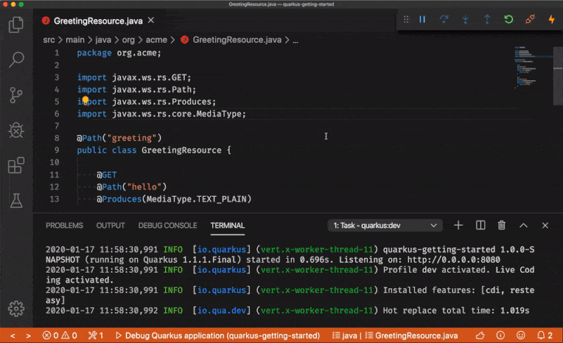

Once the Quarkus application stops running, the CodeLens URL will no longer appear.

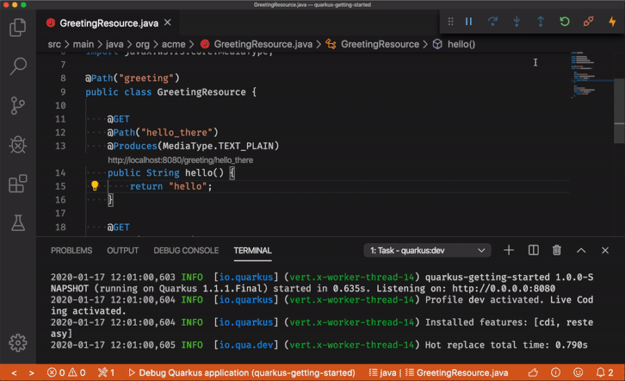

Please keep in mind, CodeLens in VS Code are only updated when certain events happen. If the URL CodeLens does not appear, some easy ways to trigger a CodeLens update are by switching tabs or by starting to type in any file. Also make sure that the `quarkus.tools.codeLens.urlCodeLensEnabled` VS Code setting is set to `true`.

## Hover support for `@ConfigProperty` name in Java sources

Hovering over the name value in a `@ConfigProperty` annotation will now display the value of the hovered property. Currently, the value will either come from the `application.properties` file, or the default value field.

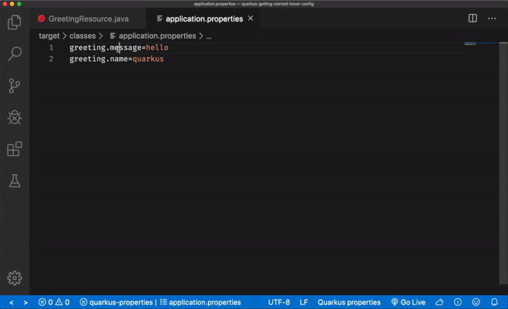

## Language support for Kubernetes, Openshift, S2i and Docker properties

There is now completion, hover, documentation and validation for `kubernetes.*`, `openshift.*`, `s2i.*`, `docker.*` properties coming from the [Kubernetes Quarkus extension](https://quarkus.io/guides/kubernetes#enable-kubernetes-support).

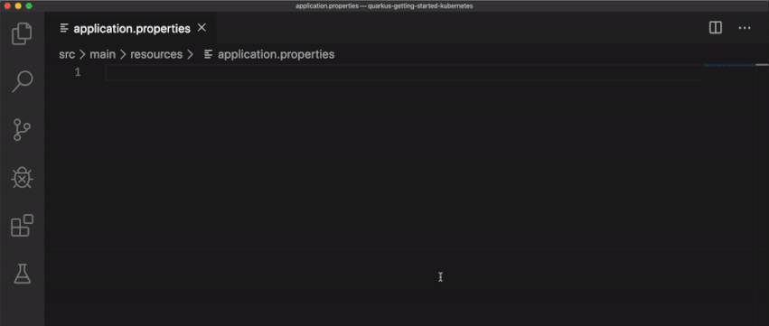

## Language support for MicroProfile REST Client properties

Likewise, there is now completion, hover, documentation and validation for the MicroProfile properties from REST Client.

After registering a REST client using `@RegisterRestClient` like so:

```java
package com.mycompany.remoteServices;

@RegisterRestClient
public interface MyServiceClient {
    @GET
    @Path("/greet")
    Response greet();
}
```

The related MicroProfile Rest config properties will have language feature support (completion, hover, validation, etc.).

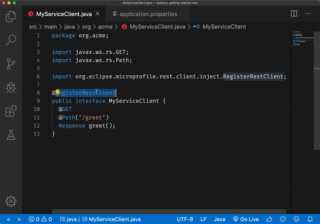

More information about using the MicroProfile REST Client with Quarkus is available on the Quarkus guides [here](https://quarkus.io/guides/rest-client).

## YAML support (experimental)

The release of [Quarkus 1.1.0.Final](https://quarkus.io/blog/quarkus-1-1-0-final-released/), brought [YAML configuration support](https://quarkus.io/guides/config#yaml), meaning that you can now configure your Quarkus application with either an `application.yaml` or `application.properties` file (but try to stick with one!).

As a result, there is now completion support for `application.yaml` files. Similarly to `application.properties`, the completion options in `application.yaml` will be in sync with the Quarkus extensions that are currently available to the current project (in `pom.xml` or `build.gradle`), therefore giving you only the relevant completion options.

This feature depends on the VS Code [YAML extension](https://marketplace.visualstudio.com/items?itemName=redhat.vscode-yaml). If it is not currently installed, a new prompt will propose to install it.

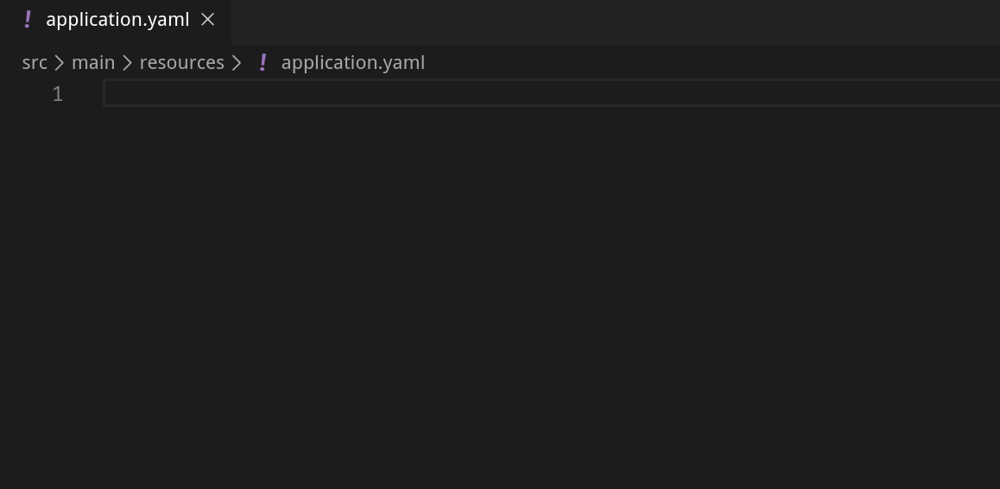

Language feature support for the `application.yaml` file is in its experimental stages. Compared to `application.properties` support, there are some limitations:

**Missing features:**

- Go to definition support
- Code action support
- Automatic completion for default values
- Limited config property and value validation support

## Quick Fix to add unknown property namespaces to ignore

There is now a new Quick Fix that helps exclude large groups of unknown properties from unknown property validation, as long as they share the same parent namespace.

For example, if your application.properties file contains four properties with an `Unknown property` error like so:

```properties
# All four properties cause an 'Unknown property' error
unknown.test1=a
unknown.test2=b
unknown.test3=c
unknown.test4=d
```

Ignoring all four properties from unknown property validation is easily done by the Quick Fix, which adds `unknown.*` to the `quarkus.tools.validation.unknown.excluded` workspace configuration array.

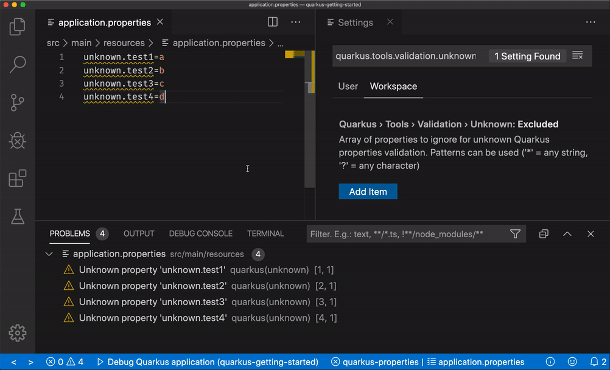

## Go to definition support for enum values in `application.properties`

Until now, Go to definition was only supported for config property keys and not the values. This release brings the Go to definition feature for enum values.

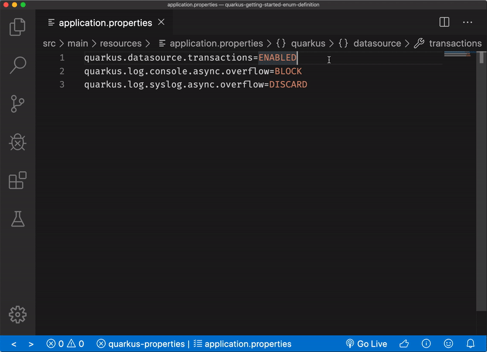

## New extensions descriptions toggle

As the number of Quarkus extensions continues to rise, the new extension descriptions in the extension selection prompts helps recognize and discover new extensions. The extension selection prompt appears when selecting Quarkus extensions from the `Quarkus: Generate a Quarkus project` and `Quarkus: Add extensions to current project` wizards.

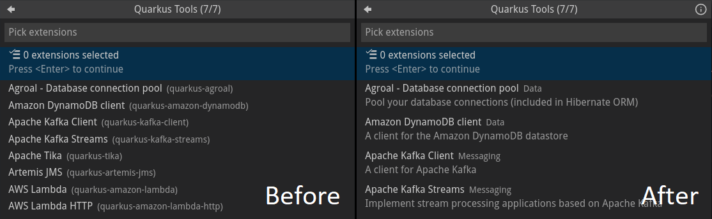

There is also a new button on the top right of the prompt that toggles whether or not the extension descriptions should appear.

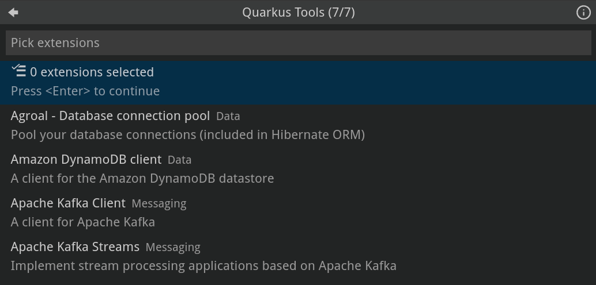

## Different ways to open a new Quarkus project

After creating a new project with the `Quarkus: Generate a Quarkus project` wizard there is now a new prompt that asks you how the new project should be opened. The following tables describe the before and after changes.

**Before**

| Scenarios | Ways to open the new project |
| --- | --- |
| All scenarios | Open project in a new window |

**After**

| Scenarios | Ways to open the new project |  |
| --- | --- | --- |
| A workspace is open | Open project by adding to current workspace | Open project in a new window |
| An editor is open | Open project in the current window | Open project in a new window |
| Nothing is open | Open project in the current window |  |

Here is one of the scenarios in action, when a new project has been generated while a workspace is already open.

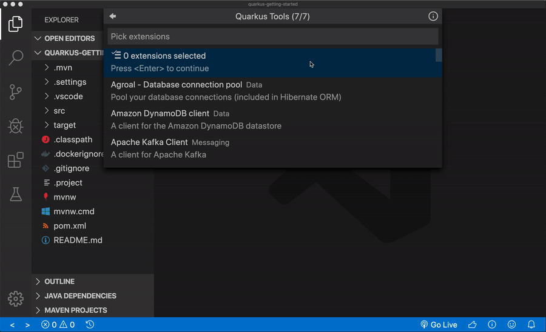

## Syntax highlighting for Qute languages

[Qute](https://quarkus.io/guides/qute-reference) is a new server-side templating engine created with Quarkus in mind. This release brings new Qute Language Modes in VS Code: Qute HTML, Qute JSON, Qute YAML and Qute Text. The new language modes are automatically applied to your current file, if your file’s file extensions is `.qute.html`, `.qute.json`, `.qute.yaml` and `.qute.txt` respectively.

Thanks to the new language modes, Qute-specific syntax highlighting and commenting are now provided.

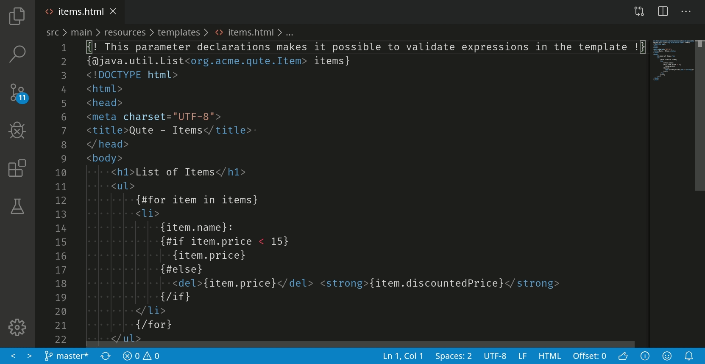

For more information about the Qute templating engine, please refer to the [Quarkus templating engine guide](https://quarkus.io/guides/qute).

## Moving Forward

This wraps up the new major features in this release. If you have any questions, suggestions or feedback, by all means please [open a GitHub issue](https://github.com/redhat-developer/vscode-quarkus/issues/new).

For future releases we are aiming to improve language support for MicroProfile properties, `application.yaml` and Qute languages.

Thank you for reading and stay tuned for the next release!

## Links

- VS Code Marketplace link: <https://marketplace.visualstudio.com/items?itemName=redhat.vscode-quarkus>
- GitHub repository: <https://github.com/redhat-developer/vscode-quarkus>
- Open a GitHub issue: <https://github.com/redhat-developer/vscode-quarkus/issues/new>
- Changelog: <https://github.com/redhat-developer/vscode-quarkus/blob/master/CHANGELOG.md>
- Version 1.2.0 blog post: <https://quarkus.io/blog/vscode-quarkus-1.2.0/>
- Version 1.1.0 blog post: <https://quarkus.io/blog/vscode-quarkus-1.1.0/>
- Version 1.0.0 blog post: <https://quarkus.io/blog/quarkus-developer-joy-for-vs-code>
