# Quarkus Tools for Visual Studio Code - 1.4.0 release

Quarkus Tools for Visual Studio Code 1.4.0 has been released on the [VS Code Marketplace](https://marketplace.visualstudio.com/items?itemName=redhat.vscode-quarkus).

[vscode-quarkus](https://github.com/redhat-developer/vscode-quarkus/) 1.4.0 fixes several bugs, including some performance issues, but the highlights of this release revolve around bringing support for multiple MicroProfile modules (Fault Tolerance, Health, LRA, Metrics, Open API, Open Tracing, Rest Client), in both properties and Java files. Many of these MicroProfile related enhancements were contributed by IBM.

For a list of all changes, please refer to the [changelog](https://github.com/redhat-developer/vscode-quarkus/blob/master/CHANGELOG.md).

Watch a demo video of all features presented in this article:

[D4woUwvMj_o](D4woUwvMj_o)

A little backstory on this release: it turns out, IBM had started to implement its own [MicroProfile Language Server](https://github.com/MicroShed/microprofile-language-server/), providing MicroProfile support for [Health](https://github.com/eclipse/microprofile-health), Open API, Rest Client for `Java files` (validation, quick fixes, completions). In the meantime, the Red Hat's Quarkus Language Server had been refactored internally to split the Quarkus related bits from a MicroProfile focused core. Naturally, Red Hat and IBM realized there would be much value in contributing to a single MicroProfile Language Server implementation, and both parties agreed to join forces on developing the MicroProfile Language Server currently powering [vscode-quarkus](https://github.com/redhat-developer/vscode-quarkus/).

The outcome of this collaboration is the [Eclipse LSP4MP (Language Server for Eclipse MicroProfile) project proposal](https://projects.eclipse.org/proposals/eclipse-lsp4mp-language-server-eclipse-microprofile-0). So stay tuned for more announcements on that subject!

And now for an overview of the new features in vscode-quarkus 1.4.0:

## MicroProfile Fault Tolerance support

[MicroProfile Fault Tolerance](https://github.com/eclipse/microprofile-fault-tolerance) properties are now managed in \*.properties and yaml files, by providing the correct properties, according to classes and methods annotated with Fault Tolerance annotations:

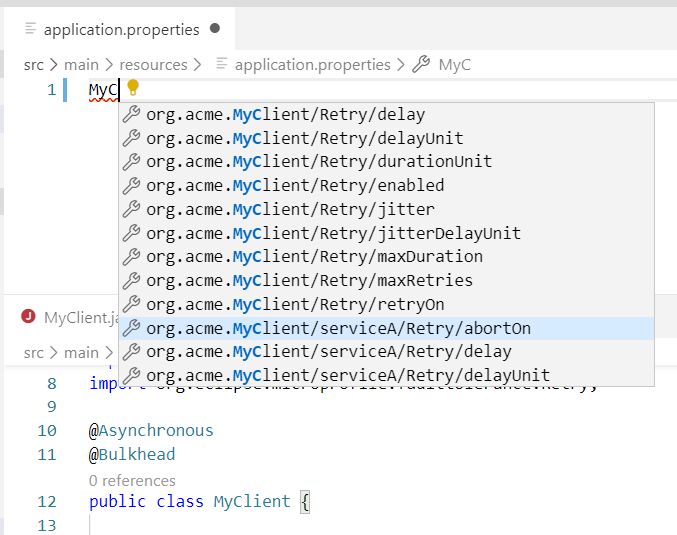

## MicroProfile Health support

Validation and quick fixes for [MicroProfile Health](https://github.com/eclipse/microprofile-health) in Java files are now available:

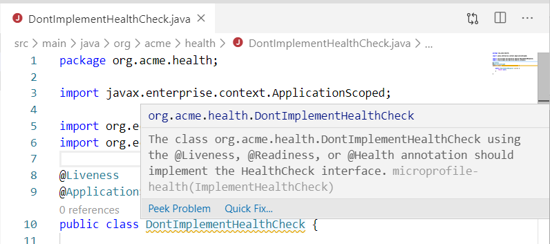

## MicroProfile LRA support

[MicroProfile LRA](https://github.com/eclipse/microprofile-lra) (Long Running Actions) properties are now supported in the \*.properties and yaml files:

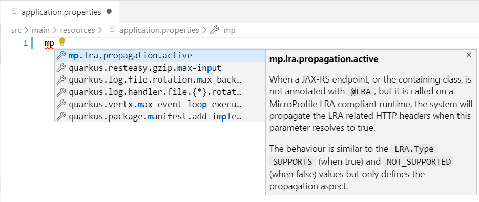

## MicroProfile Metrics support

[MicroProfile Metrics](https://github.com/eclipse/microprofile-metrics) properties are now supported in the \*.properties and yaml files:

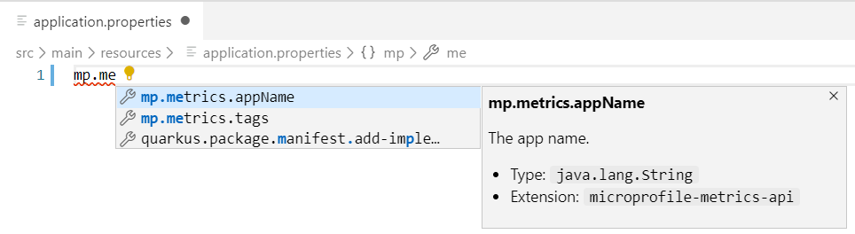

In Java files, you benefit from snippets to quickly generate part of the Metrics annotations:

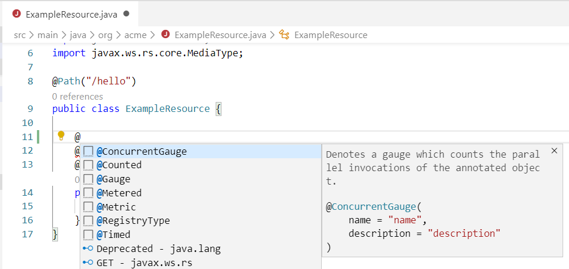

These Metrics snippets only appear if the Java project has MicroProfile Metrics as a dependency.

## MicroProfile Open API support

[MicroProfile Open API](https://github.com/eclipse/microprofile-open-api) properties are now managed in \*.properties and yaml files:

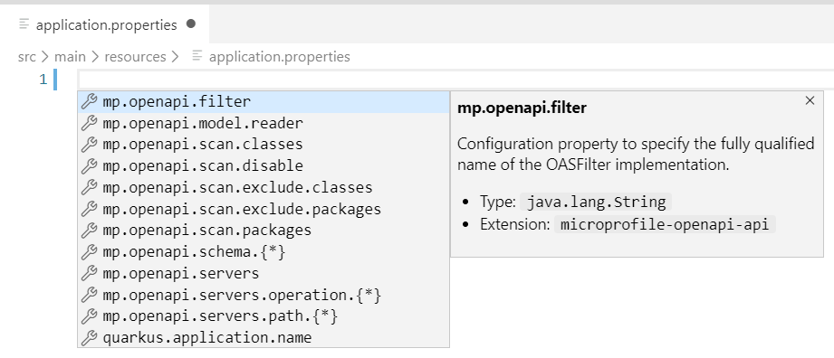

In Java files, you benefit from snippets to quickly generate part of the Open API annotations:

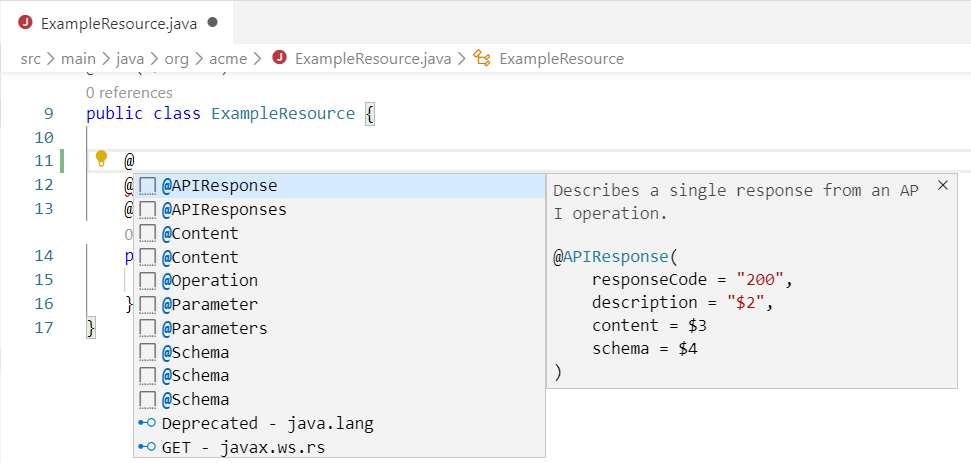

These Open API snippets only appear if the Java project depends on MicroProfile Open API.

The code action `Sources... / Generate OpenAPI Annotations` provides the ability to generate stub Open API annotations in a Java file:

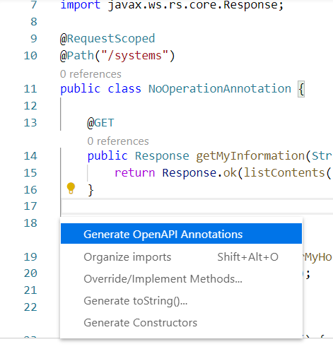

The code action generates an Open API `@Operation` annotation for each method that returns a response:

## MicroProfile Open Tracing support

[MicroProfile Open Tracing](https://github.com/eclipse/microprofile-opentracing) properties are now managed in \*.properties and yaml files:

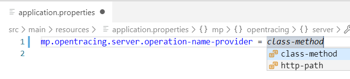

## MicroProfile Rest Client support

Validation and quick fixes for [MicroProfile Rest Client](https://github.com/eclipse/microprofile-rest-client) in Java files are now available:

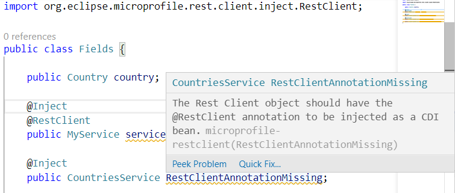

CodeLens for Rest Client are now available:

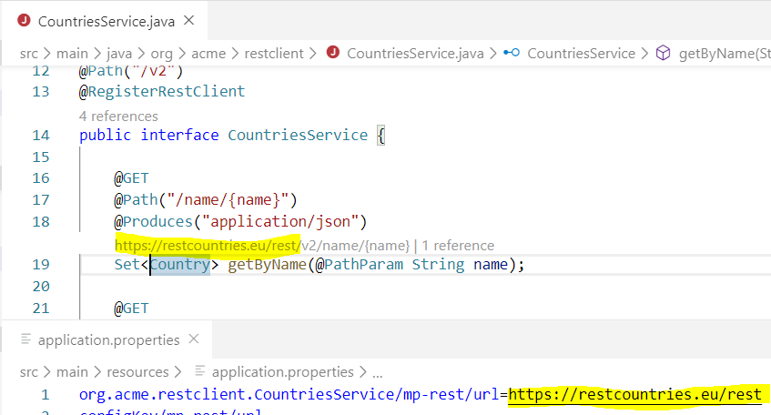

## Moving Forward

This wraps up the new major features in this release. If you have any questions, suggestions or feedback, by all means please [open a GitHub issue](https://github.com/redhat-developer/vscode-quarkus/issues/new).

For future releases we are aiming to improve language support for other MicroProfile modules like MicroProfile Reactive Messaging and other new Quarkus features like Command Mode Applications

Thank you for reading and stay tuned for the next release!

## Links

- VS Code Marketplace link: <https://marketplace.visualstudio.com/items?itemName=redhat.vscode-quarkus>
- GitHub repository: <https://github.com/redhat-developer/vscode-quarkus>
- Open a GitHub issue: <https://github.com/redhat-developer/vscode-quarkus/issues/new>
- Changelog: <https://github.com/redhat-developer/vscode-quarkus/blob/master/CHANGELOG.md>
- Version 1.3.0 blog post: <https://quarkus.io/blog/vscode-quarkus-1.3.0/>
- Version 1.2.0 blog post: <https://quarkus.io/blog/vscode-quarkus-1.2.0/>
- Version 1.1.0 blog post: <https://quarkus.io/blog/vscode-quarkus-1.1.0/>
- Version 1.0.0 blog post: <https://quarkus.io/blog/quarkus-developer-joy-for-vs-code>
