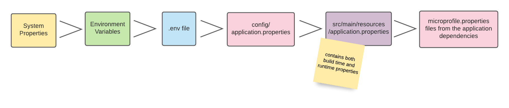

# Configuration reference guide

In this reference guide we're going to describe various aspects of Quarkus configuration. A Quarkus application and Quarkus itself (core and extensions) are both configured via the same mechanism that leverages the [SmallRye Config](https://github.com/smallrye/smallrye-config) API an implementation of the [MicroProfile Config](https://microprofile.io/project/eclipse/microprofile-config) specification.

> [!TIP]
> If you're looking for information how to make a Quarkus extension configurable then see the [Writing Your Own Extension](/guides/writing-extensions/index.md#configuration) guide.

<a id="configuration-sources"></a>
## Config Sources

By default, Quarkus reads configuration properties from multiple sources (by descending ordinal):

1. (400) [System properties](#system-properties)
2. (300) [Environment variables](#environment-variables)
3. (295) [.env](#env-file) file in the current working directory
4. (260) [Quarkus Application configuration file](#application-properties-file) in `$PWD/config/application.properties`
5. (250) [Quarkus Application configuration file](#application-properties-file) `application.properties` in classpath
6. (100) [MicroProfile Config configuration file](#microprofile-config-properties-file) `META-INF/microprofile-config.properties` in classpath

The final configuration is the aggregation of the properties defined by all these sources. A configuration property lookup starts by the highest ordinal configuration source available and works it way down to other sources until a match is found. This means that any configuration property may override a value just by setting a different value in a higher ordinal config source. For example, a property configured using an environment property overrides the value provided using the `application.properties` file.



<a id="system-properties"></a>
### System properties

System properties can be handed to the application through the `-D` flag during startup. The following examples assign the value `youshallnotpass` to the attribute `quarkus.datasource.password`.

- For Quarkus dev mode: `./mvnw quarkus:dev -Dquarkus.datasource.password=youshallnotpass`
- For a runner jar: `java -Dquarkus.datasource.password=youshallnotpass -jar target/quarkus-app/quarkus-run.jar`
- For a native executable: `./target/myapp-runner -Dquarkus.datasource.password=youshallnotpass`

<a id="environment-variables"></a>
### Environment variables

- For a runner jar: `export QUARKUS_DATASOURCE_PASSWORD=youshallnotpass ; java -jar target/quarkus-app/quarkus-run.jar`
- For a native executable: `export QUARKUS_DATASOURCE_PASSWORD=youshallnotpass ; ./target/myapp-runner`

Environment variables names follow the conversion rules specified by [MicroProfile Config](https://github.com/eclipse/microprofile-config/blob/master/spec/src/main/asciidoc/configsources.asciidoc#default-configsources). Config searches three environment variables for a given property name (e.g. `foo.BAR.baz`):

- `foo.BAR.baz` - Exact match
- `foo_BAR_baz` - Replace each character that is neither alphanumeric nor `\_` with `_`
- `FOO_BAR_BAZ` - Replace each character that is neither alphanumeric nor `\_` with `_`; then convert the name to upper case

SmallRye Config specifies [additional conversion rules](https://smallrye.io/smallrye-config/Main/config/environment-variables/).

- A property with double quotes `foo."bar".baz`, replace each character that is neither alphanumeric nor `\_` with `_`: `FOO\__BAR__BAZ`
- A property with dashes `foo.bar-baz`, replace each character that is neither alphanumeric nor `\_` with `_`: `FOO_BAR_BAZ`
- An indexed property `foo.bar[0]` or `foo.bar[0].baz`, replace each character that is neither alphanumeric nor `\_` with `_`: `FOO_BAR_0_` or `FOO_BAR_0__BAZ`

> [!CAUTION]
> In some situations, looking up the exact property name is impossible. This is the case for configuration names that contain user defined path segments.
>
> Applying the conversion rules for Environment Variables names, `quarkus.datasource."datasource-name".jdbc.url` becomes `QUARKUS_DATASOURCE\__DATASOURCE_NAME__JDBC_URL`. The configuration will work as expected if both properties are available in the Config system.
>
> If only `QUARKUS_DATASOURCE\__DATASOURCE_NAME__JDBC_URL` is present, the Config system needs to reconvert the configuration name to its most likely dotted format. This works fine for fixed configuration segments, but not for names that contain dynamic segments. In this case, Quarkus is unable to determine if `DATASOURCE_NAME` should be converted to `datasource.name` or `datasource-name` (or any other special character separator).
>
> For this reason, such properties always require their dotted version name in another source to disambiguate the Environment Variable name. It will provide additional information to perform a two-way conversion and match the property names together.
>
> ```properties
> # value can be left empty but must be supplied by another source at runtime (or be an optional)
> quarkus.datasource."datasource-name".jdbc.url=
> ```
>
> ```bash
> EXPORT QUARKUS_DATASOURCE__DATASOURCE_NAME__JDBC_URL=jdbc:postgresql://localhost:5432/database
> ```

<a id="env-file"></a>
### `.env` file in the current working directory

..env

```properties
QUARKUS_DATASOURCE_PASSWORD=youshallnotpass <1>
```

1. The name `QUARKUS_DATASOURCE_PASSWORD` follows the same conversion rules used for [Environment variables](#environment-variables).

For `dev` mode, this file can be placed in the root of the project, but it is advised to **not** check it in to version control because it typically contains passwords, access tokens, API keys or other secrets.

> [!IMPORTANT]
> Environment variables in the `.env` file are not available via the `System.getenv(String)` API.

<a id="application-properties-file"></a>
### Quarkus Application configuration file

The Quarkus Application configuration file is loaded from the classpath resources, for instance `src/main/resources/application.properties`, `src/test/resources/application.properties` or from a `jar` dependency that contains an `application.properties` entry. Each `application.properties` found is treated as a separate `ConfigSource` and follow the same rules as every other source (override per property). Additionally, the configuration file may also reside in `$PWD/config/application.properties`. The loading starts from the config folder and then classpath order (`application.properties` files in the application sources will have priority on the classloader loading order).

**`application.properties`**

```properties
greeting.message=hello <1>
quarkus.http.port=9090 <2>
```

1. This is a user-defined configuration property.
2. This is a configuration property consumed by the `quarkus-vertx-http` extension.

> [!NOTE]
> The `config/application.properties` is also available in `dev` mode. The file needs to be placed inside the build tool output directory (`target` for Maven and `build/classes/java/main` for Gradle). Keep in mind however that any cleaning operation from the build tool like `mvn clean` or `gradle clean` will remove the `config` directory as well.

<a id="microprofile-config-properties-file"></a>
### MicroProfile Config configuration file

The MicroProfile Config configuration file in `src/main/resources/META-INF/microprofile-config.properties`.

**`microprofile-config.properties`**

```properties
greeting.message=hello <1>
quarkus.http.port=9090 <2>
```

1. This is a user-defined configuration property.
2. This is a configuration property consumed by the `quarkus-vertx-http` extension.

> [!TIP]
> It works in the exact same way as Quarkus Application configuration file `application.properties`. Recommendation is to use Quarkus `application.properties`.

### Locations

Additionally to the default config locations, Quarkus provides a way to scan additional locations for configuration properties files.

The `quarkus.config.locations` configuration property accepts multiple locations separated by a comma `,` and each must represent a valid `URI`. The supported `URI` schemes are:

- file or directory (`file:`)
- classpath resource
- jar resource (`jar:`)
- http resource (`http:`)

All loaded sources use the same ordinal of the source that found the `quarkus.config.locations` configuration property. For instance, if `quarkus.config.locations` is set as a system property, then all loaded sources have their ordinals set to `400` (system properties use `400` as their ordinal). The ordinal may be overridden directly for each config source by setting the `config_ordinal` property and the ordinal value. The `config_ordinal` property only affects the ordinal of the source in which is being set. Sources are sorted first by their ordinal, then by location order, and finally by loading order.

### Additional Config Sources

Quarkus provides additional extensions which cover other configuration formats and stores:

- [YAML](/guides/config-yaml/index.md)
- [HashiCorp Vault](https://github.com/quarkiverse/quarkus-vault)
- [Consul](https://github.com/quarkiverse/quarkus-config-extensions)
- [Spring Cloud](/guides/spring-cloud-config-client/index.md)

> [!TIP]
> It is also possible to create a [Custom Config Source](/guides/config-extending-support/index.md#custom-config-source).

## ConfigMapping

The recommended way to expose configuration to a Quarkus application is by mapping it with an interface. With [SmallRye Config Mappings](https://smallrye.io/smallrye-config/Main/config/mappings/), it is possible to group multiple configuration properties in a single interface that share the same prefix (or namespace). It supports the following set of features:

- Automatic conversion of the configuration type, including List, Set, Map, Optional, and primitive types.
- Nested Config Mapping groups.
- Configuration Properties Naming Strategies
- Integration with Bean Validation

A Config Mapping requires an interface with minimal metadata configuration annotated with `@io.smallrye.config.ConfigMapping`:

```java
@ConfigMapping(prefix = "server")
public interface Server {
    String host();

    int port();

    int sslPort();
}
```

A complex object type uses the following rules to map configuration values to their member values:

- A configuration path is built by taking the object type prefix (or namespace) and the mapping member name
- The member name is converted to its kebab-case format
- If the member name is represented as a getter, the member name is taken from its property name equivalent, and then converted to its kebab-case format.
- The configuration value is automatically converted to the member type
- The configuration path is required to exist with a valid configuration value or the mapping will fail.

> [!NOTE]
> Kebab-case - the method name is derived by replacing case changes with a dash to map the configuration property.

The `Server` interface can map configuration properties with the name `server.host` into the `Server.host()` method, `server.port` into `Server.port()` method, and `server.ssl-port` into `Server.sslPort()` method. The configuration property name to look up is constructed from the prefix and the method name (in kebab-case), separated by adot (`.`) character.

A `@ConfigMapping` can be injected into any CDI aware bean:

```java
@ApplicationScoped
class BusinessBean {
    @Inject
    Server server;

    void businessMethod() {
        String host = server.host();
    }
}
```

For non-CDI components, use the `io.smallrye.config.SmallRyeConfig#getConfigMapping` API to retrieve the config mapping instance:

```java
SmallRyeConfig config = ConfigProvider.getConfig().unwrap(SmallRyeConfig.class);
Server server = config.getConfigMapping(Server.class);
```

> [!TIP]
> Check the [Mapping configuration to objects](/guides/config-mappings/index.md) guide for advanced usages with `@ConfigMapping`.

## ConfigProperty

While `@ConfigMapping` is the recommended approach, Quarkus also supports [MicroProfile Config](https://microprofile.io/project/eclipse/microprofile-config) annotations to inject the configuration properties in the application.

```java
@ConfigProperty(name = "greeting.message") <1>
String message;
```

1. You can use `@Inject @ConfigProperty` or just `@ConfigProperty`. The `@Inject` annotation is not necessary for members annotated with `@ConfigProperty`.

> [!NOTE]
> If the application attempts to inject a configuration property that is not set, an error is thrown.

```java
@ConfigProperty(name = "greeting.message") <1>
String message;

@ConfigProperty(name = "greeting.suffix", defaultValue="!") <2>
String suffix;

@ConfigProperty(name = "greeting.name")
Optional<String> name; <3>
```

1. If you do not provide a value for this property, the application startup fails with `io.quarkus.runtime.configuration.ConfigurationException: Failed to load config value of type class java.lang.String for: greeting.messagee`.
2. The default value is injected if the configuration does not provide a value for `greeting.suffix`.
3. This property is optional - an empty `Optional` is injected if the configuration does not provide a value for `greeting.name`.

> [!TIP]
> Use [Config Mappings](/guides/config-mappings/index.md#config-mappings) to group similar configuration properties.

## Default Values

If a configuration is associated with a default value (by way of the `io.smallrye.config.WithDefault` or `org.eclipse.microprofile.config.inject.ConfigProperty.defaultValue`), and no configuration value is supplied for the property, then rather than throwing an exception, the default value will be used. A default value is expressed as a `String`, and uses the same conversion mechanism used to process configuration values. Several Built-in Converters already exist for primitives, boxed primitives, and other classes; for example:

- Primitives: `boolean`, `byte`, `short`, etc.
- Boxed primitives: `java.lang.Boolean`, `java.lang.Byte`, `java.lang.Short`, etc.
- Optional containers: `java.util.Optional`, `java.util.OptionalInt`, `java.util.OptionalLong`, and `java.util.OptionalDouble`
- Java `enum` types
- JSR 310 `java.time.Duration`
- JDK networking `java.net.SocketAddress`, `java.net.InetAddress`, etc.

As you might expect, these converters are `org.eclipse.microprofile.config.spi.Converter` implementations. Therefore, these converters comply with the Microprofile or custom implementation providers expression rules like:

- Boolean values will be `true` in cases "true", "1", "YES", "Y" "ON". Otherwise, value will be interpreted as false
- For float and double values the fractional digits must be separated by a dot `.`

Note that when a combination of `Optional*` types and defaults are used, the defined default value will still be used and if no value is given for the property, the `Optional*` will be present and populated with the converted default value. However, when the property is explicitly empty, the default value is not used and the `Optional` will be empty. Consider this example:

```properties
# missing value, optional property
greeting.name=
```

In this case, since `greeting.name` was configured to be `Optional*` up above, the corresponding property value will be an empty `Optional` and execution will continue normally. This would be the case even if there was a default value configured: the default value is **not** used if the property is explicitly cleared in the configuration.

On the other hand, this example:

```properties
# missing value, non-optional
greeting.suffix=
```

will result in a `java.util.NoSuchElementException: SRCFG02004: Required property greeting.message not found` on startup and the default value will not be assigned.

## Programmatically access

The `io.smallrye.config.SmallRyeConfig` API allows to access the Config API programmatically. This API is mostly useful in situations where CDI injection is not available.

```java
SmallRyeConfig config = org.eclipse.microprofile.config.ConfigProvider.getConfig().unwrap(SmallRyeConfig.class);
String databaseName = config.getValue("database.name", String.class);
Optional<String> maybeDatabaseName = config.getOptionalValue("database.name", String.class);
```

> [!IMPORTANT]
> Do not use `System.getProperty(String)` or `System.getEnv(String)` to retrieve configuration values. These APIs are not configuration aware and do not support the features described in this guide.

<a id="profiles"></a>
## Profiles

We often need to configure our application differently depending on the target *environment*. For example, the local development environment may be different from the production environment.

Configuration Profiles allow for multiple configurations in the same file or separate files and select between them via a profile name.

### Profile in the property name

To be able to set properties with the same name, each property needs to be prefixed with a percentage sign `%` followed by the profile name and a dot `.` in the syntax `%{profile-name}.config.name`:

**application.properties**

```properties
quarkus.http.port=9090
%dev.quarkus.http.port=8181
```

The Quarkus HTTP port will be 9090. If the `dev` profile is active it will be 8181.

Profiles in the `.env` file follow the syntax `_{PROFILE}_CONFIG_KEY=value`:

..env

```properties
QUARKUS_HTTP_PORT=9090
_DEV_QUARKUS_HTTP_PORT=8181
```

If a profile does not define a value for a specific attribute, the *default* (no profile) value is used:

**application.properties**

```properties
bar=”hello”
baz=”bonjour”
%dev.bar=”hallo”
```

With the `dev` profile enabled, the property `bar` has the value `hallo`, but the property `baz` has the value `bonjour`. If the `prod` profile is enabled, `bar` has the value `hello` (as there is no specific value for the `prod` profile), and `baz` the value `bonjour`.

<a id="default-profiles"></a>
### Default Profiles

By default, Quarkus provides three profiles, that activate automatically in certain conditions:

- **dev** - Activated when in development mode (i.e. `quarkus:dev`)
- **test** - Activated when running tests
- **prod** - The default profile when not running in development or test mode

<a id="custom-profiles"></a>
### Custom Profiles

It is also possible to create additional profiles and activate them with the `quarkus.profile` configuration property. A single config property with the new profile name is the only requirement:

**application.properties**

```properties
quarkus.http.port=9090
%staging.quarkus.http.port=9999
```

Setting `quarkus.profile`  to `staging` will activate the `staging` profile.

> [!NOTE]
> The `io.quarkus.runtime.configuration.ConfigUtils.getProfiles` API provides a way to retrieve the active profiles programmatically.

### Profile-aware files

In this case, properties for a specific profile may reside in an `application-{profile}.properties` named file. The previous example may be expressed as:

**application.properties**

```properties
quarkus.http.port=9090
%staging.quarkus.http.test-port=9091
```

**application-staging.properties**

```properties
quarkus.http.port=9190
quarkus.http.test-port=9191
```

> [!NOTE]
> In this style, the configuration names in the profile-aware file do not need to be prefixed with the profile name.
>
> Properties in the profile-aware file have priority over profile-aware properties defined in the main file.

> [!WARNING]
> Do not use profile-aware files to set `quarkus.profile` or `quarkus.test.profile`. This will not work because the profile is required in advance to load the profile-aware files.

> [!IMPORTANT]
> An `application.properties` file must exist (even if empty) in the exact location of the profile-aware (`application-{profile}.properties`) file to be included in the configuration to ensure a consistent order when loading the files.

### Parent Profile

A Parent Profile adds one level of hierarchy to the current profile. The configuration `quarkus.config.profile.parent` accepts a single profile name.

When the Parent Profile is active, if a property cannot be found in the current active Profile, the config lookup fallbacks to the Parent Profile. Consider:

```properties
quarkus.profile=dev
quarkus.config.profile.parent=common

%common.quarkus.http.port=9090
%dev.quarkus.http.ssl-port=9443

quarkus.http.port=8080
quarkus.http.ssl-port=8443
```

Then

- The active profile is `dev`
- The parent profile is `common`
- `quarkus.http.port` is 9090
- `quarkus.http.ssl-port` is 9443

> [!WARNING]
> Do not use Profile-aware files to set `quarkus.config.profile.parent`. This will not work because the profile is required in advance to load the profile-aware files.

### Multiple Profiles

Multiple Profiles may be active at the same time. The configuration `quarkus.profile` accepts a comma-separated list of profile names: `quarkus.profile=common,dev`. Both `common` and `dev` are separate profiles.

When multiple profiles are active, the rules for profile configuration are the same. If two profiles define the same configuration, then the last listed profile has priority. Consider:

**application.properties**

```properties
quarkus.profile=common,dev

my.prop=1234
%common.my.prop=1234
%dev.my.prop=5678

%common.commom.prop=common
%dev.dev.prop=dev
%test.test.prop=test
```

Then

- `common.prop` value is `common`
- `dev.prop` value is `dev`
- `my.prop` value is `5678`
- `test.prop` does not have a `value`

It is also possible to define multiple profile properties, with a comma-separated list of profile names. If the same property name exists in multiple profile properties then, the property name with the most specific profile wins:

**application.properties**

```properties
quarkus.profile=dev

%prod,dev.my.prop=1234
%dev.my.prop=5678

%prod,dev.another.prop=1234
```

Then

- `my.prop` value is 5678.
- `another.prop` value is 1234.

> [!WARNING]
> Multiple profiles priority work in reverse order. With `quarkus.profile=common,dev`, Quarkus first checks the `dev` profile and then the `common` profile.

<a id="property-expressions"></a>
## Property Expressions

Quarkus provides property expressions expansion on configuration values. An expression string is a mix of plain strings and expression segments, which are wrapped by the sequence `${ ... }`.

These expressions are resolved when the property is read. So if the configuration property is build time the property expression will be resolved at build time. If the configuration property is overridable at runtime it will be resolved at runtime.

Consider:

**application.properties**

```properties
remote.host=quarkus.io
callable.url=https://${remote.host}/
```

The resolved value of the `callable.url` property is `https://quarkus.io/`.

Another example would be defining different database servers by profile:

**application.properties**

```properties
%dev.quarkus.datasource.jdbc.url=jdbc:mysql://localhost:3306/mydatabase?useSSL=false
quarkus.datasource.jdbc.url=jdbc:mysql://remotehost:3306/mydatabase?useSSL=false
```

can be simplified to:

**application.properties**

```properties
%dev.application.server=localhost
application.server=remotehost

quarkus.datasource.jdbc.url=jdbc:mysql://${application.server}:3306/mydatabase?useSSL=false
```

Additionally, the Expression Expansion engine supports the following segments:

- `${expression:value}` - Provides a default value after the `:` if the expansion doesn't find a value.
- `${my.prop${compose}}` - Composed expressions. Inner expressions are resolved first.
- `${my.prop}${my.prop}` - Multiple expressions.

If an expression cannot be expanded and no default is supplied a `NoSuchElementException` is thrown.

> [!NOTE]
> Expressions lookups are performed in all config sources. The expression values and expansion values may reside in different config sources.

### With Environment Variables

Property Expressions also work with Environment Variables.

**application.properties**

```properties
remote.host=quarkus.io
application.host=${HOST:${remote.host}}
```

This will expand the `HOST` environment variable and use the value of the property `remote.host` as the default value if `HOST` is not set.

## Secret Keys Expressions

A secret configuration may be expressed as `${handler::value}`, where the `handler` is the name of a `io.smallrye.config.SecretKeysHandler` to decode or decrypt the `value`. Consider:

**application.properties**

```properties
my.secret=${aes-gcm-nopadding::DJNrZ6LfpupFv6QbXyXhvzD8eVDnDa_kTliQBpuzTobDZxlg}

# the encryption key required to decode the secret. It can be set in any source.
smallrye.config.secret-handler.aes-gcm-nopadding.encryption-key=somearbitrarycrazystringthatdoesnotmatter
```

A lookup to `my.secret` will use the `SecretKeysHandler` name `aes-gcm-nopadding` to decode the value `DJNrZ6LfpupFv6QbXyXhvzD8eVDnDa_kTliQBpuzTobDZxlg`.

For more information, please check SmallRye Config [Secret Keys](https://smallrye.io/smallrye-config/Main/config/secret-keys/) documentation.

> [!WARNING]
> SmallRye Config may provide handlers not fully supported by Quarkus. Currently, only `smallrye-config-crypto` is supported.

## Accessing a generating UUID

The default config source from Quarkus provides a random UUID value. It generates the UUID at startup time. So, the value changes between startups, including reloads in dev mode.

You can access the generated value using the `quarkus.uuid` property. Use [expressions](#property-expressions) to access it: `${quarkus.uuid}`. For example, it can be useful to configure a Kafka client with a unique consumer group:

```properties
mp.messaging.incoming.prices.group.id=${quarkus.uuid}
```

## Clearing properties

Run time properties which are optional, and which have had values set at build time or which have a default value, may be explicitly cleared by assigning an empty string to the property. Note that this will *only* affect runtime properties, and will *only* work with properties whose values are not required.

**application.properties**

```properties
remote.host=quarkus.io
```

A lookup to `remote.host` with `-Dremote.host=` will throw an Exception, because the system property cleared the value.

<a id="indexed-properties"></a>
## Indexed Properties

A config value which contains unescaped commas may be converted to `Collection`. This works for simple cases, but it becomes cumbersome and limited for more advanced cases.

Indexed Properties provide a way to use indexes in config property names to map specific elements in a `Collection` type. Since the indexed element is part of the property name and not contained in the value, this can also be used to map complex object types as `Collection` elements. Consider:

**application.properties**

```properties
my.collection=dog,cat,turtle

my.indexed.collection[0]=dog
my.indexed.collection[1]=cat
my.indexed.collection[2]=turtle
```

The indexed property syntax uses the property name and square brackets \`\[ \] with an index in between.

A call to `Config#getValues("my.collection", String.class)`, will automatically create and convert a `List<String>` that contains the values `dog`, `cat` and `turtle`. A call to `Config#getValues("my.indexed.collection", String.class)` returns the exact same result. If the same property name exists in both forms (regular and indexed), the regular value has priority.

The indexed property is sorted by their index before being added to the target `Collection`. Any gaps contained in the indexes do not resolve to the target `Collection`, which means that the `Collection` result will store all values without any gaps.

<a id="configuring_quarkus"></a>
## Configuring Quarkus

Quarkus itself is configured via the same mechanism as your application. Quarkus reserves the `quarkus.` namespace for its own configuration. For example to configure the HTTP server port you can set `quarkus.http.port` in `application.properties`. All the Quarkus configuration properties are [documented and searchable](/guides/all-config/index.md).

> [!IMPORTANT]
> As mentioned above, properties prefixed with `quarkus.` are effectively reserved for configuring Quarkus itself and its extensions. Therefore, the `quarkus.` prefix should **never** be used for application specific properties.

### Build Time configuration

Some Quarkus configurations only take effect during build time (compile), meaning it is not possible to change it at runtime. These configurations are still available at runtime but as read-only and have no effect in Quarkus behaviour. A change to any of these configurations requires a rebuild of the application itself to reflect changes of such properties. This allows Quarkus to provide optimizations and reduce complexity based on the current build configuration. By default, Quarkus uses the `prod` configuration profile to build the application.

> [!TIP]
> The properties fixed at build time are marked with a lock icon ([lock]) in the [list of all configuration options](/guides/all-config/index.md).

However, some extensions do define properties *overridable at runtime*. A simple example is the database URL, username and password which is only known specifically in your target environment, so they can be set and influence the application behaviour at runtime.

### Config Recording

During the build process, Quarkus proceeds to record the available configuration in the final binary, to ensure it can start successfully in runtime, without missing required configuration. The following sources are excluded from recording:

- System Properties
- Environment Variables
- `.env`
- Build System Sources (provided by Maven or Gradle)

### Default Runtime Profile

The default Quarkus runtime profile is set to the profile used to build the application:

```bash
./mvnw package -Dnative -Dquarkus.profile=prod-aws
./target/my-app-1.0-runner // <1>
```

1. The command will run with the `prod-aws` profile. This can be overridden using the `quarkus.profile` configuration.

> [!IMPORTANT]
> Using a different configuration profile at runtime from the one used to build the application can lead to unexpected results.

## Change configuration after build (Reaugmentation)

If you are in the rare situation that you need to change the build time configuration after your application is built, then check out how [re-augmentation](/guides/reaugmentation/index.md) can be used to rebuild the augmentation output for a different build time configuration.

## Tracking effective build time configuration used at build time

Given that configuration sources usually provide more options than actually used during the build, it might be useful to know which configuration options have actually been used during a Quarkus build process.

### Dumping build time configuration options read during the build

Setting `quarkus.config-tracking.enabled` to `true` will enable a configuration interceptor that will record every configuration option that was read during the build process along with their values. The resulting report will be stored in `${project.basedir}/.quarkus/quarkus-prod-config-dump` by default. The target file could be configured using the following options:

- `quarkus.config-tracking.directory` - directory in which the configuration dump should be stored, the default is `${project.basedir}/.quarkus`
- `quarkus.config-tracking.file-prefix` - file name prefix, the default value is `quarkus`
- `quarkus.config-tracking.file-suffix` - file name suffix, the default value is `-config-dump`
- `quarkus.config-tracking.file` - path to a file in which the configuration dump should be stored. This option supersedes the `file-prefix` and `file-suffix` options. Also supersedes the value of `quarkus.config-tracking.directory`, unless the value is a relative path.

The `prod` part of the `quarkus-prod-config-dump` file name refers to the Quarkus build mode, indicating that the dump was taken for the production build.

The reason `${project.basedir}/.quarkus` directory was chosen as the default location was to make it easy to track build time configuration changes between builds and use that as an indicator to build output caching tools (such as [Apache Maven Build Cache](https://maven.apache.org/extensions/maven-build-cache-extension/) and [Develocity Build Cache](https://gradle.com/gradle-enterprise-solutions/build-cache/)) whether the application binary has to be re-built.

#### Filtering configuration options

Configuration tracker could be instructed to exclude some of the options from the report by configuring `quarkus.config-tracking.exclude` with a comma-separated list of configuration option names that should be filtered out.

#### Path values

Configuration options with **absolute** path values that begin with a user home directory are, by default, transformed with Unix home directory alias '\~' replacing the user home directory part and using `/` as a path element separator.

This transformation can be disabled by setting `quarkus.config-tracking.use-user-home-alias-in-paths` to `false`.

#### Hashing recorded configuration values

Configuration values can be hashed using `SHA-512` algorithm before they are written to a file. Configuration option names whose values should be hashed can be configured in `quarkus.config-tracking.hash-options` as a comma separated list.

### Tracking build time configuration changes between builds

While `quarkus.config-tracking.enabled` enables effective build time configuration report generation, there is also a way to check whether the values stored in that report have changed before the next build of the project is launched.

Maven projects could add the following goal to their `quarkus-maven-plugin` configuration:

```xml
      <plugin>
        <groupId>${quarkus.platform.group-id}</groupId>
        <artifactId>quarkus-maven-plugin</artifactId>
        <version>${quarkus.platform.version}</version>
        <extensions>true</extensions>
        <executions>
          <execution>
            <id>track-prod-config-changes</id>
            <phase>process-resources</phase>
            <goals>
              <goal>track-config-changes</goal>
            </goals>
          </execution>
        </executions>
```

The `track-config-changes` goal looks for `${project.basedir}/.quarkus/quarkus-prod-config-dump` (file name and directory are configurable) and, if the file already exists, checks whether the values stored in the config dump have changed. It will log the changed options and save the current values of each of the options present in `${project.basedir}/.quarkus/quarkus-prod-config-dump` in `${project.basedir}/target/quarkus-prod-config.check` (the target file name and location can be configured). If the build time configuration has not changed since the last build both `${project.basedir}/.quarkus/quarkus-prod-config-dump` and `${project.basedir}/.quarkus/quarkus-prod-config-dump` will be identical.

#### Dump Quarkus application dependencies

In addition to dumping configuration values, `track-config-changes` goal also dumps all the Quarkus application dependencies, including Quarkus build time dependencies. This file could be used to check whether Quarkus build classpath has changed since the previous run, for instance together with Develocity's ability to checksum a classpath. By default, the list of dependencies will be stored under `target/quarkus-prod-dependencies.txt` file. A different location could be configured using plugin parameters.

#### Dump current build configuration when the recorded configuration isn't found

By default, `track-config-changes` looks for the configuration recorded during previous build and does nothing if it's not found. Enabling `dumpCurrentWhenRecordedUnavailable` parameter will make it dump the current build configuration options taking into account `quarkus.config-tracking.*` configuration.

> [!IMPORTANT]
> Unlike the build configuration options recorded during the `quarkus:build` goal, configuration options saved by `quarkus:track-config-changes` with `dumpCurrentWhenRecordedUnavailable` enabled will include all the build configuration options exposed by a `org.eclipse.microprofile.config.Config` instance. Which means this report may include some build configuration options that will not be used by the Quarkus application build process but also may be missing some build configuration options since MicroProfile Config specification allows configuration sources not to expose all the property names they provide to users.

## Config property values injected during static initialization phase

Quarkus collects the config property values injected in CDI beans during [static initialization phase](/guides/writing-extensions/index.md#bootstrap-three-phases). The collected values are then compared with their runtime initialization counterparts and if a mismatch is detected the application startup fails. How can it happen? For example, let's have a CDI bean `org.acme.MyBean`. `MyBean` injects a `@ConfigProperty` of name `foo` and is initialized during the native build. The config property does not exist during the native build and so the default value `bar` is used. But later, when the application is started the property is defined with a system property: `-Dfoo=baz`. This would lead to inconsistent state and unexpected behavior. Therefore, Quarkus would fail in this situation by default.

```java
package org.acme;

import jakarta.enterprise.context.ApplicationScoped;
import jakarta.enterprise.event.Observes;
import jakarta.enterprise.context.Initialized;
import org.eclipse.microprofile.config.inject.ConfigProperty;

@ApplicationScoped
public class MyBean {

   @ConfigProperty(name = "foo", defaultValue = "bar") <1>
   String foo;

    void onInit(@Observes @Initialized(ApplicationScoped.class) Object event) { <2>
       // this observer method is notified during STATIC_INIT...
    }
}
```

1. The config property is injected when the bean is created and the value is fixed.
2. In this particular case, the observer `@Initialized(ApplicationScoped.class)` caused the initialization of the bean. However, there are other possibilities. For example, some extensions initialize components during static initialization phase.

You can annotate an injected field/parameter with `@io.quarkus.runtime.annotations.StaticInitSafe` to mark the injected configuration object as safe to be initialized during the static initialization phase.

```java
package org.acme;

import jakarta.enterprise.context.ApplicationScoped;
import jakarta.enterprise.event.Observes;
import jakarta.enterprise.context.Initialized;
import org.eclipse.microprofile.config.inject.ConfigProperty;
import io.quarkus.runtime.annotations.StaticInitSafe;

@ApplicationScoped
public class MyBeanNoFailure {

   @StaticInitSafe <1>
   @ConfigProperty(name = "foo", defaultValue = "bar")
   String foo;

    void onInit(@Observes @Initialized(ApplicationScoped.class) Object event) {
       // this observer method is notified during STATIC_INIT...
    }
}
```

1. Instructs Quarkus not to fail if a mismatch is detected.

<a id="additional-information"></a>
## Additional Information

- [YAML ConfigSource Extension](/guides/config-yaml/index.md)
- [HashiCorp Vault ConfigSource Extension](https://github.com/quarkiverse/quarkus-vault)
- [Consul ConfigSource Extension](https://github.com/quarkiverse/quarkus-config-extensions)
- [Spring Cloud ConfigSource Extension](/guides/spring-cloud-config-client/index.md)
- [Mapping configuration to objects](/guides/config-mappings/index.md)
- [Extending configuration support](/guides/config-extending-support/index.md)

Quarkus relies on [SmallRye Config](https://github.com/smallrye/smallrye-config/) and inherits its features:

- [Additional Config Sources](https://smallrye.io/smallrye-config/Main/config-sources/custom/)
- [Config Source Factories](https://smallrye.io/smallrye-config/Main/config-sources/factories/)
- [Additional Converters](https://smallrye.io/smallrye-config/Main/converters/custom/)
- [Interceptors](https://smallrye.io/smallrye-config/Main/extensions/interceptors/)
- [Relocate Configuration](https://smallrye.io/smallrye-config/Main/extensions/relocate/)
- [Fallback Configuration](https://smallrye.io/smallrye-config/Main/extensions/fallback/)
- [Secret Keys](https://smallrye.io/smallrye-config/Main/config/secret-keys/)

For more information, please check the [SmallRye Config documentation](https://smallrye.io/smallrye-config/Main).

## Configuration Reference

[lock] Configuration property fixed at build time - All other configuration properties are overridable at runtime

|  |  |  |
| --- | --- | --- |
| <mark>Configuration property</mark> | Type | Default |
| [lock] <a id="quarkus-core_quarkus-config-sources-system-only"></a> [`quarkus.config.sources.system-only`](#quarkus-core_quarkus-config-sources-system-only) config_property_copy_button:+++quarkus.config.sources.system-only+++[]<br><br>Set this to `true` to read configuration from system properties and environment variables only. This only applies to runtime.<br><br>Environment variable: env_var_with_copy_button:+++QUARKUS_CONFIG_SOURCES_SYSTEM_ONLY+++[] | boolean | `false` |
| [lock] <a id="quarkus-core_quarkus-config-fixed-at-build-time"></a> [`quarkus.config.fixed-at-build-time`](#quarkus-core_quarkus-config-fixed-at-build-time) config_property_copy_button:+++quarkus.config.fixed-at-build-time+++[]<br><br>If set to `true`, all configuration is frozen at build time. All values from `application.properties` and similar file-based sources are baked into the application artifact at the highest priority. At runtime, no external configuration sources are consulted: no `application.properties`, no `.env` files, no system properties, and no environment variables can affect configuration values.<br><br>The only exceptions are a small set of JVM environment properties (`java.io.tmpdir`, `user.home`, `user.dir`) which are resolved at runtime to support `@WithDefault` expressions whose values are inherently machine-dependent.<br><br>This is useful for CLI applications and sealed/immutable deployments where the binary's behavior must be fully determined at build time.<br><br>Computed defaults (`@WithDefault`) and programmatic values set by recorders still work normally. When enabled, this supersedes `quarkus.config.sources.system-only`.<br><br>Environment variable: env_var_with_copy_button:+++QUARKUS_CONFIG_FIXED_AT_BUILD_TIME+++[] | boolean | `false` |
| <a id="quarkus-core_quarkus-profile"></a> [`quarkus.profile`](#quarkus-core_quarkus-profile) config_property_copy_button:+++quarkus.profile+++[]<br><br>A comma separated list of profiles that will be active when Quarkus launches.<br><br>Environment variable: env_var_with_copy_button:+++QUARKUS_PROFILE+++[] | list of string |  |
| <a id="quarkus-core_quarkus-config-profile-parent"></a> [`quarkus.config.profile.parent`](#quarkus-core_quarkus-config-profile-parent) config_property_copy_button:+++quarkus.config.profile.parent+++[]<br><br>Accepts a single configuration profile name. If a configuration property cannot be found in the current active profile, the config performs the same lookup in the profile set by this configuration.<br><br>Environment variable: env_var_with_copy_button:+++QUARKUS_CONFIG_PROFILE_PARENT+++[] | string |  |
| <a id="quarkus-core_quarkus-config-locations"></a> [`quarkus.config.locations`](#quarkus-core_quarkus-config-locations) config_property_copy_button:+++quarkus.config.locations+++[]<br><br>Additional config locations to be loaded with the Config. The configuration support multiple locations separated by a comma and each must represent a valid `java.net.URI`.<br><br>Environment variable: env_var_with_copy_button:+++QUARKUS_CONFIG_LOCATIONS+++[] | list of [URI](https://docs.oracle.com/en/java/javase/17/docs/api/java.base/java/net/URI.html) |  |
| <a id="quarkus-core_quarkus-config-mapping-validate-unknown"></a> [`quarkus.config.mapping.validate-unknown`](#quarkus-core_quarkus-config-mapping-validate-unknown) config_property_copy_button:+++quarkus.config.mapping.validate-unknown+++[]<br><br>Validates that a `@ConfigMapping` maps every available configuration name contained in the mapping prefix.<br><br>Environment variable: env_var_with_copy_button:+++QUARKUS_CONFIG_MAPPING_VALIDATE_UNKNOWN+++[] | boolean |  |
| <a id="quarkus-core_quarkus-config-log-values"></a> [`quarkus.config.log.values`](#quarkus-core_quarkus-config-log-values) config_property_copy_button:+++quarkus.config.log.values+++[]<br><br>Enable logging of configuration values lookup in DEBUG log level. \<br>The log of configuration values require the category set to `DEBUG` in the `io.smallrye.config` category: `quarkus.log.category."io.smallrye.config".level=DEBUG`.<br><br>Environment variable: env_var_with_copy_button:+++QUARKUS_CONFIG_LOG_VALUES+++[] | boolean |  |
| <a id="quarkus-core_quarkus-config-build-time-mismatch-at-runtime"></a> [`quarkus.config.build-time-mismatch-at-runtime`](#quarkus-core_quarkus-config-build-time-mismatch-at-runtime) config_property_copy_button:+++quarkus.config.build-time-mismatch-at-runtime+++[]<br><br>What should happen if the application is started with a different build time configuration than it was compiled against. This may be useful to prevent misconfiguration.<br><br>If this is set to `warn` the application will warn at start up.<br><br>If this is set to `fail` the application will fail at start up.<br><br>Native tests leveraging`@io.quarkus.test.junit.TestProfile` are always run with `quarkus.config.build-time-mismatch-at-runtime = fail`.<br><br>Environment variable: env_var_with_copy_button:+++QUARKUS_CONFIG_BUILD_TIME_MISMATCH_AT_RUNTIME+++[] | `warn`, `fail` | `warn` |
