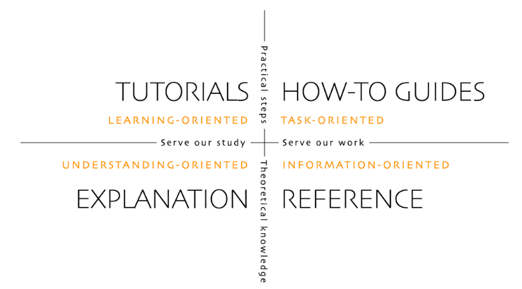

# Quarkus documentation content types

Quarkus documentation is structured into four distinct content types: concepts, how-tos, tutorials, and references. The composition and structure of Quarkus docs follow the Diátaxis systematic documentation framework for technical documentation authoring. Each content type resolves a different user need, fulfills a different purpose, and requires a different approach to its creation.

## Diátaxis documentation framework

We chose to align Quarkus docs with the Diátaxis documentation frameworkfootnote:diataxis[Procida,opts=D. Diátaxis documentation framework. https://diataxis.fr/], which defines a core content structure that addresses the different needs users have when consulting docs.

,width=40%, align=left\]

**Image credit: <https://diataxis.fr/>**

What follows is a brief summary of the different document types, but their site is worth a read if you want to understand more of the reasoning behind this classification.

## Concept guides (Explanation)

> Explanation is *discussion* that clarifies and illuminates a particular topic. Explanation is *understanding-oriented*.

Good concept guides:

- focus on explaining a topic. Their goal is to help the reader understand the concept.
- do not teach, instruct or include reference information. If you need to refer to a tutorial, how-to, or reference guide, point the reader to where they can find it, but do not replicate that information directly in your concept guide.
- provide background information and context to explain *why* things work the way they do, or why they are built the way they are. You can cite design decisions, historical reasons, and technical constraints to reaffirm your points.
- include specific examples to illustrate the explanation, but avoid making the explanation itself overly dependent on a specific technology or pattern of implementation.
- analyze the concept from multiple perspectives and draw comparisons with alternative concepts discuss if it is relevant and useful for the reader's understanding.
- may express opinions about advantages and drawbacks of the concept that you are explaining relative to different potential use cases or applications.

## How-to guides

> How-to guides are *directions* that take the reader through the steps required to solve a real-world problem. How-to guides are *goal-oriented*.

Good how-to guides:

- guide (walk-through) or demonstrate how to complete a task.
- assume you have enough context to begin the task.
- describes the concrete steps necessary to complete a task, but these steps could be in the middle of a larger task.
- do not explain concepts, they rely on other documents (like concepts) to do that.
- are adaptable to real-world use cases.
- are practical (rather than complete).

## Reference guides

> Reference guides are *technical descriptions* of the machinery and how to operate it. Reference material is *information-oriented*.

Good reference guides:

- are concise and to the point. They state, describe, and inform.
- are consistent (to the extent possible) with other reference guides. Following the template helps here.
- remain focused on describing their topic. They don't explain or provide additional context from other sources.
- provide examples or illustrations that help readers understand what is being described.
- are kept up to date. While configuration reference material is generated, extension references that describe how configuration should be applied must be accurate to be useful.

## Tutorials

> Tutorials are *lessons* that take the reader by the hand through a series of steps to complete a project of some kind. Tutorials are *learning-oriented*.

Good tutorials:

- provide a learning experience, giving the reader something they can do.
- get the reader started (they do not create an expert).
- provide the reader with concrete steps to follow that each have a comprehensible result.
- are reliable and consistent (they work for all users, every time).
- include only enough information to complete the task. They delegate to other documentation types (concepts or reference) to provide additional context.
- focus on one way of doing the task. Alternative approaches are explored in other document types (a how-to guide, for example).
