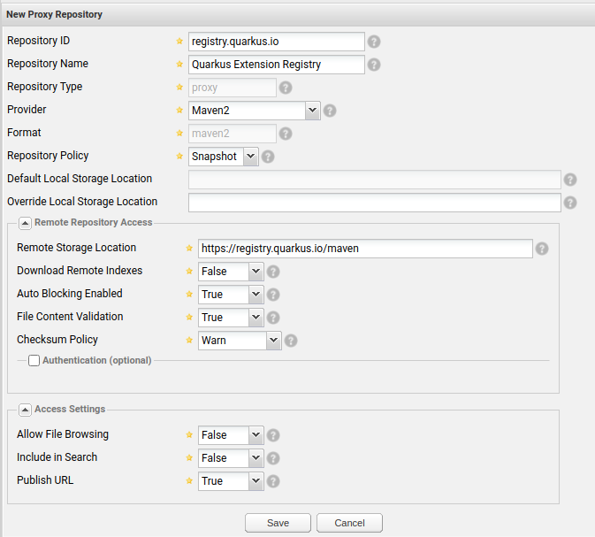
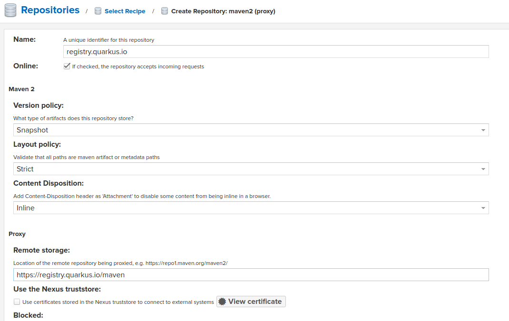

# Quarkus extension registry

The Quarkus dev tools, such as the [Quarkus CLI](/guides/cli-tooling/index.md), the [Maven](/guides/maven-tooling/index.md) and the [Gradle](/guides/gradle-tooling/index.md) plugins, or [code.quarkus.io](https://code.quarkus.io) can be used to list and search the Quarkus ecosystem for extensions that match a certain criteria. That includes the [Quarkus platform](/guides/platform/index.md) extensions and various other extensions contributed by the community, many of which are hosted on the [Quarkiverse Hub](https://github.com/quarkiverse).

The information about all the available Quarkus extensions is provided to the dev tools by *Quarkus extension registries*.

A Quarkus extension registry is a database providing information about:

- available Quarkus platforms, indicating which of those are currently recommended for new projects and/or as updates;
- available non-platform extensions, indicating which Quarkus versions they are compatible with.

<a id="registry.quarkus.io"></a>
## registry.quarkus.io

The registry hosted at [registry.quarkus.io](https://registry.quarkus.io) is the default Quarkus community extension registry. It is updated on every release of the [Quarkus community platform](https://github.com/quarkusio/quarkus-platform) and includes extensions hosted on the [Quarkiverse Hub](https://github.com/quarkiverse).

### Maven repository

The registry hosted at [registry.quarkus.io](https://registry.quarkus.io) is a Maven *snapshot* repository that provides platform and extension catalogs to the dev tools as Maven JSON artifacts. Once downloaded the extension catalogs will be cached in the user's local Maven repository and will be available to the dev tools even if the Internet network (or the registry itself) isn't available.

The extension catalog artifacts cached locally will be regularly checked for updates and updated if newer versions of those catalogs are available in the registry. The default interval to check for updates is **daily**, which matches the default Maven repository `updatePolicy` for SNAPSHOT artifacts.

<a id="registry.quarkus.io.maven.repo"></a>
#### Maven repository configuration

> [!IMPORTANT]
> The repository configuration below is shown only for illustrative purposes and does **NOT** have to be added to the user `settings.xml` or the application's `pom.xml`. The Quarkus dev tools come with this repository pre-configured.

The complete [Maven repository configuration](https://maven.apache.org/settings.html#repositories) of [registry.quarkus.io](#registry.quarkus.io) is

```xml
<repository>
  <id>registry.quarkus.io</id>
  <name>Quarkus community extension registry</name>
  <url>https://registry.quarkus.io/maven</url>
  <snapshots>
    <enabled>true</enabled>
    <updatePolicy>daily</updatePolicy>
    <checksumPolicy>warn</checksumPolicy>
  </snapshots>
</repository>
```

When the Quarkus dev tools are initialized, this repository configuration is automatically added to the Maven resolver which will be used to resolve the platform and extension catalogs from [registry.quarkus.io](#registry.quarkus.io).

#### Maven repository mirrors and proxies

When the Quarkus dev tools Maven resolver is initialized, the relevant Maven mirrors and proxies found in the user `settings.xml` are automatically applied to the [registry.quarkus.io](#registry.quarkus.io.maven.repo) Maven repository configuration, as if the [registry.quarkus.io](#registry.quarkus.io.maven.repo) Maven repository was configured in the user `settings.xml`.

That means, if, for example, a matching Maven repository mirror was applied to the [registry.quarkus.io](#registry.quarkus.io.maven.repo) Maven repository, the [registry.quarkus.io](#registry.quarkus.io.maven.repo) Maven repository would have to be added to the mirror repository group in the corresponding Maven server instance (e.g. Nexus).

#### Overriding the default registry Maven repository configuration

The default registry Maven repository configuration can actually be overridden in the user `settings.xml` by simply adding the desired `<repository>` configuration with the `registry.quarkus.io` as its `<id>` value. If such a repository configuration is found in the user `settings.xml`, the dev tools will use it in place of the default [registry.quarkus.io](#registry.quarkus.io.maven.repo) Maven repository configuration shown above.

## Quarkus Extension Registry Client Configuration

Typically, Quarkus community users will not need to have any registry-related configuration in their environment. The registry hosted at [registry.quarkus.io](#registry.quarkus.io) is enabled in all the Quarkus dev tools by default. However, there could be a few situations where a custom registry client configuration could help. For example, to change the local registry cache update policy or to configure additional (non-default) Quarkus extension registries.

### Registry client configuration location

When the Quarkus dev tools are launched, a search for the registry client configuration file is performed following these steps:

1. `quarkus.tools.config` system property is checked, if it exists, its value will be used as a path to the registry client configuration file;
2. the current directory is checked to contain the `.quarkus/config.yaml` file, if the file exists, it will be used to configure the registry client;
3. the user home directory is checked to contain the `~/.quarkus/config.yaml` file, if the file exists, it will be used to configure the registry client;
4. if none of the above steps located a configuration file, the default [registry.quarkus.io](#registry.quarkus.io.maven.repo) configuration will be used.

### Configuring multiple registries

The [registry.quarkus.io](#registry.quarkus.io) is the default Quarkus community extension registry, but it is not meant to be always the only registry. Other organizations may find it useful to create their own Quarkus extension registries to provide their own [Quarkus platforms](/guides/platform/index.md) and/or individual (non-platform) Quarkus extensions. Users wishing to enable custom Quarkus extension registries in their environment would need to add them to the registry client configuration file.

The registry client configuration file is a simple YAML file which contains a list of registries, for example:

```yaml
registries:
- registry.acme.org
- registry.quarkus.io
```

The configuration above enables two registries: `registry.acme.org` and `registry.quarkus.io`. The order of the registries is actually significant. When the Quarkus dev tools are looking for extensions on user's request, the registries will be searched in the order they are configured, i.e. from the top to the bottom of the list. Extensions and platforms found first will appear as the preferred ones to the user.

> [!IMPORTANT]
> [registry.quarkus.io](#registry.quarkus.io) is the default registry which normally does not have to be configured explicitly, however if a user provides a custom registry list and `registry.quarkus.io` is not in it, [registry.quarkus.io](#registry.quarkus.io) will **not** be enabled.

For example, here is a registry client configuration that replaces the default [registry.quarkus.io](#registry.quarkus.io) registry with a custom one:

```yaml
registries:
- registry.acme.org
```

### Limiting extension catalog to an offering

> [!NOTE]
> This feature was introduced in Quarkus 3.26.0 and will be evolving in the upcoming versions.

As described in [Extension offering metadata](https://quarkus.io/guides/extension-metadata#extension-offerings), extensions may be associated with a one or more offerings delivered and supported by a dedicated team or an organization.

A Quarkus extension registry client may be configured to limit the extension catalog provided by the registry to a specific offering. For example, with the following configuration, assuming `registry.acme.org` provides extensions associated with multiple offerings, only those extensions associated with `acme-cloud` offering will be returned by the registry client:

```yaml
registries:
- registry.acme.org:
    offering: acme-cloud <1>
- registry.quarkus.io
```

1. limits the extension catalog provided by `registry.acme.org` to the extensions that make up the `acme-cloud` offering.

> [!NOTE]
> If an offering is not configured, the complete catalog of extensions returned by the registry will be provided to the user.

Only one offering can be configured per registry at this point.

### Adjusting the registry cache update policy

Usually, a Quarkus extension registry will be implemented as a Maven snapshot repository. The platform and extension catalogs resolved from the registry as Maven artifacts will be cached in the user's local Maven repository. The platform and extension catalogs are actually `SNAPSHOT` artifacts that are periodically checked for updates by the registry client. The default registry interval to check for updates matches the default value of the Maven's `updatePolicy` for [snapshot repositories](https://maven.apache.org/settings.html#repositories) and is `daily`. This default can be overridden in the registry configuration, for example:

```yaml
registries:
- registry.acme.org:
    update-policy: "always"
- registry.quarkus.io
```

In the example above, the `registry.acme.org` registry will be checked for catalog updates on every catalog request, while the `registry.quarkus.io` registry will be checked for catalog updates once a day (on the first catalog request of the day).

Here is a complete list of choices for a registry's `update-policy` value:

- *always* - check for the updates on every catalog request;
- *daily* (default) - check for the catalog updates once a day on the first catalog request;
- *interval:X* (where X is an integer in minutes) - custom interval in minutes;
- *never* - resolve the catalogs once and never check for updates.

### Disabling a registry in the configuration

All the registries listed in the configuration file are enabled by default. A registry can be disabled though by adding `enabled: false` to its configuration. For example:

```yaml
registries:
- registry.acme.org
- registry.quarkus.io:
    enabled: false
```

In the configuration above, only the `registry.acme.org` is enabled. The configuration above is equivalent to:

```yaml
registries:
- registry.acme.org
```

### Enabling the debug mode

The registry client is not logging much information by default. However, it does resolve various artifacts from Maven repositories behind the scenes. If you would like to see artifact transfer and other debugging related messages in the logs, you can enable the debug mode in the configuration. For example:

```yaml
debug: true
registries:
- registry.acme.org
- registry.quarkus.io
```

### Overriding a registry URL

There may be situations where the URL of the registry changes, however the ID needs to be the same (because the Maven coordinates are queried). To override the registry URL, add the following:

```yaml
registries:
- registry.acme.org
- registry.quarkus.io:
    maven:
      repository:
        url: https://internal.registry.acme.org/maven
```

### <a id="how-to-register-as-nexus-repository"></a> How to register as a Nexus Repository proxy

You can register a Quarkus extension registry as a Nexus repository proxy.You need to be an administrator to perform these operations.

#### <a id="how-to-register-as-nexus-2-repository"></a> Nexus 2.x

Some options need to be set:

- Set the `Repository Policy` to `Snapshot`;
- Disable `Download Remote Indexes`;
- Disable `Allow File Browsing`;
- Disable `Include in Search`.

Here is an example on how it should look like:



#### <a id="how-to-register-as-nexus-3-repository"></a> Nexus 3.x

- Create a `maven2(proxy)` repository
- Set the `Version Policy` to `Snapshot`
- Set the `Remote Storage` URL to `https://registry.quarkus.io/maven`



#### Environment Variables

Applications using a registry client can be configured using environment variables.

`QUARKUS_REGISTRIES` environment variable can be used to specify which registries should be enabled as a comma-separated list of registry IDs. For example

```
QUARKUS_REGISTRIES=registry.acme.org,registry.quarkus.io
```

That alone will be enough to initialize a registry client to pull extension catalogs from two registries using their default configurations.

Certain registry options could be initialized with their specific environment variables. Each such option will have the following environment variable prefix:

```
QUARKUS_REGISTRY_<UPPERCASED_AND_UNDERSCORED_REGISTRY_ID>_
```

where `<UPPERCASED_AND_UNDERSCORED_REGISTRY_ID>` is a registry ID with each character converted to uppercase and a `.` replaced with `_`. For example, `REGISTRY_ACME_ORG`.

Below are examples of various options that can be configured following this approach.

##### Repository URL

`QUARKUS_REGISTRY_<UPPERCASED_AND_UNDERSCORED_REGISTRY_ID>_REPO_URL=<REPO_URL>`

Example:

```
QUARKUS_REGISTRY_REGISTRY_ACME_ORG_REPO_URL=https://internal.registry.acme.org/maven
```

##### Update policy

`QUARKUS_REGISTRY_<UPPERCASED_AND_UNDERSCORED_REGISTRY_ID>_UPDATE_POLICY=<UPDATE_POLICY>`

Example:

```
QUARKUS_REGISTRY_REGISTRY_ACME_ORG_UPDATE_POLICY=always
```

##### Offering

`QUARKUS_REGISTRY_<UPPERCASED_AND_UNDERSCORED_REGISTRY_ID>_OFFERING=<OFFERING>`

Example:

```
QUARKUS_REGISTRY_REGISTRY_ACME_ORG_OFFERING=acme-magic
```

##### Recommend Streams From

Set the oldest acceptable stream value per platform. Streams older than the configured values will be ignored by the client.

`QUARKUS_REGISTRY_<UPPERCASED_AND_UNDERSCORED_REGISTRY_ID>_RECOMMEND_STREAMS_FROM_<UPPERCASED_AND_UNDERSCORED_PLATFORM_KEY>=<STREAM_ID>`

Where `UPPERCASED_AND_UNDERSCORED_PLATFORM_KEY` is a platform key with each character converted to uppercase and a `.` replaced with `_`. For example, `IO_QUARKUS_PLATFORM`.

Example:

```
QUARKUS_REGISTRY_REGISTRY_ACME_ORG_RECOMMEND_STREAMS_FROM_IO_QUARKUS_PLATFORM=3.27
```
