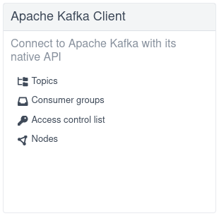
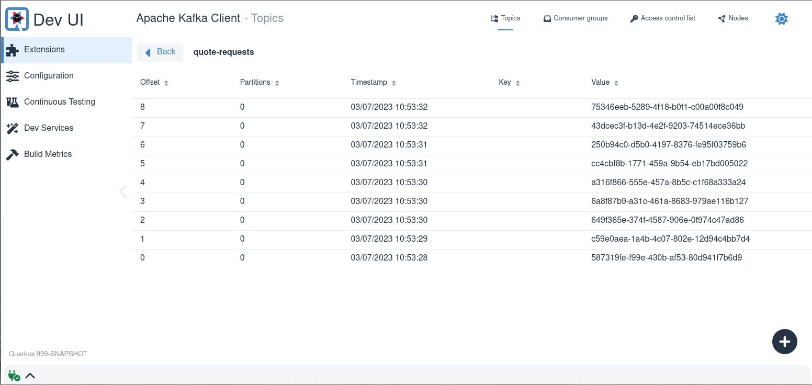

# Kafka Dev UI

If any Kafka-related extension is present (e.g. `quarkus-messaging-kafka`), the Quarkus Dev UI is extended with a Kafka broker management UI. It is connected automatically to the Kafka broker configured for the application.

With the **Kafka Dev UI**, you can directly manage your Kafka cluster and perform tasks, such as:

- Listing and creating topics
- Visualizing records
- Publishing new records
- Inspecting the list of consumer groups and their consumption lag

> [!IMPORTANT]
> Kafka Dev UI is part of the Quarkus Dev UI and is only available in development mode.
