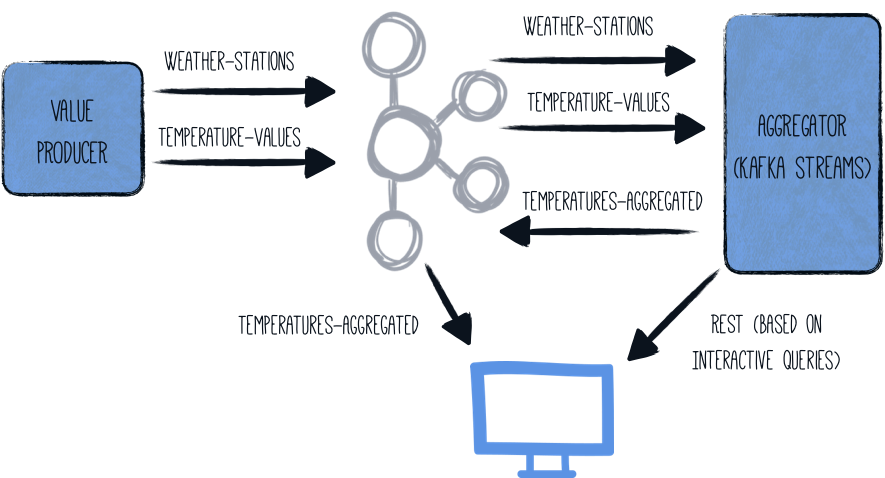
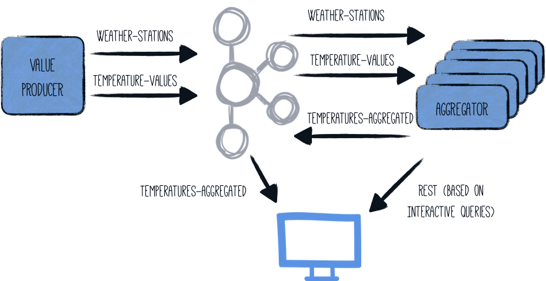

# Using Apache Kafka Streams

This guide demonstrates how your Quarkus application can utilize the Apache Kafka Streams API to implement stream processing applications based on Apache Kafka.

## Prerequisites

To complete this guide, you need:

- Roughly 30 minutes
- An IDE
- JDK 17+ installed with `JAVA_HOME` configured appropriately
- Apache Maven 3.9.16
- Docker and Docker Compose or [Podman](/guides/podman/index.md), and Docker Compose
- Optionally the [Quarkus CLI](/guides/cli-tooling/index.md) if you want to use it
- Optionally Mandrel or GraalVM installed and [configured appropriately](/guides/building-native-image/index.md#configuring-graalvm) if you want to build a native executable (or Docker if you use a native container build)

It is recommended, that you have read the [Kafka quickstart](https://github.com/quarkusio/quarkus-quickstarts/tree/main/kafka-quickstart) before.

> [!NOTE]
> The Quarkus extension for Kafka Streams allows for very fast turnaround times during development by supporting the Quarkus Dev Mode (e.g. via `./mvnw quarkus:dev`). After changing the code of your Kafka Streams topology, the application will automatically be reloaded when the next input message arrives.
>
> A recommended development set-up is to have some producer which creates test messages on the processed topic(s) in fixed intervals, e.g. every second and observe the streaming application's output topic(s) using a tool such as `kafkacat`. Using the dev mode, you'll instantly see messages on the output topic(s) as produced by the latest version of your streaming application when saving.
>
> For the best development experience, we recommend applying the following configuration settings to your Kafka broker:
>
> ```properties
> group.min.session.timeout.ms=250
> ```
>
> Also specify the following settings in your Quarkus `application.properties`:
>
> ```properties
> kafka-streams.consumer.session.timeout.ms=250
> kafka-streams.consumer.heartbeat.interval.ms=200
> ```
>
> Together, these settings will ensure that the application can very quickly reconnect to the broker after being restarted in dev mode.

## Architecture

In this guide, we are going to generate (random) temperature values in one component (named `generator`). These values are associated to given weather stations and are written in a Kafka topic (`temperature-values`). Another topic (`weather-stations`) contains just the main data about the weather stations themselves (id and name).

A second component (`aggregator`) reads from the two Kafka topics and processes them in a streaming pipeline:

- the two topics are joined on weather station id
- per weather station the min, max and average temperature is determined
- this aggregated data is written out to a third topic (`temperatures-aggregated`)

The data can be examined by inspecting the output topic. By exposing a Kafka Streams [interactive query](https://kafka.apache.org/documentation/streams/developer-guide/interactive-queries), the latest result for each weather station can alternatively be obtained via a simple REST query.

The overall architecture looks like so:



## Solution

We recommend that you follow the instructions in the next sections and create the application step by step. However, you can go right to the completed example.

Clone the Git repository: `git clone https://github.com/quarkusio/quarkus-quickstarts.git`, or download an [archive](https://github.com/quarkusio/quarkus-quickstarts/archive/main.zip).

The solution is located in the `kafka-streams-quickstart` [directory](https://github.com/quarkusio/quarkus-quickstarts/tree/main/kafka-streams-quickstart).

## Creating the Producer Maven Project

First, we need a new project with the temperature value producer. Create a new project with the following command:

**CLI**

```bash
quarkus create app org.acme:kafka-streams-quickstart-producer \
    --extension='kafka' \
    --no-code
mv kafka-streams-quickstart-producer producer
```

To create a Gradle project, add the `--gradle` or `--gradle-kotlin-dsl` option.

For more information about how to install and use the Quarkus CLI, see the [Quarkus CLI](/guides/cli-tooling/index.md) guide.

**Maven**

```bash
mvn io.quarkus.platform:quarkus-maven-plugin:3.40.1.2:create \
    -DprojectGroupId=org.acme \
    -DprojectArtifactId=kafka-streams-quickstart-producer \
    -Dextensions='kafka' \
    -DnoCode
mv kafka-streams-quickstart-producer producer
```

To create a Gradle project, add the `-DbuildTool=gradle` or `-DbuildTool=gradle-kotlin-dsl` option.

For Windows users:

- If using Powershell, wrap `-D` parameters in double quotes e.g. `"-DprojectArtifactId=kafka-streams-quickstart-producer"`

This command generates a Maven project, importing the Reactive Messaging and Kafka connector extensions.

If you already have your Quarkus project configured, you can add the `messaging-kafka` extension to your project by running the following command in your project base directory:

**CLI**

```bash
quarkus extension add quarkus-messaging-kafka
```

**Maven**

```bash
./mvnw quarkus:add-extension -Dextensions='quarkus-messaging-kafka'
```

**Gradle**

```bash
./gradlew addExtension --extensions='quarkus-messaging-kafka'
```

This will add the following to your build file:

**pom.xml**

```xml
<dependency>
    <groupId>io.quarkus</groupId>
    <artifactId>quarkus-messaging-kafka</artifactId>
</dependency>
```

**build.gradle**

```gradle
implementation("io.quarkus:quarkus-messaging-kafka")
```

### The Temperature Value Producer

Create the `producer/src/main/java/org/acme/kafka/streams/producer/generator/ValuesGenerator.java` file, with the following content:

```java
package org.acme.kafka.streams.producer.generator;

import java.math.BigDecimal;
import java.math.RoundingMode;
import java.time.Duration;
import java.time.Instant;
import java.util.Arrays;
import java.util.Collections;
import java.util.List;
import java.util.Random;

import jakarta.enterprise.context.ApplicationScoped;

import io.smallrye.mutiny.Multi;
import io.smallrye.reactive.messaging.kafka.Record;
import org.eclipse.microprofile.reactive.messaging.Outgoing;
import org.jboss.logging.Logger;

/**
 * A bean producing random temperature data every second.
 * The values are written to a Kafka topic (temperature-values).
 * Another topic contains the name of weather stations (weather-stations).
 * The Kafka configuration is specified in the application configuration.
 */
@ApplicationScoped
public class ValuesGenerator {

    private static final Logger LOG = Logger.getLogger(ValuesGenerator.class);

    private Random random = new Random();

    private List<WeatherStation> stations = List.of(
                        new WeatherStation(1, "Hamburg", 13),
                        new WeatherStation(2, "Snowdonia", 5),
                        new WeatherStation(3, "Boston", 11),
                        new WeatherStation(4, "Tokio", 16),
                        new WeatherStation(5, "Cusco", 12),
                        new WeatherStation(6, "Svalbard", -7),
                        new WeatherStation(7, "Porthsmouth", 11),
                        new WeatherStation(8, "Oslo", 7),
                        new WeatherStation(9, "Marrakesh", 20));

    @Outgoing("temperature-values")                                        // <1>
    public Multi<Record<Integer, String>> generate() {
        return Multi.createFrom().ticks().every(Duration.ofMillis(500))    // <2>
                .onOverflow().drop()
                .map(tick -> {
                    WeatherStation station = stations.get(random.nextInt(stations.size()));
                    double temperature = BigDecimal.valueOf(random.nextGaussian() * 15 + station.averageTemperature)
                            .setScale(1, RoundingMode.HALF_UP)
                            .doubleValue();

                    LOG.infov("station: {0}, temperature: {1}", station.name, temperature);
                    return Record.of(station.id, Instant.now() + ";" + temperature);
                });
    }

    @Outgoing("weather-stations")                                          // <3>
    public Multi<Record<Integer, String>> weatherStations() {
        return Multi.createFrom().items(stations.stream()
            .map(s -> Record.of(
                    s.id,
                    "{ \"id\" : " + s.id +
                    ", \"name\" : \"" + s.name + "\" }"))
        );
    }

    private static class WeatherStation {

        int id;
        String name;
        int averageTemperature;

        public WeatherStation(int id, String name, int averageTemperature) {
            this.id = id;
            this.name = name;
            this.averageTemperature = averageTemperature;
        }
    }
}
```

1. Instruct Reactive Messaging to dispatch the items from the returned `Multi` to `temperature-values`.
2. The method returns a Mutiny *stream* (`Multi`) emitting a random temperature value every 0.5 seconds.
3. Instruct Reactive Messaging to dispatch the items from the returned `Multi` (static list of weather stations) to `weather-stations`.

The two methods each return a *reactive stream* whose items are sent to the streams named `temperature-values` and `weather-stations`, respectively.

### Topic Configuration

The two channels are mapped to Kafka topics using the Quarkus configuration file `application.properties`. For that, add the following to the file `producer/src/main/resources/application.properties`:

```properties
# Configure the Kafka broker location
kafka.bootstrap.servers=localhost:9092

mp.messaging.outgoing.temperature-values.connector=smallrye-kafka
mp.messaging.outgoing.temperature-values.key.serializer=org.apache.kafka.common.serialization.IntegerSerializer
mp.messaging.outgoing.temperature-values.value.serializer=org.apache.kafka.common.serialization.StringSerializer

mp.messaging.outgoing.weather-stations.connector=smallrye-kafka
mp.messaging.outgoing.weather-stations.key.serializer=org.apache.kafka.common.serialization.IntegerSerializer
mp.messaging.outgoing.weather-stations.value.serializer=org.apache.kafka.common.serialization.StringSerializer
```

This configures the Kafka bootstrap server, the two topics and the corresponding (de-)serializers. More details about the different configuration options are available on the [Producer configuration](https://kafka.apache.org/documentation/#producerconfigs) and [Consumer configuration](https://kafka.apache.org/documentation/#consumerconfigs) section from the Kafka documentation.

## Creating the Aggregator Maven Project

With the producer application in place, it's time to implement the actual aggregator application, which will run the Kafka Streams pipeline. Create another project like so:

**CLI**

```bash
quarkus create app org.acme:kafka-streams-quickstart-aggregator \
    --extension='kafka-streams,rest-jackson' \
    --no-code
mv kafka-streams-quickstart-aggregator aggregator
```

To create a Gradle project, add the `--gradle` or `--gradle-kotlin-dsl` option.

For more information about how to install and use the Quarkus CLI, see the [Quarkus CLI](/guides/cli-tooling/index.md) guide.

**Maven**

```bash
mvn io.quarkus.platform:quarkus-maven-plugin:3.40.1.2:create \
    -DprojectGroupId=org.acme \
    -DprojectArtifactId=kafka-streams-quickstart-aggregator \
    -Dextensions='kafka-streams,rest-jackson' \
    -DnoCode
mv kafka-streams-quickstart-aggregator aggregator
```

To create a Gradle project, add the `-DbuildTool=gradle` or `-DbuildTool=gradle-kotlin-dsl` option.

For Windows users:

- If using Powershell, wrap `-D` parameters in double quotes e.g. `"-DprojectArtifactId=kafka-streams-quickstart-aggregator"`

This creates the `aggregator` project with the Quarkus extension for Kafka Streams and with the Jackson support for Quarkus REST (formerly RESTEasy Reactive).

If you already have your Quarkus project configured, you can add the `kafka-streams` extension to your project by running the following command in your project base directory:

**CLI**

```bash
quarkus extension add kafka-streams
```

**Maven**

```bash
./mvnw quarkus:add-extension -Dextensions='kafka-streams'
```

**Gradle**

```bash
./gradlew addExtension --extensions='kafka-streams'
```

This will add the following to your `pom.xml`:

**pom.xml**

```xml
<dependency>
    <groupId>io.quarkus</groupId>
    <artifactId>quarkus-kafka-streams</artifactId>
</dependency>
```

**build.gradle**

```gradle
implementation("io.quarkus:quarkus-kafka-streams")
```

### The Pipeline Implementation

Let's begin the implementation of the stream processing application by creating a few value objects for representing temperature measurements, weather stations and for keeping track of aggregated values.

First, create the file `aggregator/src/main/java/org/acme/kafka/streams/aggregator/model/WeatherStation.java`, representing a weather station, with the following content:

```java
package org.acme.kafka.streams.aggregator.model;

import io.quarkus.runtime.annotations.RegisterForReflection;

@RegisterForReflection // <1>
public class WeatherStation {

    public int id;
    public String name;
}
```

1. The `@RegisterForReflection` annotation instructs Quarkus to keep the class and its members during the native compilation. More details about the `@RegisterForReflection` annotation can be found on  the [native application tips](/guides/writing-native-applications-tips/index.md#registerForReflection) page.

Then the file `aggregator/src/main/java/org/acme/kafka/streams/aggregator/model/TemperatureMeasurement.java`, representing temperature measurements for a given station:

```java
package org.acme.kafka.streams.aggregator.model;

import java.time.Instant;

public class TemperatureMeasurement {

    public int stationId;
    public String stationName;
    public Instant timestamp;
    public double value;

    public TemperatureMeasurement(int stationId, String stationName, Instant timestamp,
            double value) {
        this.stationId = stationId;
        this.stationName = stationName;
        this.timestamp = timestamp;
        this.value = value;
    }
}
```

And finally `aggregator/src/main/java/org/acme/kafka/streams/aggregator/model/Aggregation.java`, which will be used to keep track of the aggregated values while the events are processed in the streaming pipeline:

```java
package org.acme.kafka.streams.aggregator.model;

import java.math.BigDecimal;
import java.math.RoundingMode;

import io.quarkus.runtime.annotations.RegisterForReflection;

@RegisterForReflection
public class Aggregation {

    public int stationId;
    public String stationName;
    public double min = Double.MAX_VALUE;
    public double max = Double.MIN_VALUE;
    public int count;
    public double sum;
    public double avg;

    public Aggregation updateFrom(TemperatureMeasurement measurement) {
        stationId = measurement.stationId;
        stationName = measurement.stationName;

        count++;
        sum += measurement.value;
        avg = BigDecimal.valueOf(sum / count)
                .setScale(1, RoundingMode.HALF_UP).doubleValue();

        min = Math.min(min, measurement.value);
        max = Math.max(max, measurement.value);

        return this;
    }
}
```

Next, let's create the actual streaming query implementation itself in the `aggregator/src/main/java/org/acme/kafka/streams/aggregator/streams/TopologyProducer.java` file. All we need to do for that is to declare a CDI producer method which returns the Kafka Streams `Topology`; the Quarkus extension will take care of configuring, starting and stopping the actual Kafka Streams engine.

```java
package org.acme.kafka.streams.aggregator.streams;

import java.time.Instant;

import jakarta.enterprise.context.ApplicationScoped;
import jakarta.enterprise.inject.Produces;

import org.acme.kafka.streams.aggregator.model.Aggregation;
import org.acme.kafka.streams.aggregator.model.TemperatureMeasurement;
import org.acme.kafka.streams.aggregator.model.WeatherStation;
import org.apache.kafka.common.serialization.Serdes;
import org.apache.kafka.streams.StreamsBuilder;
import org.apache.kafka.streams.Topology;
import org.apache.kafka.streams.kstream.Consumed;
import org.apache.kafka.streams.kstream.GlobalKTable;
import org.apache.kafka.streams.kstream.Materialized;
import org.apache.kafka.streams.kstream.Produced;
import org.apache.kafka.streams.state.KeyValueBytesStoreSupplier;
import org.apache.kafka.streams.state.Stores;

import io.quarkus.kafka.client.serialization.ObjectMapperSerde;

@ApplicationScoped
public class TopologyProducer {

    static final String WEATHER_STATIONS_STORE = "weather-stations-store";

    private static final String WEATHER_STATIONS_TOPIC = "weather-stations";
    private static final String TEMPERATURE_VALUES_TOPIC = "temperature-values";
    private static final String TEMPERATURES_AGGREGATED_TOPIC = "temperatures-aggregated";

    @Produces
    public Topology buildTopology() {
        StreamsBuilder builder = new StreamsBuilder();

        ObjectMapperSerde<WeatherStation> weatherStationSerde = new ObjectMapperSerde<>(
                WeatherStation.class);
        ObjectMapperSerde<Aggregation> aggregationSerde = new ObjectMapperSerde<>(Aggregation.class);

        KeyValueBytesStoreSupplier storeSupplier = Stores.persistentKeyValueStore(
                WEATHER_STATIONS_STORE);

        GlobalKTable<Integer, WeatherStation> stations = builder.globalTable( // <1>
                WEATHER_STATIONS_TOPIC,
                Consumed.with(Serdes.Integer(), weatherStationSerde));

        builder.stream(                                                       // <2>
                        TEMPERATURE_VALUES_TOPIC,
                        Consumed.with(Serdes.Integer(), Serdes.String())
                )
                .join(                                                        // <3>
                        stations,
                        (stationId, timestampAndValue) -> stationId,
                        (timestampAndValue, station) -> {
                            String[] parts = timestampAndValue.split(";");
                            return new TemperatureMeasurement(station.id, station.name,
                                    Instant.parse(parts[0]), Double.valueOf(parts[1]));
                        }
                )
                .groupByKey()                                                 // <4>
                .aggregate(                                                   // <5>
                        Aggregation::new,
                        (stationId, value, aggregation) -> aggregation.updateFrom(value),
                        Materialized.<Integer, Aggregation> as(storeSupplier)
                            .withKeySerde(Serdes.Integer())
                            .withValueSerde(aggregationSerde)
                )
                .toStream()
                .to(                                                          // <6>
                        TEMPERATURES_AGGREGATED_TOPIC,
                        Produced.with(Serdes.Integer(), aggregationSerde)
                );

        return builder.build();
    }
}
```

1. The `weather-stations` table is read into a `GlobalKTable`, representing the current state of each weather station
2. The `temperature-values` topic is read into a `KStream`; whenever a new message arrives to this topic, the pipeline will be processed for this measurement
3. The message from the `temperature-values` topic is joined with the corresponding weather station, using the topic's key (weather station id); the join result contains the data from the measurement and associated weather station message
4. The values are grouped by message key (the weather station id)
5. Within each group, all the measurements of that station are aggregated, by keeping track of minimum and maximum values and calculating the average value of all measurements of that station (see the `Aggregation` type)
6. The results of the pipeline are written out to the `temperatures-aggregated` topic

The Kafka Streams extension is configured via the Quarkus configuration file `application.properties`. Create the file `aggregator/src/main/resources/application.properties` with the following contents:

```properties
quarkus.kafka-streams.bootstrap-servers=localhost:9092
quarkus.kafka-streams.application-server=${hostname}:8080
quarkus.kafka-streams.topics=weather-stations,temperature-values

# pass-through options
kafka-streams.cache.max.bytes.buffering=10240
kafka-streams.commit.interval.ms=1000
kafka-streams.metadata.max.age.ms=500
kafka-streams.auto.offset.reset=earliest
kafka-streams.metrics.recording.level=DEBUG
```

The options with the `quarkus.kafka-streams` prefix can be changed dynamically at application startup, e.g. via environment variables or system properties. `bootstrap-servers` and `application-server` are mapped to the Kafka Streams properties `bootstrap.servers` and `application.server`, respectively. `topics` is specific to Quarkus: the application will wait for all the given topics to exist before launching the Kafka Streams engine. This is to done to gracefully await the creation of topics that don't yet exist at application startup time.

> [!TIP]
> Alternatively, you can use `kafka.bootstrap.servers` instead of `quarkus.kafka-streams.bootstrap-servers` as you did in the *generator* project above.

> [!NOTE]
> Once you are ready to promote your application into production, consider changing the above configuration values. While `cache.max.bytes.buffering=10240` will move your records faster through the topology, the default value of `10485760` is more throughput-friendly. Also condider increasing `metadata.max.age.ms` from `500`, which will update cluster metadata quickly, but will generate a lot of redundant requests, to a value closer to the default of `300000`. A `commit.interval.ms` of `1000` is good for exactly-once processing, but might generate excessive load for  the default at-least-once processing with the default value of `30000`.

All the properties within the `kafka-streams` namespace are passed through as-is to the Kafka Streams engine. Changing their values requires a rebuild of the application.

## Building and Running the Applications

We now can build the `producer` and `aggregator` applications:

```bash
./mvnw clean package -f producer/pom.xml
./mvnw clean package -f aggregator/pom.xml
```

Instead of running them directly on the host machine using the Quarkus dev mode, we're going to package them into container images and launch them via Docker Compose. This is done in order to demonstrate scaling the `aggregator` aggregation to multiple nodes later on.

The `Dockerfile` created by Quarkus by default needs one adjustment for the `aggregator` application in order to run the Kafka Streams pipeline. To do so, edit the file `aggregator/src/main/docker/Dockerfile.jvm` and replace the line `FROM fabric8/java-alpine-openjdk8-jre` with `FROM fabric8/java-centos-openjdk8-jdk`.

Next create a Docker Compose file (`docker-compose.yaml`) for spinning up the two applications as well as Apache Kafka like so:

```yaml
services:
  kafka:
    image: quay.io/strimzi/kafka:latest-kafka-4.1.0
    command: [
      "sh", "-c",
      "./bin/kafka-storage.sh format --standalone -t $$(./bin/kafka-storage.sh random-uuid) -c ./config/server.properties && ./bin/kafka-server-start.sh ./config/server.properties --override advertised.listeners=$${KAFKA_ADVERTISED_LISTENERS} --override num.partitions=$${KAFKA_NUM_PARTITIONS} --override group.min.session.timeout.ms=$${KAFKA_GROUP_MIN_SESSION_TIMEOUT_MS}"
    ]
    ports:
      - "9092:9092"
    environment:
      LOG_DIR: "/tmp/logs"
      KAFKA_ADVERTISED_LISTENERS: 'PLAINTEXT://kafka:9092'
      KAFKA_NUM_PARTITIONS: 3
      KAFKA_GROUP_MIN_SESSION_TIMEOUT_MS: 100
    networks:
      - kafkastreams-network

  producer:
    image: quarkus-quickstarts/kafka-streams-producer:1.0
    build:
      context: producer
      dockerfile: src/main/docker/Dockerfile.${QUARKUS_MODE:-jvm}
    environment:
      KAFKA_BOOTSTRAP_SERVERS: kafka:9092
    networks:
      - kafkastreams-network

  aggregator:
    image: quarkus-quickstarts/kafka-streams-aggregator:1.0
    build:
      context: aggregator
      dockerfile: src/main/docker/Dockerfile.${QUARKUS_MODE:-jvm}
    environment:
      QUARKUS_KAFKA_STREAMS_BOOTSTRAP_SERVERS: kafka:9092
    networks:
      - kafkastreams-network

networks:
  kafkastreams-network:
    name: ks
```

To launch all the containers, building the `producer` and `aggregator` container images, run `docker-compose up --build`.

> [!TIP]
> Instead of `QUARKUS_KAFKA_STREAMS_BOOTSTRAP_SERVERS`, you can use `KAFKA_BOOTSTRAP_SERVERS`.

You should see log statements from the `producer` application about messages being sent to the "temperature-values" topic.

Now run an instance of the *debezium/tooling* image, attaching to the same network all the other containers run in. This image provides several useful tools such as *kafkacat* and *httpie*:

```bash
docker run --tty --rm -i --network ks debezium/tooling:latest
```

Within the tooling container, run *kafkacat* to examine the results of the streaming pipeline:

```
kafkacat -b kafka:9092 -C -o beginning -q -t temperatures-aggregated

{"avg":34.7,"count":4,"max":49.4,"min":16.8,"stationId":9,"stationName":"Marrakesh","sum":138.8}
{"avg":15.7,"count":1,"max":15.7,"min":15.7,"stationId":2,"stationName":"Snowdonia","sum":15.7}
{"avg":12.8,"count":7,"max":25.5,"min":-13.8,"stationId":7,"stationName":"Porthsmouth","sum":89.7}
...
```

You should see new values arrive as the producer continues to emit temperature measurements, each value on the outbound topic showing the minimum, maximum and average temperature values of the represented weather station.

## Interactive Queries

Subscribing to the `temperatures-aggregated` topic is a great way to react to any new temperature values. It's a bit wasteful though if you're just interested in the latest aggregated value for a given weather station. This is where Kafka Streams interactive queries shine: they let you directly query the underlying state store of the pipeline for the value associated to a given key. By exposing a simple REST endpoint which queries the state store, the latest aggregation result can be retrieved without having to subscribe to any Kafka topic.

Let's begin by creating a new class `InteractiveQueries` in the file `aggregator/src/main/java/org/acme/kafka/streams/aggregator/streams/InteractiveQueries.java`:

one more method to the `KafkaStreamsPipeline` class which obtains the current state for a given key:

```java
package org.acme.kafka.streams.aggregator.streams;

import jakarta.enterprise.context.ApplicationScoped;
import jakarta.inject.Inject;

import org.acme.kafka.streams.aggregator.model.Aggregation;
import org.acme.kafka.streams.aggregator.model.WeatherStationData;
import org.apache.kafka.streams.KafkaStreams;
import org.apache.kafka.streams.errors.InvalidStateStoreException;
import org.apache.kafka.streams.state.QueryableStoreTypes;
import org.apache.kafka.streams.state.ReadOnlyKeyValueStore;

@ApplicationScoped
public class InteractiveQueries {

    @Inject
    KafkaStreams streams;

    public GetWeatherStationDataResult getWeatherStationData(int id) {
        Aggregation result = getWeatherStationStore().get(id);

        if (result != null) {
            return GetWeatherStationDataResult.found(WeatherStationData.from(result)); // <1>
        }
        else {
            return GetWeatherStationDataResult.notFound();                             // <2>
        }
    }

    private ReadOnlyKeyValueStore<Integer, Aggregation> getWeatherStationStore() {
        while (true) {
            try {
                return streams.store(StoreQueryParameters
                    .fromNameAndType(TopologyProducer.WEATHER_STATIONS_STORE, QueryableStoreTypes.keyValueStore()));
            } catch (InvalidStateStoreException e) {
                // ignore, store not ready yet
            }
        }
    }
}
```

1. A value for the given station id was found, so that value will be returned
2. No value was found, either because a non-existing station was queried or no measurement exists yet for the given station

Also create the method's return type in the file `aggregator/src/main/java/org/acme/kafka/streams/aggregator/streams/GetWeatherStationDataResult.java`:

```java
package org.acme.kafka.streams.aggregator.streams;

import java.util.Optional;
import java.util.OptionalInt;

import org.acme.kafka.streams.aggregator.model.WeatherStationData;

public class GetWeatherStationDataResult {

    private static GetWeatherStationDataResult NOT_FOUND =
            new GetWeatherStationDataResult(null);

    private final WeatherStationData result;

    private GetWeatherStationDataResult(WeatherStationData result) {
        this.result = result;
    }

    public static GetWeatherStationDataResult found(WeatherStationData data) {
        return new GetWeatherStationDataResult(data);
    }

    public static GetWeatherStationDataResult notFound() {
        return NOT_FOUND;
    }

    public Optional<WeatherStationData> getResult() {
        return Optional.ofNullable(result);
    }
}
```

Also create `aggregator/src/main/java/org/acme/kafka/streams/aggregator/model/WeatherStationData.java`, which represents the actual aggregation result for a weather station:

```java
package org.acme.kafka.streams.aggregator.model;

import io.quarkus.runtime.annotations.RegisterForReflection;

@RegisterForReflection
public class WeatherStationData {

    public int stationId;
    public String stationName;
    public double min = Double.MAX_VALUE;
    public double max = Double.MIN_VALUE;
    public int count;
    public double avg;

    private WeatherStationData(int stationId, String stationName, double min, double max,
            int count, double avg) {
        this.stationId = stationId;
        this.stationName = stationName;
        this.min = min;
        this.max = max;
        this.count = count;
        this.avg = avg;
    }

    public static WeatherStationData from(Aggregation aggregation) {
        return new WeatherStationData(
                aggregation.stationId,
                aggregation.stationName,
                aggregation.min,
                aggregation.max,
                aggregation.count,
                aggregation.avg);
    }
}
```

We now can add a simple REST endpoint (`aggregator/src/main/java/org/acme/kafka/streams/aggregator/rest/WeatherStationEndpoint.java`), which invokes `getWeatherStationData()` and returns the data to the client:

```java
package org.acme.kafka.streams.aggregator.rest;

import java.net.URI;
import java.net.URISyntaxException;
import java.util.List;

import jakarta.enterprise.context.ApplicationScoped;
import jakarta.inject.Inject;
import jakarta.ws.rs.GET;
import jakarta.ws.rs.Path;
import jakarta.ws.rs.core.MediaType;
import jakarta.ws.rs.core.Response;
import jakarta.ws.rs.core.Response.Status;

import org.acme.kafka.streams.aggregator.streams.GetWeatherStationDataResult;
import org.acme.kafka.streams.aggregator.streams.KafkaStreamsPipeline;

@ApplicationScoped
@Path("/weather-stations")
public class WeatherStationEndpoint {

    @Inject
    InteractiveQueries interactiveQueries;

    @GET
    @Path("/data/{id}")
    public Response getWeatherStationData(int id) {
        GetWeatherStationDataResult result = interactiveQueries.getWeatherStationData(id);

        if (result.getResult().isPresent()) {  // <1>
            return Response.ok(result.getResult().get()).build();
        }
        else {
            return Response.status(Status.NOT_FOUND.getStatusCode(),
                    "No data found for weather station " + id).build();
        }
    }
}
```

1. Depending on whether a value was obtained, either return that value or a 404 response

With this code in place, it's time to rebuild the application and the `aggregator` service in Docker Compose:

```bash
./mvnw clean package -f aggregator/pom.xml
docker-compose stop aggregator
docker-compose up --build -d
```

This will rebuild the `aggregator` container and restart its service. Once that's done, you can invoke the service's REST API to obtain the temperature data for one of the existing stations. To do so, you can use `httpie` in the tooling container launched before:

```
http aggregator:8080/weather-stations/data/1

HTTP/1.1 200 OK
Connection: keep-alive
Content-Length: 85
Content-Type: application/json
Date: Tue, 18 Jun 2019 19:29:16 GMT

{
    "avg": 12.9,
    "count": 146,
    "max": 41.0,
    "min": -25.6,
    "stationId": 1,
    "stationName": "Hamburg"
}
```

## Scaling Out

A very interesting trait of Kafka Streams applications is that they can be scaled out, i.e. the load and state can be distributed amongst multiple application instances running the same pipeline. Each node will then contain a subset of the aggregation results, but Kafka Streams provides you with [an API](https://kafka.apache.org/documentation/streams/developer-guide/interactive-queries#querying-remote-state-stores-for-the-entire-app) to obtain the information which node is hosting a given key. The application can then either fetch the data directly from the other instance, or simply point the client to the location of that other node.

Launching multiple instances of the `aggregator` application will make look the overall architecture like so:



The `InteractiveQueries` class must be adjusted slightly for this distributed architecture:

```java
public GetWeatherStationDataResult getWeatherStationData(int id) {
    StreamsMetadata metadata = streams.metadataForKey(                  // <1>
            TopologyProducer.WEATHER_STATIONS_STORE,
            id,
            Serdes.Integer().serializer()
    );

    if (metadata == null || metadata == StreamsMetadata.NOT_AVAILABLE) {
        LOG.warn("Found no metadata for key {}", id);
        return GetWeatherStationDataResult.notFound();
    }
    else if (metadata.host().equals(host)) {                            // <2>
        LOG.info("Found data for key {} locally", id);
        Aggregation result = getWeatherStationStore().get(id);

        if (result != null) {
            return GetWeatherStationDataResult.found(WeatherStationData.from(result));
        }
        else {
            return GetWeatherStationDataResult.notFound();
        }
    }
    else {                                                              // <3>
        LOG.info(
            "Found data for key {} on remote host {}:{}",
            id,
            metadata.host(),
            metadata.port()
        );
        return GetWeatherStationDataResult.foundRemotely(metadata.host(), metadata.port());
    }
}

public List<PipelineMetadata> getMetaData() {                           // <4>
    return streams.allMetadataForStore(TopologyProducer.WEATHER_STATIONS_STORE)
            .stream()
            .map(m -> new PipelineMetadata(
                    m.hostInfo().host() + ":" + m.hostInfo().port(),
                    m.topicPartitions()
                        .stream()
                        .map(TopicPartition::toString)
                        .collect(Collectors.toSet()))
            )
            .collect(Collectors.toList());
}
```

1. The streams metadata for the given weather station id is obtained
2. The given key (weather station id) is maintained by the local application node, i.e. it can answer the query itself
3. The given key is maintained by another application node; in this case the information about that node (host and port) will be returned
4. The `getMetaData()` method is added to provide callers with a list of all the nodes in the application cluster.

The `GetWeatherStationDataResult` type must be adjusted accordingly:

```java
package org.acme.kafka.streams.aggregator.streams;

import java.util.Optional;
import java.util.OptionalInt;

import org.acme.kafka.streams.aggregator.model.WeatherStationData;

public class GetWeatherStationDataResult {

    private static GetWeatherStationDataResult NOT_FOUND =
            new GetWeatherStationDataResult(null, null, null);

    private final WeatherStationData result;
    private final String host;
    private final Integer port;

    private GetWeatherStationDataResult(WeatherStationData result, String host,
            Integer port) {
        this.result = result;
        this.host = host;
        this.port = port;
    }

    public static GetWeatherStationDataResult found(WeatherStationData data) {
        return new GetWeatherStationDataResult(data, null, null);
    }

    public static GetWeatherStationDataResult foundRemotely(String host, int port) {
        return new GetWeatherStationDataResult(null, host, port);
    }

    public static GetWeatherStationDataResult notFound() {
        return NOT_FOUND;
    }

    public Optional<WeatherStationData> getResult() {
        return Optional.ofNullable(result);
    }

    public Optional<String> getHost() {
        return Optional.ofNullable(host);
    }

    public OptionalInt getPort() {
        return port != null ? OptionalInt.of(port) : OptionalInt.empty();
    }
}
```

Also, the return type for `getMetaData()` must be defined (`aggregator/src/main/java/org/acme/kafka/streams/aggregator/streams/PipelineMetadata.java`):

```java
package org.acme.kafka.streams.aggregator.streams;

import java.util.Set;

public class PipelineMetadata {

    public String host;
    public Set<String> partitions;

    public PipelineMetadata(String host, Set<String> partitions) {
        this.host = host;
        this.partitions = partitions;
    }
}
```

Lastly, the REST endpoint class must be updated:

```java
package org.acme.kafka.streams.aggregator.rest;

import java.net.URI;
import java.net.URISyntaxException;
import java.util.List;

import jakarta.enterprise.context.ApplicationScoped;
import jakarta.inject.Inject;
import jakarta.ws.rs.Consumes;
import jakarta.ws.rs.GET;
import jakarta.ws.rs.Path;
import jakarta.ws.rs.Produces;
import jakarta.ws.rs.core.MediaType;
import jakarta.ws.rs.core.Response;
import jakarta.ws.rs.core.Response.Status;

import org.acme.kafka.streams.aggregator.streams.GetWeatherStationDataResult;
import org.acme.kafka.streams.aggregator.streams.KafkaStreamsPipeline;
import org.acme.kafka.streams.aggregator.streams.PipelineMetadata;

@ApplicationScoped
@Path("/weather-stations")
public class WeatherStationEndpoint {

    @Inject
    InteractiveQueries interactiveQueries;

    @GET
    @Path("/data/{id}")
    @Consumes(MediaType.APPLICATION_JSON)
    @Produces(MediaType.APPLICATION_JSON)
    public Response getWeatherStationData(int id) {
        GetWeatherStationDataResult result = interactiveQueries.getWeatherStationData(id);

        if (result.getResult().isPresent()) {                     // <1>
            return Response.ok(result.getResult().get()).build();
        }
        else if (result.getHost().isPresent()) {                  // <2>
            URI otherUri = getOtherUri(result.getHost().get(), result.getPort().getAsInt(),
                    id);
            return Response.seeOther(otherUri).build();
        }
        else {                                                    // <3>
            return Response.status(Status.NOT_FOUND.getStatusCode(),
                    "No data found for weather station " + id).build();
        }
    }

    @GET
    @Path("/meta-data")
    @Produces(MediaType.APPLICATION_JSON)
    public List<PipelineMetadata> getMetaData() {                 // <4>
        return interactiveQueries.getMetaData();
    }

    private URI getOtherUri(String host, int port, int id) {
        try {
            return new URI("http://" + host + ":" + port + "/weather-stations/data/" + id);
        }
        catch (URISyntaxException e) {
            throw new RuntimeException(e);
        }
    }
}
```

1. The data was found locally, so return it
2. The data is maintained by another node, so reply with a redirect (HTTP status code 303) if the data for the given key is stored on one of the other nodes.
3. No data was found for the given weather station id
4. Exposes information about all the hosts forming the application cluster

Now stop the `aggregator` service again and rebuild it. Then let's spin up three instances of it:

```bash
./mvnw clean package -f aggregator/pom.xml
docker-compose stop aggregator
docker-compose up --build -d --scale aggregator=3
```

When invoking the REST API on any of the three instances, it might either be that the aggregation for the requested weather station id is stored locally on the node receiving the query, or it could be stored on one of the other two nodes.

As the load balancer of Docker Compose will distribute requests to the `aggregator` service in a round-robin fashion, we'll invoke the actual nodes directly. The application exposes information about all the host names via REST:

```
http aggregator:8080/weather-stations/meta-data

HTTP/1.1 200 OK
Connection: keep-alive
Content-Length: 202
Content-Type: application/json
Date: Tue, 18 Jun 2019 20:00:23 GMT

[
    {
        "host": "2af13fe516a9:8080",
        "partitions": [
            "temperature-values-2"
        ]
    },
    {
        "host": "32cc8309611b:8080",
        "partitions": [
            "temperature-values-1"
        ]
    },
    {
        "host": "1eb39af8d587:8080",
        "partitions": [
            "temperature-values-0"
        ]
    }
]
```

Retrieve the data from one of the three hosts shown in the response (your actual host names will differ):

```
http 2af13fe516a9:8080/weather-stations/data/1
```

If that node holds the data for key "1", you'll get a response like this:

```
HTTP/1.1 200 OK
Connection: keep-alive
Content-Length: 74
Content-Type: application/json
Date: Tue, 11 Jun 2019 19:16:31 GMT

{
  "avg": 11.9,
  "count": 259,
  "max": 50.0,
  "min": -30.1,
  "stationId": 1,
  "stationName": "Hamburg"
}
```

Otherwise, the service will send a redirect:

```
HTTP/1.1 303 See Other
Connection: keep-alive
Content-Length: 0
Date: Tue, 18 Jun 2019 20:01:03 GMT
Location: http://1eb39af8d587:8080/weather-stations/data/1
```

You can also have *httpie* automatically follow the redirect by passing the `--follow option`:

```bash
http --follow 2af13fe516a9:8080/weather-stations/data/1
```

## Running Natively

The Quarkus extension for Kafka Streams enables the execution of stream processing applications natively via GraalVM without further configuration.

To run both the `producer` and `aggregator` applications in native mode, the Maven builds can be executed using `-Dnative`:

```bash
./mvnw clean package -f producer/pom.xml -Dnative -Dnative-image.container-runtime=docker
./mvnw clean package -f aggregator/pom.xml -Dnative -Dnative-image.container-runtime=docker
```

Now create an environment variable named `QUARKUS_MODE` and with value set to "native":

```bash
export QUARKUS_MODE=native
```

This is used by the Docker Compose file to use the correct `Dockerfile` when building the `producer` and `aggregator` images. The Kafka Streams application can work with less than 50 MB RSS in native mode. To do so, add the `Xmx` option to the program invocation in `aggregator/src/main/docker/Dockerfile.native`:

```dockerfile
CMD ["./application", "-Dquarkus.http.host=0.0.0.0", "-Xmx32m"]
```

Now start Docker Compose as described above (don't forget to rebuild the container images).

## Kafka Streams Health Checks

If you are using the `quarkus-smallrye-health` extension, `quarkus-kafka-streams` will automatically add:

- a readiness health check to validate that all topics declared in the `quarkus.kafka-streams.topics` property are created,
- a liveness health check based on the Kafka Streams state.

So when you access the `/q/health` endpoint of your application you will have information about the state of the Kafka Streams and the available and/or missing topics.

This is an example of when the status is `DOWN`:

```
curl -i http://aggregator:8080/q/health

HTTP/1.1 503 Service Unavailable
content-type: application/json; charset=UTF-8
content-length: 454

{
    "status": "DOWN",
    "checks": [
        {
            "name": "Kafka Streams state health check", <1>
            "status": "DOWN",
            "data": {
                "state": "CREATED"
            }
        },
        {
            "name": "Kafka Streams topics health check", <2>
            "status": "DOWN",
            "data": {
                "available_topics": "weather-stations,temperature-values",
                "missing_topics": "hygrometry-values"
            }
        }
    ]
}
```

1. Liveness health check. Also available at `/q/health/live` endpoint.
2. Readiness health check. Also available at `/q/health/ready` endpoint.

So as you can see, the status is `DOWN` as soon as one of the `quarkus.kafka-streams.topics` is missing or the Kafka Streams `state` is not `RUNNING`.

If no topics are available, the `available_topics` key will not be present in the `data` field of the `Kafka Streams topics health check`. As well as if no topics are missing, the `missing_topics` key will not be present in the `data` field of the `Kafka Streams topics health check`.

You can of course disable the health check of the `quarkus-kafka-streams` extension by setting the `quarkus.kafka-streams.health.enabled` property to `false` in your `application.properties`.

Obviously you can create your liveness and readiness probes based on the respective endpoints `/q/health/live` and `/q/health/ready`.

### Liveness health check

Here is an example of the liveness check:

```
curl -i http://aggregator:8080/q/health/live

HTTP/1.1 503 Service Unavailable
content-type: application/json; charset=UTF-8
content-length: 225

{
    "status": "DOWN",
    "checks": [
        {
            "name": "Kafka Streams state health check",
            "status": "DOWN",
            "data": {
                "state": "CREATED"
            }
        }
    ]
}
```

The `state` is coming from the `KafkaStreams.State` enum.

### Readiness health check

Here is an example of the readiness check:

```
curl -i http://aggregator:8080/q/health/ready

HTTP/1.1 503 Service Unavailable
content-type: application/json; charset=UTF-8
content-length: 265

{
    "status": "DOWN",
    "checks": [
        {
            "name": "Kafka Streams topics health check",
            "status": "DOWN",
            "data": {
                "missing_topics": "weather-stations,temperature-values"
            }
        }
    ]
}
```

## Going Further

This guide has shown how you can build stream processing applications using Quarkus and the Kafka Streams APIs, both in JVM and native modes. For running your KStreams application in production, you could also add health checks and metrics for the data pipeline. Refer to the Quarkus guides on [Micrometer](/guides/telemetry-micrometer/index.md), and [SmallRye Health](/guides/smallrye-health/index.md) to learn more.

## Configuration Reference

[lock] Configuration property fixed at build time - All other configuration properties are overridable at runtime

|  |  |  |
| --- | --- | --- |
| <mark>Configuration property</mark> | Type | Default |
| [lock] <a id="quarkus-kafka-streams_quarkus-kafka-streams-health-enabled"></a> [`quarkus.kafka-streams.health.enabled`](#quarkus-kafka-streams_quarkus-kafka-streams-health-enabled) config_property_copy_button:+++quarkus.kafka-streams.health.enabled+++[]<br><br>Whether a health check is published in case the smallrye-health extension is present (defaults to true).<br><br>Environment variable: env_var_with_copy_button:+++QUARKUS_KAFKA_STREAMS_HEALTH_ENABLED+++[] | boolean | `true` |
| <a id="quarkus-kafka-streams_quarkus-kafka-streams-application-id"></a> [`quarkus.kafka-streams.application-id`](#quarkus-kafka-streams_quarkus-kafka-streams-application-id) config_property_copy_button:+++quarkus.kafka-streams.application-id+++[]<br><br>A unique identifier for this Kafka Streams application. If not set, defaults to quarkus.application.name.<br><br>Environment variable: env_var_with_copy_button:+++QUARKUS_KAFKA_STREAMS_APPLICATION_ID+++[] | string | `${quarkus.application.name}` |
| <a id="quarkus-kafka-streams_quarkus-kafka-streams-bootstrap-servers"></a> [`quarkus.kafka-streams.bootstrap-servers`](#quarkus-kafka-streams_quarkus-kafka-streams-bootstrap-servers) config_property_copy_button:+++quarkus.kafka-streams.bootstrap-servers+++[]<br><br>A comma-separated list of host:port pairs identifying the Kafka bootstrap server(s). If not set, fallback to `kafka.bootstrap.servers`, and if not set either use `localhost:9092`.<br><br>Environment variable: env_var_with_copy_button:+++QUARKUS_KAFKA_STREAMS_BOOTSTRAP_SERVERS+++[] | list of host:port | `localhost:9092` |
| <a id="quarkus-kafka-streams_quarkus-kafka-streams-application-server"></a> [`quarkus.kafka-streams.application-server`](#quarkus-kafka-streams_quarkus-kafka-streams-application-server) config_property_copy_button:+++quarkus.kafka-streams.application-server+++[]<br><br>A unique identifier of this application instance, typically in the form host:port.<br><br>Environment variable: env_var_with_copy_button:+++QUARKUS_KAFKA_STREAMS_APPLICATION_SERVER+++[] | string |  |
| <a id="quarkus-kafka-streams_quarkus-kafka-streams-topics"></a> [`quarkus.kafka-streams.topics`](#quarkus-kafka-streams_quarkus-kafka-streams-topics) config_property_copy_button:+++quarkus.kafka-streams.topics+++[]<br><br>A comma-separated list of topic names. The pipeline will only be started once all these topics are present in the Kafka cluster and `ignore.topics` is set to false.<br><br>Environment variable: env_var_with_copy_button:+++QUARKUS_KAFKA_STREAMS_TOPICS+++[] | list of string |  |
| <a id="quarkus-kafka-streams_quarkus-kafka-streams-topic-patterns"></a> [`quarkus.kafka-streams.topic-patterns`](#quarkus-kafka-streams_quarkus-kafka-streams-topic-patterns) config_property_copy_button:+++quarkus.kafka-streams.topic-patterns+++[]<br><br>A comma-separated list of topic name patterns. The pipeline will only be started once all these topics are present in the Kafka cluster and `ignore.topics` is set to false.<br><br>Environment variable: env_var_with_copy_button:+++QUARKUS_KAFKA_STREAMS_TOPIC_PATTERNS+++[] | list of string |  |
| <a id="quarkus-kafka-streams_quarkus-kafka-streams-topics-timeout"></a> [`quarkus.kafka-streams.topics-timeout`](#quarkus-kafka-streams_quarkus-kafka-streams-topics-timeout) config_property_copy_button:+++quarkus.kafka-streams.topics-timeout+++[]<br><br>Timeout to wait for topic names to be returned from admin client. If set to 0 (or negative), `topics` check is ignored.<br><br>Environment variable: env_var_with_copy_button:+++QUARKUS_KAFKA_STREAMS_TOPICS_TIMEOUT+++[] | [Duration](https://docs.oracle.com/en/java/javase/17/docs/api/java.base/java/time/Duration.html) [[question circle]](#duration-note-anchor-quarkus-kafka-streams_quarkus-kafka-streams) | `10S` |
| <a id="quarkus-kafka-streams_quarkus-kafka-streams-schema-registry-key"></a> [`quarkus.kafka-streams.schema-registry-key`](#quarkus-kafka-streams_quarkus-kafka-streams-schema-registry-key) config_property_copy_button:+++quarkus.kafka-streams.schema-registry-key+++[]<br><br>The schema registry key. Different schema registry libraries expect a registry URL in different configuration properties. For Apicurio Registry, use `apicurio.registry.url`. For Confluent schema registry, use `schema.registry.url`.<br><br>Environment variable: env_var_with_copy_button:+++QUARKUS_KAFKA_STREAMS_SCHEMA_REGISTRY_KEY+++[] | string | `schema.registry.url` |
| <a id="quarkus-kafka-streams_quarkus-kafka-streams-schema-registry-url"></a> [`quarkus.kafka-streams.schema-registry-url`](#quarkus-kafka-streams_quarkus-kafka-streams-schema-registry-url) config_property_copy_button:+++quarkus.kafka-streams.schema-registry-url+++[]<br><br>The schema registry URL.<br><br>Environment variable: env_var_with_copy_button:+++QUARKUS_KAFKA_STREAMS_SCHEMA_REGISTRY_URL+++[] | string |  |
| <a id="quarkus-kafka-streams_quarkus-kafka-streams-security-protocol"></a> [`quarkus.kafka-streams.security.protocol`](#quarkus-kafka-streams_quarkus-kafka-streams-security-protocol) config_property_copy_button:+++quarkus.kafka-streams.security.protocol+++[]<br><br>The security protocol to use See <https://docs.confluent.io/current/streams/developer-guide/security.html++#++security-example><br><br>Environment variable: env_var_with_copy_button:+++QUARKUS_KAFKA_STREAMS_SECURITY_PROTOCOL+++[] | string |  |
| <a id="quarkus-kafka-streams_quarkus-kafka-streams-sasl-mechanism"></a> [`quarkus.kafka-streams.sasl.mechanism`](#quarkus-kafka-streams_quarkus-kafka-streams-sasl-mechanism) config_property_copy_button:+++quarkus.kafka-streams.sasl.mechanism+++[]<br><br>SASL mechanism used for client connections<br><br>Environment variable: env_var_with_copy_button:+++QUARKUS_KAFKA_STREAMS_SASL_MECHANISM+++[] | string |  |
| <a id="quarkus-kafka-streams_quarkus-kafka-streams-sasl-jaas-config"></a> [`quarkus.kafka-streams.sasl.jaas-config`](#quarkus-kafka-streams_quarkus-kafka-streams-sasl-jaas-config) config_property_copy_button:+++quarkus.kafka-streams.sasl.jaas-config+++[]<br><br>JAAS login context parameters for SASL connections in the format used by JAAS configuration files<br><br>Environment variable: env_var_with_copy_button:+++QUARKUS_KAFKA_STREAMS_SASL_JAAS_CONFIG+++[] | string |  |
| <a id="quarkus-kafka-streams_quarkus-kafka-streams-sasl-client-callback-handler-class"></a> [`quarkus.kafka-streams.sasl.client-callback-handler-class`](#quarkus-kafka-streams_quarkus-kafka-streams-sasl-client-callback-handler-class) config_property_copy_button:+++quarkus.kafka-streams.sasl.client-callback-handler-class+++[]<br><br>The fully qualified name of a SASL client callback handler class<br><br>Environment variable: env_var_with_copy_button:+++QUARKUS_KAFKA_STREAMS_SASL_CLIENT_CALLBACK_HANDLER_CLASS+++[] | string |  |
| <a id="quarkus-kafka-streams_quarkus-kafka-streams-sasl-login-callback-handler-class"></a> [`quarkus.kafka-streams.sasl.login-callback-handler-class`](#quarkus-kafka-streams_quarkus-kafka-streams-sasl-login-callback-handler-class) config_property_copy_button:+++quarkus.kafka-streams.sasl.login-callback-handler-class+++[]<br><br>The fully qualified name of a SASL login callback handler class<br><br>Environment variable: env_var_with_copy_button:+++QUARKUS_KAFKA_STREAMS_SASL_LOGIN_CALLBACK_HANDLER_CLASS+++[] | string |  |
| <a id="quarkus-kafka-streams_quarkus-kafka-streams-sasl-login-class"></a> [`quarkus.kafka-streams.sasl.login-class`](#quarkus-kafka-streams_quarkus-kafka-streams-sasl-login-class) config_property_copy_button:+++quarkus.kafka-streams.sasl.login-class+++[]<br><br>The fully qualified name of a class that implements the Login interface<br><br>Environment variable: env_var_with_copy_button:+++QUARKUS_KAFKA_STREAMS_SASL_LOGIN_CLASS+++[] | string |  |
| <a id="quarkus-kafka-streams_quarkus-kafka-streams-sasl-kerberos-service-name"></a> [`quarkus.kafka-streams.sasl.kerberos-service-name`](#quarkus-kafka-streams_quarkus-kafka-streams-sasl-kerberos-service-name) config_property_copy_button:+++quarkus.kafka-streams.sasl.kerberos-service-name+++[]<br><br>The Kerberos principal name that Kafka runs as<br><br>Environment variable: env_var_with_copy_button:+++QUARKUS_KAFKA_STREAMS_SASL_KERBEROS_SERVICE_NAME+++[] | string |  |
| <a id="quarkus-kafka-streams_quarkus-kafka-streams-sasl-kerberos-kinit-cmd"></a> [`quarkus.kafka-streams.sasl.kerberos-kinit-cmd`](#quarkus-kafka-streams_quarkus-kafka-streams-sasl-kerberos-kinit-cmd) config_property_copy_button:+++quarkus.kafka-streams.sasl.kerberos-kinit-cmd+++[]<br><br>Kerberos kinit command path<br><br>Environment variable: env_var_with_copy_button:+++QUARKUS_KAFKA_STREAMS_SASL_KERBEROS_KINIT_CMD+++[] | string |  |
| <a id="quarkus-kafka-streams_quarkus-kafka-streams-sasl-kerberos-ticket-renew-window-factor"></a> [`quarkus.kafka-streams.sasl.kerberos-ticket-renew-window-factor`](#quarkus-kafka-streams_quarkus-kafka-streams-sasl-kerberos-ticket-renew-window-factor) config_property_copy_button:+++quarkus.kafka-streams.sasl.kerberos-ticket-renew-window-factor+++[]<br><br>Login thread will sleep until the specified window factor of time from last refresh<br><br>Environment variable: env_var_with_copy_button:+++QUARKUS_KAFKA_STREAMS_SASL_KERBEROS_TICKET_RENEW_WINDOW_FACTOR+++[] | double |  |
| <a id="quarkus-kafka-streams_quarkus-kafka-streams-sasl-kerberos-ticket-renew-jitter"></a> [`quarkus.kafka-streams.sasl.kerberos-ticket-renew-jitter`](#quarkus-kafka-streams_quarkus-kafka-streams-sasl-kerberos-ticket-renew-jitter) config_property_copy_button:+++quarkus.kafka-streams.sasl.kerberos-ticket-renew-jitter+++[]<br><br>Percentage of random jitter added to the renewal time<br><br>Environment variable: env_var_with_copy_button:+++QUARKUS_KAFKA_STREAMS_SASL_KERBEROS_TICKET_RENEW_JITTER+++[] | double |  |
| <a id="quarkus-kafka-streams_quarkus-kafka-streams-sasl-kerberos-min-time-before-relogin"></a> [`quarkus.kafka-streams.sasl.kerberos-min-time-before-relogin`](#quarkus-kafka-streams_quarkus-kafka-streams-sasl-kerberos-min-time-before-relogin) config_property_copy_button:+++quarkus.kafka-streams.sasl.kerberos-min-time-before-relogin+++[]<br><br>Percentage of random jitter added to the renewal time<br><br>Environment variable: env_var_with_copy_button:+++QUARKUS_KAFKA_STREAMS_SASL_KERBEROS_MIN_TIME_BEFORE_RELOGIN+++[] | long |  |
| <a id="quarkus-kafka-streams_quarkus-kafka-streams-sasl-login-refresh-window-factor"></a> [`quarkus.kafka-streams.sasl.login-refresh-window-factor`](#quarkus-kafka-streams_quarkus-kafka-streams-sasl-login-refresh-window-factor) config_property_copy_button:+++quarkus.kafka-streams.sasl.login-refresh-window-factor+++[]<br><br>Login refresh thread will sleep until the specified window factor relative to the credential's lifetime has been reached-<br><br>Environment variable: env_var_with_copy_button:+++QUARKUS_KAFKA_STREAMS_SASL_LOGIN_REFRESH_WINDOW_FACTOR+++[] | double |  |
| <a id="quarkus-kafka-streams_quarkus-kafka-streams-sasl-login-refresh-window-jitter"></a> [`quarkus.kafka-streams.sasl.login-refresh-window-jitter`](#quarkus-kafka-streams_quarkus-kafka-streams-sasl-login-refresh-window-jitter) config_property_copy_button:+++quarkus.kafka-streams.sasl.login-refresh-window-jitter+++[]<br><br>The maximum amount of random jitter relative to the credential's lifetime<br><br>Environment variable: env_var_with_copy_button:+++QUARKUS_KAFKA_STREAMS_SASL_LOGIN_REFRESH_WINDOW_JITTER+++[] | double |  |
| <a id="quarkus-kafka-streams_quarkus-kafka-streams-sasl-login-refresh-min-period"></a> [`quarkus.kafka-streams.sasl.login-refresh-min-period`](#quarkus-kafka-streams_quarkus-kafka-streams-sasl-login-refresh-min-period) config_property_copy_button:+++quarkus.kafka-streams.sasl.login-refresh-min-period+++[]<br><br>The desired minimum duration for the login refresh thread to wait before refreshing a credential<br><br>Environment variable: env_var_with_copy_button:+++QUARKUS_KAFKA_STREAMS_SASL_LOGIN_REFRESH_MIN_PERIOD+++[] | [Duration](https://docs.oracle.com/en/java/javase/17/docs/api/java.base/java/time/Duration.html) [[question circle]](#duration-note-anchor-quarkus-kafka-streams_quarkus-kafka-streams) |  |
| <a id="quarkus-kafka-streams_quarkus-kafka-streams-sasl-login-refresh-buffer"></a> [`quarkus.kafka-streams.sasl.login-refresh-buffer`](#quarkus-kafka-streams_quarkus-kafka-streams-sasl-login-refresh-buffer) config_property_copy_button:+++quarkus.kafka-streams.sasl.login-refresh-buffer+++[]<br><br>The amount of buffer duration before credential expiration to maintain when refreshing a credential<br><br>Environment variable: env_var_with_copy_button:+++QUARKUS_KAFKA_STREAMS_SASL_LOGIN_REFRESH_BUFFER+++[] | [Duration](https://docs.oracle.com/en/java/javase/17/docs/api/java.base/java/time/Duration.html) [[question circle]](#duration-note-anchor-quarkus-kafka-streams_quarkus-kafka-streams) |  |
| <a id="quarkus-kafka-streams_quarkus-kafka-streams-ssl-protocol"></a> [`quarkus.kafka-streams.ssl.protocol`](#quarkus-kafka-streams_quarkus-kafka-streams-ssl-protocol) config_property_copy_button:+++quarkus.kafka-streams.ssl.protocol+++[]<br><br>The SSL protocol used to generate the SSLContext<br><br>Environment variable: env_var_with_copy_button:+++QUARKUS_KAFKA_STREAMS_SSL_PROTOCOL+++[] | string |  |
| <a id="quarkus-kafka-streams_quarkus-kafka-streams-ssl-provider"></a> [`quarkus.kafka-streams.ssl.provider`](#quarkus-kafka-streams_quarkus-kafka-streams-ssl-provider) config_property_copy_button:+++quarkus.kafka-streams.ssl.provider+++[]<br><br>The name of the security provider used for SSL connections<br><br>Environment variable: env_var_with_copy_button:+++QUARKUS_KAFKA_STREAMS_SSL_PROVIDER+++[] | string |  |
| <a id="quarkus-kafka-streams_quarkus-kafka-streams-ssl-cipher-suites"></a> [`quarkus.kafka-streams.ssl.cipher-suites`](#quarkus-kafka-streams_quarkus-kafka-streams-ssl-cipher-suites) config_property_copy_button:+++quarkus.kafka-streams.ssl.cipher-suites+++[]<br><br>A list of cipher suites<br><br>Environment variable: env_var_with_copy_button:+++QUARKUS_KAFKA_STREAMS_SSL_CIPHER_SUITES+++[] | string |  |
| <a id="quarkus-kafka-streams_quarkus-kafka-streams-ssl-enabled-protocols"></a> [`quarkus.kafka-streams.ssl.enabled-protocols`](#quarkus-kafka-streams_quarkus-kafka-streams-ssl-enabled-protocols) config_property_copy_button:+++quarkus.kafka-streams.ssl.enabled-protocols+++[]<br><br>The list of protocols enabled for SSL connections<br><br>Environment variable: env_var_with_copy_button:+++QUARKUS_KAFKA_STREAMS_SSL_ENABLED_PROTOCOLS+++[] | string |  |
| <a id="quarkus-kafka-streams_quarkus-kafka-streams-ssl-truststore-type"></a> [`quarkus.kafka-streams.ssl.truststore.type`](#quarkus-kafka-streams_quarkus-kafka-streams-ssl-truststore-type) config_property_copy_button:+++quarkus.kafka-streams.ssl.truststore.type+++[]<br><br>Trust store type<br><br>Environment variable: env_var_with_copy_button:+++QUARKUS_KAFKA_STREAMS_SSL_TRUSTSTORE_TYPE+++[] | string |  |
| <a id="quarkus-kafka-streams_quarkus-kafka-streams-ssl-truststore-location"></a> [`quarkus.kafka-streams.ssl.truststore.location`](#quarkus-kafka-streams_quarkus-kafka-streams-ssl-truststore-location) config_property_copy_button:+++quarkus.kafka-streams.ssl.truststore.location+++[]<br><br>Trust store location<br><br>Environment variable: env_var_with_copy_button:+++QUARKUS_KAFKA_STREAMS_SSL_TRUSTSTORE_LOCATION+++[] | string |  |
| <a id="quarkus-kafka-streams_quarkus-kafka-streams-ssl-truststore-password"></a> [`quarkus.kafka-streams.ssl.truststore.password`](#quarkus-kafka-streams_quarkus-kafka-streams-ssl-truststore-password) config_property_copy_button:+++quarkus.kafka-streams.ssl.truststore.password+++[]<br><br>Trust store password<br><br>Environment variable: env_var_with_copy_button:+++QUARKUS_KAFKA_STREAMS_SSL_TRUSTSTORE_PASSWORD+++[] | string |  |
| <a id="quarkus-kafka-streams_quarkus-kafka-streams-ssl-truststore-certificates"></a> [`quarkus.kafka-streams.ssl.truststore.certificates`](#quarkus-kafka-streams_quarkus-kafka-streams-ssl-truststore-certificates) config_property_copy_button:+++quarkus.kafka-streams.ssl.truststore.certificates+++[]<br><br>Trust store certificates<br><br>Environment variable: env_var_with_copy_button:+++QUARKUS_KAFKA_STREAMS_SSL_TRUSTSTORE_CERTIFICATES+++[] | string |  |
| <a id="quarkus-kafka-streams_quarkus-kafka-streams-ssl-keystore-type"></a> [`quarkus.kafka-streams.ssl.keystore.type`](#quarkus-kafka-streams_quarkus-kafka-streams-ssl-keystore-type) config_property_copy_button:+++quarkus.kafka-streams.ssl.keystore.type+++[]<br><br>Key store type<br><br>Environment variable: env_var_with_copy_button:+++QUARKUS_KAFKA_STREAMS_SSL_KEYSTORE_TYPE+++[] | string |  |
| <a id="quarkus-kafka-streams_quarkus-kafka-streams-ssl-keystore-location"></a> [`quarkus.kafka-streams.ssl.keystore.location`](#quarkus-kafka-streams_quarkus-kafka-streams-ssl-keystore-location) config_property_copy_button:+++quarkus.kafka-streams.ssl.keystore.location+++[]<br><br>Key store location<br><br>Environment variable: env_var_with_copy_button:+++QUARKUS_KAFKA_STREAMS_SSL_KEYSTORE_LOCATION+++[] | string |  |
| <a id="quarkus-kafka-streams_quarkus-kafka-streams-ssl-keystore-password"></a> [`quarkus.kafka-streams.ssl.keystore.password`](#quarkus-kafka-streams_quarkus-kafka-streams-ssl-keystore-password) config_property_copy_button:+++quarkus.kafka-streams.ssl.keystore.password+++[]<br><br>Key store password<br><br>Environment variable: env_var_with_copy_button:+++QUARKUS_KAFKA_STREAMS_SSL_KEYSTORE_PASSWORD+++[] | string |  |
| <a id="quarkus-kafka-streams_quarkus-kafka-streams-ssl-keystore-key"></a> [`quarkus.kafka-streams.ssl.keystore.key`](#quarkus-kafka-streams_quarkus-kafka-streams-ssl-keystore-key) config_property_copy_button:+++quarkus.kafka-streams.ssl.keystore.key+++[]<br><br>Key store private key<br><br>Environment variable: env_var_with_copy_button:+++QUARKUS_KAFKA_STREAMS_SSL_KEYSTORE_KEY+++[] | string |  |
| <a id="quarkus-kafka-streams_quarkus-kafka-streams-ssl-keystore-certificate-chain"></a> [`quarkus.kafka-streams.ssl.keystore.certificate-chain`](#quarkus-kafka-streams_quarkus-kafka-streams-ssl-keystore-certificate-chain) config_property_copy_button:+++quarkus.kafka-streams.ssl.keystore.certificate-chain+++[]<br><br>Key store certificate chain<br><br>Environment variable: env_var_with_copy_button:+++QUARKUS_KAFKA_STREAMS_SSL_KEYSTORE_CERTIFICATE_CHAIN+++[] | string |  |
| <a id="quarkus-kafka-streams_quarkus-kafka-streams-ssl-key-password"></a> [`quarkus.kafka-streams.ssl.key.password`](#quarkus-kafka-streams_quarkus-kafka-streams-ssl-key-password) config_property_copy_button:+++quarkus.kafka-streams.ssl.key.password+++[]<br><br>Password of the private key in the key store<br><br>Environment variable: env_var_with_copy_button:+++QUARKUS_KAFKA_STREAMS_SSL_KEY_PASSWORD+++[] | string |  |
| <a id="quarkus-kafka-streams_quarkus-kafka-streams-ssl-keymanager-algorithm"></a> [`quarkus.kafka-streams.ssl.keymanager-algorithm`](#quarkus-kafka-streams_quarkus-kafka-streams-ssl-keymanager-algorithm) config_property_copy_button:+++quarkus.kafka-streams.ssl.keymanager-algorithm+++[]<br><br>The algorithm used by key manager factory for SSL connections<br><br>Environment variable: env_var_with_copy_button:+++QUARKUS_KAFKA_STREAMS_SSL_KEYMANAGER_ALGORITHM+++[] | string |  |
| <a id="quarkus-kafka-streams_quarkus-kafka-streams-ssl-trustmanager-algorithm"></a> [`quarkus.kafka-streams.ssl.trustmanager-algorithm`](#quarkus-kafka-streams_quarkus-kafka-streams-ssl-trustmanager-algorithm) config_property_copy_button:+++quarkus.kafka-streams.ssl.trustmanager-algorithm+++[]<br><br>The algorithm used by trust manager factory for SSL connections<br><br>Environment variable: env_var_with_copy_button:+++QUARKUS_KAFKA_STREAMS_SSL_TRUSTMANAGER_ALGORITHM+++[] | string |  |
| <a id="quarkus-kafka-streams_quarkus-kafka-streams-ssl-endpoint-identification-algorithm"></a> [`quarkus.kafka-streams.ssl.endpoint-identification-algorithm`](#quarkus-kafka-streams_quarkus-kafka-streams-ssl-endpoint-identification-algorithm) config_property_copy_button:+++quarkus.kafka-streams.ssl.endpoint-identification-algorithm+++[]<br><br>The endpoint identification algorithm to validate server hostname using server certificate<br><br>Environment variable: env_var_with_copy_button:+++QUARKUS_KAFKA_STREAMS_SSL_ENDPOINT_IDENTIFICATION_ALGORITHM+++[] | string | `https` |
| <a id="quarkus-kafka-streams_quarkus-kafka-streams-ssl-secure-random-implementation"></a> [`quarkus.kafka-streams.ssl.secure-random-implementation`](#quarkus-kafka-streams_quarkus-kafka-streams-ssl-secure-random-implementation) config_property_copy_button:+++quarkus.kafka-streams.ssl.secure-random-implementation+++[]<br><br>The SecureRandom PRNG implementation to use for SSL cryptography operations<br><br>Environment variable: env_var_with_copy_button:+++QUARKUS_KAFKA_STREAMS_SSL_SECURE_RANDOM_IMPLEMENTATION+++[] | string |  |

<a id="duration-note-anchor-quarkus-kafka-streams_quarkus-kafka-streams"></a>

> [!NOTE]
> **About the Duration format**
>
> To write duration values, use the standard `java.time.Duration` format. See the [Duration#parse() Java API documentation](https://docs.oracle.com/en/java/javase/17/docs/api/java.base/java/time/Duration.html#parse(java.lang.CharSequence)) for more information.
>
> You can also use a simplified format, starting with a number:
>
> - If the value is only a number, it represents time in seconds.
> - If the value is a number followed by `ms`, it represents time in milliseconds.
>
> In other cases, the simplified format is translated to the `java.time.Duration` format for parsing:
>
> - If the value is a number followed by `h`, `m`, or `s`, it is prefixed with `PT`.
> - If the value is a number followed by `d`, it is prefixed with `P`.
