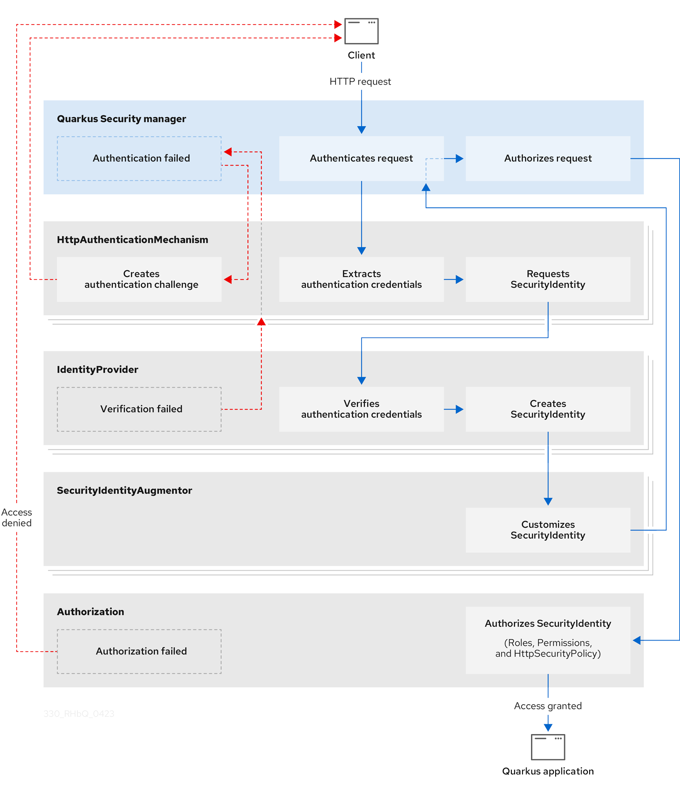

# Quarkus Security architecture

The Quarkus Security architecture provides several built-in authentication mechanisms and is highly customizable. The primary mechanism for securing HTTP applications in Quarkus is the `HttpAuthenticationMechanism` interface.

## Overview of the Quarkus Security architecture

When a client sends an HTTP request, Quarkus Security orchestrates security authentication and authorization by interacting with several built-in core components, including `HttpAuthenticationMechanism`, `IdentityProvider`, and `SecurityIdentityAugmentor`.

The sequential security validation process results in one of three outcomes:

- The HTTP request gets authenticated and authorized, and access to the Quarkus application gets granted.
- The HTTP request authentication fails, and the requester receives a challenge specific to the authentication mechanism, for example, a `401` error, a URL redirect to reauthenticate, or some other custom authentication challenge response. For practical examples of challenge responses, see the Quarkus [Security Tips and Tricks](/guides/security-customization/index.md) guide.
- The HTTP request authorization fails, and the requester gets denied access to the Quarkus application.

The following diagram steps through the detailed process flow of the Quarkus Security architecture:

*The Quarkus Security architecture and process flow*

## Core components of the Quarkus Security architecture

### `HttpAuthenticationMechanism`

Quarkus Security uses `HttpAuthenticationMechanism` to extract the authentication credentials from the HTTP request and delegates them to `IdentityProvider` to convert the credentials to `SecurityIdentity`. For example, the credentials can come from the `Authorization` header, client HTTPS certificates, or cookies.

When Quarkus Security rejects an authentication request, `HttpAuthenticationMechanism` returns an authentication challenge to the client. The type of challenge depends on the authentication mechanism. For example, with the OpenID Connect (OIDC) Authorization Code Flow mechanism, a redirect URL gets generated, and the client is returned to the OpenID Connect provider to authenticate.

### `IdentityProvider`

`IdentityProvider` verifies the authentication credentials and maps them to `SecurityIdentity`, which has the username, roles, original authentication credentials, and other attributes.

You can inject a `SecurityIdentity` instance for every authenticated resource to get the authenticated identity information.

In other contexts, it is possible to have other parallel representations of the same information or parts of it, for example, `SecurityContext` for Jakarta REST or `JsonWebToken` for JSON Web Tokens (JWT).

For more information, see the Quarkus [Identity providers](/guides/security-identity-providers/index.md) guide.

### `SecurityIdentityAugmentor`

Because Quarkus Security is customizable, you can, for example, add authorization roles to `SecurityIdentity` and register and prioritize one or more `SecurityIdentityAugmentor` implementations.

Registered instances of `SecurityIdentityAugmentor` are invoked during the final stage of the security authentication process. For more information, see the [Security Identity Customization](/guides/security-customization/index.md#security-identity-customization) section of the "Security Tips and Tricks" guide.

## Supported authentication mechanisms

The Quarkus Security framework supports multiple authentication mechanisms, which can also be combined. Some supported authentication mechanisms are built into Quarkus, while others require you to add an extension.

To learn about security authentication in Quarkus and the supported mechanisms and protocols, see the Quarkus [Authentication mechanisms in Quarkus](/guides/security-authentication-mechanisms/index.md) guide.

## Proactive authentication

Proactive authentication is enabled in Quarkus by default. The request is always authenticated if an incoming request has a credential, even if the target page does not require authentication. For more information, see the Quarkus [Proactive authentication](/guides/security-proactive-authentication/index.md) guide.

## Quarkus Security customization

Quarkus Security is customizable. You can customize the following core security components of Quarkus:

- `HttpAuthenticationMechanism`
- `IdentityProvider`
- `SecurityIdentityAugmentor`

For more information about customizing Quarkus Security, including reactive security and how to register a security provider, see the Quarkus [Security tips and tricks](/guides/security-customization/index.md) guide.

## References

- [Quarkus Security overview](/guides/security-overview/index.md)
- [Other supported authentication mechanisms](/guides/security-authentication-mechanisms/index.md#other-supported-authentication-mechanisms)
- [Identity providers](/guides/security-identity-providers/index.md)
- [Authorization of web endpoints](/guides/security-authorize-web-endpoints-reference/index.md)
