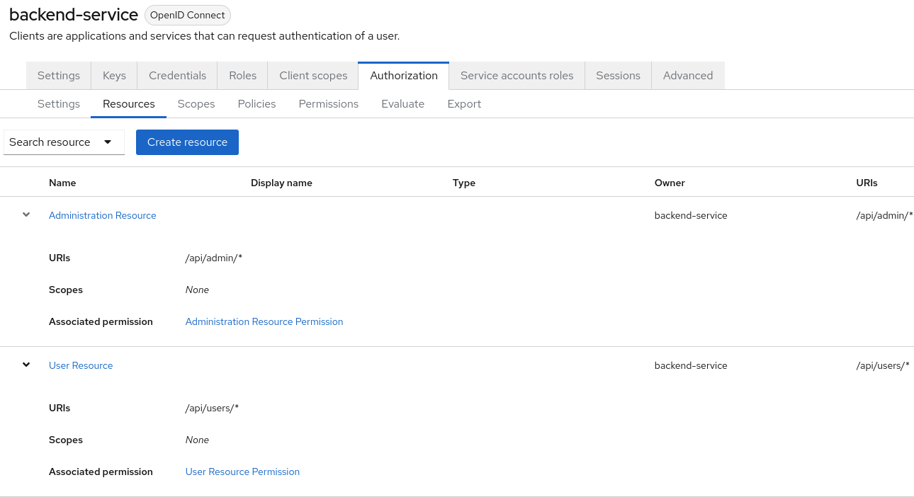
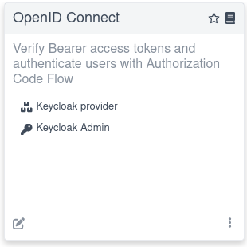

# Using OpenID Connect (OIDC) and Keycloak to centralize authorization

Learn how to enable bearer token authorization in your Quarkus application by using [Keycloak Authorization Services](https://www.keycloak.org/docs/latest/authorization_services/index.html) for secure access to protected resources.

## Overview

The Keycloak Authorization extension, `quarkus-keycloak-authorization`, extends the OpenID Connect extension, `quarkus-oidc`, to provide advanced authorization capabilities. It features a policy enforcer that dynamically manages access to secured resources. Access is governed by permissions defined in Keycloak, supporting flexible and dynamic Resource-Based Access Control (RBAC).

Use the `quarkus-keycloak-authorization` extension only if you are using Keycloak and the Keycloak Authorization Services feature is enabled in your environment to handle authorization decisions.

If you are not using Keycloak, or if Keycloak is configured without the Keycloak Authorization Services feature, use the `quarkus-oidc` extension instead.

The `quarkus-keycloak-authorization` extension centralizes authorization responsibilities in Keycloak, enhancing security and simplifying application maintenance:

- It uses the `quarkus-oidc` extension to verify bearer tokens.
- It sends verified tokens to Keycloak Authorization Services.
- It allows Keycloak to evaluate resource-based permissions dynamically by using attributes such as resource name, identifier, or URI.

By externalizing authorization decisions, you can:

- Implement diverse access control strategies without modifying application code.
- Reduce redeployment needs as security requirements evolve.

This extension is compatible only with Quarkus [OIDC service applications](/guides/security-oidc-bearer-token-authentication/index.md). It complements explicit mechanisms such as role-based access control with dynamic authorization policies.

**Key Features**

- **Centralized Management**: Delegate authorization decisions to Keycloak for consistent security policies across applications.
- **Dynamic Permissions**: Define access control dynamically by using resource attributes.
- **Simplified Maintenance**: Reduce the need to update and redeploy applications when access policies change.

Before using this extension, ensure the following:

1. Keycloak Authorization Services feature is enabled in your Keycloak instance.
2. Your Quarkus application includes the `quarkus-keycloak-authorization` extension.

For detailed steps, see the [OIDC Bearer Token Authentication](/guides/security-oidc-bearer-token-authentication/index.md) guide.

To learn more about Keycloak Authorization Services and the policy enforcer, visit the official documentation: [Keycloak Authorization Services Documentation](https://www.keycloak.org/docs/latest/authorization_services/index.html#_enforcer_overview).

## Prerequisites

To complete this guide, you need:

- Roughly 15 minutes
- An IDE
- JDK 17+ installed with `JAVA_HOME` configured appropriately
- Apache Maven 3.9.16
- A working container runtime (Docker or [Podman](/guides/podman/index.md))
- Optionally the [Quarkus CLI](/guides/cli-tooling/index.md) if you want to use it
- Optionally Mandrel or GraalVM installed and [configured appropriately](/guides/building-native-image/index.md#configuring-graalvm) if you want to build a native executable (or Docker if you use a native container build)

- [jq tool](https://stedolan.github.io/jq/)
- [Keycloak](https://www.keycloak.org)

## Architecture

This example demonstrates a simple microservice setup with two protected endpoints:

- `/api/users/me`
- `/api/admin`

Access to these endpoints is controlled by using bearer tokens. To gain access, the following conditions must be met:

- **Valid token**: The token must have a correct signature, a valid expiration date, and the appropriate audience.
- **Trust**: The microservice must trust the issuing Keycloak server.

The bearer tokens issued by the Keycloak server serve as:

- **User identifiers**: Indicating the subject (user) for whom the token was issued.
- **Client references**: Identifying the client application acting on behalf of the user, per OAuth 2.0 Authorization Server standards.

For `/api/users/me`:

- **Access policy**: Open to users with a valid bearer token and the `user` role.
- **Response**: Returns user details as a JSON object derived from the token.

  .Example response

  ```json
  {
    "user": {
      "id": "1234",
      "username": "johndoe",
      "email": "johndoe@example.com"
    }
  }
  ```


For `/api/admin`:

- **Access policy**: Restricted to users with a valid bearer token and the `admin` role.

This example highlights the use of role-based access control (RBAC) policies to protect resources. Key points include:

- **Policy flexibility**: Keycloak supports various policy types, such as attribute-based and custom policies, enabling fine-grained control.
- **Decoupled application logic**: Authorization policies are managed entirely by Keycloak, allowing your application to focus on its core functionality.

## Solution

Follow the instructions in the next sections to create the application step by step. However, you can go right to the completed example.

Clone the Git repository: `git clone https://github.com/quarkusio/quarkus-quickstarts.git`, or download an [archive](https://github.com/quarkusio/quarkus-quickstarts/archive/main.zip).

The solution is in the `security-keycloak-authorization-quickstart` [directory](https://github.com/quarkusio/quarkus-quickstarts/tree/main/security-keycloak-authorization-quickstart).

## Creating the project

To get started, create a new project by using the following command:

**CLI**

```bash
quarkus create app org.acme:security-keycloak-authorization-quickstart \
    --extension='oidc,keycloak-authorization,rest-jackson' \
    --no-code
cd security-keycloak-authorization-quickstart
```

To create a Gradle project, add the `--gradle` or `--gradle-kotlin-dsl` option.

For more information about how to install and use the Quarkus CLI, see the [Quarkus CLI](/guides/cli-tooling/index.md) guide.

**Maven**

```bash
mvn io.quarkus.platform:quarkus-maven-plugin:3.40.1.2:create \
    -DprojectGroupId=org.acme \
    -DprojectArtifactId=security-keycloak-authorization-quickstart \
    -Dextensions='oidc,keycloak-authorization,rest-jackson' \
    -DnoCode
cd security-keycloak-authorization-quickstart
```

To create a Gradle project, add the `-DbuildTool=gradle` or `-DbuildTool=gradle-kotlin-dsl` option.

For Windows users:

- If using Powershell, wrap `-D` parameters in double quotes e.g. `"-DprojectArtifactId=security-keycloak-authorization-quickstart"`

This command generates a new project with the `keycloak-authorization` extension. The extension integrates a Keycloak Adapter into your Quarkus application, providing the necessary capabilities to interact with a Keycloak server and perform bearer token authorization.

If you already have an existing Quarkus project, you can add the `oidc` and `keycloak-authorization` extensions by running the following command in your project's base directory:

**CLI**

```bash
quarkus extension add oidc,keycloak-authorization
```

**Maven**

```bash
./mvnw quarkus:add-extension -Dextensions='oidc,keycloak-authorization'
```

**Gradle**

```bash
./gradlew addExtension --extensions='oidc,keycloak-authorization'
```

This command adds the following dependencies to your build file:

**pom.xml**

```xml
<dependency>
    <groupId>io.quarkus</groupId>
    <artifactId>quarkus-oidc</artifactId>
</dependency>
<dependency>
    <groupId>io.quarkus</groupId>
    <artifactId>quarkus-keycloak-authorization</artifactId>
</dependency>
```

**build.gradle**

```gradle
implementation("io.quarkus:quarkus-oidc")
implementation("io.quarkus:quarkus-keycloak-authorization")
```

Start by implementing the `/api/users/me` endpoint. The following code defines a Jakarta REST resource that provides user details:

```java
package org.acme.security.keycloak.authorization;

import jakarta.inject.Inject;
import jakarta.ws.rs.GET;
import jakarta.ws.rs.Path;

import org.jboss.resteasy.reactive.NoCache;

import io.quarkus.security.identity.SecurityIdentity;

@Path("/api/users")
public class UsersResource {

    @Inject
    SecurityIdentity identity;

    @GET
    @Path("/me")
    @NoCache
    public User me() {
        return new User(identity);
    }

    public static class User {

        private final String userName;

        User(SecurityIdentity identity) {
            this.userName = identity.getPrincipal().getName();
        }

        public String getUserName() {
            return userName;
        }
    }
}
```

Next, define the `/api/admin` endpoint. The following code represents a simple Jakarta REST resource protected with authentication:

```java
package org.acme.security.keycloak.authorization;

import jakarta.ws.rs.GET;
import jakarta.ws.rs.Path;
import jakarta.ws.rs.Produces;
import jakarta.ws.rs.core.MediaType;

import io.quarkus.security.Authenticated;

@Path("/api/admin")
@Authenticated
public class AdminResource {

    @GET
    @Produces(MediaType.TEXT_PLAIN)
    public String admin() {
        return "granted";
    }
}
```

Notice that explicit annotations such as `@RolesAllowed` are not defined to enforce access control for the resources. Instead, the `keycloak-authorization` extension dynamically maps the URIs of protected resources in Keycloak.

Access control is managed as follows:

- Keycloak evaluates permissions for each request based on its configured policies.
- The extension enforces these permissions, granting or denying access based on the roles or policies defined in Keycloak.

This decouples access control logic from the application code, making it easier to manage and update access policies directly in Keycloak.

## Configuring the application

You can use the OpenID Connect extension to configure the adapter settings through the `application.properties` file, typically located in the `src/main/resources` directory. For example:

```properties
# OIDC Configuration
%prod.quarkus.oidc.auth-server-url=https://localhost:8543/realms/quarkus <1>
quarkus.oidc.client-id=backend-service <2>
quarkus.oidc.credentials.secret=secret <3>
quarkus.oidc.tls.verification=none <4>

# Enable Policy Enforcement
quarkus.keycloak.policy-enforcer.enabled=true <5>

# Import the realm file with Dev Services for Keycloak
# Note: This property is effective only in dev mode, not in JVM or native modes
quarkus.keycloak.devservices.realm-path=quarkus-realm.json <6>
```

1. Specifies the URL of the Keycloak server and the realm used for authentication.
2. Identifies the client application within the Keycloak realm.
3. Defines the client secret for authentication with the Keycloak server.
4. Disables TLS verification for development purposes, not recommended for production.
5. Enables the Keycloak policy enforcer to manage access control based on defined permissions.
6. Configures Dev Services to import a specified realm file, effective only in dev mode and not in JVM or native modes.

> [!NOTE]
> Adding the `%prod.` profile prefix to `quarkus.oidc.auth-server-url` ensures that Dev Services for Keycloak automatically launches a container in development mode. For more details, see the [Running the application in Dev mode](#keycloak-dev-mode) section.

> [!NOTE]
> By default, applications using the `quarkus-oidc` extension are treated as `service` type applications. However, the extension also supports `web-app` type applications under the following conditions:
>
> - The access token returned during the authorization code grant flow must be the source of roles (`quarkus.oidc.roles.source=accesstoken`).
> - Note: For `web-app` type applications, ID token roles are checked by default.

## Starting and configuring the Keycloak server

> [!NOTE]
> Do not start the Keycloak server when you run the application in dev mode. Dev Services for Keycloak launches a container. For more information, see the [Running the application in Dev mode](#keycloak-dev-mode) section.

To start a Keycloak server, use the following Docker command:

```shell
docker run --name keycloak \
  -e KC_BOOTSTRAP_ADMIN_USERNAME=admin \
  -e KC_BOOTSTRAP_ADMIN_PASSWORD=admin \
  -p 8543:8443 \
  -v "$(pwd)"/config/keycloak-keystore.jks:/etc/keycloak-keystore.jks \
  quay.io/keycloak/keycloak:26.7.4 \
  start --hostname-strict=false --https-key-store-file=/etc/keycloak-keystore.jks <1>
```

1. For Keycloak keystore, use the `keycloak-keystore.jks` file located at [quarkus-quickstarts/security-keycloak-authorization-quickstart/config](https://github.com/quarkusio/quarkus-quickstarts/blob/main/security-keycloak-authorization-quickstart/config/keycloak-keystore.jks).

**Accessing the Keycloak server**

1. Open your browser and navigate to <https://localhost:8543>.
2. Log in to the Keycloak Administration Console by using the following credentials: - **Username**: `admin`   - **Password**: `admin`

To create a new realm, import the [realm configuration file](https://github.com/quarkusio/quarkus-quickstarts/tree/main/security-keycloak-authorization-quickstart/config/quarkus-realm.json). For detailed steps on creating realms, refer to the Keycloak documentation: [Create a new realm](https://www.keycloak.org/docs/latest/server_admin/index.html#_create-realm).

After importing the realm, go to Clients, choose the `backend-service` client, and select the Authorization and Resources tab for this client. You can now review the resource permissions:



The resource access permissions are configured directly in Keycloak, which eliminates the need for `@RolesAllowed` annotations in your application code. This approach centralizes access control management within Keycloak, simplifying application maintenance and security updates.

<a id="keycloak-dev-mode"></a>
## Running the application in dev mode

To run the application in development mode, use the following command:

**CLI**

```bash
quarkus dev
```

**Maven**

```bash
./mvnw quarkus:dev
```

**Gradle**

```bash
./gradlew --console=plain quarkusDev
```

[Dev Services for Keycloak](/guides/security-openid-connect-dev-services/index.md) starts a Keycloak container and imports the `quarkus-realm.json` configuration file.

Open a [Dev UI](/guides/dev-ui/index.md) available at [/q/dev-ui](http://localhost:8080/q/dev-ui) and click a **Provider: Keycloak** link on an **OpenID Connect** card in the Dev UI.

**Interacting with Dev UI**

1. Open the [Dev UI](/guides/dev-ui/index.md) at [/q/dev-ui](http://localhost:8080/q/dev-ui).
2. Click the **Provider: Keycloak** link within the **OpenID Connect** card in the Dev UI.

When prompted to log in to a `Single Page Application` provided by `OpenID Connect Dev UI`, do the following:

1. Log in as `alice` (password: `alice`), who only has a `User Permission` to access the `/api/users/me` resource:
   1. Access `/api/admin`, which returns `403`.
   2. Access `/api/users/me`, which returns `200`.
2. Log out and log in as `admin` (password: `admin`), who has both `Admin Permission` to access the `/api/admin` resource and `User Permission` to access the `/api/users/me` resource:
   1. Access `/api/admin`, which returns `200`.
   2. Access `/api/users/me`, which returns `200`.

If you started Dev Services for Keycloak without importing a realm file such as [quarkus-realm.json](https://github.com/quarkusio/quarkus-quickstarts/tree/main/security-keycloak-authorization-quickstart/config/quarkus-realm.json), create a default `quarkus` realm without Keycloak authorization policies:

1. Select the **Keycloak Admin** link from the **OpenID Connect** card in the Dev UI.
2. Log in to the Keycloak admin console. The username and password are both `admin`.
3. Follow the instructions at [Keycloak Authorization Services documentation](https://www.keycloak.org/docs/latest/authorization_services/index.html) to enable authorization policies in the `quarkus` realm.

The **Keycloak Admin** link is easy to find in Dev UI:



If your application uses Keycloak authorization configured with [JavaScript policies](https://www.keycloak.org/docs/latest/authorization_services/index.html#_policy_js) that are deployed in a JAR archive, Dev Services for Keycloak can transfer this archive to the Keycloak container. Use the following properties in `application.properties` to configure the transfer:

```properties
# Alias the policies archive
quarkus.keycloak.devservices.resource-aliases.policies=/policies.jar <1>
# Map the policies archive to a specific location in the container
quarkus.keycloak.devservices.resource-mappings.policies=/opt/keycloak/providers/policies.jar <2>
```

1. Creates a `policies` alias for the `/policies.jar` classpath resource. The policies archive can also be located on the file system.
2. Maps the policies archive to the `/opt/keycloak/providers/policies.jar` location inside the Keycloak container.

## Running the application in JVM mode

After exploring the application in dev mode, you can run it as a standard Java application in JVM mode.

Compile the application:

**CLI**

```bash
quarkus build
```

**Maven**

```bash
./mvnw install
```

**Gradle**

```bash
./gradlew build
```

Run the application:

```shell
java -jar target/quarkus-app/quarkus-run.jar
```

## Running the application in native mode

You can compile this demo into native code; no modifications are required.

Native compilation eliminates the need for a JVM in the production environment because the produced binary includes the runtime and is optimized for minimal resource usage.

Compilation takes longer and is disabled by default. To build the application, enable the `native` profile.

Build the native binary:

**CLI**

```bash
quarkus build --native
```

**Maven**

```bash
./mvnw install -Dnative
```

**Gradle**

```bash
./gradlew build -Dquarkus.native.enabled=true
```

After a while, run the native binary:

```shell
./target/security-keycloak-authorization-quickstart-1.0.0-SNAPSHOT-runner
```

<a id="testing"></a>
## Testing the application

See the preceding [Running the application in Dev mode](#keycloak-dev-mode) section for instructions on testing your application in development mode.

You can test the application running in JVM or native modes by using `curl`.

The application uses bearer token authorization. To access its resources, first obtain an access token from the Keycloak server:

```shell
export access_token=$(\
    curl --insecure -X POST https://localhost:8543/realms/quarkus/protocol/openid-connect/token \
    --user backend-service:secret \
    -H 'content-type: application/x-www-form-urlencoded' \
    -d 'username=alice&password=alice&grant_type=password' | jq --raw-output '.access_token' \
 )
```

> [!NOTE]
> If the `quarkus.oidc.authentication.user-info-required` property is set to `true`, the application requires that an access token is used to request `UserInfo`. In that case, you must add the `scope=openid` query parameter to the token grant request; for example:
>
> ```shell
> export access_token=$(\
>     curl --insecure -X POST http://localhost:8180/realms/quarkus/protocol/openid-connect/token \
>     --user backend-service:secret \
>     -H 'content-type: application/x-www-form-urlencoded' \
>     -d 'username=alice&password=alice&grant_type=password&scope=openid' | jq --raw-output '.access_token' \
>  )
> ```

The preceding example obtains an access token for the user `alice`.

Any user with a valid access token can access the `http://localhost:8080/api/users/me` endpoint, which returns a JSON payload with user details:

```shell
curl -v -X GET \
  http://localhost:8080/api/users/me \
  -H "Authorization: Bearer "$access_token
```

The `http://localhost:8080/api/admin` endpoint is restricted to users with the `admin` role. If you try to access this endpoint with the previously issued access token, the server returns a `403 Forbidden` response:

```shell
curl -v -X GET \
  http://localhost:8080/api/admin \
  -H "Authorization: Bearer "$access_token
```

To access the admin endpoint, get an access token for the `admin` user:

```shell
export access_token=$(\
    curl --insecure -X POST https://localhost:8543/realms/quarkus/protocol/openid-connect/token \
    --user backend-service:secret \
    -H 'content-type: application/x-www-form-urlencoded' \
    -d 'username=admin&password=admin&grant_type=password' | jq --raw-output '.access_token' \
 )
```

## Injecting the authorization client

You can use the [Keycloak Authorization Client Java API](https://www.keycloak.org/docs/latest/authorization_services/#_service_client_api) for advanced tasks, such as managing resources and getting permissions directly from Keycloak. To enable this functionality, inject an `AuthzClient` instance into your beans:

```java
public class ProtectedResource {
    @Inject
    AuthzClient authzClient;
}
```

> [!NOTE]
> To use the `AuthzClient` directly, set `quarkus.keycloak.policy-enforcer.enabled=true`. Otherwise, no bean is available for injection.

## Mapping protected resources

By default, the extension uses lazy loading to fetch resources from Keycloak on demand. It uses the request URI to identify and map application resources that require protection.

To disable lazy loading and instead pre-load all resources at startup, configure the following property:

```properties
quarkus.keycloak.policy-enforcer.lazy-load-paths=false
```

The time required to pre-load resources from Keycloak during startup depends on the number of resources, which might impact your application's initial load time.

## More about configuring protected resources

In the default configuration, Keycloak manages the roles and decides who can access which routes.

To configure the protected routes by using the `@RolesAllowed` annotation or the `application.properties` file, check the [OpenID Connect (OIDC) Bearer token authentication](/guides/security-oidc-bearer-token-authentication/index.md) and [Authorization of web endpoints](/guides/security-authorize-web-endpoints-reference/index.md) guides. For more details, check the [Quarkus Security overview](/guides/security-overview/index.md).

## Access to public resources

To allow access to a public resource without applying `quarkus-keycloak-authorization` policies, define a `permit` HTTP policy in the `application.properties` file. For more information, see the [Authorization of web endpoints](/guides/security-authorize-web-endpoints-reference/index.md) guide.

You do not need to disable policy checks for a Keycloak Authorization Policy when using configurations like the following:

```properties
quarkus.keycloak.policy-enforcer.paths.1.paths=/api/public
quarkus.keycloak.policy-enforcer.paths.1.enforcement-mode=DISABLED
```

To restrict access to public resources for anonymous users, define an enforcing Keycloak Authorization Policy:

```properties
quarkus.keycloak.policy-enforcer.paths.1.paths=/api/public-enforcing
quarkus.keycloak.policy-enforcer.paths.1.enforcement-mode=ENFORCING
```

Only the default tenant configuration applies when controlling anonymous access to the public resource is required.

## Checking permission scopes programmatically

In addition to resource permissions, you can define method scopes. A scope typically represents an action performed on a resource. You can create an enforcing Keycloak Authorization Policy with a method scope. For example:

```properties
# path policy with enforced scope 'read' for method 'GET'
quarkus.keycloak.policy-enforcer.paths.1.name=Scope Permission Resource
quarkus.keycloak.policy-enforcer.paths.1.paths=/api/protected/standard-way
quarkus.keycloak.policy-enforcer.paths.1.methods.get.method=GET
quarkus.keycloak.policy-enforcer.paths.1.methods.get.scopes=read <1>

# path policies without scope
quarkus.keycloak.policy-enforcer.paths.2.name=Scope Permission Resource
quarkus.keycloak.policy-enforcer.paths.2.paths=/api/protected/programmatic-way,/api/protected/annotation-way
```

1. User must have resource permission `Scope Permission Resource` and scope `read`

The Keycloak Policy Enforcer secures the `/api/protected/standard-way` request path, removing the need for annotations such as `@RolesAllowed`. However, in some scenarios, you might need to perform a programmatic check.

You can achieve this by injecting a `SecurityIdentity` instance into your beans, as shown in the following example. Or, you can get the same result by annotating the resource method with `@PermissionsAllowed`. The following example demonstrates three resource methods, each requiring the same `read` scope:

```java
import java.security.BasicPermission;
import java.util.List;

import jakarta.inject.Inject;
import jakarta.ws.rs.ForbiddenException;
import jakarta.ws.rs.GET;
import jakarta.ws.rs.Path;

import org.keycloak.representations.idm.authorization.Permission;

import io.quarkus.security.PermissionsAllowed;
import io.quarkus.security.identity.SecurityIdentity;
import io.smallrye.mutiny.Uni;

@Path("/api/protected")
public class ProtectedResource {

    @Inject
    SecurityIdentity identity;

    @GET
    @Path("/standard-way")
    public Uni<List<Permission>> standardWay() { <1>
        return Uni.createFrom().item(identity.<List<Permission>> getAttribute("permissions"));
    }

    @GET
    @Path("/programmatic-way")
    public Uni<List<Permission>> programmaticWay() {
        var requiredPermission = new BasicPermission("Scope Permission Resource") {
            @Override
            public String getActions() {
                return "read";
            }
        };
        return identity.checkPermission(requiredPermission).onItem() <2>
                .transform(granted -> {
                    if (granted) {
                        return identity.getAttribute("permissions");
                    }
                    throw new ForbiddenException();
                });
    }

    @PermissionsAllowed("Scope Permission Resource:read") <3>
    @GET
    @Path("/annotation-way")
    public Uni<List<Permission>> annotationWay() {
        return Uni.createFrom().item(identity.<List<Permission>> getAttribute("permissions"));
    }
}
```

1. The `/standard-way` sub-path requires both the resource permission and the `read` scope, based on the configuration set in the `application.properties` file.
2. The `/programmatic-way` sub-path checks only for the `Scope Permission Resource` permission by default. However, you can enforce additional constraints, such as scope requirements, by using `SecurityIdentity#checkPermission`.
3. The `@PermissionsAllowed` annotation at `/annotation-way` restricts access to requests that have the `Scope Permission Resource` permission along with the `read` scope. For more information, see the section [Authorization using annotations](/guides/security-authorize-web-endpoints-reference/index.md#standard-security-annotations) of the Authorization of web endpoints guide.

## Multi-tenancy

You can set up policy enforcer configurations for each tenant, similar to how it is done with [OpenID Connect (OIDC) multi-tenancy](/guides/security-openid-connect-multitenancy/index.md). For example:

```properties
quarkus.keycloak.policy-enforcer.enabled=true

# Default Tenant
quarkus.oidc.auth-server-url=${keycloak.url:replaced-by-test-resource}/realms/quarkus
quarkus.oidc.client-id=quarkus-app
quarkus.oidc.credentials.secret=secret

quarkus.keycloak.policy-enforcer.enforcement-mode=PERMISSIVE
quarkus.keycloak.policy-enforcer.paths.1.name=Permission Resource
quarkus.keycloak.policy-enforcer.paths.1.paths=/api/permission
quarkus.keycloak.policy-enforcer.paths.1.claim-information-point.claims.static-claim=static-claim

# Service Tenant

quarkus.oidc.service-tenant.auth-server-url=${keycloak.url:replaced-by-test-resource}/realms/quarkus
quarkus.oidc.service-tenant.client-id=quarkus-app
quarkus.oidc.service-tenant.credentials.secret=secret

quarkus.keycloak.service-tenant.policy-enforcer.enforcement-mode=PERMISSIVE
quarkus.keycloak.service-tenant.policy-enforcer.paths.1.name=Permission Resource Service
quarkus.keycloak.service-tenant.policy-enforcer.paths.1.paths=/api/permission
quarkus.keycloak.service-tenant.policy-enforcer.paths.1.claim-information-point.claims.static-claim=static-claim

# WebApp Tenant

quarkus.oidc.webapp-tenant.auth-server-url=${keycloak.url:replaced-by-test-resource}/realms/quarkus
quarkus.oidc.webapp-tenant.client-id=quarkus-app
quarkus.oidc.webapp-tenant.credentials.secret=secret
quarkus.oidc.webapp-tenant.application-type=web-app
quarkus.oidc.webapp-tenant.roles.source=accesstoken

quarkus.keycloak.webapp-tenant.policy-enforcer.enforcement-mode=PERMISSIVE
quarkus.keycloak.webapp-tenant.policy-enforcer.paths.1.name=Permission Resource WebApp
quarkus.keycloak.webapp-tenant.policy-enforcer.paths.1.paths=/api/permission
quarkus.keycloak.webapp-tenant.policy-enforcer.paths.1.claim-information-point.claims.static-claim=static-claim
```

## Dynamic tenant configuration resolution

To create configurations for multiple tenants while avoiding excessive entries in your configuration file, you can use the `io.quarkus.keycloak.pep.TenantPolicyConfigResolver` interface to define them programmatically at runtime.

```java
package org.acme.security.keycloak.authorization;

import java.util.Map;

import jakarta.enterprise.context.ApplicationScoped;

import io.quarkus.keycloak.pep.TenantPolicyConfigResolver;
import io.quarkus.keycloak.pep.runtime.KeycloakPolicyEnforcerConfig;
import io.quarkus.keycloak.pep.runtime.KeycloakPolicyEnforcerTenantConfig;
import io.quarkus.oidc.OidcRequestContext;
import io.quarkus.oidc.OidcTenantConfig;
import io.smallrye.mutiny.Uni;
import io.vertx.ext.web.RoutingContext;

@ApplicationScoped
public class CustomTenantPolicyConfigResolver implements TenantPolicyConfigResolver {

    private final KeycloakPolicyEnforcerTenantConfig enhancedTenantConfig;
    private final KeycloakPolicyEnforcerTenantConfig newTenantConfig;

    public CustomTenantPolicyConfigResolver(KeycloakPolicyEnforcerConfig enforcerConfig) {
        this.enhancedTenantConfig = KeycloakPolicyEnforcerTenantConfig.builder(enforcerConfig.defaultTenant()) <1>
            .paths("/enhanced-config")
            .permissionName("Permission Name")
            .get("read-scope")
            .build();
        this.newTenantConfig = KeycloakPolicyEnforcerTenantConfig.builder() <2>
            .paths("/new-config")
            .claimInformationPoint(Map.of("claims", Map.of("grant", "{request.parameter['grant']}")))
            .build();
    }

    @Override
    public Uni<KeycloakPolicyEnforcerTenantConfig> resolve(RoutingContext routingContext, OidcTenantConfig tenantConfig,
                                                OidcRequestContext<KeycloakPolicyEnforcerTenantConfig> requestContext) {
        String path = routingContext.normalizedPath();
        String tenantId = tenantConfig.tenantId().orElse(null);
        if ("enhanced-config-tenant".equals(tenantId) && path.equals("/enhanced-config")) {
            return Uni.createFrom().item(enhancedTenantConfig);
        } else if ("new-config-tenant".equals(tenantId) && path.equals("/new-config")) {
            return Uni.createFrom().item(newTenantConfig);
        }
        return Uni.createFrom().nullItem(); <3>
    }
}
```

1. Define or update the `/enhanced-config` path in the default tenant configuration.
2. Add the `/new-config` path to the tenant configuration, including custom claims and values that are populated programmatically.
3. Fallback to the default static tenant configuration resolution defined in the `application.properties` file or other SmallRye Config sources.

## Configuration reference

This configuration adheres to the official [Keycloak Policy Enforcer Configuration](https://www.keycloak.org/docs/latest/authorization_services/index.html#_enforcer_filter) guidelines. For detailed insights into various configuration options, see the following documentation:

[lock] Configuration property fixed at build time - All other configuration properties are overridable at runtime

|  |  |  |
| --- | --- | --- |
| <mark>Configuration property</mark> | Type | Default |
| [lock] <a id="quarkus-keycloak-authorization_quarkus-keycloak-policy-enforcer-enabled"></a> [`quarkus.keycloak.policy-enforcer.enabled`](#quarkus-keycloak-authorization_quarkus-keycloak-policy-enforcer-enabled) config_property_copy_button:+++quarkus.keycloak.policy-enforcer.enabled+++[]<br><br>Enables policy enforcement.<br><br>Environment variable: env_var_with_copy_button:+++QUARKUS_KEYCLOAK_POLICY_ENFORCER_ENABLED+++[] | boolean | `false` |
| <a id="quarkus-keycloak-authorization_quarkus-keycloak-connection-pool-size"></a> [`quarkus.keycloak.connection-pool-size`](#quarkus-keycloak-authorization_quarkus-keycloak-connection-pool-size) config_property_copy_button:+++quarkus.keycloak.connection-pool-size+++[]<br><br>Adapters will make separate HTTP invocations to the Keycloak server to turn an access code into an access token. This config option defines how many connections to the Keycloak server should be pooled<br><br>Environment variable: env_var_with_copy_button:+++QUARKUS_KEYCLOAK_CONNECTION_POOL_SIZE+++[] | int | `20` |
| <a id="quarkus-keycloak-authorization_quarkus-keycloak-policy-enforcer-enforcement-mode"></a> [`quarkus.keycloak.policy-enforcer.enforcement-mode`](#quarkus-keycloak-authorization_quarkus-keycloak-policy-enforcer-enforcement-mode) config_property_copy_button:+++quarkus.keycloak.policy-enforcer.enforcement-mode+++[]<br><br>Specifies how policies are enforced.<br><br>Environment variable: env_var_with_copy_button:+++QUARKUS_KEYCLOAK_POLICY_ENFORCER_ENFORCEMENT_MODE+++[] | `permissive`, `enforcing`, `disabled` | `enforcing` |
| <a id="quarkus-keycloak-authorization_quarkus-keycloak-policy-enforcer-path-cache-max-entries"></a> [`quarkus.keycloak.policy-enforcer.path-cache.max-entries`](#quarkus-keycloak-authorization_quarkus-keycloak-policy-enforcer-path-cache-max-entries) config_property_copy_button:+++quarkus.keycloak.policy-enforcer.path-cache.max-entries+++[]<br><br>Defines the limit of entries that should be kept in the cache<br><br>Environment variable: env_var_with_copy_button:+++QUARKUS_KEYCLOAK_POLICY_ENFORCER_PATH_CACHE_MAX_ENTRIES+++[] | int | `1000` |
| <a id="quarkus-keycloak-authorization_quarkus-keycloak-policy-enforcer-path-cache-lifespan"></a> [`quarkus.keycloak.policy-enforcer.path-cache.lifespan`](#quarkus-keycloak-authorization_quarkus-keycloak-policy-enforcer-path-cache-lifespan) config_property_copy_button:+++quarkus.keycloak.policy-enforcer.path-cache.lifespan+++[]<br><br>Defines the time in milliseconds when the entry should be expired<br><br>Environment variable: env_var_with_copy_button:+++QUARKUS_KEYCLOAK_POLICY_ENFORCER_PATH_CACHE_LIFESPAN+++[] | long | `30000` |
| <a id="quarkus-keycloak-authorization_quarkus-keycloak-policy-enforcer-lazy-load-paths"></a> [`quarkus.keycloak.policy-enforcer.lazy-load-paths`](#quarkus-keycloak-authorization_quarkus-keycloak-policy-enforcer-lazy-load-paths) config_property_copy_button:+++quarkus.keycloak.policy-enforcer.lazy-load-paths+++[]<br><br>Specifies how the adapter should fetch the server for resources associated with paths in your application. If true, the policy enforcer is going to fetch resources on-demand accordingly with the path being requested<br><br>Environment variable: env_var_with_copy_button:+++QUARKUS_KEYCLOAK_POLICY_ENFORCER_LAZY_LOAD_PATHS+++[] | boolean | `true` |
| <a id="quarkus-keycloak-authorization_quarkus-keycloak-policy-enforcer-claim-information-point-complex-config"></a> [`quarkus.keycloak.policy-enforcer.claim-information-point."complex-config"`](#quarkus-keycloak-authorization_quarkus-keycloak-policy-enforcer-claim-information-point-complex-config) config_property_copy_button:+++quarkus.keycloak.policy-enforcer.claim-information-point."complex-config"+++[]<br><br>Complex config.<br><br>Environment variable: env_var_with_copy_button:+++QUARKUS_KEYCLOAK_POLICY_ENFORCER_CLAIM_INFORMATION_POINT__COMPLEX_CONFIG_+++[] | Map\<String,Map\<String,Map\<String,String>>> |  |
| <a id="quarkus-keycloak-authorization_quarkus-keycloak-policy-enforcer-claim-information-point-simple-config"></a> [`quarkus.keycloak.policy-enforcer.claim-information-point."simple-config"`](#quarkus-keycloak-authorization_quarkus-keycloak-policy-enforcer-claim-information-point-simple-config) config_property_copy_button:+++quarkus.keycloak.policy-enforcer.claim-information-point."simple-config"+++[]<br><br>Simple config.<br><br>Environment variable: env_var_with_copy_button:+++QUARKUS_KEYCLOAK_POLICY_ENFORCER_CLAIM_INFORMATION_POINT__SIMPLE_CONFIG_+++[] | Map\<String,Map\<String,String>> |  |
| <a id="quarkus-keycloak-authorization_quarkus-keycloak-policy-enforcer-http-method-as-scope"></a> [`quarkus.keycloak.policy-enforcer.http-method-as-scope`](#quarkus-keycloak-authorization_quarkus-keycloak-policy-enforcer-http-method-as-scope) config_property_copy_button:+++quarkus.keycloak.policy-enforcer.http-method-as-scope+++[]<br><br>Specifies how scopes should be mapped to HTTP methods. If set to true, the policy enforcer will use the HTTP method from the current request to check whether access should be granted<br><br>Environment variable: env_var_with_copy_button:+++QUARKUS_KEYCLOAK_POLICY_ENFORCER_HTTP_METHOD_AS_SCOPE+++[] | boolean | `false` |
| <a id="quarkus-keycloak-authorization_quarkus-keycloak-policy-enforcer-paths-paths-name"></a> [`quarkus.keycloak.policy-enforcer.paths."paths".name`](#quarkus-keycloak-authorization_quarkus-keycloak-policy-enforcer-paths-paths-name) config_property_copy_button:+++quarkus.keycloak.policy-enforcer.paths."paths".name+++[]<br><br>The name of a resource on the server that is to be associated with a given path<br><br>Environment variable: env_var_with_copy_button:+++QUARKUS_KEYCLOAK_POLICY_ENFORCER_PATHS__PATHS__NAME+++[] | string |  |
| <a id="quarkus-keycloak-authorization_quarkus-keycloak-policy-enforcer-paths-paths-paths"></a> [`quarkus.keycloak.policy-enforcer.paths."paths".paths`](#quarkus-keycloak-authorization_quarkus-keycloak-policy-enforcer-paths-paths-paths) config_property_copy_button:+++quarkus.keycloak.policy-enforcer.paths."paths".paths+++[]<br><br>HTTP request paths that should be protected by the policy enforcer<br><br>Environment variable: env_var_with_copy_button:+++QUARKUS_KEYCLOAK_POLICY_ENFORCER_PATHS__PATHS__PATHS+++[] | list of string |  |
| <a id="quarkus-keycloak-authorization_quarkus-keycloak-policy-enforcer-paths-paths-methods-methods-method"></a> [`quarkus.keycloak.policy-enforcer.paths."paths".methods."methods".method`](#quarkus-keycloak-authorization_quarkus-keycloak-policy-enforcer-paths-paths-methods-methods-method) config_property_copy_button:+++quarkus.keycloak.policy-enforcer.paths."paths".methods."methods".method+++[]<br><br>The name of the HTTP method<br><br>Environment variable: env_var_with_copy_button:+++QUARKUS_KEYCLOAK_POLICY_ENFORCER_PATHS__PATHS__METHODS__METHODS__METHOD+++[] | string | required [exclamation circle] |
| <a id="quarkus-keycloak-authorization_quarkus-keycloak-policy-enforcer-paths-paths-methods-methods-scopes"></a> [`quarkus.keycloak.policy-enforcer.paths."paths".methods."methods".scopes`](#quarkus-keycloak-authorization_quarkus-keycloak-policy-enforcer-paths-paths-methods-methods-scopes) config_property_copy_button:+++quarkus.keycloak.policy-enforcer.paths."paths".methods."methods".scopes+++[]<br><br>An array of strings with the scopes associated with the method<br><br>Environment variable: env_var_with_copy_button:+++QUARKUS_KEYCLOAK_POLICY_ENFORCER_PATHS__PATHS__METHODS__METHODS__SCOPES+++[] | list of string | required [exclamation circle] |
| <a id="quarkus-keycloak-authorization_quarkus-keycloak-policy-enforcer-paths-paths-methods-methods-scopes-enforcement-mode"></a> [`quarkus.keycloak.policy-enforcer.paths."paths".methods."methods".scopes-enforcement-mode`](#quarkus-keycloak-authorization_quarkus-keycloak-policy-enforcer-paths-paths-methods-methods-scopes-enforcement-mode) config_property_copy_button:+++quarkus.keycloak.policy-enforcer.paths."paths".methods."methods".scopes-enforcement-mode+++[]<br><br>A string referencing the enforcement mode for the scopes associated with a method<br><br>Environment variable: env_var_with_copy_button:+++QUARKUS_KEYCLOAK_POLICY_ENFORCER_PATHS__PATHS__METHODS__METHODS__SCOPES_ENFORCEMENT_MODE+++[] | `all`, `any`, `disabled` | `all` |
| <a id="quarkus-keycloak-authorization_quarkus-keycloak-policy-enforcer-paths-paths-enforcement-mode"></a> [`quarkus.keycloak.policy-enforcer.paths."paths".enforcement-mode`](#quarkus-keycloak-authorization_quarkus-keycloak-policy-enforcer-paths-paths-enforcement-mode) config_property_copy_button:+++quarkus.keycloak.policy-enforcer.paths."paths".enforcement-mode+++[]<br><br>Specifies how policies are enforced<br><br>Environment variable: env_var_with_copy_button:+++QUARKUS_KEYCLOAK_POLICY_ENFORCER_PATHS__PATHS__ENFORCEMENT_MODE+++[] | `permissive`, `enforcing`, `disabled` | `enforcing` |
| <a id="quarkus-keycloak-authorization_quarkus-keycloak-policy-enforcer-paths-paths-claim-information-point-complex-config"></a> [`quarkus.keycloak.policy-enforcer.paths."paths".claim-information-point."complex-config"`](#quarkus-keycloak-authorization_quarkus-keycloak-policy-enforcer-paths-paths-claim-information-point-complex-config) config_property_copy_button:+++quarkus.keycloak.policy-enforcer.paths."paths".claim-information-point."complex-config"+++[]<br><br>Complex config.<br><br>Environment variable: env_var_with_copy_button:+++QUARKUS_KEYCLOAK_POLICY_ENFORCER_PATHS__PATHS__CLAIM_INFORMATION_POINT__COMPLEX_CONFIG_+++[] | Map\<String,Map\<String,Map\<String,String>>> |  |
| <a id="quarkus-keycloak-authorization_quarkus-keycloak-policy-enforcer-paths-paths-claim-information-point-simple-config"></a> [`quarkus.keycloak.policy-enforcer.paths."paths".claim-information-point."simple-config"`](#quarkus-keycloak-authorization_quarkus-keycloak-policy-enforcer-paths-paths-claim-information-point-simple-config) config_property_copy_button:+++quarkus.keycloak.policy-enforcer.paths."paths".claim-information-point."simple-config"+++[]<br><br>Simple config.<br><br>Environment variable: env_var_with_copy_button:+++QUARKUS_KEYCLOAK_POLICY_ENFORCER_PATHS__PATHS__CLAIM_INFORMATION_POINT__SIMPLE_CONFIG_+++[] | Map\<String,Map\<String,String>> |  |
| [lock] <a id="quarkus-keycloak-authorization_quarkus-keycloak-policy-enforcer-enable"></a> <mark>link:#quarkus-keycloak-authorization_quarkus-keycloak-policy-enforcer-enable\[`quarkus.keycloak.policy-enforcer.enable`\]</mark> config_property_copy_button:+++quarkus.keycloak.policy-enforcer.enable+++[]<br><br>*This property is deprecated since `3.26`: use `quarkus.keycloak.policy-enforcer.enabled` instead.*<br><br>Enables policy enforcement.<br><br>Environment variable: env_var_with_copy_button:+++QUARKUS_KEYCLOAK_POLICY_ENFORCER_ENABLE+++[] | boolean |  |
| <a id="quarkus-keycloak-authorization_quarkus-keycloak-policy-enforcer-paths-paths-path"></a> <mark>link:#quarkus-keycloak-authorization_quarkus-keycloak-policy-enforcer-paths-paths-path\[`quarkus.keycloak.policy-enforcer.paths."paths".path`\]</mark> config_property_copy_button:+++quarkus.keycloak.policy-enforcer.paths."paths".path+++[]<br><br>*This property is deprecated since `Quarkus 3.10`.*<br><br>A URI relative to the application’s context path that should be protected by the policy enforcer<br><br>Environment variable: env_var_with_copy_button:+++QUARKUS_KEYCLOAK_POLICY_ENFORCER_PATHS__PATHS__PATH+++[] | string |  |
| <a id="quarkus-keycloak-authorization_section_quarkus-keycloak"></a> [Additional named tenants](#quarkus-keycloak-authorization_section_quarkus-keycloak) | Type | Default |
| <a id="quarkus-keycloak-authorization_quarkus-keycloak-tenant-connection-pool-size"></a> [`quarkus.keycloak."tenant".connection-pool-size`](#quarkus-keycloak-authorization_quarkus-keycloak-tenant-connection-pool-size) config_property_copy_button:+++quarkus.keycloak."tenant".connection-pool-size+++[]<br><br>Adapters will make separate HTTP invocations to the Keycloak server to turn an access code into an access token. This config option defines how many connections to the Keycloak server should be pooled<br><br>Environment variable: env_var_with_copy_button:+++QUARKUS_KEYCLOAK__TENANT__CONNECTION_POOL_SIZE+++[] | int | `20` |
| <a id="quarkus-keycloak-authorization_quarkus-keycloak-tenant-policy-enforcer-enforcement-mode"></a> [`quarkus.keycloak."tenant".policy-enforcer.enforcement-mode`](#quarkus-keycloak-authorization_quarkus-keycloak-tenant-policy-enforcer-enforcement-mode) config_property_copy_button:+++quarkus.keycloak."tenant".policy-enforcer.enforcement-mode+++[]<br><br>Specifies how policies are enforced.<br><br>Environment variable: env_var_with_copy_button:+++QUARKUS_KEYCLOAK__TENANT__POLICY_ENFORCER_ENFORCEMENT_MODE+++[] | `permissive`, `enforcing`, `disabled` | `enforcing` |
| <a id="quarkus-keycloak-authorization_quarkus-keycloak-tenant-policy-enforcer-paths-paths-name"></a> [`quarkus.keycloak."tenant".policy-enforcer.paths."paths".name`](#quarkus-keycloak-authorization_quarkus-keycloak-tenant-policy-enforcer-paths-paths-name) config_property_copy_button:+++quarkus.keycloak."tenant".policy-enforcer.paths."paths".name+++[]<br><br>The name of a resource on the server that is to be associated with a given path<br><br>Environment variable: env_var_with_copy_button:+++QUARKUS_KEYCLOAK__TENANT__POLICY_ENFORCER_PATHS__PATHS__NAME+++[] | string |  |
| <a id="quarkus-keycloak-authorization_quarkus-keycloak-tenant-policy-enforcer-paths-paths-paths"></a> [`quarkus.keycloak."tenant".policy-enforcer.paths."paths".paths`](#quarkus-keycloak-authorization_quarkus-keycloak-tenant-policy-enforcer-paths-paths-paths) config_property_copy_button:+++quarkus.keycloak."tenant".policy-enforcer.paths."paths".paths+++[]<br><br>HTTP request paths that should be protected by the policy enforcer<br><br>Environment variable: env_var_with_copy_button:+++QUARKUS_KEYCLOAK__TENANT__POLICY_ENFORCER_PATHS__PATHS__PATHS+++[] | list of string |  |
| <a id="quarkus-keycloak-authorization_quarkus-keycloak-tenant-policy-enforcer-paths-paths-methods-methods-method"></a> [`quarkus.keycloak."tenant".policy-enforcer.paths."paths".methods."methods".method`](#quarkus-keycloak-authorization_quarkus-keycloak-tenant-policy-enforcer-paths-paths-methods-methods-method) config_property_copy_button:+++quarkus.keycloak."tenant".policy-enforcer.paths."paths".methods."methods".method+++[]<br><br>The name of the HTTP method<br><br>Environment variable: env_var_with_copy_button:+++QUARKUS_KEYCLOAK__TENANT__POLICY_ENFORCER_PATHS__PATHS__METHODS__METHODS__METHOD+++[] | string | required [exclamation circle] |
| <a id="quarkus-keycloak-authorization_quarkus-keycloak-tenant-policy-enforcer-paths-paths-methods-methods-scopes"></a> [`quarkus.keycloak."tenant".policy-enforcer.paths."paths".methods."methods".scopes`](#quarkus-keycloak-authorization_quarkus-keycloak-tenant-policy-enforcer-paths-paths-methods-methods-scopes) config_property_copy_button:+++quarkus.keycloak."tenant".policy-enforcer.paths."paths".methods."methods".scopes+++[]<br><br>An array of strings with the scopes associated with the method<br><br>Environment variable: env_var_with_copy_button:+++QUARKUS_KEYCLOAK__TENANT__POLICY_ENFORCER_PATHS__PATHS__METHODS__METHODS__SCOPES+++[] | list of string | required [exclamation circle] |
| <a id="quarkus-keycloak-authorization_quarkus-keycloak-tenant-policy-enforcer-paths-paths-methods-methods-scopes-enforcement-mode"></a> [`quarkus.keycloak."tenant".policy-enforcer.paths."paths".methods."methods".scopes-enforcement-mode`](#quarkus-keycloak-authorization_quarkus-keycloak-tenant-policy-enforcer-paths-paths-methods-methods-scopes-enforcement-mode) config_property_copy_button:+++quarkus.keycloak."tenant".policy-enforcer.paths."paths".methods."methods".scopes-enforcement-mode+++[]<br><br>A string referencing the enforcement mode for the scopes associated with a method<br><br>Environment variable: env_var_with_copy_button:+++QUARKUS_KEYCLOAK__TENANT__POLICY_ENFORCER_PATHS__PATHS__METHODS__METHODS__SCOPES_ENFORCEMENT_MODE+++[] | `all`, `any`, `disabled` | `all` |
| <a id="quarkus-keycloak-authorization_quarkus-keycloak-tenant-policy-enforcer-paths-paths-enforcement-mode"></a> [`quarkus.keycloak."tenant".policy-enforcer.paths."paths".enforcement-mode`](#quarkus-keycloak-authorization_quarkus-keycloak-tenant-policy-enforcer-paths-paths-enforcement-mode) config_property_copy_button:+++quarkus.keycloak."tenant".policy-enforcer.paths."paths".enforcement-mode+++[]<br><br>Specifies how policies are enforced<br><br>Environment variable: env_var_with_copy_button:+++QUARKUS_KEYCLOAK__TENANT__POLICY_ENFORCER_PATHS__PATHS__ENFORCEMENT_MODE+++[] | `permissive`, `enforcing`, `disabled` | `enforcing` |
| <a id="quarkus-keycloak-authorization_quarkus-keycloak-tenant-policy-enforcer-paths-paths-claim-information-point-complex-config"></a> [`quarkus.keycloak."tenant".policy-enforcer.paths."paths".claim-information-point."complex-config"`](#quarkus-keycloak-authorization_quarkus-keycloak-tenant-policy-enforcer-paths-paths-claim-information-point-complex-config) config_property_copy_button:+++quarkus.keycloak."tenant".policy-enforcer.paths."paths".claim-information-point."complex-config"+++[]<br><br>Complex config.<br><br>Environment variable: env_var_with_copy_button:+++QUARKUS_KEYCLOAK__TENANT__POLICY_ENFORCER_PATHS__PATHS__CLAIM_INFORMATION_POINT__COMPLEX_CONFIG_+++[] | Map\<String,Map\<String,Map\<String,String>>> |  |
| <a id="quarkus-keycloak-authorization_quarkus-keycloak-tenant-policy-enforcer-paths-paths-claim-information-point-simple-config"></a> [`quarkus.keycloak."tenant".policy-enforcer.paths."paths".claim-information-point."simple-config"`](#quarkus-keycloak-authorization_quarkus-keycloak-tenant-policy-enforcer-paths-paths-claim-information-point-simple-config) config_property_copy_button:+++quarkus.keycloak."tenant".policy-enforcer.paths."paths".claim-information-point."simple-config"+++[]<br><br>Simple config.<br><br>Environment variable: env_var_with_copy_button:+++QUARKUS_KEYCLOAK__TENANT__POLICY_ENFORCER_PATHS__PATHS__CLAIM_INFORMATION_POINT__SIMPLE_CONFIG_+++[] | Map\<String,Map\<String,String>> |  |
| <a id="quarkus-keycloak-authorization_quarkus-keycloak-tenant-policy-enforcer-path-cache-max-entries"></a> [`quarkus.keycloak."tenant".policy-enforcer.path-cache.max-entries`](#quarkus-keycloak-authorization_quarkus-keycloak-tenant-policy-enforcer-path-cache-max-entries) config_property_copy_button:+++quarkus.keycloak."tenant".policy-enforcer.path-cache.max-entries+++[]<br><br>Defines the limit of entries that should be kept in the cache<br><br>Environment variable: env_var_with_copy_button:+++QUARKUS_KEYCLOAK__TENANT__POLICY_ENFORCER_PATH_CACHE_MAX_ENTRIES+++[] | int | `1000` |
| <a id="quarkus-keycloak-authorization_quarkus-keycloak-tenant-policy-enforcer-path-cache-lifespan"></a> [`quarkus.keycloak."tenant".policy-enforcer.path-cache.lifespan`](#quarkus-keycloak-authorization_quarkus-keycloak-tenant-policy-enforcer-path-cache-lifespan) config_property_copy_button:+++quarkus.keycloak."tenant".policy-enforcer.path-cache.lifespan+++[]<br><br>Defines the time in milliseconds when the entry should be expired<br><br>Environment variable: env_var_with_copy_button:+++QUARKUS_KEYCLOAK__TENANT__POLICY_ENFORCER_PATH_CACHE_LIFESPAN+++[] | long | `30000` |
| <a id="quarkus-keycloak-authorization_quarkus-keycloak-tenant-policy-enforcer-lazy-load-paths"></a> [`quarkus.keycloak."tenant".policy-enforcer.lazy-load-paths`](#quarkus-keycloak-authorization_quarkus-keycloak-tenant-policy-enforcer-lazy-load-paths) config_property_copy_button:+++quarkus.keycloak."tenant".policy-enforcer.lazy-load-paths+++[]<br><br>Specifies how the adapter should fetch the server for resources associated with paths in your application. If true, the policy enforcer is going to fetch resources on-demand accordingly with the path being requested<br><br>Environment variable: env_var_with_copy_button:+++QUARKUS_KEYCLOAK__TENANT__POLICY_ENFORCER_LAZY_LOAD_PATHS+++[] | boolean | `true` |
| <a id="quarkus-keycloak-authorization_quarkus-keycloak-tenant-policy-enforcer-claim-information-point-complex-config"></a> [`quarkus.keycloak."tenant".policy-enforcer.claim-information-point."complex-config"`](#quarkus-keycloak-authorization_quarkus-keycloak-tenant-policy-enforcer-claim-information-point-complex-config) config_property_copy_button:+++quarkus.keycloak."tenant".policy-enforcer.claim-information-point."complex-config"+++[]<br><br>Complex config.<br><br>Environment variable: env_var_with_copy_button:+++QUARKUS_KEYCLOAK__TENANT__POLICY_ENFORCER_CLAIM_INFORMATION_POINT__COMPLEX_CONFIG_+++[] | Map\<String,Map\<String,Map\<String,String>>> |  |
| <a id="quarkus-keycloak-authorization_quarkus-keycloak-tenant-policy-enforcer-claim-information-point-simple-config"></a> [`quarkus.keycloak."tenant".policy-enforcer.claim-information-point."simple-config"`](#quarkus-keycloak-authorization_quarkus-keycloak-tenant-policy-enforcer-claim-information-point-simple-config) config_property_copy_button:+++quarkus.keycloak."tenant".policy-enforcer.claim-information-point."simple-config"+++[]<br><br>Simple config.<br><br>Environment variable: env_var_with_copy_button:+++QUARKUS_KEYCLOAK__TENANT__POLICY_ENFORCER_CLAIM_INFORMATION_POINT__SIMPLE_CONFIG_+++[] | Map\<String,Map\<String,String>> |  |
| <a id="quarkus-keycloak-authorization_quarkus-keycloak-tenant-policy-enforcer-http-method-as-scope"></a> [`quarkus.keycloak."tenant".policy-enforcer.http-method-as-scope`](#quarkus-keycloak-authorization_quarkus-keycloak-tenant-policy-enforcer-http-method-as-scope) config_property_copy_button:+++quarkus.keycloak."tenant".policy-enforcer.http-method-as-scope+++[]<br><br>Specifies how scopes should be mapped to HTTP methods. If set to true, the policy enforcer will use the HTTP method from the current request to check whether access should be granted<br><br>Environment variable: env_var_with_copy_button:+++QUARKUS_KEYCLOAK__TENANT__POLICY_ENFORCER_HTTP_METHOD_AS_SCOPE+++[] | boolean | `false` |

## References

- [Keycloak documentation](https://www.keycloak.org/documentation.html)
- [Keycloak Authorization Services](https://www.keycloak.org/docs/latest/authorization_services/index.html)
- [OpenID Connect](https://openid.net/developers/how-connect-works/)
- [JSON Web Token](https://datatracker.ietf.org/doc/html/rfc7519)
- [Quarkus Security overview](/guides/security-overview/index.md)
- [Quarkus Keycloak Admin Client](/guides/security-keycloak-admin-client/index.md)
