# Protect a Quarkus web application by using an Auth0 OpenID Connect provider

[Quarkus Security](/guides/security-architecture/index.md) provides comprehensive OpenId Connect (OIDC) and OAuth2 support with its `quarkus-oidc` extension, supporting both [Authorization code flow](/guides/security-oidc-code-flow-authentication/index.md) and [Bearer token](/guides/security-oidc-bearer-token-authentication/index.md) authentication mechanisms.

With Quarkus, you can easily configure OIDC providers such as [Keycloak](https://www.keycloak.org/documentation), [Okta](https://developer.okta.com/), [Auth0](https://auth0.com/docs/), and other [well-known social OIDC and OAuth2 providers](/guides/security-openid-connect-providers/index.md).

Learn how to use the Quarkus OpenID Connect extension (`quarkus-oidc`) together with the [Auth0](https://auth0.com/docs/) OIDC provider to protect your API endpoints.

## Prerequisites

Review the following documentation before you begin:

- [Auth0 docs site](https://auth0.com/docs/)
- [Quarkus OpenID Connect Authorization code flow mechanism for protecting web applications](/guides/security-oidc-code-flow-authentication/index.md)
- [Quarkus OpenID Connect (OIDC) Bearer token authentication](/guides/security-oidc-bearer-token-authentication/index.md)

## Create an Auth0 application

Go to the Auth0 dashboard and create a regular web application. For example, create an Auth0 application called `QuarkusAuth0`.

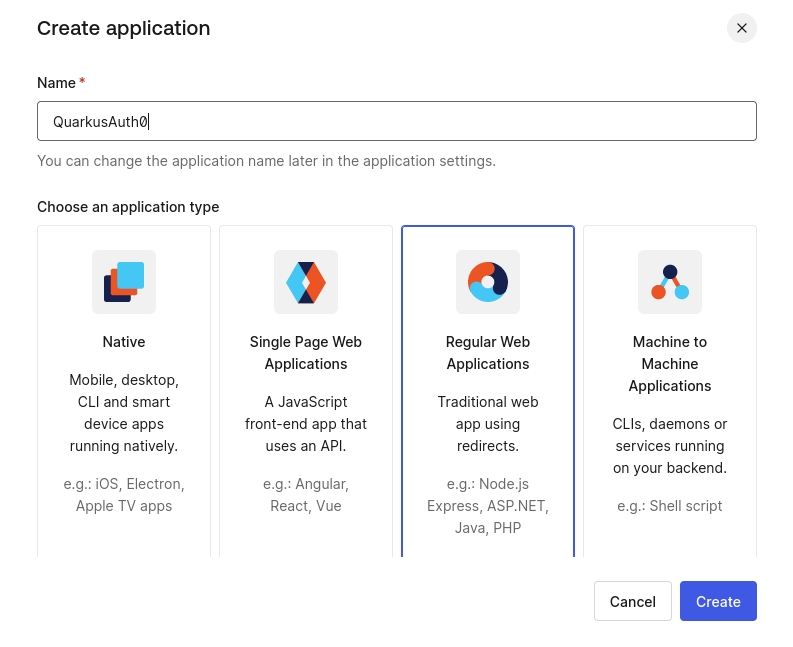

Your Auth0 application gets created with a client ID, secret, and HTTPS-based domain. Make a note of these properties because you will need them to complete the Quarkus configuration in the next step.

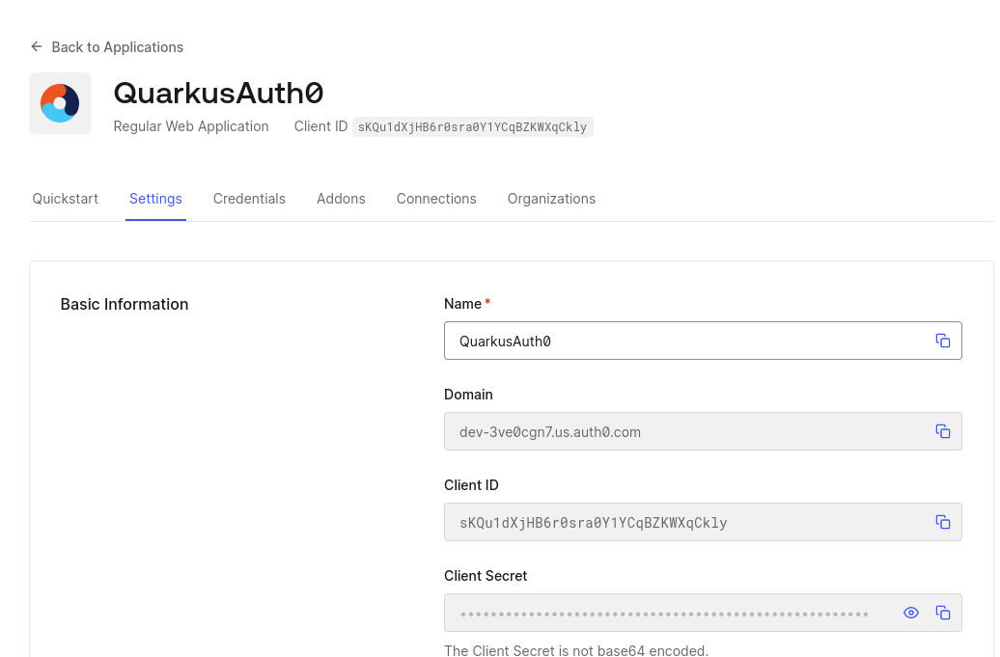

Next, while still in the Auth0 dashboard, add some users to your application.

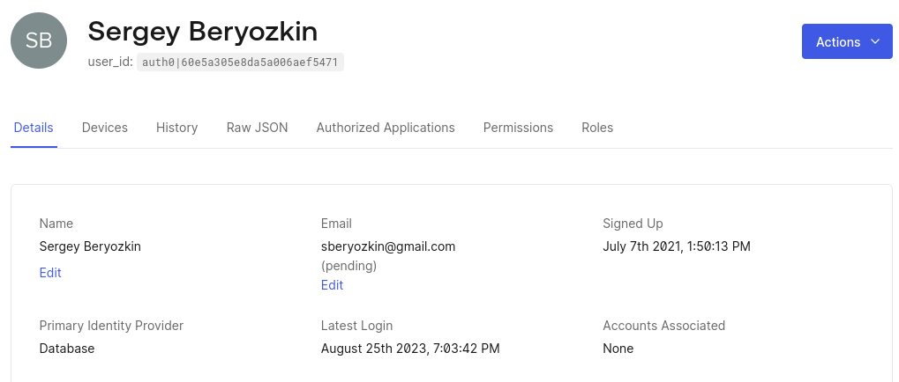

Now that you have successfully created and configured your Auth0 application, you are ready to start creating and configuring a Quarkus endpoint. In the steps that follow, you will continue to configure and update the Auth0 application as well.

## Create a Quarkus application

Use the following Maven command to create a Quarkus REST (formerly RESTEasy Reactive) application that can be secured with the Quarkus OIDC extension.

**CLI**

```bash
quarkus create app org.acme:quarkus-auth0 \
    --extension='rest,oidc' \
    --no-code
cd quarkus-auth0
```

To create a Gradle project, add the `--gradle` or `--gradle-kotlin-dsl` option.

For more information about how to install and use the Quarkus CLI, see the [Quarkus CLI](/guides/cli-tooling/index.md) guide.

**Maven**

```bash
mvn io.quarkus.platform:quarkus-maven-plugin:3.40.1.2:create \
    -DprojectGroupId=org.acme \
    -DprojectArtifactId=quarkus-auth0 \
    -Dextensions='rest,oidc' \
    -DnoCode
cd quarkus-auth0
```

To create a Gradle project, add the `-DbuildTool=gradle` or `-DbuildTool=gradle-kotlin-dsl` option.

For Windows users:

- If using Powershell, wrap `-D` parameters in double quotes e.g. `"-DprojectArtifactId=quarkus-auth0"`

Create the application workspace and import it into your favorite IDE. Let's add a Jakarta REST endpoint that can only be accessed by authenticated users:

```java
package org.acme;

import org.eclipse.microprofile.jwt.JsonWebToken;

import io.quarkus.oidc.IdToken;
import io.quarkus.security.Authenticated;
import jakarta.inject.Inject;
import jakarta.ws.rs.GET;
import jakarta.ws.rs.Path;
import jakarta.ws.rs.Produces;
import jakarta.ws.rs.core.MediaType;

@Path("/hello")
public class GreetingResource {

    @Inject
    @IdToken <1>
    JsonWebToken idToken;

    @GET
    @Authenticated <2>
    @Produces(MediaType.TEXT_PLAIN)
    public String hello() {
        return "Hello, " + idToken.getName();
    }
}
```

1. The injected `JsonWebToken` (JWT) bean has an `@IdToken` qualifier, which means it represents not an access token but OIDC `ID token`. `IdToken` provides information in the form of claims about the current user authenticated during the OIDC authorization code flow and you can use `JsonWebToken` API to access these claims.
2. The `io.quarkus.security.Authenticated` annotation is added to the `hello()` method, which means that only authenticated users can access it.

> [!NOTE]
> The access token acquired during the authorization code flow, alongside the ID token, is not used directly by the endpoint but is used only to access downstream services on behalf of the currently authenticated user. More to come on the topic of "access tokens", later in this tutorial.

Configure OIDC in the Quarkus `application.properties` file  by using the properties from the Auth0 application that you created earlier.

```configuration
# Make sure the application domain is prefixed with 'https://'
quarkus.oidc.auth-server-url=https://dev-3ve0cgn7.us.auth0.com
quarkus.oidc.application-type=web-app
quarkus.oidc.client-id=sKQu1dXjHB6r0sra0Y1YCqBZKWXqCkly
quarkus.oidc.credentials.secret=${client-secret}
```

In completing this step, you have just configured Quarkus to use the domain, client ID, and secret of your Auth0 application. Setting the property `quarkus.oidc.application-type=web-app` instructs Quarkus to use the OIDC authorization code flow, but there are also other methods, which are discussed later on in the tutorial.

The endpoint address will be  <http://localhost:8080/hello>, which must also be registered as an allowed callback URL in your Auth0 application.

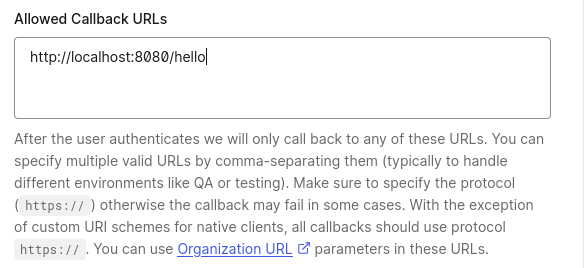

After completing this step, when you access the Quarkus <http://localhost:8080/hello> endpoint from a browser, Auth0 redirects you back to the same address after the authentication is completed.

> [!NOTE]
> By default, Quarkus automatically uses the current request path as the callback path. But you can override the default behavior and configure a specific callback path by setting the Quarkus `quarkus.oidc.authentication.redirect-path` property.
>
> In production, your application will most likely have a larger URL space, with multiple endpoint addresses available. In such cases, you can set a dedicated callback (redirect) path and register this URL in the provider's dashboard, as outlined in the following configuration example:
>
> `quarkus.oidc.authentication.redirect-path=/authenticated-welcome`
>
> In the example scenario, Quarkus calls `/authenticated-welcome` after accepting a redirect from Auth0, completing the authorization code flow,  and creating the session cookie. Successfully authenticated users are also allowed to access other parts of the secured application space, without needing to authenticate again. For example, the endpoint callback method can use a JAX-RS API to redirect users to other parts of the secured application where a session cookie will be verified.

Now you are ready to start testing the endpoint.

## Test the Quarkus endpoint

Start Quarkus in dev mode:

```bash
$ mvn quarkus:dev
```

> [!NOTE]
> This is the only time during this tutorial when you are expected to manually start Quarkus in dev mode. The configuration and code update steps in the remaining sections of this tutorial are automatically observed and processed by Quarkus without you needing to restart the application manually.

Open the browser and access <http://localhost:8080/hello>.

You will be redirected to Auth0 and prompted to log in:

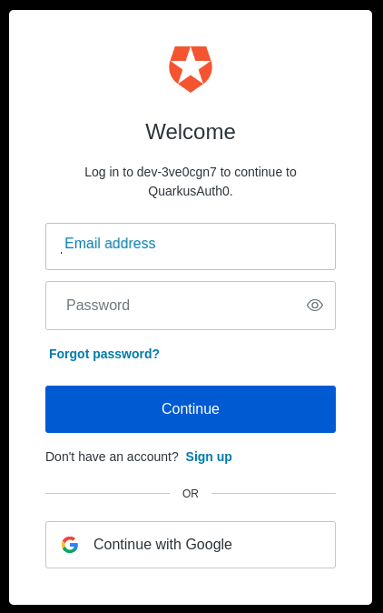

and authorize the `QuarkusAuth0` application to access your account:

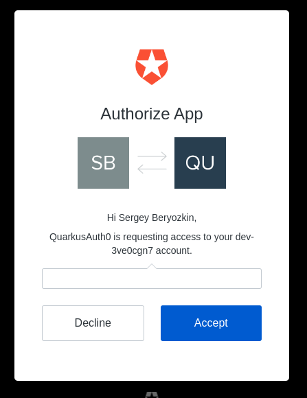

Finally, you will be redirected back to the Quarkus endpoint which will return the following response: `Hello, auth0|60e5a305e8da5a006aef5471`

> [!TIP]
> Notice that the current username does not get returned. To learn more about why this behavior occurs, you can use OIDC Dev UI as explained in the [Dev UI for all OpenID Connect Providers](/guides/security-openid-connect-dev-services/index.md#dev-ui-all-oidc-providers) section of the "Dev Services and UI for OpenID Connect (OIDC)" guide and the following section.

## Looking at Auth0 tokens in the OIDC Dev UI

Quarkus provides a great [Dev UI](/guides/dev-ui/index.md) experience. Specifically, Quarkus offers built-in support for developing and testing OIDC endpoints with a Keycloak container. [DevService for Keycloak](/guides/security-openid-connect-dev-services/index.md#dev-services-for-keycloak) is automatically started and used if the address of the OIDC provider is not specified for the Quarkus `quarkus.oidc.auth-server-url` configuration property.

You can continue using the Quarkus OIDC Dev UI when the provider is already configured. Use the following instructions to update your configuration:

First, change your Quarkus application type from `web-app` to `hybrid`, as follows:

```configuration
quarkus.oidc.auth-server-url=https://dev-3ve0cgn7.us.auth0.com
quarkus.oidc.application-type=hybrid <1>
quarkus.oidc.client-id=sKQu1dXjHB6r0sra0Y1YCqBZKWXqCkly
quarkus.oidc.credentials.secret=${client-secret}
```

1. Application type is changed to `hybrid` because OIDC Dev UI currently supports `SPA` (single-page application) mode only. OIDC Dev UI single-page application, using its own Java Script, authenticates users to the OIDC provider and uses the access token as a Bearer token to access the Quarkus endpoint as a service.

Typically, Quarkus must be configured with `quarkus.oidc.application-type=service` to support `Bearer` token authentication, but it also supports a `hybrid` application type, which means it can support both the authorization code and bearer token flows at the same time.

You also need to configure the Auth0 application to allow the callbacks to the OIDC Dev UI. Use the following URL format:

`http://localhost:8080/q/dev-ui/quarkus-oidc/${provider-name}-provider`

- Where in this example, the `${provider-name}` is `auth0`

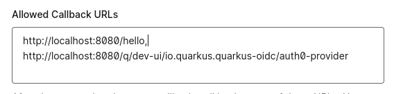

Now you are ready to use OIDC Dev UI with Auth0.

Open <http://localhost:8080/q/dev/> in a browser session. An OpenId Connect card that links to an Auth0 provider SPA displays, as follows:

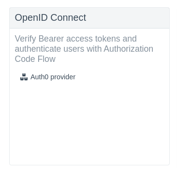

Click **Auth0 provider** followed by **Login into Single Page Application**:

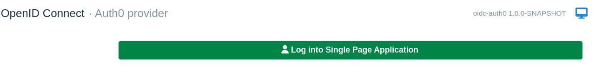

You will be redirected to Auth0 to log in. You will then be redirected to the OIDC Dev UI dashboard, as follows:

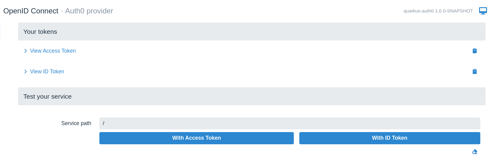

Here, you can look at both ID and access tokens in the encoded and decoded formats, copy them to the clipboard or use them to test the service endpoint. We will test the endpoint later but for now let's check the ID token:

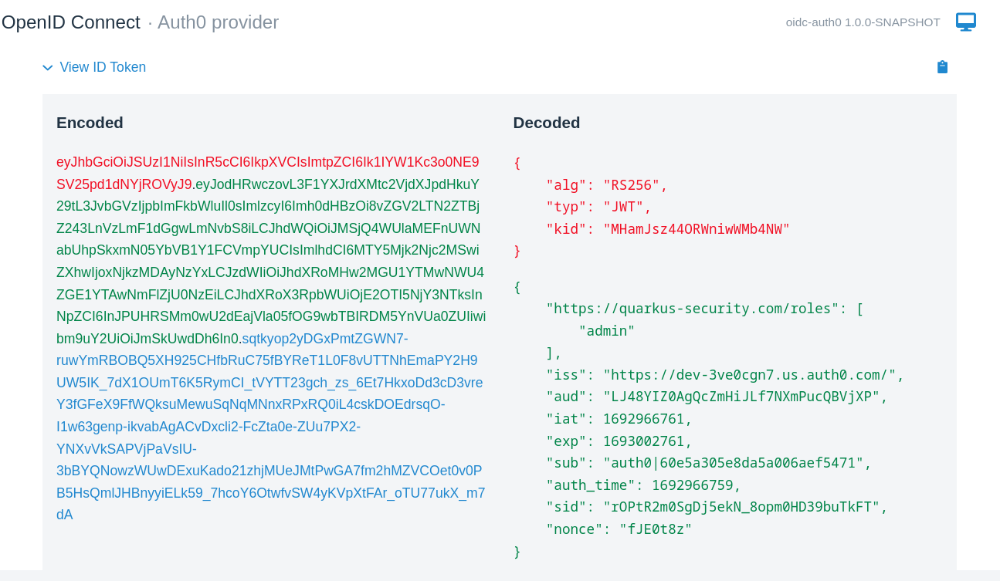

As you can see it does not have any claim representing a user name but if you check its `sub` (subject) claim you will see its value matches what you got in the response when you accessed the Quarkus endpoint directly from the browser, `auth0|60e5a305e8da5a006aef5471`.

Fix it by configuring Quarkus to request a standard OIDC `profile` scope during the authentication process which should result in the ID token including more information:

```configuration
quarkus.oidc.auth-server-url=https://dev-3ve0cgn7.us.auth0.com
quarkus.oidc.application-type=hybrid
quarkus.oidc.client-id=sKQu1dXjHB6r0sra0Y1YCqBZKWXqCkly
quarkus.oidc.credentials.secret=${client-secret}

quarkus.oidc.authentication.scopes=profile <1>
```

1. Request `profile` scope in addition to the default `openid` scope.

Go back to <http://localhost:8080/q/dev/>, repeat the process of logging in to `Auth0` and check the ID token again, now you should see the ID token containing the `name` claim:

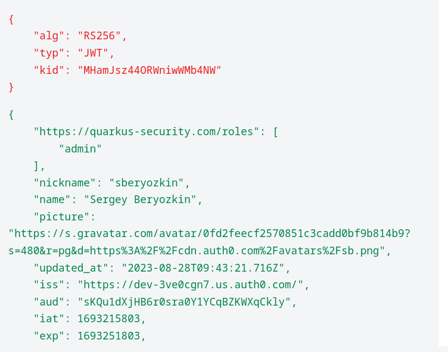

You should get the name when you access the Quarkus endpoint directly from the browser. Clear the browser cookie cache, access <http://localhost:8080/hello> and yet again, you get `Hello, auth0|60e5a305e8da5a006aef5471` returned. Hmm, what is wrong ?

The answer lies with the specifics of the `org.eclipse.microprofile.jwt.JsonWebToken#getName()` implementation, which, according to the [MicroProfile MP JWT RBAC  specification](https://github.com/eclipse/microprofile-jwt-auth), checks an MP JWT specific `upn` claim, trying `preferred_username` next and finally `sub` which explains why you get the `Hello, auth0|60e5a305e8da5a006aef5471` answer even with the ID token containing the `name` claim. We can fix it easily by changing the endpoint `hello()` method's implementation to return a specific claim value:

```java
package org.acme;

import org.eclipse.microprofile.jwt.JsonWebToken;

import io.quarkus.oidc.IdToken;
import io.quarkus.security.Authenticated;
import jakarta.inject.Inject;
import jakarta.ws.rs.GET;
import jakarta.ws.rs.Path;
import jakarta.ws.rs.Produces;
import jakarta.ws.rs.core.MediaType;

@Path("/hello")
public class GreetingResource {

    @Inject
    @IdToken
    JsonWebToken idToken;

    @GET
    @Authenticated
    @Produces(MediaType.TEXT_PLAIN)
    public String hello() {
        return "Hello, " + idToken.getClaim("name");
    }
}
```

Now clear the browser cache, access <http://localhost:8080/hello> and finally the user name is returned.

## Logout support

Now that you have the users signing in to Quarkus with the help of Auth0, you probably want to support a user-initiated logout. Quarkus supports [RP-initiated and other standard OIDC logout mechanisms, as well as the local session logout](https://quarkus.io/guides/security-oidc-code-flow-authentication#logout-and-expiration).

Currently, Auth0 does not support the standard OIDC RP-initiated logout and does not provide an end session endpoint URL in its discoverable metadata, but it provides its own logout mechanism which works nearly exactly the same as the standard one.

It is easy to support it with Quarkus OIDC. You must configure an Auth0 end session endpoint URL and have Quarkus include both the `client-id` query parameter and the post logout URL as the `returnTo` query parameter in the RP-initated logout redirect request to Auth0:

```configuration
quarkus.oidc.auth-server-url=https://dev-3ve0cgn7.us.auth0.com
quarkus.oidc.application-type=hybrid
quarkus.oidc.client-id=sKQu1dXjHB6r0sra0Y1YCqBZKWXqCkly
quarkus.oidc.credentials.secret=${client-secret}
quarkus.oidc.authentication.scopes=openid,profile

quarkus.oidc.end-session-path=v2/logout <1>
quarkus.oidc.logout.post-logout-uri-param=returnTo <2>
quarkus.oidc.logout.extra-params.client_id=${quarkus.oidc.client-id} <3>
quarkus.oidc.logout.path=/logout <4>
quarkus.oidc.logout.post-logout-path=/hello/post-logout <5>

quarkus.http.auth.permission.authenticated.paths=/logout
quarkus.http.auth.permission.authenticated.policy=authenticated <6>
```

1. Auth0 does not include the end session URL in its metadata, so complement it with manually configuring the Auth0 end session endpoint URL.
2. Auth0 will not recognize a standard `post_logout_redirect_uri` query parameter and expects a parameter `returnTo` instead.
3. Auth0 expects `client-id` in the logout request.
4. Authenticated requests to `/logout` path will be treated as RP-inititated logout requests.
5. This is a public resource to where the logged out user should be returned to.
6. Make sure the `/logout` path is protected.

Here we have customized the Auth0 end session endpoint URL and indicated to Quarkus that an `http://localhost:8080/logout` request must trigger a logout of the currently authenticated user. An interesting thing about the `/logout` path is that it is `virtual`, it is not supported by any method in the JAX-RS endpoint, so for Quarkus OIDC to be able to react to `/logout` requests we attach an `authenticated` [HTTP security policy](https://quarkus.io/guides/security-authorize-web-endpoints-reference#authorization-using-configuration) to this path directly in the configuration.

We also have configured Quarkus to return the logged out user to the public `/hello/post-logout` resource, and this path is included in the logout request as the Auth0 specific `returnTo` query parameter. Finally, the Quarkus application's `client-id` is included in the logout URL as well.

Update the endpoint to accept the post logout redirects:

```java
package org.acme;

import org.eclipse.microprofile.jwt.JsonWebToken;

import io.quarkus.oidc.IdToken;
import io.quarkus.security.Authenticated;
import jakarta.inject.Inject;
import jakarta.ws.rs.GET;
import jakarta.ws.rs.Path;
import jakarta.ws.rs.Produces;
import jakarta.ws.rs.core.MediaType;

@Path("/hello")
public class GreetingResource {

    @Inject
    @IdToken
    JsonWebToken idToken;

    @GET
    @Authenticated
    @Produces(MediaType.TEXT_PLAIN)
    public String hello() {
        return "Hello, " + idToken.getClaim("name");
    }

    @GET
    @Path("post-logout")
    @Produces(MediaType.TEXT_PLAIN)
    public String postLogout() {
        return "You were logged out";
    }
}
```

Note the addition of the public `/hello/post-logout` resource method.

Before we test the logout, make sure the `Auth0` application is configured to allow this post logout redirect back to Quarkus after the user has been logged out:

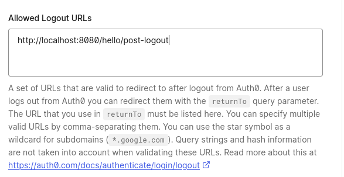

Now, clear the browser cookie cache, access <http://localhost:8080/hello>, login to Quarkus with Auth0, get the user name returned, and go to `http://localhost:8080/logout`. You'll see the `You were logged out` message displayed in the browser.

Next, go to the <http://localhost:8080/q/dev/>, login to Auth0 from the Dev UI SPA and notice you can now logout from the OIDC Dev UI too, see the symbol representing the logout next to the `Logged in as Sergey Beryozkin` text:

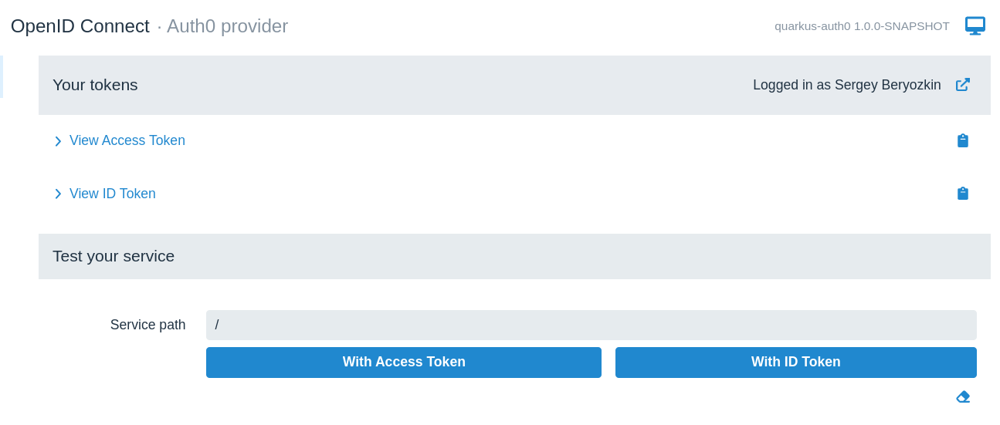

For the logout to work from OIDC DevUI, the Auth0 application's list of allowed logout callbacks has to be updated to include the OIDC DevUI endpoint:

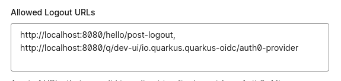

Now logout directly from OIDC Dev UI and login as a new user - add more users to the registered Auth0 application if required.

<a id="role-based-access-control"></a>
## Role-based access control

We have confirmed that the Quarkus endpoint can be accessed by users who have authenticated with the help of `Auth0`.

The next step is to introduce role-based access control (RBAC) to have users in a specific role only, such as `admin`, be able to access the endpoint.

See also the [Permission Based Access Control](#permission-based-access-control) section below.

Auth0 tokens do not include any claims containing roles by default, so, first, you must customize the `Login` flow of the `Auth0` application with a custom action which will add the roles to tokens. Select `Actions/Flows/Login` in the `Auth0` dashboard, choose `Add Action/Build Custom`, name it as `AddRoleClaim`:

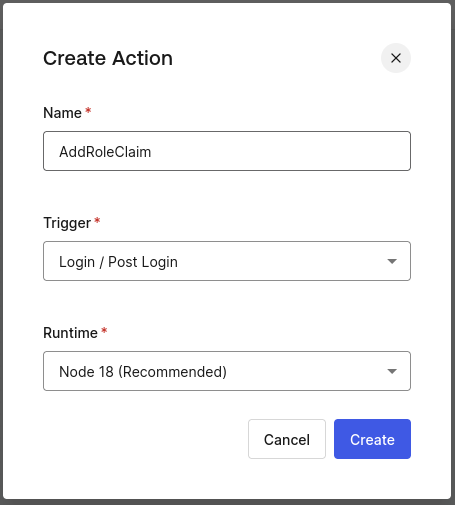

Add the following action script to it:

```javascript
exports.onExecutePostLogin = async (event, api) => {
  const namespace = 'https://quarkus-security.com';
  if (event.authorization) {
    api.idToken.setCustomClaim(`${namespace}/roles`, event.authorization.roles);
    api.accessToken.setCustomClaim(`${namespace}/roles`, event.authorization.roles);
  }
};
```

Note a custom Auth0 claim has to be namespace qualified, so the claim which will contain roles will be named as "<https://quarkus-security.com/roles">. Have a look at the ID token content we analyzed in the previous sections and you will see how this claim is represented, for example:

```json
{
  "https://quarkus-security.com/roles": [
      "admin"
  ]
}
```

The `Auth0` Login Flow diagram should look like this now:

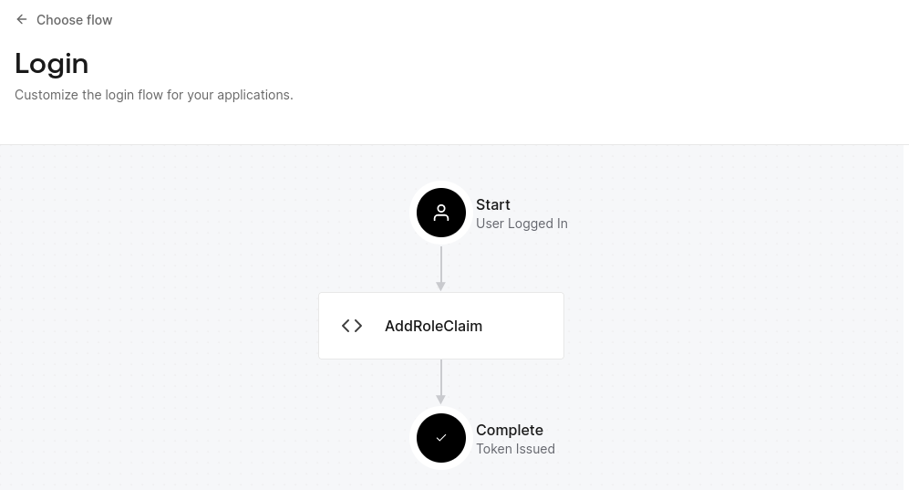

You must add a role such as `admin` to the users registered in the `Auth0` application.

Create an `admin` role:

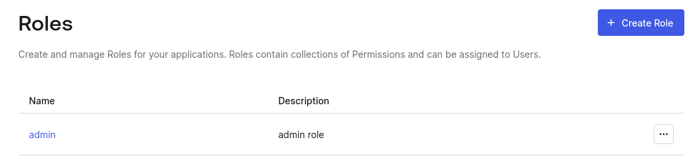

and add it to the registered user:

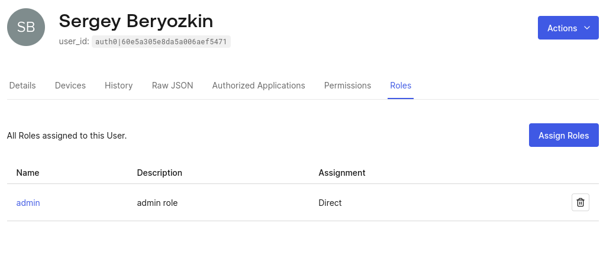

Next, update the Quarkus endpoint to require that only users with the `admin` role can access the endpoint:

```java
package org.acme;

import org.eclipse.microprofile.jwt.JsonWebToken;

import io.quarkus.oidc.IdToken;
import jakarta.annotation.security.RolesAllowed;
import jakarta.inject.Inject;
import jakarta.ws.rs.GET;
import jakarta.ws.rs.Path;
import jakarta.ws.rs.Produces;
import jakarta.ws.rs.core.MediaType;

@Path("/hello")
public class GreetingResource {

    @Inject
    @IdToken
    JsonWebToken idToken;

    @GET
    @RolesAllowed("admin")
    @Produces(MediaType.TEXT_PLAIN)
    public String hello() {
        return "Hello, " + idToken.getClaim("name");
    }

    @GET
    @Path("post-logout")
    @Produces(MediaType.TEXT_PLAIN)
    public String postLogout() {
        return "You were logged out";
    }
}
```

Open <http://localhost:8080/hello>, authenticate to Auth0 and get `403`. The reason you get `403` is because Quarkus OIDC does not know which claim in the `Auth0` tokens represents the roles information, by default a `groups` claim is checked, while Auth0 tokens are now expected to have an "<https://quarkus-security.com/roles"> claim.

Fix it by telling Quarkus OIDC which claim must be checked to enforce RBAC:

```configuration
quarkus.oidc.auth-server-url=https://dev-3ve0cgn7.us.auth0.com
quarkus.oidc.application-type=hybrid
quarkus.oidc.authentication.scopes=profile
quarkus.oidc.client-id=sKQu1dXjHB6r0sra0Y1YCqBZKWXqCkly
quarkus.oidc.credentials.secret=${client-secret}

quarkus.oidc.roles.role-claim-path="https://quarkus-security.com/roles" <1>

# Logout
quarkus.oidc.end-session-path=v2/logout
quarkus.oidc.logout.post-logout-uri-param=returnTo
quarkus.oidc.logout.extra-params.client_id=${quarkus.oidc.client-id}
quarkus.oidc.logout.path=/logout
quarkus.oidc.logout.post-logout-path=/hello/post-logout
quarkus.http.auth.permission.authenticated.paths=/logout
quarkus.http.auth.permission.authenticated.policy=authenticated
```

1. Point to the custom roles claim. The path to the roles claim is in double quotes because the claim is namespace qualified.

Now, clear the browser cookie cache, access <http://localhost:8080/hello> again, authenticate to Auth0 and get an expected user name.

<a id="opaque-access-tokens"></a>
## Access Quarkus with opaque Auth0 access tokens

> [!NOTE]
> The main goal of this section is to explain how Quarkus can be tuned to accept `opaque` bearer Auth0 access tokens as opposed to Auth0 JWT access tokens because Auth0 access tokens issued during the authorization code flow are opaque by default and they can only be used to request `UserInfo` in addition to the information about the current user which is already available in ID token. Learning how to verify opaque tokens can be useful because many OIDC and OAuth2 providers will issue opaque access tokens only.
>
> For more information on how to configure Auth0 and Quarkus to have authorization code access tokens issued in the JWT format and propagated to service endpoints, see the following [Propagate access tokens to microservices](#token-propagation) and [Access tokens in JWT format](#jwt-access-tokens) sections.

So far we have only tested the Quarkus endpoint using OIDC authorization code flow. In this flow you use the browser to access the Quarkus endpoint, Quarkus itself manages the authorization code flow, a user is redirected to Auth0, logs in, is redirected back to Quarkus, Quarkus completes the flow by exchanging the code for the ID, access, and refresh tokens, and works with the ID token representing the successful user authentication. The access token is not relevant at the moment. As mentioned earlier, in the authorization code flow, Quarkus will only use the access token to access downstream services on behalf of the currently authenticated user.

Let's imagine though that the Quarkus endpoint we have developed has to accept `Bearer` access tokens too: it may be that the other Quarkus endpoint which is propagating it to this endpoint or it can be SPA which uses the access token to access the Quarkus endpoint. And Quarkus OIDC DevUI SPA which we already used to analyze the ID token fits perfectly for using the access token available to SPA to test the Quarkus endpoint.

Let's go again to <http://localhost:8080/q/dev-ui>, select the `OpenId Connect` card, login to Auth0, and check the Access token content:

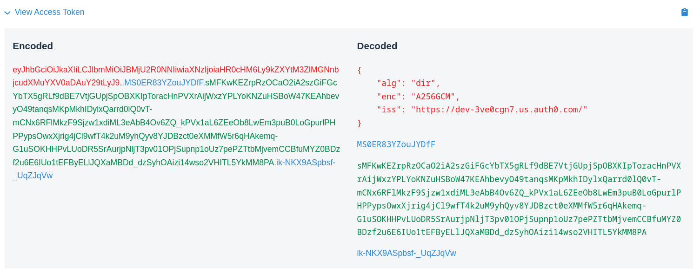

This access token, as opposed to the ID token we looked at earlier, cannot be verified by Quarkus directly. This is because the access token is in `JWE` (encrypted) as opposed to `JWS` (signed) format. You can see from the decoded token headers that it has been encrypted directly with a secret key known to Auth0 only, and therefore its content cannot be decrypted by Quarkus. From the Quarkus's perspective this access token is an `opaque` one, Quarkus cannot use public Auth0 asymmetric verification keys to verify it.

To confirm it, enter `/hello` as the `Service Address` in the `Test Service` area and press `With Access Token` and you will get the HTTP `401` status:

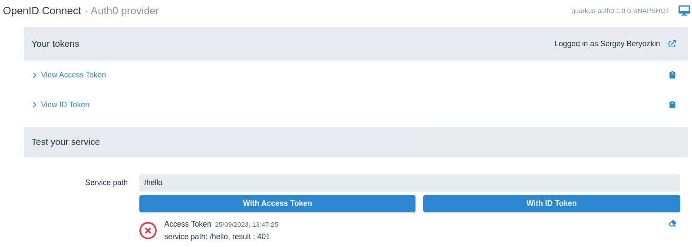

For Quarkus be able to accept such access tokens, one of the two options should be available. The first option is to introspect the opaque token remotely using a provider's introspection endpoint. Token introspection is typically supported at the `OAuth2` level, and since `OIDC` is built on top of `OAuth2`, some OIDC providers such as Keycloak support the token introspection as well. However, Auth0 does not support the token introspection, you can check it by looking at the publicly available Auth0 metadata, add `/.well-known/openid-configuration` to the address of your configured Auth0 provider, and open the resulting URL, `https://dev-3ve0cgn7.us.auth0.com/.well-known/openid-configuration`. You will see that Auth0 does not have an introspection endpoint:

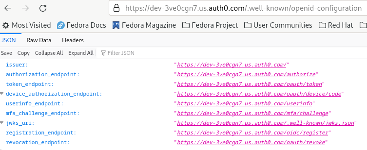

Therefore the other option, indirect access token verification, where the access token is used to acquire `UserInfo` from Auth0 can be used to accept and verify opaque Auth0 tokens. This option works because OIDC providers have to verify access tokens before they can issue `UserInfo` and Auth0 has a `UserInfo` endpoint.

So lets configure Quarkus to request that the access tokens must be verified by using them to acquire `UserInfo`:

```configuration
quarkus.oidc.auth-server-url=https://dev-3ve0cgn7.us.auth0.com
quarkus.oidc.application-type=hybrid
quarkus.oidc.authentication.scopes=profile
quarkus.oidc.client-id=sKQu1dXjHB6r0sra0Y1YCqBZKWXqCkly
quarkus.oidc.credentials.secret=${client-secret}

# Point to the custom roles claim
quarkus.oidc.roles.role-claim-path="https://quarkus-security.com/roles"

# Logout
quarkus.oidc.end-session-path=v2/logout
quarkus.oidc.logout.post-logout-uri-param=returnTo
quarkus.oidc.logout.extra-params.client_id=${quarkus.oidc.client-id}
quarkus.oidc.logout.path=/logout
quarkus.oidc.logout.post-logout-path=/hello/post-logout
quarkus.http.auth.permission.authenticated.paths=/logout
quarkus.http.auth.permission.authenticated.policy=authenticated

quarkus.oidc.token.verify-access-token-with-user-info=true <1>
```

1. Verify access tokens indirectly by using them to request `UserInfo`.

Update the endpoint code to expect `UserInfo` as opposed to `ID token`:

```java
package org.acme;

import io.quarkus.oidc.UserInfo;
import jakarta.annotation.security.RolesAllowed;
import jakarta.inject.Inject;
import jakarta.ws.rs.GET;
import jakarta.ws.rs.Path;
import jakarta.ws.rs.Produces;
import jakarta.ws.rs.core.MediaType;

@Path("/hello")
public class GreetingResource {

    @Inject
    UserInfo userInfo;

    @GET
    @RolesAllowed("admin")
    @Produces(MediaType.TEXT_PLAIN)
    public String hello() {
        return "Hello, " + userInfo.getName();
    }

    @GET
    @Path("post-logout")
    @Produces(MediaType.TEXT_PLAIN)
    public String postLogout() {
        return "You were logged out";
    }
}
```

This code will now work both for the authorization code and bearer access token flows.

Let's go to the OIDC Dev UI where we looked at the access token, enter `/hello` as the `Service Address` in the `Test Service` area and press `With Access Token` and you will get `200`:

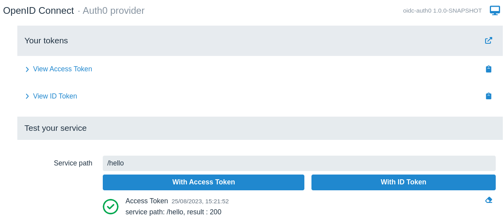

To confirm that it really does work, update the test endpoint to allow a `user` role only with `@RolesAllowed("user")`. Try to access the endpoint from OIDC Dev UI again, and you will get the HTTP `403` error. Revert the code back to `@RolesAllowed("admin")` to get the reassuring HTTP `200` status again.

When verifying the opaque access token indirectly, by using it to request `UserInfo`, Quarkus will use `UserInfo` as the source of the roles information, if any. As it happens, Auth0 includes the custom role claim which was created earlier in the `UserInfo` response as well.

> [!NOTE]
> As has already been mentioned in the introduction to this section, the main goal of this section is to explain how Quarkus can verify opaque access tokens. In general, propagating access tokens whose only purpose is to allow retrieving `UserInfo` to services should be avoided unless the front-end JAX-RS endpoint or SPA prefers to delegate UserInfo retrieval to the trusted service.
>
> For a recommended approach of working with Auth0 access tokens, see the following [Propagate access tokens to microservices](#token-propagation) and [Access tokens in JWT format](#jwt-access-tokens) sections.

> [!NOTE]
> Typically one uses access tokens to access remote services but OIDC DevUI SPA dashboard also offers an option to test with the ID token. This option is only available to emulate the cases where SPA delegates to the endpoint to verify and retrieve some information from the ID token for SPA to use - but ID token will still be sent to the endpoint as Bearer token by OIDC DevUI. Prefer testing with the access token in most cases.

> [!NOTE]
> You can use SwaggerUI or GraphQL from OIDC DevUI for testing the service, instead of manually entering the service path to test. For example, if you add
>
> ```xml
> <dependency>
>    <groupId>io.quarkus</groupId>
>    <artifactId>quarkus-smallrye-openapi</artifactId>
> </dependency>
> ```
>
> to your application's pom then you will see a Swagger link in OIDC Dev UI:
>
> 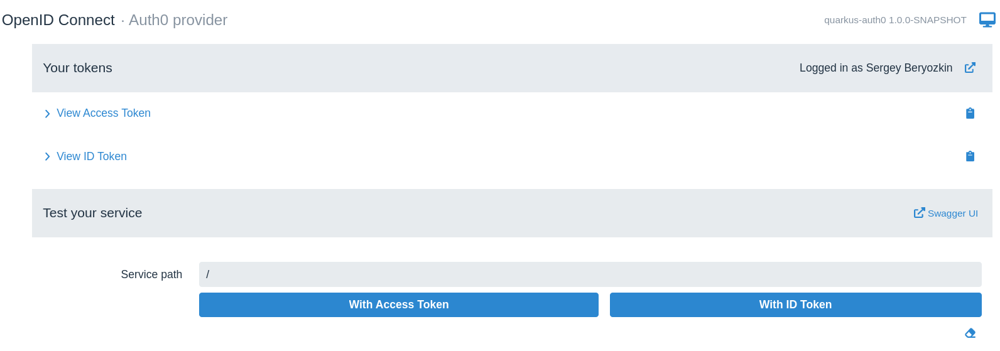
>
> Click the Swagger link and start testing the service.

<a id="token-propagation"></a>
## Propagate access tokens to microservices

Now that we have managed to use OIDC authorization code flow and used both ID token and UserInfo to access the user information, the next typical task is to propagate the current Auth0 access token to access the downstream service on behalf of the currently authenticated user.

In fact, the last code example, showing the injected `UserInfo`, is a concrete example of the access token propagation, in this case, Quarkus propagates the Auth0 access token to the Auth0 `UserInfo` endpoint to acquire `UserInfo`. Quarkus does it without users having to do anything themselves.

But what about propagating access tokens to some custom services ? It is very easy to achieve in Quarkus, both for the authorization code and bearer token flows. All you need to do is to create a REST Client interface for calling the service requiring a Bearer token access and annotate it with `@AccessToken` and the access token arriving to the front-end endpoint as the Auth0 Bearer access token or acquired by Quarkus after completing the Auth0 authorization code flow, will be propagated to the target microservice. This is as easy as it can get.

For examples of propagating access tokens, see the following sections in this tutorial. For more information about token propagation, see [OIDC token propagation](/guides/security-openid-connect-client-reference/index.md#token-propagation-rest).

<a id="jwt-access-tokens"></a>
### Access tokens in JWT format

We have already looked in detail at how Quarkus OIDC can handle [Access Quarkus with opaque Auth0 access tokens](#opaque-access-tokens), but we don't want to propagate Auth0 opaque tokens to micro services which do something useful on behalf on the currently authenticated user, beyond checking its UserInfo.

A microservice which the front-end Quarkus application will access by propagating authorization code flow access tokens to it is represented in the Auth0 dashboard as an `API`. Let's add it in the `Applications/APIs`:

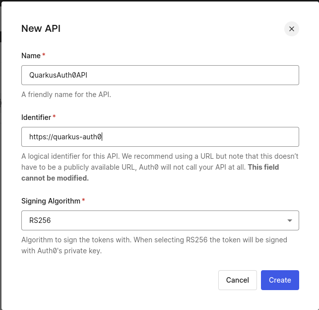

The `https://quarkus-auth0` identifier of the created `QuarkusAuth0API` will serve as this API's `audience`. Providing this audience as a query parameter in the authorization code flow redirect to Auth0 will ensure that Auth0 issues access tokens in the JWT format.

### API microservice

Add the following dependencies to the project to support OIDC token propagation and REST clients:

**pom.xml**

```xml
<dependency>
    <groupId>io.quarkus</groupId>
    <artifactId>quarkus-rest-client-jackson</artifactId>
</dependency>
<dependency>
   <groupId>io.quarkus</groupId>
   <artifactId>quarkus-rest-client-oidc-token-propagation</artifactId>
</dependency>
```

Create `ApiEchoService` service class:

```java
package org.acme;

import io.quarkus.security.Authenticated;
import jakarta.ws.rs.POST;
import jakarta.ws.rs.Path;
import jakarta.ws.rs.Produces;
import jakarta.ws.rs.core.MediaType;

@Path("/echo")
public class ApiEchoService {

    @POST
    @Authenticated
    @Produces(MediaType.TEXT_PLAIN)
    public String echoUserName(String username) {
        return username;
    }
}
```

And configure it as an OIDC `service` application which will only fetch public verification keys from Auth0. The configuration for this microservice should only have a single line:

```configuration
quarkus.oidc.auth-server-url=https://dev-3ve0cgn7.us.auth0.com
```

which is all what is needed for the OIDC `service` application to fetch Auth0 public verification keys and use them to verify Auth0 access tokens in JWT format.

> [!NOTE]
> In this tutorial you have already configured the OIDC `hybrid` application which can handle both authorization code and bearer token authentication flows. In production you will run microservices as separate servers but for the sake of simplicity `ApiEchoService` will not have to be started as a second server with its own configuration containing `quarkus.oidc.auth-server-url=https://dev-3ve0cgn7.us.auth0.com` only, and therefore the current configuration which already has the Auth0 dev tenant address configured will be reused.
>
> The `hybrid` OIDC application type will ensure that `http://localhost:8080/hello` requests to `GreetingResource` initiate an Authorization code flow while `http://localhost:8080/echo` requests to `ApiEchoService`, initiated by `GreetingResource`, will lead to the authorization code flow tokens being propagated and accepted by `ApiEchoService` as bearer JWT access tokens.

Next, add a REST client interface representing `ApiEchoService`:

```java
package org.acme;

import jakarta.ws.rs.POST;
import jakarta.ws.rs.Path;
import jakarta.ws.rs.Produces;
import jakarta.ws.rs.core.MediaType;

import org.eclipse.microprofile.rest.client.inject.RegisterRestClient;
import io.quarkus.oidc.token.propagation.common.AccessToken;

@RegisterRestClient
@AccessToken <1>
@Path("/echo")
public interface ApiEchoServiceClient {

    @POST
    @Produces(MediaType.TEXT_PLAIN)
    String echoUserName(String username);
}
```

1. Propagate access token as an HTTP `Authorization: Bearer accesstoken` header

And update the configuration for the Quarkus front-end application, `GreetingResource`, which has been created earlier, to request that an authorization code flow access token (as opposed to ID token) includes an `aud` (audience) claim targeting `ApiEchoService`, as well as configure the base URL for the `ApiEchoService` REST client:

```configuration
quarkus.oidc.auth-server-url=https://dev-3ve0cgn7.us.auth0.com
quarkus.oidc.application-type=hybrid
quarkus.oidc.authentication.scopes=profile
quarkus.oidc.authentication.extra-params.audience=https://quarkus-auth0 <1>
quarkus.oidc.client-id=sKQu1dXjHB6r0sra0Y1YCqBZKWXqCkly
quarkus.oidc.credentials.secret=${client-secret}

# Point to the custom roles claim
quarkus.oidc.roles.role-claim-path="https://quarkus-security.com/roles"

# Logout
quarkus.oidc.end-session-path=v2/logout
quarkus.oidc.logout.post-logout-uri-param=returnTo
quarkus.oidc.logout.extra-params.client_id=${quarkus.oidc.client-id}
quarkus.oidc.logout.path=/logout
quarkus.oidc.logout.post-logout-path=/hello/post-logout
quarkus.http.auth.permission.authenticated.paths=/logout
quarkus.http.auth.permission.authenticated.policy=authenticated

quarkus.oidc.token.verify-access-token-with-user-info=true

org.acme.ApiEchoServiceClient/mp-rest/url=http://localhost:${port} <2>

quarkus.test.integration-test-profile=test
%prod.port=8080
%dev.port=8080
%test.port=8081
```

1. Pass an extra `audience` query parameter to the Auth0 authorization endpoint during the authorization code flow redirect from Quarkus to Auth0. It will ensure that the access token is issued in the JWT format and includes an `aud` (audience) claim which will contain `https://quarkus-auth0`.
2. Point `ApiEchoServiceClient` to the `ApiEchoService` endpoint. HTTP port in the `org.acme.ApiEchoServiceClient/mp-rest/url=http://localhost:${port}` property is parameterized to ensure the correct URL is built while using the dev, test and prod modes.

Finally update `GreetingResource` to request that `ApiEchoService` echoes a user name:

```java
package org.acme;

import io.quarkus.oidc.UserInfo;
import io.quarkus.security.Authenticated;
import jakarta.annotation.security.RolesAllowed;
import jakarta.inject.Inject;
import jakarta.ws.rs.GET;
import jakarta.ws.rs.Path;
import jakarta.ws.rs.Produces;
import jakarta.ws.rs.core.MediaType;

import org.eclipse.microprofile.rest.client.inject.RestClient;

@Path("/hello")
public class GreetingResource {
    @Inject
    @RestClient
    ApiEchoServiceClient echoClient; <1>

    @Inject
    UserInfo userInfo;

    @GET
    @RolesAllowed("admin")
    @Produces(MediaType.TEXT_PLAIN)
    public String hello() {
        return "Hello, " + echoClient.echoUserName(userInfo.getName()); <2>
    }

    @GET
    @Path("post-logout")
    @Produces(MediaType.TEXT_PLAIN)
    public String postLogout() {
        return "You were logged out";
    }
}
```

1. Inject `ApiEchoServiceClient` REST client
2. Use `ApiEchoServiceClient` to echo the user name.

Open a browser, access <http://localhost:8080/hello> and get your name displayed in the browser.

Let's go to <http://localhost:8080/q/dev-ui>, select the `OpenId Connect` card, login to Auth0, and check the Access token content:

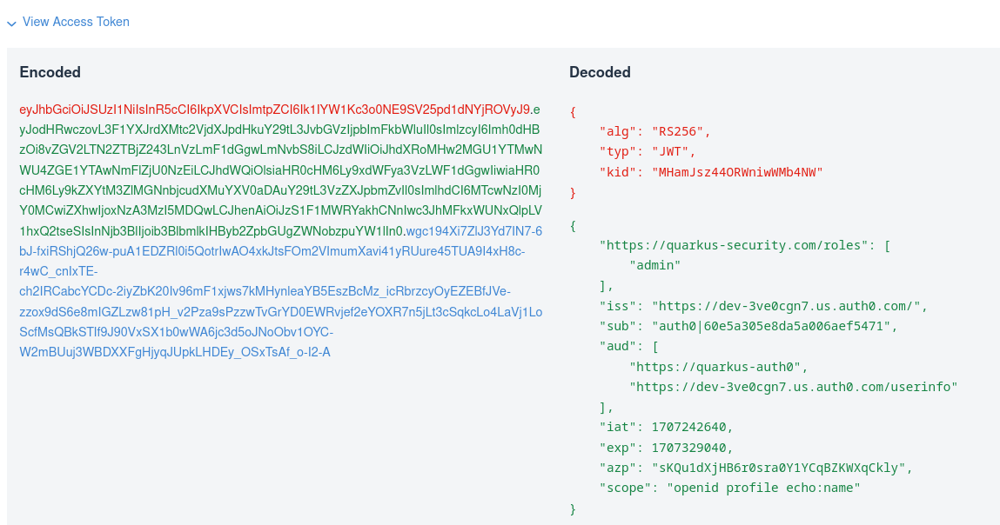

As you can see, the access token is no longer encrypted as shown in the [Access Quarkus with opaque Auth0 access tokens](#opaque-access-tokens) section and indeed it is in the JWT format now.

<a id="permission-based-access-control"></a>
### Permission Based Access Control

We have discussed in the [Role-based access control](#role-based-access-control) section how to get Quarkus to check a namespace qualified claim containing user roles and use this information to enforce role-based access control. You have configured Auth0 to add the custom roles claim to both ID and access tokens.

However, Permission Based Access Control is better suited to the case where an access token is propagated by the front-end endpoint to a microservice which will check if a given access token has been authorized for this service to perform a concrete action, as opposed to this token vouching for a user be in a specific role. For example, being in the admin role does not necessarily mean the user is allowed to have a read and write access to some of this microservice's content.

Let's see how Permission Based Access Control constraints can be applied to `ApiEchoService`.

Go to the Auth0 dashboard, add an `echo:name` permission to the `QuarkusAuth0API` API:

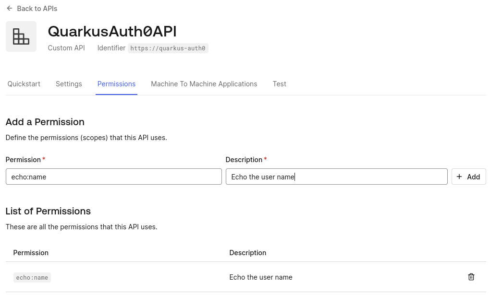

The `echo:name` permission will be included in the access token as a standard OAuth2 `scope` claim value if this scope will also be requested during the authorization code flow. Update the configuration as follows:

```configuration
quarkus.oidc.auth-server-url=https://dev-3ve0cgn7.us.auth0.com
quarkus.oidc.application-type=hybrid
quarkus.oidc.authentication.scopes=profile,echo:name <1>
quarkus.oidc.authentication.extra-params.audience=https://quarkus-auth0
quarkus.oidc.client-id=sKQu1dXjHB6r0sra0Y1YCqBZKWXqCkly
quarkus.oidc.credentials.secret=${client-secret}

# Point to the custom roles claim
quarkus.oidc.roles.role-claim-path="https://quarkus-security.com/roles"

# Logout
quarkus.oidc.end-session-path=v2/logout
quarkus.oidc.logout.post-logout-uri-param=returnTo
quarkus.oidc.logout.extra-params.client_id=${quarkus.oidc.client-id}
quarkus.oidc.logout.path=/logout
quarkus.oidc.logout.post-logout-path=/hello/post-logout
quarkus.http.auth.permission.authenticated.paths=/logout
quarkus.http.auth.permission.authenticated.policy=authenticated

quarkus.oidc.token.verify-access-token-with-user-info=true

org.acme.ApiEchoServiceClient/mp-rest/url=http://localhost:8080
```

1. An extra `echo:name` scope will be requested during the authorization code flow.

Now update `ApiEchoService` to enforce Permission Based Access Control:

```java
package org.acme;

import io.quarkus.security.PermissionsAllowed;
import jakarta.ws.rs.POST;
import jakarta.ws.rs.Path;
import jakarta.ws.rs.Produces;
import jakarta.ws.rs.core.MediaType;

@Path("/echo")
public class ApiEchoService {

    @POST
    @PermissionsAllowed("echo:name")
    @Produces(MediaType.TEXT_PLAIN)
    String echoUserName(String username) {
        return username;
    }
}
```

This is all what is needed as Quarkus OIDC automatically associates `scope` claim values as permissions with the current security identity.

> [!NOTE]
> You can enforce both Role Based and Permission Based Access Controls in Quarkus by combining `@RolesAllowed` and `@PermissionsAllowed` annotations.

Open a browser, access <http://localhost:8080/hello> and get the name displayed in the browser.

To confirm the permission is correctly enforced, change it to `echo.name`: `@PermissionsAllowed("echo.name")`. Clear the browser cache, access <http://localhost:8080/hello> again and you will get `403` reported by `ApiEchoService`. Now revert it back to `@PermissionsAllowed("echo:name")`.

## Integration testing

You have already used OIDC DevUI SPA to login to Auth0 and test the Quarkus endpoint with the access token, updating the endpoint code along the way.

However, running tests is also essential, lets see how we can test the endpoint and configuration which you have developed during the course of this tutorial, using [Quarkus Continuous Testing](/guides/continuous-testing/index.md) feature.

Start with the following test code :

```java
package org.acme;

import io.quarkus.test.junit.QuarkusTest;
import org.junit.jupiter.api.Test;

import static io.restassured.RestAssured.given;
import static org.hamcrest.CoreMatchers.is;

@QuarkusTest
public class GreetingResourceTest {

    @Test
    public void testHelloEndpoint() {
        given()
          .when().get("/hello")
          .then()
             .statusCode(200)
             .body(is("Hello, Sergey Beryozkin"));
    }

}
```

If you recall, when the application was started in dev mode, the following could be seen in the CLI window:

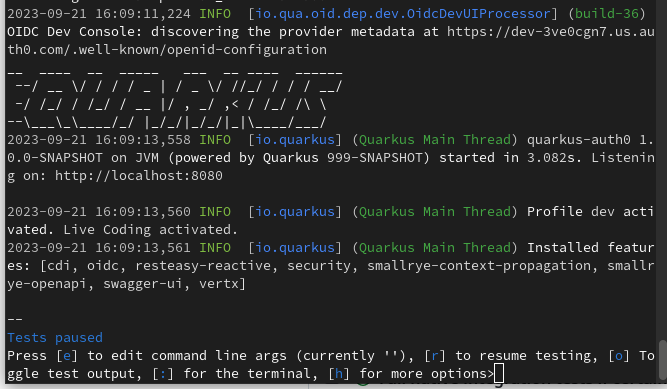

Press `r` and notice this test failing with `403` which is expected because the test does not send a token to the endpoint:

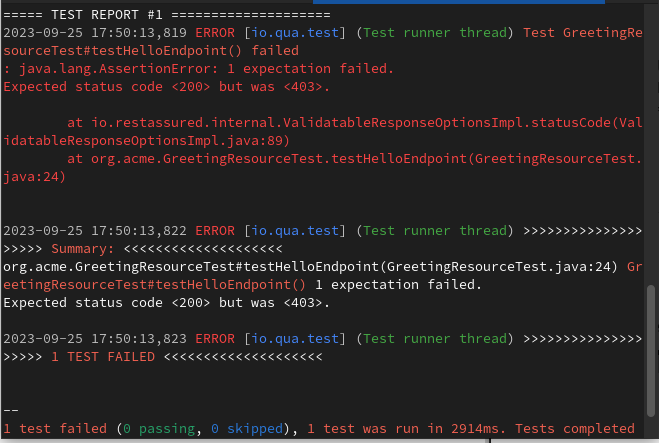

Before fixing the test, let's review the options available for testing Quarkus endpoints secured by OIDC. These options might vary, depending on which flow your application supports and how you prefer to test. Endpoints which use OIDC authorization code flow can be tested using [one of these options](/guides/security-oidc-code-flow-authentication/index.md#code-flow-integration-testing) and endpoints which use Bearer token authentication can be tested using [one of these options](/guides/security-oidc-bearer-token-authentication/index.md#bearer-token-integration-testing).

As you can see, testing of the endpoints secured with Auth0 can be done with the help of `Wiremock`, or `@TestSecurity` annotation. Experiment with writing such tests on your own and reach out if you encounter any problems.

In this tutorial though, we will use a recently added `OidcTestClient` to support testing endpoints which use live Auth0 development tenants.

Here is a related fragment of the configuration:

```configuration
quarkus.oidc.auth-server-url=https://dev-3ve0cgn7.us.auth0.com
quarkus.oidc.application-type=hybrid
quarkus.oidc.authentication.scopes=profile
quarkus.oidc.client-id=sKQu1dXjHB6r0sra0Y1YCqBZKWXqCkly
quarkus.oidc.credentials.secret=${client-secret}
```

In production, you will distinguish between prod and test level configuration with `%prod.` and `%test.` qualifiers. Let's assume that the above configuration will indeed be prefixed with `%test.` in your real application, with this configuration also including the `%prod.` qualified Auth0 production tenant configuration.

Using `OidcTestClient` to test such configuration requires acquiring a token from the Auth0 dev tenant, using either OAuth2 `password` or `client_credentials` grant, we will try a `password` grant. Make sure the application registered in the Auth0 dashboard allows the `password` grant:

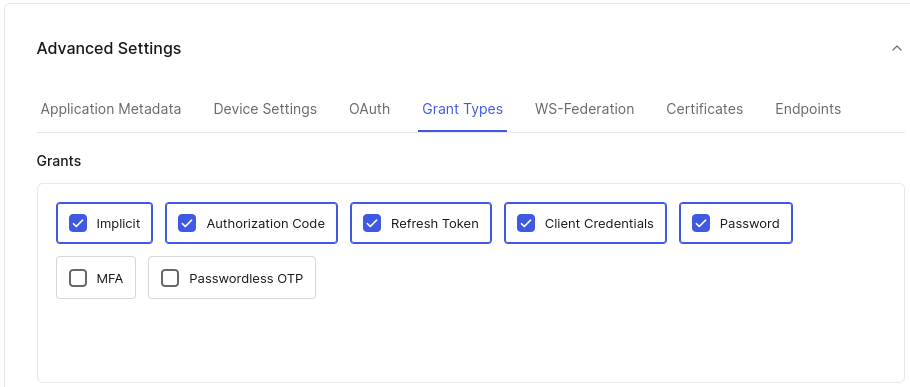

> [!NOTE]
> It is important to clarify that we do not recommend using the deprecated OAuth2 `password` token grant in production. However using it can help testing the endpoint with tokens acquired from the live dev Auth0 tenant.

`OidcTestClient` should be used to test applications accepting bearer tokens which will work for the endpoint developed in this tutorial as it supports both authorization code flow and bearer token authentication. You would need to use OIDC WireMock or `HtmlUnit` directly against the Auth0 dev tenant if only the authorization code flow was supported - in the latter case `HtmlUnit` test code would have to be aligned with how Auth0 challenges users to enter their credentials. If you like, you can copy the [HtmlUnit test fragment](/guides/security-oidc-code-flow-authentication/index.md#code-flow-integration-testing-wiremock) from the documentation and experiment with it.

In meantime we will now proceed with fixing the currently failing test using `OidcTestClient`.

First you must add the following dependency:

**pom.xml**

```xml
<dependency>
    <groupId>io.quarkus</groupId>
    <artifactId>quarkus-test-oidc-server</artifactId>
    <scope>test</scope>
</dependency>
```

**build.gradle**

```gradle
testImplementation("io.quarkus:quarkus-test-oidc-server")
```

which provides a utility class `io.quarkus.test.oidc.client.OidcTestClient` which can be used in tests for acquiring access tokens (This dependency also offers an OIDC WireMock support - review the documentation how to use it for testing if you want).

Now update the test code like this:

```java
package org.acme;

import static io.restassured.RestAssured.given;
import static org.hamcrest.CoreMatchers.is;

import java.util.Map;

import org.junit.jupiter.api.AfterAll;
import org.junit.jupiter.api.Test;

import io.quarkus.test.junit.QuarkusTest;
import io.quarkus.test.oidc.client.OidcTestClient;

@QuarkusTest
public class GreetingResourceTest {

    static OidcTestClient oidcTestClient = new OidcTestClient();

    @AfterAll
    public static void close() {
        client.close();
    }

    @Test
    public void testHelloEndpoint() {
        given()
          .auth().oauth2(getAccessToken(`sberyozkin@gmail.com`, "userpassword"))
          .when().get("/hello")
          .then()
             .statusCode(200)
             .body(is("Hello, Sergey Beryozkin"));
    }

    private String getAccessToken(String name, String secret) {
        return oidcTestClient.getAccessToken(name, secret, <1>
            Map.of("audience", "https://quarkus-auth0",
	           "scope", "openid profile"));
    }
}
```

1. `OidcTestClient` is used to acquire an access token, using one of the registered user's name and password, as well as the `audience` and `scope` parameters.

`OidcTestClient` will itself find out the `Auth0` token endpoint address, client id and secret.

Press `r` again and have the test passing:

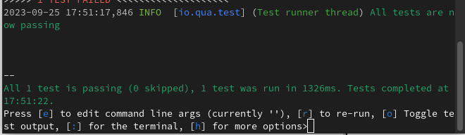

By the way, if you like, you can run the tests in Continuous mode directly from DevUI:

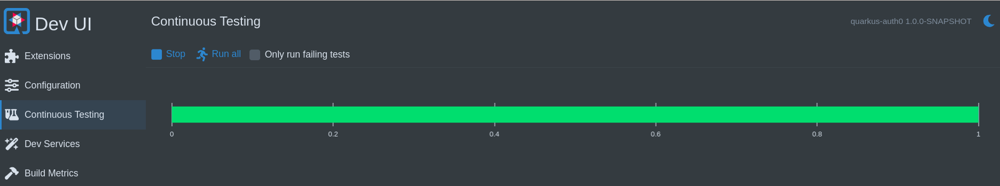

<a id="production-mode"></a>
## Production mode

You have developed and tested the Quarkus endpoint secured with Auth0 in the development mode. The next step is to run your application in the production mode. Choose between JVM and native modes.

### Run the Application in JVM mode

Compile the application:

**CLI**

```bash
quarkus build
```

**Maven**

```bash
./mvnw install
```

**Gradle**

```bash
./gradlew build
```

Run the application:

```bash
java -jar target/quarkus-app/quarkus-run.jar
```

Open a browser, access <http://localhost:8080/hello> and get the name displayed in the browser.

### Run the application in native mode

You can compile this same demo into native mode without needing any modifications. This implies that you no longer need to install a JVM on your production environment. The runtime technology is included in the produced binary and optimized to run with minimal resources required.

Compilation takes a bit longer, so this step is disabled by default.

Build your application again by enabling the `native` profile:

**CLI**

```bash
quarkus build --native
```

**Maven**

```bash
./mvnw install -Dnative
```

**Gradle**

```bash
./gradlew build -Dquarkus.native.enabled=true
```

Next run the following binary directly:

```bash
./target/quarkus-auth0-1.0.0-SNAPSHOT-runner
```

Open a browser, access <http://localhost:8080/hello> and get the name displayed in the browser.

## Troubleshooting

The steps described in this tutorial should work exactly as the tutorial describes. You might have to clear the browser cookies when accessing the updated Quarkus endpoint if you have already completed the authentication. You might need to restart the Quarkus application manually in dev mode but it is not expected. If you need help completing this tutorial, you can get in touch with the Quarkus team.

## Summary

This tutorial demonstrated how Quarkus endpoints can be secured with the `quarkus-oidc` extension and Auth0 using Authorization code and Bearer token authentication flows, with both flows being supported by the same endpoint code. Without writing a single line of code, you have added support for the custom Auth0 logout flow and enabled role-based access control with a custom Auth0 namespace qualified claim. Token propagation from the front-end endpoint to the microservice endpoint has been achieved by adding the `@AccessToken` annotation to the microservice REST client. Microservice endpoint activated the permission-based access control with the `@PermissionsAllowed` annotation. You used Quarkus dev mode to update the code and configuration without restarting the endpoint, and you also used the OIDC Dev UI to visualize and test Auth0 tokens. You used the continuous testing feature of Quarkus to complement OIDC Dev UI tests with integration tests against the live Auth0 development tenant. Finally, you have run the application in JVM and native modes.

Enjoy!

## References

- [Quarkus Security overview](/guides/security-overview/index.md)
- [OIDC code flow mechanism for protecting web applications](/guides/security-oidc-code-flow-authentication/index.md)
- [Configuring well-known OpenID Connect providers](/guides/security-openid-connect-providers/index.md)
