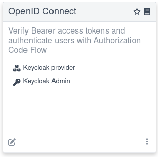

# Protect a web application by using OpenID Connect (OIDC) authorization code flow

Discover how to secure application HTTP endpoints by using the Quarkus OpenID Connect (OIDC) authorization code flow mechanism with the Quarkus OIDC extension, providing robust authentication and authorization.

For more information, see [OIDC code flow mechanism for protecting web applications](/guides/security-oidc-code-flow-authentication/index.md).

To learn about how well-known social providers such as Apple, Facebook, GitHub, Google, Mastodon, Microsoft, Spotify, Twitch, and X (formerly Twitter) can be used with Quarkus OIDC, see [Configuring well-known OpenID Connect providers](/guides/security-openid-connect-providers/index.md). See also, [Authentication mechanisms in Quarkus](/guides/security-authentication-mechanisms/index.md#other-supported-authentication-mechanisms).

If you want to protect your service applications by using OIDC Bearer token authentication, see [OIDC Bearer token authentication](/guides/security-oidc-bearer-token-authentication/index.md).

## Prerequisites

To complete this guide, you need:

- Roughly 15 minutes
- An IDE
- JDK 17+ installed with `JAVA_HOME` configured appropriately
- Apache Maven 3.9.16
- A working container runtime (Docker or [Podman](/guides/podman/index.md))
- Optionally the [Quarkus CLI](/guides/cli-tooling/index.md) if you want to use it
- Optionally Mandrel or GraalVM installed and [configured appropriately](/guides/building-native-image/index.md#configuring-graalvm) if you want to build a native executable (or Docker if you use a native container build)

## Architecture

In this example, we build a simple web application with a single page:

- `/index.html`

This page is protected, and only authenticated users can access it.

## Solution

Follow the instructions in the next sections and create the application step by step. Alternatively, you can go right to the completed example.

Clone the Git repository by running the `git clone https://github.com/quarkusio/quarkus-quickstarts.git` command. Alternatively, download an [archive](https://github.com/quarkusio/quarkus-quickstarts/archive/main.zip).

The solution is located in the `security-openid-connect-web-authentication-quickstart` [directory](https://github.com/quarkusio/quarkus-quickstarts/tree/main/security-openid-connect-web-authentication-quickstart).

## Create the Maven project

First, we need a new project. Create a new project by running the following command:

**CLI**

```bash
quarkus create app org.acme:security-openid-connect-web-authentication-quickstart \
    --extension='rest,oidc' \
    --no-code
cd security-openid-connect-web-authentication-quickstart
```

To create a Gradle project, add the `--gradle` or `--gradle-kotlin-dsl` option.

For more information about how to install and use the Quarkus CLI, see the [Quarkus CLI](/guides/cli-tooling/index.md) guide.

**Maven**

```bash
mvn io.quarkus.platform:quarkus-maven-plugin:3.40.1.2:create \
    -DprojectGroupId=org.acme \
    -DprojectArtifactId=security-openid-connect-web-authentication-quickstart \
    -Dextensions='rest,oidc' \
    -DnoCode
cd security-openid-connect-web-authentication-quickstart
```

To create a Gradle project, add the `-DbuildTool=gradle` or `-DbuildTool=gradle-kotlin-dsl` option.

For Windows users:

- If using Powershell, wrap `-D` parameters in double quotes e.g. `"-DprojectArtifactId=security-openid-connect-web-authentication-quickstart"`

If you already have your Quarkus project configured, you can add the `oidc` extension to your project by running the following command in your project base directory:

**CLI**

```bash
quarkus extension add oidc
```

**Maven**

```bash
./mvnw quarkus:add-extension -Dextensions='oidc'
```

**Gradle**

```bash
./gradlew addExtension --extensions='oidc'
```

This adds the following dependency to your build file:

**pom.xml**

```xml
<dependency>
   <groupId>io.quarkus</groupId>
   <artifactId>quarkus-oidc</artifactId>
</dependency>
```

**build.gradle**

```gradle
implementation("io.quarkus:quarkus-oidc")
```

## Write the application

Let's write a simple Jakarta REST resource that has all the tokens returned in the authorization code grant response injected:

```java
package org.acme.security.openid.connect.web.authentication;

import jakarta.inject.Inject;
import jakarta.ws.rs.GET;
import jakarta.ws.rs.Path;
import jakarta.ws.rs.Produces;

import org.eclipse.microprofile.jwt.Claims;
import org.eclipse.microprofile.jwt.JsonWebToken;

import io.quarkus.oidc.IdToken;
import io.quarkus.oidc.RefreshToken;

@Path("/tokens")
public class TokenResource {

   /**
    * Injection point for the ID token issued by the OpenID Connect provider
    */
   @Inject
   @IdToken
   JsonWebToken idToken;

   /**
    * Injection point for the access token issued by the OpenID Connect provider
    */
   @Inject
   JsonWebToken accessToken;

   /**
    * Injection point for the refresh token issued by the OpenID Connect provider
    */
   @Inject
   RefreshToken refreshToken;

   /**
    * Returns the tokens available to the application.
    * This endpoint exists only for demonstration purposes.
    * Do not expose these tokens in a real application.
    *
    * @return an HTML page containing the tokens available to the application.
    */
   @GET
   @Produces("text/html")
   public String getTokens() {
       StringBuilder response = new StringBuilder().append("<html>")
               .append("<body>")
               .append("<ul>");


       Object userName = this.idToken.getClaim(Claims.preferred_username);

       if (userName != null) {
           response.append("<li>username: ").append(userName.toString()).append("</li>");
       }

       Object scopes = this.accessToken.getClaim("scope");

       if (scopes != null) {
           response.append("<li>scopes: ").append(scopes.toString()).append("</li>");
       }

       response.append("<li>refresh_token: ").append(refreshToken.getToken() != null).append("</li>");

       return response.append("</ul>").append("</body>").append("</html>").toString();
   }
}
```

This endpoint has ID, access, and refresh tokens injected. It returns a `preferred_username` claim from the ID token, a `scope` claim from the access token, and a refresh token availability status.

You only need to inject the tokens if the endpoint needs to use the ID token to interact with the currently authenticated user or use the access token to access a downstream service on behalf of this user.

For more information, see the [Access ID and Access Tokens](/guides/security-oidc-code-flow-authentication/index.md#access_id_and_access_tokens) section of the reference guide.

## Configure the application

The OIDC extension allows you to define the configuration by using the `application.properties` file in the `src/main/resources` directory.

```properties
%prod.quarkus.oidc.auth-server-url=http://localhost:8180/realms/quarkus
quarkus.oidc.client-id=frontend
quarkus.oidc.credentials.secret=secret
quarkus.oidc.application-type=web-app
quarkus.http.auth.permission.authenticated.paths=/*
quarkus.http.auth.permission.authenticated.policy=authenticated
```

This is the simplest configuration you can have when enabling authentication to your application.

The `quarkus.oidc.client-id` property references the `client_id` issued by the OIDC provider, and the `quarkus.oidc.credentials.secret` property sets the client secret.

The `quarkus.oidc.application-type` property is set to `web-app` to tell Quarkus that you want to enable the OIDC authorization code flow so that your users are redirected to the OIDC provider to authenticate.

Finally, the `quarkus.http.auth.permission.authenticated` permission is set to tell Quarkus about the paths you want to protect. In this case, all paths are protected by a policy that ensures only `authenticated` users can access them. For more information, see [Security Authorization Guide](/guides/security-authorize-web-endpoints-reference/index.md).

> [!NOTE]
> When you do not configure a client secret with `quarkus.oidc.credentials.secret`,  it is recommended to configure `quarkus.oidc.token-state-manager.encryption-secret`.
>
> The `quarkus.oidc.token-state-manager.encryption-secret` enables the default token state manager to encrypt the user tokens in a browser cookie. If this key is not defined, and the `quarkus.oidc.credentials.secret` fallback is not configured, Quarkus uses a random key. A random key causes existing logins to be invalidated either on application restart or in environment with multiple instances of your application. Alternatively, encryption can also be disabled by setting `quarkus.oidc.token-state-manager.encryption-required` to `false`. However, you should disable secret encryption in development environments only.
>
> The encryption secret is recommended to be 32 chars long. For example, `quarkus.oidc.token-state-manager.encryption-secret=AyM1SysPpbyDfgZld3umj1qzKObwVMk`

## Start and configure the Keycloak server

To start a Keycloak server, use Docker and run the following command:

```bash
docker run --name keycloak -e KC_BOOTSTRAP_ADMIN_USERNAME=admin -e KC_BOOTSTRAP_ADMIN_PASSWORD=admin -p 8180:8080 quay.io/keycloak/keycloak:26.7.4 start-dev
```

You can access your Keycloak Server at [localhost:8180](http://localhost:8180).

To access the Keycloak Administration Console, log in as the `admin` user. The username and password are both `admin`.

To create a new realm, import the [realm configuration file](https://github.com/quarkusio/quarkus-quickstarts/tree/main/security-openid-connect-web-authentication-quickstart/config/quarkus-realm.json). For more information, see the Keycloak documentation about how to [create and configure a new realm](https://www.keycloak.org/docs/latest/server_admin/index.html#configuring-realms).

## Run the application in dev and JVM modes

To run the application in dev mode, use:

**CLI**

```bash
quarkus dev
```

**Maven**

```bash
./mvnw quarkus:dev
```

**Gradle**

```bash
./gradlew --console=plain quarkusDev
```

After exploring the application in dev mode, you can run it as a standard Java application.

First, compile it:

**CLI**

```bash
quarkus build
```

**Maven**

```bash
./mvnw install
```

**Gradle**

```bash
./gradlew build
```

Then, run it:

```bash
java -jar target/quarkus-app/quarkus-run.jar
```

## Run the application in Native mode

This same demo can be compiled into native code. No modifications are required.

This implies that you no longer need to install a JVM on your production environment, as the runtime technology is included in the produced binary and optimized to run with minimal resources.

Compilation takes longer, so this step is turned off by default. You can build again by enabling the native build:

**CLI**

```bash
quarkus build --native
```

**Maven**

```bash
./mvnw install -Dnative
```

**Gradle**

```bash
./gradlew build -Dquarkus.native.enabled=true
```

After a while, you can run this binary directly:

```bash
./target/security-openid-connect-web-authentication-quickstart-runner
```

## Test the application

To test the application, open your browser and access the following URL:

- <http://localhost:8080/tokens>

If everything works as expected, you are redirected to the Keycloak server to authenticate.

To authenticate to the application, enter the following credentials at the Keycloak login page:

- Username: **alice**
- Password: **alice**

After clicking the `Login` button, you are redirected back to the application, and a session cookie will be created.

The session for this demo is valid for a short period of time and, on every page refresh, you will be asked to re-authenticate. For information about how to increase the session timeouts, see the Keycloak [session timeout](https://www.keycloak.org/docs/latest/server_admin/#_timeouts) documentation. For example, you can access the Keycloak Admin console directly from the dev UI by clicking the `Keycloak Admin` link if you use [Dev Services for Keycloak](/guides/security-oidc-code-flow-authentication/index.md#code-flow-integration-testing-keycloak-devservices) in dev mode:



For more information about writing the integration tests that depend on `Dev Services for Keycloak`, see the [Dev Services for Keycloak](/guides/security-oidc-code-flow-authentication/index.md#code-flow-integration-testing-keycloak-devservices) section.

## Summary

You have learned how to set up and use the OIDC authorization code flow mechanism to protect and test application HTTP endpoints. After you have completed this tutorial, explore [OIDC Bearer token authentication](/guides/security-oidc-bearer-token-authentication/index.md) and [other authentication mechanisms](/guides/security-authentication-mechanisms/index.md).

## References

- [Quarkus Security overview](/guides/security-overview/index.md)
- [OIDC code flow mechanism for protecting web applications](/guides/security-oidc-code-flow-authentication/index.md)
- [Configuring well-known OpenID Connect providers](/guides/security-openid-connect-providers/index.md)
- [OpenID Connect and OAuth2 Client and Filters reference guide](/guides/security-openid-connect-client-reference/index.md)
- [Dev Services for Keycloak](/guides/security-openid-connect-dev-services/index.md)
- [Sign and encrypt JWT tokens with SmallRye JWT Build](/guides/security-jwt-build/index.md)
- [Choosing between OpenID Connect, SmallRye JWT, and OAuth2 authentication mechanisms](/guides/security-authentication-mechanisms/index.md#oidc-jwt-oauth2-comparison)
- [Quarkus Keycloak Admin Client](/guides/security-keycloak-admin-client/index.md)
- [Keycloak Documentation](https://www.keycloak.org/documentation.html)
- [Protect Quarkus web application by using Auth0 OpenID Connect provider](/guides/security-oidc-auth0-tutorial/index.md)
- [OpenID Connect](https://openid.net/connect/)
- [JSON Web Token](https://tools.ietf.org/html/rfc7519)
