# Dev Services and Dev UI for OpenID Connect (OIDC)

You can use Dev Services for Keycloak and the Dev UI for the OpenID Connect (OIDC) Keycloak provider and adapt these services for other OpenID Connect providers. You can also use the Dev UI with OpenID Connect providers that have already been started before you run Quarkus in development mode.

## Introduction

Quarkus provides the Dev Services for Keycloak feature, which is enabled by default when the `quarkus-oidc` extension is started in dev mode, the integration tests are running in test mode, and when no `quarkus.oidc.auth-server-url` property is configured. The Dev Services for Keycloak feature starts a Keycloak container for both the dev and test modes. It initializes them by registering the existing Keycloak realm or creating a new realm with the client and users required for you to start developing your Quarkus application secured by Keycloak immediately. The container restarts when the `application.properties` or the realm file changes have been detected.

Additionally, [Dev UI](/guides/dev-ui/index.md) available at [/q/dev-ui/extensions](http://localhost:8080/q/dev-ui/extensions) complements this feature with a Dev UI page, which helps to acquire the tokens from Keycloak and test your Quarkus application.

If `quarkus.oidc.auth-server-url` is already set, then a generic OpenID Connect Dev Console, which can be used with all OpenID Connect providers, is activated. For more information, see [Dev UI for all OpenID Connect providers](#dev-ui-all-oidc-providers).

<a id="dev-services-for-keycloak"></a>
## Dev Services for Keycloak

Start your application without configuring `quarkus.oidc` properties in the `application.properties` file:

**CLI**

```bash
quarkus dev
```

**Maven**

```bash
./mvnw quarkus:dev
```

**Gradle**

```bash
./gradlew --console=plain quarkusDev
```

The console displays output similar to this:

```shell
KeyCloak Dev Services Starting:
2021-11-02 17:14:24,864 INFO  [org.tes.con.wai.str.HttpWaitStrategy] (build-10) /unruffled_agnesi: Waiting for 60 seconds for URL: http://localhost:32781 (where port 32781 maps to container port 8080)
2021-11-02 17:14:44,170 INFO  [io.qua.oid.dep.dev.key.KeycloakDevServicesProcessor] (build-10) Dev Services for Keycloak started.
```

> [!NOTE]
> Adding the `quarkus.keycloak.devservices.java-opts=-XX:UseSVE=0` configuration property may help to workaround Keycloak Dev Services startup problems on some Mac OS systems.

> [!IMPORTANT]
> When logging in to the Keycloak admin console, the username is `admin`, and the password is `admin`.

Be aware that Dev Services for Keycloak defaults to not initiating a new container if it detects an existing container labeled `quarkus-dev-service-keycloak`. It connects to this container provided the value of the `quarkus.keycloak.devservices.service-name` property matches the label's value (default `quarkus`). In such cases, expect a slightly altered output when you run the following:

**CLI**

```bash
quarkus dev
```

**Maven**

```bash
./mvnw quarkus:dev
```

**Gradle**

```bash
./gradlew --console=plain quarkusDev
```

```shell
2021-08-27 18:42:43,530 INFO  [io.qua.dev.com.ContainerLocator] (build-15) Dev Services container found: 48fee151a31ddfe32c39965be8f61108587b25ed2f66cdc18bb926d9e2e570c5 (quay.io/keycloak/keycloak:21.0.2). Connecting to: 0.0.0.0:32797.
2021-08-27 18:42:43,600 INFO  [io.qua.oid.dep.dev.key.KeycloakDevServicesProcessor] (build-15) Dev Services for Keycloak started.
...
```

> [!NOTE]
> If the Keycloak container is not ready within the default 60-second timeout, you can resolve this by extending the timeout period. For instance, set it to 2 minutes with `quarkus.devservices.timeout=2M`.

You can turn off sharing of the containers by specifying `quarkus.keycloak.devservices.shared=false`.

Now, open the main [Dev UI page](http://localhost:8080/q/dev) and observe the **OpenID Connect** card linking to a Keycloak page. For example:

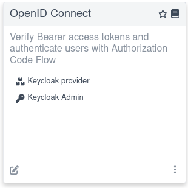

Click the **Keycloak provider** link. This action opens a Keycloak page whose appearance varies depending on how the Dev Services for Keycloak feature is configured.

<a id="develop-service-applications"></a>
### Developing service applications

By default, the Keycloak page can be used to support the development of a [Quarkus OIDC service application](/guides/security-oidc-bearer-token-authentication/index.md).

<a id="keycloak-authorization-code-grant"></a>
#### Authorization code grant

If you set `quarkus.oidc.devui.grant.type=code` in the `application.properties` file (this is a default value), then an `authorization_code` grant is used to acquire both access and ID tokens. Using this grant is recommended to emulate a typical flow where a single page application (SPA) acquires the tokens and uses them to access Quarkus services.

First, you see an option to **Log into Single Page Application**. For example:

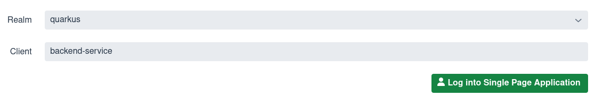

Choose the Keycloak realm and client ID to use during the authentication process.

> [!NOTE]
> This SPA represents a public OpenID Connect client; therefore, the client IDs you enter must identify public Keycloak clients that have no secrets. This is because SPA is not a web application and cannot securely handle the secrets it needs to complete the authorization code flow if the client secret is also expected to complete the authorization code flow.
>
> The clients requiring secrets can only be supported with this SPA if a default realm has been created or if `quarkus.oidc.credentials.secret` is configured and a single custom realm is used. In both cases, the SPA can figure out the client secret it might need to complete the authorization code flow after Keycloak redirects the user back to it.

Next, after selecting **Log into Single Page Application**, you are redirected to Keycloak to authenticate, for example, as `alice:alice`. Then, you are returned to the page representing the SPA:

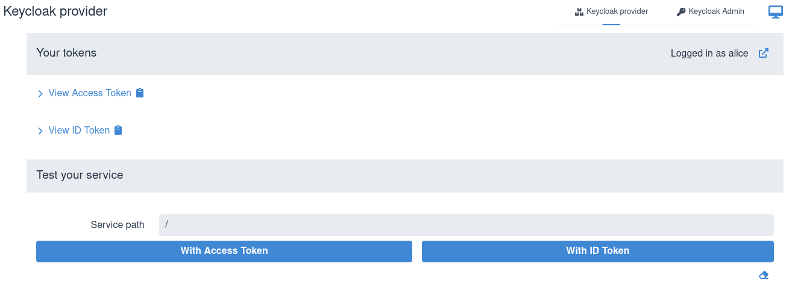

You can view the acquired access and ID tokens, for example:

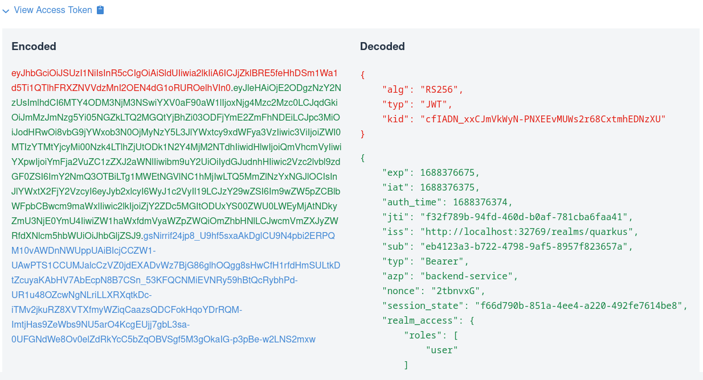

This view shows the encoded JSON Web Token (JWT) token on the left side and highlights the headers in red, payload or claims in green, and signature in blue. It also shows the decoded JWT token on the right side, where you can see the header, claim names, and their values.

Next, test the service by entering a relative service path and sending a token. SPA usually sends access tokens to the application endpoint, so choose the **With Access Token** option, for example:

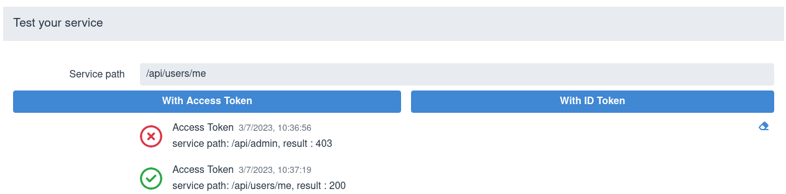

To clear the test results area, use the eraser icon in the lower right corner.

Sometimes, ID tokens are forwarded to application frontends as bearer tokens. This helps endpoints identify the user logged into SPA or perform out-of-band token verification. Choose the **With ID Token** option in such cases.

> [!NOTE]
> When you import custom Keycloak realms, you may find, after inspecting both the access and ID tokens in Dev UI, that only the access token contains the list of roles in its `groups` claim. This information is important for accessing endpoints that are secured with the `@RolesAllowed` annotation. To tell Keycloak to include this information in the ID token, add the `microprofile-jwt` scope to the list of client scopes in the Keycloak admin console. Alternatively, add the `microprofile-jwt` scope to the list of required scopes using the `quarkus.oidc.authentication.scopes` property.
>
> For more information, see the [Keycloak server administration guide](https://www.keycloak.org/docs/latest/server_admin/#protocol).

Manually entering the service paths is not ideal. For information about enabling Swagger or GraphQL UI for testing the service with the access token already acquired by the OIDC Dev UI, see the [Test with Swagger UI or GraphQL UI](#test-with-swagger-graphql) section.

Finally, you can click **Log Out**


so you can authenticate to Keycloak as a different user.

Keycloak might return an error when you try to **Log into Single Page Application**. For example, `quarkus.oidc.client-id` might not match the client ID in the realm imported to Keycloak, or the client in this realm might not be configured correctly to support the authorization code flow. In such cases, Keycloak returns an `error_description` query parameter, and the Dev UI also shows this error description. For example:

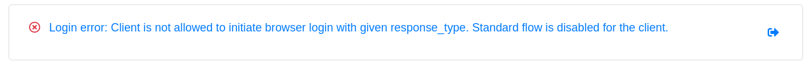

If the error occurs, log in to Keycloak by using the **Keycloak Admin** option, update the realm configuration as necessary, and check the `application.properties`.

<a id="test-with-swagger-graphql"></a>
##### Test with Swagger UI or GraphQL UI

You can avoid manually entering the service paths and test your service with Swagger UI or GraphQL UI if `quarkus-smallrye-openapi` or `quarkus-smallrye-graphql` are used in your project. For example, start Quarkus in dev mode with both `quarkus-smallrye-openapi` and `quarkus-smallrye-graphql` dependencies. You can see the following options after logging in to Keycloak:

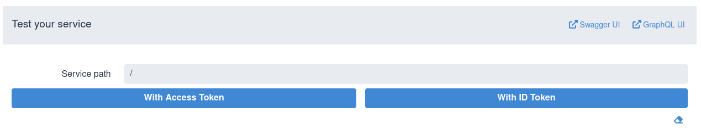

For example, clicking **Swagger UI** opens the Swagger UI in a new browser tab where you can test the service by using the token acquired by Dev UI for Keycloak. The Swagger UI does not try to re-authenticate again. In the Swagger UI, do not choose a Swagger UI `Authorize` option; the OIDC Dev UI has authorized and provided the access token for Swagger UI to use for testing.

Integration with GraphQL UI works similarly; the access token acquired by Dev UI for Keycloak is used.

> [!NOTE]
> You might need to register a redirect URI for the authorization code flow initiated by Dev UI for Keycloak to work. This is because Keycloak might enforce that the authenticated users are redirected only to the configured redirect URI. It is recommended to do this in production to avoid the users being redirected to the wrong endpoints, which might happen if the correct `redirect_uri` parameter in the authentication request URI has been manipulated.
>
> If Keycloak enforces it, you see an authentication error informing you that the `redirect_uri` value is wrong.
>
> In this case, select the **Keycloak Admin** option in the top right corner, login as `admin:admin`, select the test realm and the client which Dev UI for Keycloak is configured with, and add `http://localhost:8080/q/dev-ui/quarkus-oidc/keycloak-provider` to `Valid Redirect URIs`. If you used `-Dquarkus.http.port` when starting Quarkus, then change `8080` to the value of `quarkus.http.port`
>
> If the container is shared between multiple applications running on different ports, you must register `redirect_uri` values for each application.
>
> You can set the `redirect_uri` value to `*` only for test purposes, especially when the containers are shared between multiple applications.
>
> If no custom realm is imported, Dev Services for Keycloak sets the `redirect_uri` value to `*` when it creates a default realm.

#### Implicit grant

If you set `quarkus.oidc.devui.grant.type=implicit` in the `application.properties` file, then an `implicit` grant is used to acquire both access and ID tokens. Use this grant to emulate a single page application only if the authorization code grant does not work; for example, when a client is configured in Keycloak to support an implicit grant.

#### Password grant

If you set `quarkus.oidc.devui.grant.type=password` in the `application.properties` file, then you see a screen similar to this one:

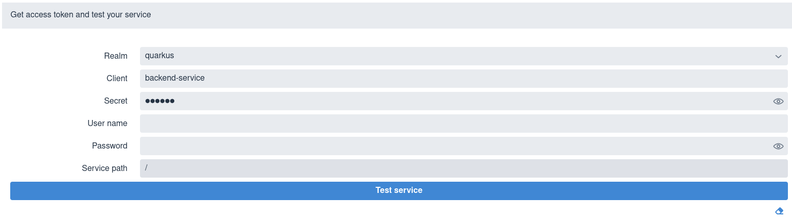

Select a realm, enter a client ID and secret, user name and password, a relative service endpoint path, and click **Test service**. It returns a status code, such as `200`, `403`, `401`, or `404`. If the username is also set in the `quarkus.keycloak.devservices.users` map property containing usernames and passwords, then you do not have to set a password when testing the service. Be aware that you do not have to initialize `quarkus.keycloak.devservices.users` to test the service by using the `password` grant.

In the Dev UI console, you can also see output similar to the following:

```shell
2021-07-19 17:58:11,407 INFO  [io.qua.oid.dep.dev.key.KeycloakDevConsolePostHandler] (security-openid-connect-quickstart-dev.jar) (DEV Console action) Using password grant to get a token from 'http://localhost:32818/realms/quarkus/protocol/openid-connect/token' for user 'alice' in realm 'quarkus' with client id 'quarkus-app'
2021-07-19 17:58:11,533 INFO  [io.qua.oid.dep.dev.key.KeycloakDevConsolePostHandler] (security-openid-connect-quickstart-dev.jar) (DEV Console action) Test token: eyJhbGciOiJSUzI1NiIsInR5cCIgOiAiSldUIiwia2lkIiA6ICJ6Z2tDazJQZ1JaYnVlVG5kcTFKSW1sVnNoZ2hhbWhtbnBNcXU0QUt5MnJBIn0.ey...
2021-07-19 17:58:11,536 INFO  [io.qua.oid.dep.dev.key.KeycloakDevConsolePostHandler] (security-openid-connect-quickstart-dev.jar) (DEV Console action) Sending token to 'http://localhost:8080/api/admin'
2021-07-19 17:58:11,674 INFO  [io.qua.oid.dep.dev.key.KeycloakDevConsolePostHandler] (security-openid-connect-quickstart-dev.jar) (DEV Console action) Result: 200
```

A token is acquired from Keycloak by using a `password` grant and is sent to the service endpoint.

#### Client credentials grant

If you set `quarkus.oidc.devui.grant.type=client`, then a `client_credentials` grant is used to acquire a token, with the page showing no **User** field in this case:

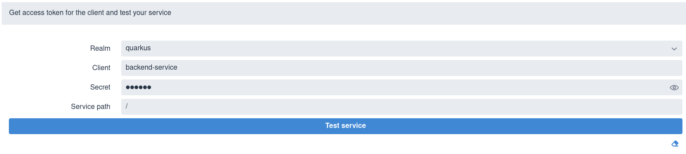

Select a realm, enter the client ID and secret, a relative service endpoint path, and click **Test service**. It returns a status code, such as `200`, `403`, `401`, or `404`.

<a id="develop-web-app-applications"></a>
### Developing OpenID Connect web-app applications

To develop a [Quarkus OIDC web application](/guides/security-oidc-code-flow-authentication/index.md), set `quarkus.oidc.application-type=web-app` in the `application.properties` file before starting the application.

Starting the application displays a screen similar to this one:


Set a relative service endpoint path and click **Log in to your web application**. You are redirected to Keycloak to enter a username and password in a new browser tab before you get a response from the Quarkus application.

### Running the tests

You can run the tests against a Keycloak container started in a test mode in a [Continuous Testing](/guides/continuous-testing/index.md) mode.

It is also recommended to run the integration tests against Keycloak by using Dev Services for Keycloak. For more information, see [Testing OpenID Connect Service Applications with Dev Services](/guides/security-oidc-bearer-token-authentication/index.md#bearer-token-integration-testing-keycloak-devservices) and [Testing OpenID Connect WebApp Applications with Dev Services](/guides/security-oidc-code-flow-authentication/index.md#code-flow-integration-testing-keycloak-devservices).

<a id="keycloak-initialization"></a>
### Keycloak initialization

The `quay.io/keycloak/keycloak:26.7.4` image which contains a Keycloak distribution powered by Quarkus is used to start a container by default. `quarkus.keycloak.devservices.image-name` can be used to change the Keycloak image name. For example, set it to `quay.io/keycloak/keycloak:19.0.3-legacy` to use a Keycloak distribution powered by WildFly. Be aware that a Quarkus-based Keycloak distribution is only available starting from Keycloak `20.0.0`.

Dev Services for Keycloak initializes a launched Keycloak server next.

By default, the `quarkus` and `quarkus-app` client with a `secret` password, `alice` and `bob` users (with the passwords matching the names), and `user` and `admin` roles are created, with `alice` given both `admin` and `user` roles and `bob` - the `user` role.

Usernames, secrets, and their roles can be customized with `quarkus.keycloak.devservices.users` (the map which contains usernames and secrets) and `quarkus.keycloak.devservices.roles` (the map which contains usernames and comma-separated role values).

For example:

```properties
%dev.quarkus.keycloak.devservices.users.duke=dukePassword
%dev.quarkus.keycloak.devservices.roles.duke=reader
%dev.quarkus.keycloak.devservices.users.john=johnPassword
%dev.quarkus.keycloak.devservices.roles.john=reader,writer
```

This configuration creates two users: \* `duke` with a `dukePassword` password and a `reader` role \* `john` with a `johnPassword` password and `reader` and `writer` roles

To customize the client ID and secret, you can use the `quarkus.oidc.client-id` and `quarkus.oidc.credentials.secret` properties. Additionally, you can adjust the lifespans of the access token and SSO session with the `quarkus.keycloak.devservices.access-token-lifespan` and `quarkus.keycloak.devservices.sso-session-max-lifespan` properties, which are set to 10 minutes by default.

However, it is likely that your Keycloak configuration is more complex and requires setting more properties.

This is why `quarkus.keycloak.devservices.realm-path` is always checked before initializing Keycloak with the default or configured realm, client, user, and roles properties. If the realm file exists on the file system or classpath, then only this realm is used to initialize Keycloak, for example:

```properties
quarkus.keycloak.devservices.realm-path=quarkus-realm.json
```

You can use `quarkus.keycloak.devservices.realm-path` to initialize Keycloak with multiple realm files by providing a comma-separated list of files:

```
quarkus.keycloak.devservices.realm-path=quarkus-realm1.json,quarkus-realm2.json
```

Also, the Keycloak page offers an option to `Sign In To Keycloak To Configure Realms` by using a **Keycloak Admin** option in the right top corner:


Sign in to Keycloak as `admin:admin` to further customize the realm properties, create or import a new realm, or export the realm.

You can also copy classpath and file system resources to the container. For example, if your application configures Keycloak authorization with [JavaScript policies](https://www.keycloak.org/docs/latest/authorization_services/index.html#_policy_js) that are deployed to Keycloak in a jar file, then you can configure `Dev Services for Keycloak` to copy this jar to the Keycloak container as follows:

```properties
quarkus.keycloak.devservices.resource-aliases.policies=/policies.jar <1>
quarkus.keycloak.devservices.resource-mappings.policies=/opt/keycloak/providers/policies.jar <2>
```

1. `policies` alias is created for the classpath `/policies.jar` resource. Policy jars can also be located in the file system.
2. The policies jar is mapped to the `/opt/keycloak/providers/policies.jar` container location.

## Disable HTTPS

In some cases, you might see Keycloak `HTTPS required` errors that cause either Keycloak startup or communication failures.

You might be facing a Docker issue that mainly affects MacOS users attempting to use Keycloak locally where the ports do not automatically bind to `localhost`.

The easiest option to resolve it is to disable HTTPS with a `quarkus.keycloak.devservices.disable-https=true` property. It runs the following Keycloak admin command inside your Keycloak container everytime it restarts:

```bash
kcadm.sh update realms/master -s sslRequired=NONE
```

Another approach is to provide a localhost with port bindings configuration.

A common solution is to update your `docker-compose` file to use a private IPv4 address, such as `localhost`. For example:

```yaml
    ports:
      - "127.0.0.1:8081:8080"
```

Alternatively, you can change the default behaviour within MacOS Docker Desktop to use `localhost` when binding ports. Inside the Docker Desktop, go to `Settings > Resources > Network > Port Binding Behaviour` and change it to `localhost by default`. Be aware that this change is applied to all docker containers, and may have unforeseen side affects. Update to the latest version of Docker if you do not see this Docker Desktop option.

## Disable Dev Services for Keycloak

Dev Services for Keycloak is not activated if either `quarkus.oidc.auth-server-url` is already initialized or the default OIDC tenant is disabled with `quarkus.oidc.tenant.enabled=false`, regardless of whether you work with Keycloak or not.

If you prefer not to have a Dev Services for Keycloak container started or do not work with Keycloak, then you can also disable this feature with `quarkus.keycloak.devservices.enabled=false` - it is only necessary if you expect to start `quarkus:dev` without `quarkus.oidc.auth-server-url`.

The main Dev UI page includes an empty **OpenID Connect** card when Dev Services for Keycloak is disabled and the `quarkus.oidc.auth-server-url` property has not been initialized:

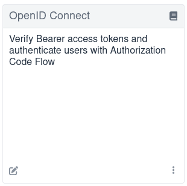

If `quarkus.oidc.auth-server-url` is already set, then a generic OpenID Connect Dev Console, which can be used with all OpenID Connect providers, can be activated. For more information, see the [Dev UI for all OpenID Connect providers](#dev-ui-all-oidc-providers) section.

<a id="dev-ui-all-oidc-providers"></a>
## Dev UI for all OpenID Connect providers

The Dev UI for all OpenID Connect providers is activated if the following conditions are met:

- The `quarkus.oidc.auth-server-url` points to an already started OpenID Connect provider, which can be Keycloak or other provider.
- The `quarkus.oidc.application-type` is set to `service`, the default value, or `hybrid`.
- The `quarkus.oidc.client-id` is set.

Setting `quarkus.oidc.credentials.secret` is most likely required for Keycloak and other providers for the authorization code flow initiated from Dev UI to complete unless the client identified with `quarkus.oidc.client-id` is configured as a public client in your OpenID Connect provider's administration console.

For example, you can use Dev UI to test Google authentication with this configuration:

```properties
quarkus.oidc.provider=google
quarkus.oidc.application-type=hybrid
quarkus.oidc.client-id=${google-client-id}
quarkus.oidc.credentials.secret=${google-client-secret}
```

Run:

**CLI**

```bash
quarkus dev
```

**Maven**

```bash
./mvnw quarkus:dev
```

**Gradle**

```bash
./gradlew --console=plain quarkusDev
```

This command outputs a message similar to the following example:

```shell
...
2021-09-07 15:53:42,697 INFO  [io.qua.oid.dep.dev.OidcDevConsoleProcessor] (build-41) OIDC Dev Console: discovering the provider metadata at https://accounts.google.com/.well-known/openid-configuration
...
```

If the provider metadata discovery has been successful, then after you open the main [Dev UI page](http://localhost:8080/q/dev), you can see the following **OpenID Connect** card referencing a `Google` provider:

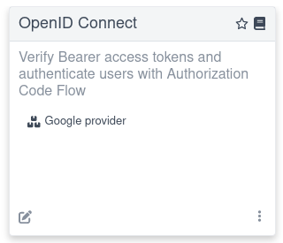

Follow the link to log in to your provider, get the tokens, and test the application. The experience is the same as described in the [Authorization code grant for Keycloak](#keycloak-authorization-code-grant) section, where the Dev Services for Keycloak container has been started, especially if you work with Keycloak.

You likely need to configure your OpenID Connect provider to support redirecting back to the `Dev Console`. You add `http://localhost:8080/q/dev-ui/quarkus-oidc/<providerName>-provider` as one of the supported redirect and logout URLs, where `<providerName>` must be replaced by the name of the provider shown in the Dev UI, for example, `auth0`.

The Dev UI experience described in the [Authorization code grant for Keycloak](#keycloak-authorization-code-grant) section might differ slightly if you work with other providers. For example, an access token might not be in JWT format, so it would not be possible to show its internal content. However, all providers should return ID tokens in the JWT format.

> [!NOTE]
> The current access token is used by default to test the service with Swagger UI or GrapghQL UI. If the provider (other than Keycloak) returns a binary access token, then it is used with Swagger UI or GrapghQL UI only if this provider has a token introspection endpoint; otherwise, an `IdToken`, which is always in a JWT format is passed to Swagger UI or GrapghQL UI. In such cases, you can verify with the manual Dev UI test that `401` is always returned for the current binary access token. Also, note that using `IdToken` as a fallback with either of these user interfaces is only possible with the authorization code flow.

Some providers, such as `Auth0` do not support a standard RP-initiated logout, so the provider-specific logout properties must be configured for a logout option to be visible. For more information, see [User-initiated logout](/guides/security-oidc-code-flow-authentication/index.md#user-initiated-logout) section in the "OpenID Connect authorization code flow mechanism for protecting web applications" guide.

Similarly, if you want to use a `password` or `client_credentials` grant for Dev UI to acquire the tokens, then you might need to configure some extra provider-specific properties, for example:

```properties
quarkus.oidc.devui.grant.type=password
quarkus.oidc.devui.grant-options.password.audience=http://localhost:8080
```

## Non-application root path considerations

This document refers to the `http://localhost:8080/q/dev-ui` Dev UI URL in several places where `q` is a default non-application root path. If you customize `quarkus.http.root-path` or `quarkus.http.non-application-root-path` properties, then replace `q` accordingly. For more information, see the [Path resolution in Quarkus](https://quarkus.io/blog/path-resolution-in-quarkus/) blog post.

<a id="dev-services-for-oidc"></a>
## Dev Services for OIDC

When you work with Keycloak in production, [Dev Services for Keycloak](#dev-services-for-keycloak) provides the best dev mode experience. For other OpenID Connect providers, it is recommended to enable the Dev Services for OIDC like in the example below:

```properties
quarkus.oidc.devservices.enabled=true
```

> [!NOTE]
> the Dev Services for OIDC are enabled by default if Docker and Podman are not available.

Once enabled, Quarkus starts a new OIDC server that supports most common OpenID Connect operations. You can confirm in your console that the OIDC server started, you will see output similar to the following:

```shell
2025-01-08 20:50:20,900 INFO  [io.qua.dev.oid.OidcDevServicesProcessor] (build-16) Dev Services for OIDC started on http://localhost:38139
```

If you navigate to the [Dev UI for all OpenID Connect providers](#dev-ui-all-oidc-providers), you can log into the OIDC server as builtin users `alice` or `bob`:

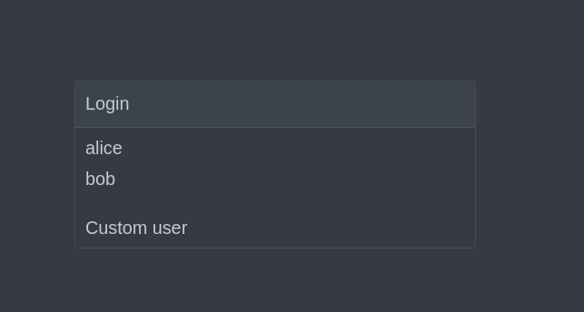

This login page is also displayed if you navigate to authenticated request path during the development of the [Quarkus OIDC web application](/guides/security-oidc-code-flow-authentication/index.md). As always, the default roles for `alice` are `admin` and `user`, while the roles for `bob` are just `user`. You can configure those built-in roles if required:

```properties
quarkus.oidc.devservices.roles.alice=root <1>
quarkus.oidc.devservices.roles.bob=guest
```

1. Assign a `root` role to the user `alice`.

Another option is log in as a custom user with the username and roles of your choice:

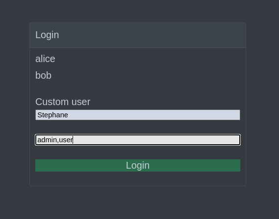

Whichever user you choose, no password is required.

## Configuration reference

### Keycloak Dev Services

[lock] Configuration property fixed at build time - All other configuration properties are overridable at runtime

|  |  |  |
| --- | --- | --- |
| <mark>Configuration property</mark> | Type | Default |
| [lock] <a id="quarkus-devservices-keycloak_quarkus-keycloak-devservices-enabled"></a> [`quarkus.keycloak.devservices.enabled`](#quarkus-devservices-keycloak_quarkus-keycloak-devservices-enabled) config_property_copy_button:+++quarkus.keycloak.devservices.enabled+++[]<br><br>Flag to enable (default) or disable Dev Services. When enabled, Dev Services for Keycloak automatically configures and starts Keycloak in Dev or Test mode, and when Docker is running.<br><br>Environment variable: env_var_with_copy_button:+++QUARKUS_KEYCLOAK_DEVSERVICES_ENABLED+++[] | boolean | `true` |
| [lock] <a id="quarkus-devservices-keycloak_quarkus-keycloak-devservices-image-name"></a> [`quarkus.keycloak.devservices.image-name`](#quarkus-devservices-keycloak_quarkus-keycloak-devservices-image-name) config_property_copy_button:+++quarkus.keycloak.devservices.image-name+++[]<br><br>The container image name for Dev Services providers. Defaults to a Quarkus-based Keycloak image. For a WildFly-based distribution, use an image like `quay.io/keycloak/keycloak:19.0.3-legacy`. Keycloak Quarkus and WildFly images are initialized differently. Dev Services for Keycloak will assume it is a Keycloak Quarkus image unless the image version ends with `-legacy`. Override with `quarkus.keycloak.devservices.keycloak-x-image`.<br><br>Environment variable: env_var_with_copy_button:+++QUARKUS_KEYCLOAK_DEVSERVICES_IMAGE_NAME+++[] | string | `quay.io/keycloak/keycloak:26.7.4` |
| [lock] <a id="quarkus-devservices-keycloak_quarkus-keycloak-devservices-keycloak-x-image"></a> [`quarkus.keycloak.devservices.keycloak-x-image`](#quarkus-devservices-keycloak_quarkus-keycloak-devservices-keycloak-x-image) config_property_copy_button:+++quarkus.keycloak.devservices.keycloak-x-image+++[]<br><br>Indicates if a Keycloak-X image is used. By default, the image is identified by `keycloak-x` in the image name. For custom images, override with `quarkus.keycloak.devservices.keycloak-x-image`. You do not need to set this property if the default check works.<br><br>Environment variable: env_var_with_copy_button:+++QUARKUS_KEYCLOAK_DEVSERVICES_KEYCLOAK_X_IMAGE+++[] | boolean |  |
| [lock] <a id="quarkus-devservices-keycloak_quarkus-keycloak-devservices-shared"></a> [`quarkus.keycloak.devservices.shared`](#quarkus-devservices-keycloak_quarkus-keycloak-devservices-shared) config_property_copy_button:+++quarkus.keycloak.devservices.shared+++[]<br><br>Determines if the Keycloak container is shared. When shared, Quarkus uses label-based service discovery to find and reuse a running Keycloak container, so a second one is not started. Otherwise, if a matching container is not is found, a new container is started. The service discovery uses the `quarkus-dev-service-label` label, whose value is set by the `service-name` property. Container sharing is available only in dev mode.<br><br>Environment variable: env_var_with_copy_button:+++QUARKUS_KEYCLOAK_DEVSERVICES_SHARED+++[] | boolean | `true` |
| [lock] <a id="quarkus-devservices-keycloak_quarkus-keycloak-devservices-service-name"></a> [`quarkus.keycloak.devservices.service-name`](#quarkus-devservices-keycloak_quarkus-keycloak-devservices-service-name) config_property_copy_button:+++quarkus.keycloak.devservices.service-name+++[]<br><br>The value of the `quarkus-dev-service-keycloak` label for identifying the Keycloak container. Used in shared mode to locate an existing container with this label. If not found, a new container is initialized with this label. Applicable only in dev mode.<br><br>Environment variable: env_var_with_copy_button:+++QUARKUS_KEYCLOAK_DEVSERVICES_SERVICE_NAME+++[] | string | `keycloak` |
| [lock] <a id="quarkus-devservices-keycloak_quarkus-keycloak-devservices-realm-path"></a> [`quarkus.keycloak.devservices.realm-path`](#quarkus-devservices-keycloak_quarkus-keycloak-devservices-realm-path) config_property_copy_button:+++quarkus.keycloak.devservices.realm-path+++[]<br><br>A comma-separated list of class or file system paths to Keycloak realm files. This list is used to initialize Keycloak. The first value in this list is used to initialize default tenant connection properties.<br><br>To learn more about Keycloak realm files, consult the [Importing and Exporting Keycloak Realms documentation](https://www.keycloak.org/server/importExport).<br><br>Environment variable: env_var_with_copy_button:+++QUARKUS_KEYCLOAK_DEVSERVICES_REALM_PATH+++[] | list of string |  |
| [lock] <a id="quarkus-devservices-keycloak_quarkus-keycloak-devservices-resource-aliases-alias-name"></a> [`quarkus.keycloak.devservices.resource-aliases."alias-name"`](#quarkus-devservices-keycloak_quarkus-keycloak-devservices-resource-aliases-alias-name) config_property_copy_button:+++quarkus.keycloak.devservices.resource-aliases."alias-name"+++[]<br><br>Aliases to additional class or file system resources that are used to initialize Keycloak. Each map entry represents a mapping between an alias and a class or file system resource path.<br><br>Environment variable: env_var_with_copy_button:+++QUARKUS_KEYCLOAK_DEVSERVICES_RESOURCE_ALIASES__ALIAS_NAME_+++[] | Map\<String,String> |  |
| [lock] <a id="quarkus-devservices-keycloak_quarkus-keycloak-devservices-resource-mappings-resource-name"></a> [`quarkus.keycloak.devservices.resource-mappings."resource-name"`](#quarkus-devservices-keycloak_quarkus-keycloak-devservices-resource-mappings-resource-name) config_property_copy_button:+++quarkus.keycloak.devservices.resource-mappings."resource-name"+++[]<br><br>Additional class or file system resources that are used to initialize Keycloak. Each map entry represents a mapping between a class or file system resource path alias and the Keycloak container location.<br><br>Environment variable: env_var_with_copy_button:+++QUARKUS_KEYCLOAK_DEVSERVICES_RESOURCE_MAPPINGS__RESOURCE_NAME_+++[] | Map\<String,String> |  |
| [lock] <a id="quarkus-devservices-keycloak_quarkus-keycloak-devservices-java-opts"></a> [`quarkus.keycloak.devservices.java-opts`](#quarkus-devservices-keycloak_quarkus-keycloak-devservices-java-opts) config_property_copy_button:+++quarkus.keycloak.devservices.java-opts+++[]<br><br>The `JAVA_OPTS` passed to the keycloak JVM<br><br>Environment variable: env_var_with_copy_button:+++QUARKUS_KEYCLOAK_DEVSERVICES_JAVA_OPTS+++[] | string |  |
| [lock] <a id="quarkus-devservices-keycloak_quarkus-keycloak-devservices-show-logs"></a> [`quarkus.keycloak.devservices.show-logs`](#quarkus-devservices-keycloak_quarkus-keycloak-devservices-show-logs) config_property_copy_button:+++quarkus.keycloak.devservices.show-logs+++[]<br><br>Show Keycloak log messages with a "Keycloak:" prefix.<br><br>Environment variable: env_var_with_copy_button:+++QUARKUS_KEYCLOAK_DEVSERVICES_SHOW_LOGS+++[] | boolean | `false` |
| [lock] <a id="quarkus-devservices-keycloak_quarkus-keycloak-devservices-start-command"></a> [`quarkus.keycloak.devservices.start-command`](#quarkus-devservices-keycloak_quarkus-keycloak-devservices-start-command) config_property_copy_button:+++quarkus.keycloak.devservices.start-command+++[]<br><br>Keycloak start command. Use this property to experiment with Keycloak start options, see `https://www.keycloak.org/server/all-config`. Note, it is ignored when loading legacy Keycloak WildFly images.<br><br>Environment variable: env_var_with_copy_button:+++QUARKUS_KEYCLOAK_DEVSERVICES_START_COMMAND+++[] | string |  |
| [lock] <a id="quarkus-devservices-keycloak_quarkus-keycloak-devservices-features"></a> [`quarkus.keycloak.devservices.features`](#quarkus-devservices-keycloak_quarkus-keycloak-devservices-features) config_property_copy_button:+++quarkus.keycloak.devservices.features+++[]<br><br>Keycloak features. Use this property to enable one or more experimental Keycloak features. Note, if you also have to customize a Keycloak `start-command()`, you can use a `--features` option as part of the start command sequence, instead of configuring this property.<br><br>Environment variable: env_var_with_copy_button:+++QUARKUS_KEYCLOAK_DEVSERVICES_FEATURES+++[] | list of string |  |
| [lock] <a id="quarkus-devservices-keycloak_quarkus-keycloak-devservices-realm-name"></a> [`quarkus.keycloak.devservices.realm-name`](#quarkus-devservices-keycloak_quarkus-keycloak-devservices-realm-name) config_property_copy_button:+++quarkus.keycloak.devservices.realm-name+++[]<br><br>The name of the Keycloak realm. This property is used to create the realm if the realm file pointed to by the `realm-path` property does not exist. The default value is `quarkus` in this case. It is recommended to always set this property so that Dev Services for Keycloak can identify the realm name without parsing the realm file.<br><br>Environment variable: env_var_with_copy_button:+++QUARKUS_KEYCLOAK_DEVSERVICES_REALM_NAME+++[] | string |  |
| [lock] <a id="quarkus-devservices-keycloak_quarkus-keycloak-devservices-create-realm"></a> [`quarkus.keycloak.devservices.create-realm`](#quarkus-devservices-keycloak_quarkus-keycloak-devservices-create-realm) config_property_copy_button:+++quarkus.keycloak.devservices.create-realm+++[]<br><br>Specifies whether to create the Keycloak realm when no realm file is found at the `realm-path`. Set to `false` if the realm is to be created using either the Keycloak Administration Console or the Keycloak Admin API provided by `io.quarkus.test.common.QuarkusTestResourceLifecycleManager`.<br><br>Environment variable: env_var_with_copy_button:+++QUARKUS_KEYCLOAK_DEVSERVICES_CREATE_REALM+++[] | boolean | `true` |
| [lock] <a id="quarkus-devservices-keycloak_quarkus-keycloak-devservices-create-client"></a> [`quarkus.keycloak.devservices.create-client`](#quarkus-devservices-keycloak_quarkus-keycloak-devservices-create-client) config_property_copy_button:+++quarkus.keycloak.devservices.create-client+++[]<br><br>Specifies whether to create the default client id `quarkus-app` with a secret `secret` and register them if the `create-realm` property is set to true. For OIDC extension configuration properties `quarkus.oidc.client.id` and `quarkus.oidc.credentials.secret` will be configured. For OIDC Client extension configuration properties `quarkus.oidc-client.client.id` and `quarkus.oidc-client.credentials.secret` will be configured. Set to `false` if clients have to be created using either the Keycloak Administration Console or the Keycloak Admin API provided by `io.quarkus.test.common.QuarkusTestResourceLifecycleManager` or registered dynamically.<br><br>Environment variable: env_var_with_copy_button:+++QUARKUS_KEYCLOAK_DEVSERVICES_CREATE_CLIENT+++[] | boolean | `true` |
| [lock] <a id="quarkus-devservices-keycloak_quarkus-keycloak-devservices-start-with-disabled-tenant"></a> [`quarkus.keycloak.devservices.start-with-disabled-tenant`](#quarkus-devservices-keycloak_quarkus-keycloak-devservices-start-with-disabled-tenant) config_property_copy_button:+++quarkus.keycloak.devservices.start-with-disabled-tenant+++[]<br><br>Specifies whether to start the container even if the default OIDC tenant is disabled. Setting this property to true may be necessary in a multi-tenant OIDC setup, especially when OIDC tenants are created dynamically.<br><br>Environment variable: env_var_with_copy_button:+++QUARKUS_KEYCLOAK_DEVSERVICES_START_WITH_DISABLED_TENANT+++[] | boolean | `false` |
| [lock] <a id="quarkus-devservices-keycloak_quarkus-keycloak-devservices-users-users"></a> [`quarkus.keycloak.devservices.users."users"`](#quarkus-devservices-keycloak_quarkus-keycloak-devservices-users-users) config_property_copy_button:+++quarkus.keycloak.devservices.users."users"+++[]<br><br>A map of Keycloak usernames to passwords. If empty, default users `alice` and `bob` are created with their names as passwords. This map is used for user creation when no realm file is found at the `realm-path`.<br><br>Environment variable: env_var_with_copy_button:+++QUARKUS_KEYCLOAK_DEVSERVICES_USERS__USERS_+++[] | Map\<String,String> |  |
| [lock] <a id="quarkus-devservices-keycloak_quarkus-keycloak-devservices-roles-role-name"></a> [`quarkus.keycloak.devservices.roles."role-name"`](#quarkus-devservices-keycloak_quarkus-keycloak-devservices-roles-role-name) config_property_copy_button:+++quarkus.keycloak.devservices.roles."role-name"+++[]<br><br>A map of roles for Keycloak users. If empty, default roles are assigned: `alice` receives `admin` and `user` roles, while other users receive `user` role. This map is used for role creation when no realm file is found at the `realm-path`.<br><br>Environment variable: env_var_with_copy_button:+++QUARKUS_KEYCLOAK_DEVSERVICES_ROLES__ROLE_NAME_+++[] | Map\<String,List\<String>> |  |
| [lock] <a id="quarkus-devservices-keycloak_quarkus-keycloak-devservices-port"></a> [`quarkus.keycloak.devservices.port`](#quarkus-devservices-keycloak_quarkus-keycloak-devservices-port) config_property_copy_button:+++quarkus.keycloak.devservices.port+++[]<br><br>The specific port for the dev service to listen on.<br><br>If not specified, a random port is selected.<br><br>Environment variable: env_var_with_copy_button:+++QUARKUS_KEYCLOAK_DEVSERVICES_PORT+++[] | int |  |
| [lock] <a id="quarkus-devservices-keycloak_quarkus-keycloak-devservices-container-env-environment-variable-name"></a> [`quarkus.keycloak.devservices.container-env."environment-variable-name"`](#quarkus-devservices-keycloak_quarkus-keycloak-devservices-container-env-environment-variable-name) config_property_copy_button:+++quarkus.keycloak.devservices.container-env."environment-variable-name"+++[]<br><br>Environment variables to be passed to the container.<br><br>Environment variable: env_var_with_copy_button:+++QUARKUS_KEYCLOAK_DEVSERVICES_CONTAINER_ENV__ENVIRONMENT_VARIABLE_NAME_+++[] | Map\<String,String> |  |
| [lock] <a id="quarkus-devservices-keycloak_quarkus-keycloak-devservices-container-memory-limit"></a> [`quarkus.keycloak.devservices.container-memory-limit`](#quarkus-devservices-keycloak_quarkus-keycloak-devservices-container-memory-limit) config_property_copy_button:+++quarkus.keycloak.devservices.container-memory-limit+++[]<br><br>Memory limit for Keycloak container, up to `Long.MAX_VALUE` bytes.<br><br>If not specified, 1250MiB is the default memory limit.<br><br>Environment variable: env_var_with_copy_button:+++QUARKUS_KEYCLOAK_DEVSERVICES_CONTAINER_MEMORY_LIMIT+++[] | MemorySize [[question circle]](#memory-size-note-anchor-quarkus-devservices-keycloak_quarkus-keycloak) | `1250M` |
| [lock] <a id="quarkus-devservices-keycloak_quarkus-keycloak-devservices-web-client-timeout"></a> [`quarkus.keycloak.devservices.web-client-timeout`](#quarkus-devservices-keycloak_quarkus-keycloak-devservices-web-client-timeout) config_property_copy_button:+++quarkus.keycloak.devservices.web-client-timeout+++[]<br><br>The WebClient timeout. Use this property to configure how long an HTTP client used by OIDC dev service admin client will wait for a response from OpenId Connect Provider when acquiring admin token and creating realm.<br><br>Environment variable: env_var_with_copy_button:+++QUARKUS_KEYCLOAK_DEVSERVICES_WEB_CLIENT_TIMEOUT+++[] | [Duration](https://docs.oracle.com/en/java/javase/17/docs/api/java.base/java/time/Duration.html) [[question circle]](#duration-note-anchor-quarkus-devservices-keycloak_quarkus-keycloak) | `4S` |
| [lock] <a id="quarkus-devservices-keycloak_quarkus-keycloak-devservices-disable-https"></a> [`quarkus.keycloak.devservices.disable-https`](#quarkus-devservices-keycloak_quarkus-keycloak-devservices-disable-https) config_property_copy_button:+++quarkus.keycloak.devservices.disable-https+++[]<br><br>Specifies whether to disable HTTPS on the master realm by setting `sslRequired=NONE`. This is useful when the Keycloak container is started without HTTPS support and the master realm's default SSL requirement prevents HTTP access.<br><br>Environment variable: env_var_with_copy_button:+++QUARKUS_KEYCLOAK_DEVSERVICES_DISABLE_HTTPS+++[] | boolean | `false` |
| [lock] <a id="quarkus-devservices-keycloak_quarkus-keycloak-devservices-host-accessible-ports"></a> [`quarkus.keycloak.devservices.host-accessible-ports`](#quarkus-devservices-keycloak_quarkus-keycloak-devservices-host-accessible-ports) config_property_copy_button:+++quarkus.keycloak.devservices.host-accessible-ports+++[]<br><br>The host ports to expose to the Keycloak container. When this list is non-empty, the host is made accessible from the container using the `host.testcontainers.internal` hostname, and only the listed ports are exposed. This may be necessary when Keycloak needs to make HTTP callbacks to the application running on the host.<br><br>Environment variable: env_var_with_copy_button:+++QUARKUS_KEYCLOAK_DEVSERVICES_HOST_ACCESSIBLE_PORTS+++[] | list of int |  |
| [lock] <a id="quarkus-devservices-keycloak_quarkus-keycloak-devservices-access-token-lifespan"></a> [`quarkus.keycloak.devservices.access-token-lifespan`](#quarkus-devservices-keycloak_quarkus-keycloak-devservices-access-token-lifespan) config_property_copy_button:+++quarkus.keycloak.devservices.access-token-lifespan+++[]<br><br>The access token lifespan in the default realm.<br><br>Environment variable: env_var_with_copy_button:+++QUARKUS_KEYCLOAK_DEVSERVICES_ACCESS_TOKEN_LIFESPAN+++[] | [Duration](https://docs.oracle.com/en/java/javase/17/docs/api/java.base/java/time/Duration.html) [[question circle]](#duration-note-anchor-quarkus-devservices-keycloak_quarkus-keycloak) | `10M` |
| [lock] <a id="quarkus-devservices-keycloak_quarkus-keycloak-devservices-sso-session-max-lifespan"></a> [`quarkus.keycloak.devservices.sso-session-max-lifespan`](#quarkus-devservices-keycloak_quarkus-keycloak-devservices-sso-session-max-lifespan) config_property_copy_button:+++quarkus.keycloak.devservices.sso-session-max-lifespan+++[]<br><br>The SSO session max lifespan in the default realm.<br><br>Environment variable: env_var_with_copy_button:+++QUARKUS_KEYCLOAK_DEVSERVICES_SSO_SESSION_MAX_LIFESPAN+++[] | [Duration](https://docs.oracle.com/en/java/javase/17/docs/api/java.base/java/time/Duration.html) [[question circle]](#duration-note-anchor-quarkus-devservices-keycloak_quarkus-keycloak) | `10M` |

<a id="duration-note-anchor-quarkus-devservices-keycloak_quarkus-keycloak"></a>

> [!NOTE]
> **About the Duration format**
>
> To write duration values, use the standard `java.time.Duration` format. See the [Duration#parse() Java API documentation](https://docs.oracle.com/en/java/javase/17/docs/api/java.base/java/time/Duration.html#parse(java.lang.CharSequence)) for more information.
>
> You can also use a simplified format, starting with a number:
>
> - If the value is only a number, it represents time in seconds.
> - If the value is a number followed by `ms`, it represents time in milliseconds.
>
> In other cases, the simplified format is translated to the `java.time.Duration` format for parsing:
>
> - If the value is a number followed by `h`, `m`, or `s`, it is prefixed with `PT`.
> - If the value is a number followed by `d`, it is prefixed with `P`.

<a id="memory-size-note-anchor-quarkus-devservices-keycloak_quarkus-keycloak"></a>

> [!NOTE]
> **About the MemorySize format**
>
> A size configuration option recognizes strings in this format (shown as a regular expression): `[0-9]+[KkMmGgTtPpEeZzYy]?`.
>
> If no suffix is given, assume bytes.

### OIDC Dev Services

[lock] Configuration property fixed at build time - All other configuration properties are overridable at runtime

|  |  |  |
| --- | --- | --- |
| <mark>Configuration property</mark> | Type | Default |
| [lock] <a id="quarkus-devservices-oidc_quarkus-oidc-devservices-enabled"></a> [`quarkus.oidc.devservices.enabled`](#quarkus-devservices-oidc_quarkus-oidc-devservices-enabled) config_property_copy_button:+++quarkus.oidc.devservices.enabled+++[]<br><br>Use OpenID Connect Dev Services instead of Keycloak.<br><br>Environment variable: env_var_with_copy_button:+++QUARKUS_OIDC_DEVSERVICES_ENABLED+++[] | boolean | `Enabled when Docker and Podman are not available` |
| [lock] <a id="quarkus-devservices-oidc_quarkus-oidc-devservices-access-token-expires-in"></a> [`quarkus.oidc.devservices.access-token-expires-in`](#quarkus-devservices-oidc_quarkus-oidc-devservices-access-token-expires-in) config_property_copy_button:+++quarkus.oidc.devservices.access-token-expires-in+++[]<br><br>Relative duration the access token will expire in.<br><br>Environment variable: env_var_with_copy_button:+++QUARKUS_OIDC_DEVSERVICES_ACCESS_TOKEN_EXPIRES_IN+++[] | [Duration](https://docs.oracle.com/en/java/javase/17/docs/api/java.base/java/time/Duration.html) [[question circle]](#duration-note-anchor-quarkus-devservices-oidc_quarkus-oidc) | `5M` |
| [lock] <a id="quarkus-devservices-oidc_quarkus-oidc-devservices-id-token-expires-in"></a> [`quarkus.oidc.devservices.id-token-expires-in`](#quarkus-devservices-oidc_quarkus-oidc-devservices-id-token-expires-in) config_property_copy_button:+++quarkus.oidc.devservices.id-token-expires-in+++[]<br><br>Relative duration the ID token will expire in.<br><br>Environment variable: env_var_with_copy_button:+++QUARKUS_OIDC_DEVSERVICES_ID_TOKEN_EXPIRES_IN+++[] | [Duration](https://docs.oracle.com/en/java/javase/17/docs/api/java.base/java/time/Duration.html) [[question circle]](#duration-note-anchor-quarkus-devservices-oidc_quarkus-oidc) | `5M` |
| [lock] <a id="quarkus-devservices-oidc_quarkus-oidc-devservices-roles-role-name"></a> [`quarkus.oidc.devservices.roles."role-name"`](#quarkus-devservices-oidc_quarkus-oidc-devservices-roles-role-name) config_property_copy_button:+++quarkus.oidc.devservices.roles."role-name"+++[]<br><br>A map of roles for OIDC identity provider users.<br><br>If empty, default roles are assigned: user `alice` receives `admin` and `user` roles and user `bob` receives role `user`.<br><br>Environment variable: env_var_with_copy_button:+++QUARKUS_OIDC_DEVSERVICES_ROLES__ROLE_NAME_+++[] | Map\<String,List\<String>> |  |

<a id="duration-note-anchor-quarkus-devservices-oidc_quarkus-oidc"></a>

> [!NOTE]
> **About the Duration format**
>
> To write duration values, use the standard `java.time.Duration` format. See the [Duration#parse() Java API documentation](https://docs.oracle.com/en/java/javase/17/docs/api/java.base/java/time/Duration.html#parse(java.lang.CharSequence)) for more information.
>
> You can also use a simplified format, starting with a number:
>
> - If the value is only a number, it represents time in seconds.
> - If the value is a number followed by `ms`, it represents time in milliseconds.
>
> In other cases, the simplified format is translated to the `java.time.Duration` format for parsing:
>
> - If the value is a number followed by `h`, `m`, or `s`, it is prefixed with `PT`.
> - If the value is a number followed by `d`, it is prefixed with `P`.

## References

- [Dev Services Overview](/guides/dev-services/index.md)
- [Dev UI](/guides/dev-ui/index.md)
- [Keycloak Documentation](https://www.keycloak.org/documentation.html)
- [OpenID Connect](https://openid.net/connect/)
- [OIDC Bearer token authentication](/guides/security-oidc-bearer-token-authentication/index.md)
- [OIDC code flow mechanism for protecting web applications](/guides/security-oidc-code-flow-authentication/index.md)
- [Quarkus Security overview](/guides/security-overview/index.md)
