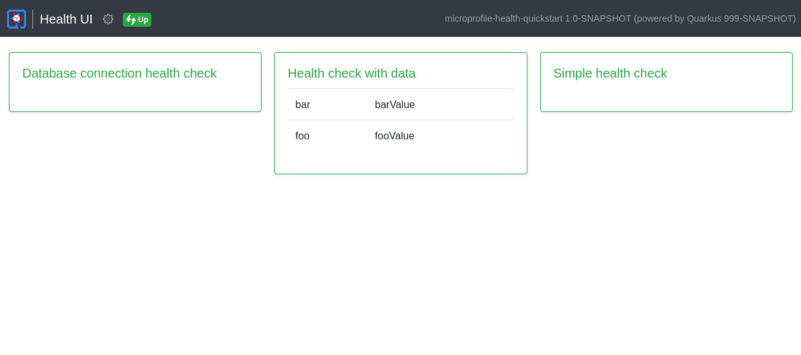

# SmallRye Health

This guide demonstrates how your Quarkus application can use [SmallRye Health](https://github.com/smallrye/smallrye-health/) an implementation of the [MicroProfile Health](https://github.com/eclipse/microprofile-health/) specification.

SmallRye Health allows applications to provide information about their state to external viewers which is typically useful in cloud environments where automated processes must be able to determine whether the application should be discarded or restarted.

## Prerequisites

To complete this guide, you need:

- Roughly 15 minutes
- An IDE
- JDK 17+ installed with `JAVA_HOME` configured appropriately
- Apache Maven 3.9.16
- Optionally the [Quarkus CLI](/guides/cli-tooling/index.md) if you want to use it
- Optionally Mandrel or GraalVM installed and [configured appropriately](/guides/building-native-image/index.md#configuring-graalvm) if you want to build a native executable (or Docker if you use a native container build)

## Architecture

In this guide, we build a simple REST application that exposes MicroProfile Health functionalities at the `/q/health/live` and `/q/health/ready` endpoints according to the specification.

## Solution

We recommend that you follow the instructions in the next sections and create the application step by step. However, you can go right to the completed example.

Clone the Git repository: `git clone https://github.com/quarkusio/quarkus-quickstarts.git`, or download an [archive](https://github.com/quarkusio/quarkus-quickstarts/archive/main.zip).

The solution is located in the `microprofile-health-quickstart` [directory](https://github.com/quarkusio/quarkus-quickstarts/tree/main/microprofile-health-quickstart).

## Creating the Maven Project

First, we need a new project. Create a new project with the following command:

**CLI**

```bash
quarkus create app org.acme:microprofile-health-quickstart \
    --extension='smallrye-health' \
    --no-code
cd microprofile-health-quickstart
```

To create a Gradle project, add the `--gradle` or `--gradle-kotlin-dsl` option.

For more information about how to install and use the Quarkus CLI, see the [Quarkus CLI](/guides/cli-tooling/index.md) guide.

**Maven**

```bash
mvn io.quarkus.platform:quarkus-maven-plugin:3.40.1.2:create \
    -DprojectGroupId=org.acme \
    -DprojectArtifactId=microprofile-health-quickstart \
    -Dextensions='smallrye-health' \
    -DnoCode
cd microprofile-health-quickstart
```

To create a Gradle project, add the `-DbuildTool=gradle` or `-DbuildTool=gradle-kotlin-dsl` option.

For Windows users:

- If using Powershell, wrap `-D` parameters in double quotes e.g. `"-DprojectArtifactId=microprofile-health-quickstart"`

This command generates a project, importing the `smallrye-health` extension.

If you already have your Quarkus project configured, you can add the `smallrye-health` extension to your project by running the following command in your project base directory:

**CLI**

```bash
quarkus extension add smallrye-health
```

**Maven**

```bash
./mvnw quarkus:add-extension -Dextensions='smallrye-health'
```

**Gradle**

```bash
./gradlew addExtension --extensions='smallrye-health'
```

This will add the following to your build file:

**pom.xml**

```xml
<dependency>
    <groupId>io.quarkus</groupId>
    <artifactId>quarkus-smallrye-health</artifactId>
</dependency>
```

**build.gradle**

```gradle
implementation("io.quarkus:quarkus-smallrye-health")
```

## Running the health check

Importing the `smallrye-health` extension directly exposes three REST endpoints:

- `/q/health/live` - The application is up and running.
- `/q/health/ready` - The application is ready to serve requests.
- `/q/health/started` - The application is started.
- `/q/health` - Accumulating all health check procedures in the application.

To check that the `smallrye-health` extension is working as expected:

- start your Quarkus application with:

  **CLI**

  ```bash
  quarkus dev
  ```

  \+

  **Maven**

  ```bash
  ./mvnw quarkus:dev
  ```

  \+

  **Gradle**

  ```bash
  ./gradlew --console=plain quarkusDev
  ```

- access the `http://localhost:8080/q/health/live` endpoint using your browser or `curl http://localhost:8080/q/health/live`

All `health` REST endpoints return a simple JSON object with two fields:

- `status` -- the overall result of all the health check procedures
- `checks` -- an array of individual checks

The general `status` of the health check is computed as a logical AND of all the declared health check procedures. The `checks` array is empty as we have not specified any health check procedure yet so let's define some.

> [!NOTE]
> **Management interface**
>
> By default, the health checks are exposed on the main HTTP server. You can expose them on a separate network interface and port by enabling the management interface with the `quarkus.management.enabled=true` property. Refer to the [management interface reference](/guides/management-interface-reference/index.md) for more information.

## Creating your first health check

In this section, we create our first simple health check procedure.

Create the `org.acme.microprofile.health.SimpleHealthCheck` class:

```java
package org.acme.microprofile.health;

import org.eclipse.microprofile.health.HealthCheck;
import org.eclipse.microprofile.health.HealthCheckResponse;
import org.eclipse.microprofile.health.Liveness;

import jakarta.enterprise.context.ApplicationScoped;

@Liveness
@ApplicationScoped <1><2>
public class SimpleHealthCheck implements HealthCheck {

    @Override
    public HealthCheckResponse call() {
        return HealthCheckResponse.up("Simple health check");
    }
}
```

1. It's recommended to annotate the health check class with `@ApplicationScoped` or the `@Singleton` scope so that a single bean instance is used for all health check requests.
2. If a bean class annotated with one of the health check annotations declares no scope then the `@Singleton` scope is used automatically.

As you can see, the health check procedures are defined as CDI beans that implement the `HealthCheck` interface and are annotated with one of the health check qualifiers, such as:

- `@Liveness` - the liveness check accessible at `/q/health/live`
- `@Readiness` - the readiness check accessible at `/q/health/ready`

`HealthCheck` is a functional interface whose single method `call` returns a `HealthCheckResponse` object which can be easily constructed by the fluent builder API shown in the example.

As we have started our Quarkus application in dev mode simply repeat the request to `http://localhost:8080/q/health/live` by refreshing your browser window or by using `curl http://localhost:8080/q/health/live`. Because we defined our health check to be a liveness procedure (with `@Liveness` qualifier) the new health check procedure is now present in the `checks` array.

Congratulations! You've created your first Quarkus health check procedure. Let's continue by exploring what else can be done with SmallRye Health.

## Adding a readiness health check procedure

In the previous section, we created a simple liveness health check procedure which states whether our application is running or not. In this section, we will create a readiness health check which will be able to state whether our application is able to process requests.

We will create another health check procedure that simulates a connection to an external service provider such as a database. For starters, we will always return the response indicating the application is ready.

Create `org.acme.microprofile.health.DatabaseConnectionHealthCheck` class:

```java
package org.acme.microprofile.health;

import org.eclipse.microprofile.health.HealthCheck;
import org.eclipse.microprofile.health.HealthCheckResponse;
import org.eclipse.microprofile.health.Readiness;

import jakarta.enterprise.context.ApplicationScoped;

@Readiness
@ApplicationScoped
public class DatabaseConnectionHealthCheck implements HealthCheck {

    @Override
    public HealthCheckResponse call() {
        return HealthCheckResponse.up("Database connection health check");
    }
}

```

If you now rerun the health check at `http://localhost:8080/q/health/live` the `checks` array will contain only the previously defined `SimpleHealthCheck` as it is the only check defined with the `@Liveness` qualifier. However, if you access `http://localhost:8080/q/health/ready` (in the browser or with `curl http://localhost:8080/q/health/ready`) you will see only the `Database connection health check` as it is the only health check defined with the `@Readiness` qualifier as the readiness health check procedure.

> [!NOTE]
> If you access `http://localhost:8080/q/health` you will get back both checks.

More information about which health check procedures should be used in which situation is detailed in the MicroProfile Health specification. Generally, the liveness procedures determine whether the application should be restarted while readiness procedures determine whether it makes sense to contact the application with requests.

## Adding a startup health check procedure

The third and final type of health check procedures is startup. Startup procedures are defined as an option for slow starting containers (should not be needed in Quarkus) to delay the invocations of liveness probe which will take over from startup once the startup responds UP for the first time. Startup health checks are defined with the `@Startup` qualifier.

> [!NOTE]
> Please make sure that you import the microprofile `org.eclipse.microprofile.health.Startup` annotation since there is an unfortunate clash with `io.quarkus.runtime.Startup`.

Create `org.acme.microprofile.health.StartupHealthCheck` class:

```java
package org.acme.microprofile.health;

import org.eclipse.microprofile.health.HealthCheck;
import org.eclipse.microprofile.health.HealthCheckResponse;
import org.eclipse.microprofile.health.Startup;

import jakarta.enterprise.context.ApplicationScoped;

@Startup
@ApplicationScoped
public class StartupHealthCheck implements HealthCheck {

    @Override
    public HealthCheckResponse call() {
        return HealthCheckResponse.up("Startup health check");
    }
}
```

The startup health check will be available either at `http://localhost:8080/q/health/started` or together with other health check procedure at `http://localhost:8080/q/health`.

## Negative health check procedures

In this section, we extend our `Database connection health check` with the option of stating that our application is not ready to process requests as the underlying database connection cannot be established. For simplicity reasons, we only determine whether the database is accessible or not by a configuration property.

Update the `org.acme.microprofile.health.DatabaseConnectionHealthCheck` class:

```java
package org.acme.microprofile.health;

import org.eclipse.microprofile.config.inject.ConfigProperty;
import org.eclipse.microprofile.health.HealthCheck;
import org.eclipse.microprofile.health.HealthCheckResponse;
import org.eclipse.microprofile.health.HealthCheckResponseBuilder;
import org.eclipse.microprofile.health.Readiness;

import jakarta.enterprise.context.ApplicationScoped;

@Readiness
@ApplicationScoped
public class DatabaseConnectionHealthCheck implements HealthCheck {

    @ConfigProperty(name = "database.up", defaultValue = "false")
    private boolean databaseUp;

    @Override
    public HealthCheckResponse call() {

        HealthCheckResponseBuilder responseBuilder = HealthCheckResponse.named("Database connection health check");

        try {
            simulateDatabaseConnectionVerification();
            responseBuilder.up();
        } catch (IllegalStateException e) {
            // cannot access the database
            responseBuilder.down();
        }

        return responseBuilder.build();
    }

    private void simulateDatabaseConnectionVerification() {
        if (!databaseUp) {
            throw new IllegalStateException("Cannot contact database");
        }
    }
}
```

> [!NOTE]
> Until now, we used a simplified method of building a `HealthCheckResponse` through the `HealthCheckResponse#up(String)` (there is also `HealthCheckResponse#down(String)`) which will directly build the response object. From now on, we utilize the full builder capabilities provided by the `HealthCheckResponseBuilder` class.

If you now rerun the readiness health check (at `http://localhost:8080/q/health/ready`) the overall `status` should be DOWN. You can also check the liveness check at `http://localhost:8080/q/health/live` which will return the overall `status` UP because it isn't influenced by the readiness checks.

As we shouldn't leave this application with a readiness check in a DOWN state and because we are running Quarkus in dev mode you can add `database.up=true` in `src/main/resources/application.properties` and rerun the readiness health check again -- it should be up again.

## Adding user-specific data to the health check response

In previous sections, we saw how to create simple health checks with only the minimal attributes, namely, the health check name and its status (UP or DOWN). However, the MicroProfile Health specification also provides a way for the applications to supply arbitrary data in the form of key-value pairs sent to the consuming end. This can be done by using the `withData(key, value)` method of the health check response builder API.

Let's create a new health check procedure `org.acme.microprofile.health.DataHealthCheck`:

```java
package org.acme.microprofile.health;

import org.eclipse.microprofile.health.Liveness;
import org.eclipse.microprofile.health.HealthCheck;
import org.eclipse.microprofile.health.HealthCheckResponse;

import jakarta.enterprise.context.ApplicationScoped;

@Liveness
@ApplicationScoped
public class DataHealthCheck implements HealthCheck {

    @Override
    public HealthCheckResponse call() {
        return HealthCheckResponse.named("Health check with data")
                .up()
                .withData("foo", "fooValue")
                .withData("bar", "barValue")
                .build();
    }
}
```

If you rerun the liveness health check procedure by accessing the `/q/health/live` endpoint you can see that the new health check `Health check with data` is present in the `checks` array. This check contains a new attribute called `data` which is a JSON object consisting of the properties we have defined in our health check procedure.

This functionality is specifically useful in failure scenarios where you can pass the error along with the health check response.

```java
        try {
            simulateDatabaseConnectionVerification();
            responseBuilder.up();
        } catch (IllegalStateException e) {
            // cannot access the database
            responseBuilder.down()
                    .withData("error", e.getMessage()); // pass the exception message
        }
```

## Context propagation into the health check invocations

For performance reasons, the context (e.g., CDI or security context) is not propagated into each health check invocation. However, if you need to enable this functionality you can set the config property `quarkus.smallrye-health.context-propagation=true` to allow the context propagation into every health check call.

## Reactive health checks

MicroProfile Health currently doesn't support returning reactive types, but SmallRye Health does.

If you want to provide a reactive health check, you can implement the `io.smallrye.health.api.AsyncHealthCheck` interface instead of the `org.eclipse.microprofile.health.HealthCheck` one. The `io.smallrye.health.api.AsyncHealthCheck` interface allows you to return a `Uni<HealthCheckResponse>`.

The following example shows a reactive liveness check:

```java
import io.smallrye.health.api.AsyncHealthCheck;

import org.eclipse.microprofile.health.Liveness;
import org.eclipse.microprofile.health.HealthCheckResponse;

import jakarta.enterprise.context.ApplicationScoped;

@Liveness
@ApplicationScoped
public class LivenessAsync implements AsyncHealthCheck {

    @Override
    public Uni<HealthCheckResponse> call() {
        return Uni.createFrom().item(HealthCheckResponse.up("liveness-reactive"))
                .onItem().delayIt().by(Duration.ofMillis(10));
    }
}
```

## Health status change observers

If you need to react to change of the health status of your application, the Smallrye Health extension provides a CDI event that can notify you about the individual health status changes.

To observe the health status change, you can observe the `io.smallrye.health.api.event.HealthStatusChangeEvent` with the standard CDI observation mechanism. Since we cannot guarantee that the observer method runs all the time on the worker thread (meaning it can run on the event loop thread), it's recommended that you never block in the in observer method.

```java
import io.smallrye.health.api.event.HealthStatusChangeEvent;

@ApplicationScoped
public class HealthObserver {

    public void observeHealthChange(@Observes @Default HealthStatusChangeEvent event) {
        ...
    }

    public void observeReadinessChange(@Observes @Readiness HealthStatusChangeEvent event) {
        ...
    }

    public void observeLivenessChange(@Observes @Liveness HealthStatusChangeEvent event) {
        ...
    }
}
```

## Extension health checks

Some extension may provide default health checks, including the extension will automatically register its health checks.

For example, `quarkus-agroal` that is used to manage Quarkus datasource(s) automatically register a readiness health check that will validate each datasource: [Datasource Health Check](/guides/datasource/index.md#datasource-health-check).

You can disable extension health checks via the property `quarkus.health.extensions.enabled` so none will be automatically registered.

<a id="ui"></a>
## Health UI

> [!NOTE]
> Experimental - not included in the MicroProfile specification

`health-ui` allows you to see your Health Checks in a Web GUI.

The Quarkus `smallrye-health` extension ships with `health-ui` and enables it by default in dev and test modes, but it can also be explicitly configured for production mode as well.

`health-ui` can be accessed from <http://localhost:8080/q/health-ui/> .



## Management interface

By default, the health checks are exposed on the main HTTP server. You can expose them on a separate network interface and port by setting `quarkus.management.enabled=true` in your application configuration. Note that this property is a build-time property. The value cannot be overridden at runtime.

If you enable the management interface without customizing the management network interface and port, the health checks are exposed under: `http://0.0.0.0:9000/q/health`. You can configure the *path* (the `health` segment in the previous URL) using the `quarkus.smallrye-health.root-path` property.

Refer to the [management interface reference](/guides/management-interface-reference/index.md) for more information.

## Conclusion

SmallRye Health provides a way for your application to distribute information about its healthiness state to state whether it is able to function properly. Liveness checks are utilized to tell whether the application should be restarted and readiness checks are used to tell whether the application is able to process requests.

All that is needed to enable the SmallRye Health features in Quarkus is:

- adding the `smallrye-health` Quarkus extension to your project using the `quarkus-maven-plugin`:

  **CLI**

  ```bash
  quarkus extension add smallrye-health
  ```

  \+

  **Maven**

  ```bash
  ./mvnw quarkus:add-extension -Dextensions='smallrye-health'
  ```

  \+

  **Gradle**

  ```bash
  ./gradlew addExtension --extensions='smallrye-health'
  ```


- or simply adding the following Maven dependency:

  .pom.xml

  ```
  <dependency>
      <groupId>io.quarkus</groupId>
      <artifactId>quarkus-smallrye-health</artifactId>
  </dependency>
  ```

  .build.gradle

  ```
  implementation("io.quarkus:quarkus-smallrye-health")
  ```


## Configuration Reference

[lock] Configuration property fixed at build time - All other configuration properties are overridable at runtime

|  |  |  |
| --- | --- | --- |
| <mark>Configuration property</mark> | Type | Default |
| [lock] <a id="quarkus-smallrye-health_quarkus-smallrye-health-enabled"></a> [`quarkus.smallrye-health.enabled`](#quarkus-smallrye-health_quarkus-smallrye-health-enabled) config_property_copy_button:+++quarkus.smallrye-health.enabled+++[]<br><br>Activate or disable this extension. Disabling this extension means that no health related information is exposed.<br><br>Environment variable: env_var_with_copy_button:+++QUARKUS_SMALLRYE_HEALTH_ENABLED+++[] | boolean | `true` |
| [lock] <a id="quarkus-smallrye-health_quarkus-smallrye-health-extensions-enabled"></a> [`quarkus.smallrye-health.extensions.enabled`](#quarkus-smallrye-health_quarkus-smallrye-health-extensions-enabled) config_property_copy_button:+++quarkus.smallrye-health.extensions.enabled+++[]<br><br>Whether extensions published health check should be enabled.<br><br>Environment variable: env_var_with_copy_button:+++QUARKUS_SMALLRYE_HEALTH_EXTENSIONS_ENABLED+++[] | boolean | `true` |
| [lock] <a id="quarkus-smallrye-health_quarkus-smallrye-health-openapi-included"></a> [`quarkus.smallrye-health.openapi.included`](#quarkus-smallrye-health_quarkus-smallrye-health-openapi-included) config_property_copy_button:+++quarkus.smallrye-health.openapi.included+++[]<br><br>Whether to include the Liveness and Readiness Health endpoints in the generated OpenAPI document<br><br>Environment variable: env_var_with_copy_button:+++QUARKUS_SMALLRYE_HEALTH_OPENAPI_INCLUDED+++[] | boolean | `false` |
| [lock] <a id="quarkus-smallrye-health_quarkus-smallrye-health-root-path"></a> [`quarkus.smallrye-health.root-path`](#quarkus-smallrye-health_quarkus-smallrye-health-root-path) config_property_copy_button:+++quarkus.smallrye-health.root-path+++[]<br><br>Root path for health-checking endpoints. By default, this value will be resolved as a path relative to `${quarkus.http.non-application-root-path}`. If the management interface is enabled, the value will be resolved as a path relative to `${quarkus.management.root-path}`.<br><br>Environment variable: env_var_with_copy_button:+++QUARKUS_SMALLRYE_HEALTH_ROOT_PATH+++[] | string | `health` |
| [lock] <a id="quarkus-smallrye-health_quarkus-smallrye-health-liveness-path"></a> [`quarkus.smallrye-health.liveness-path`](#quarkus-smallrye-health_quarkus-smallrye-health-liveness-path) config_property_copy_button:+++quarkus.smallrye-health.liveness-path+++[]<br><br>The relative path of the liveness health-checking endpoint. By default, this value will be resolved as a path relative to `${quarkus.smallrye-health.rootPath}`.<br><br>Environment variable: env_var_with_copy_button:+++QUARKUS_SMALLRYE_HEALTH_LIVENESS_PATH+++[] | string | `live` |
| [lock] <a id="quarkus-smallrye-health_quarkus-smallrye-health-readiness-path"></a> [`quarkus.smallrye-health.readiness-path`](#quarkus-smallrye-health_quarkus-smallrye-health-readiness-path) config_property_copy_button:+++quarkus.smallrye-health.readiness-path+++[]<br><br>The relative path of the readiness health-checking endpoint. By default, this value will be resolved as a path relative to `${quarkus.smallrye-health.rootPath}`.<br><br>Environment variable: env_var_with_copy_button:+++QUARKUS_SMALLRYE_HEALTH_READINESS_PATH+++[] | string | `ready` |
| [lock] <a id="quarkus-smallrye-health_quarkus-smallrye-health-group-path"></a> [`quarkus.smallrye-health.group-path`](#quarkus-smallrye-health_quarkus-smallrye-health-group-path) config_property_copy_button:+++quarkus.smallrye-health.group-path+++[]<br><br>The relative path of the health group endpoint. By default, this value will be resolved as a path relative to `${quarkus.smallrye-health.rootPath}`.<br><br>Environment variable: env_var_with_copy_button:+++QUARKUS_SMALLRYE_HEALTH_GROUP_PATH+++[] | string | `group` |
| [lock] <a id="quarkus-smallrye-health_quarkus-smallrye-health-wellness-path"></a> [`quarkus.smallrye-health.wellness-path`](#quarkus-smallrye-health_quarkus-smallrye-health-wellness-path) config_property_copy_button:+++quarkus.smallrye-health.wellness-path+++[]<br><br>The relative path of the wellness health-checking endpoint. By default, this value will be resolved as a path relative to `${quarkus.smallrye-health.rootPath}`.<br><br>Environment variable: env_var_with_copy_button:+++QUARKUS_SMALLRYE_HEALTH_WELLNESS_PATH+++[] | string | `well` |
| [lock] <a id="quarkus-smallrye-health_quarkus-smallrye-health-startup-path"></a> [`quarkus.smallrye-health.startup-path`](#quarkus-smallrye-health_quarkus-smallrye-health-startup-path) config_property_copy_button:+++quarkus.smallrye-health.startup-path+++[]<br><br>The relative path of the startup health-checking endpoint. By default, this value will be resolved as a path relative to `${quarkus.smallrye-health.rootPath}`.<br><br>Environment variable: env_var_with_copy_button:+++QUARKUS_SMALLRYE_HEALTH_STARTUP_PATH+++[] | string | `started` |
| [lock] <a id="quarkus-smallrye-health_quarkus-smallrye-health-max-group-registries-count"></a> [`quarkus.smallrye-health.max-group-registries-count`](#quarkus-smallrye-health_quarkus-smallrye-health-max-group-registries-count) config_property_copy_button:+++quarkus.smallrye-health.max-group-registries-count+++[]<br><br>The number of the maximum health groups that can be created.<br><br>Environment variable: env_var_with_copy_button:+++QUARKUS_SMALLRYE_HEALTH_MAX_GROUP_REGISTRIES_COUNT+++[] | int |  |
| [lock] <a id="quarkus-smallrye-health_quarkus-smallrye-health-default-health-group"></a> [`quarkus.smallrye-health.default-health-group`](#quarkus-smallrye-health_quarkus-smallrye-health-default-health-group) config_property_copy_button:+++quarkus.smallrye-health.default-health-group+++[]<br><br>The name of the default health group used when no other health group is defined on the health check.<br><br>Environment variable: env_var_with_copy_button:+++QUARKUS_SMALLRYE_HEALTH_DEFAULT_HEALTH_GROUP+++[] | string |  |
| [lock] <a id="quarkus-smallrye-health_quarkus-smallrye-health-management-enabled"></a> [`quarkus.smallrye-health.management.enabled`](#quarkus-smallrye-health_quarkus-smallrye-health-management-enabled) config_property_copy_button:+++quarkus.smallrye-health.management.enabled+++[]<br><br>If management interface is turned on the health endpoints and ui will be published under the management interface. This allows you to exclude Health from management by setting the value to false<br><br>Environment variable: env_var_with_copy_button:+++QUARKUS_SMALLRYE_HEALTH_MANAGEMENT_ENABLED+++[] | boolean | `true` |
| [lock] <a id="quarkus-smallrye-health_quarkus-smallrye-health-include-problem-details"></a> [`quarkus.smallrye-health.include-problem-details`](#quarkus-smallrye-health_quarkus-smallrye-health-include-problem-details) config_property_copy_button:+++quarkus.smallrye-health.include-problem-details+++[]<br><br>Specify the reported DOWN responses should be aligned with RFC 9457 - Problem Details for HTTP APIs.<br><br>Environment variable: env_var_with_copy_button:+++QUARKUS_SMALLRYE_HEALTH_INCLUDE_PROBLEM_DETAILS+++[] | boolean | `false` |
| <a id="quarkus-smallrye-health_quarkus-smallrye-health-ui-enabled"></a> [`quarkus.smallrye-health.ui.enabled`](#quarkus-smallrye-health_quarkus-smallrye-health-ui-enabled) config_property_copy_button:+++quarkus.smallrye-health.ui.enabled+++[]<br><br>If Health UI should be enabled. By default, Health UI is enabled if it is included (see `always-include`).<br><br>Environment variable: env_var_with_copy_button:+++QUARKUS_SMALLRYE_HEALTH_UI_ENABLED+++[] | boolean | `true` |
| <a id="quarkus-smallrye-health_quarkus-smallrye-health-additional-property-property-name"></a> [`quarkus.smallrye-health.additional.property."property-name"`](#quarkus-smallrye-health_quarkus-smallrye-health-additional-property-property-name) config_property_copy_button:+++quarkus.smallrye-health.additional.property."property-name"+++[]<br><br>Additional top-level properties to be included in the resulting JSON object.<br><br>Environment variable: env_var_with_copy_button:+++QUARKUS_SMALLRYE_HEALTH_ADDITIONAL_PROPERTY__PROPERTY_NAME_+++[] | Map\<String,String> |  |
| <a id="quarkus-smallrye-health_quarkus-smallrye-health-check-check-classname-enabled"></a> [`quarkus.smallrye-health.check."check-classname".enabled`](#quarkus-smallrye-health_quarkus-smallrye-health-check-check-classname-enabled) config_property_copy_button:+++quarkus.smallrye-health.check."check-classname".enabled+++[]<br><br>Whether the HealthCheck should be enabled.<br><br>Environment variable: env_var_with_copy_button:+++QUARKUS_SMALLRYE_HEALTH_CHECK__CHECK_CLASSNAME__ENABLED+++[] | boolean | `false` |
| [lock] <a id="quarkus-smallrye-health_quarkus-smallrye-health-context-propagation"></a> <mark>link:#quarkus-smallrye-health_quarkus-smallrye-health-context-propagation\[`quarkus.smallrye-health.context-propagation`\]</mark> config_property_copy_button:+++quarkus.smallrye-health.context-propagation+++[]<br><br>*This property is deprecated since `3.30`.*<br><br>Whether the context should be propagated to each health check invocation.<br><br>Environment variable: env_var_with_copy_button:+++QUARKUS_SMALLRYE_HEALTH_CONTEXT_PROPAGATION+++[] | boolean | `false` |
| <a id="quarkus-smallrye-health_quarkus-smallrye-health-ui-enable"></a> <mark>link:#quarkus-smallrye-health_quarkus-smallrye-health-ui-enable\[`quarkus.smallrye-health.ui.enable`\]</mark> config_property_copy_button:+++quarkus.smallrye-health.ui.enable+++[]<br><br>*This property is deprecated since `3.26`: use `quarkus.smallrye-health.ui.enabled` instead.*<br><br>If Health UI should be enabled. By default, Health UI is enabled if it is included (see `always-include`).<br><br>Environment variable: env_var_with_copy_button:+++QUARKUS_SMALLRYE_HEALTH_UI_ENABLE+++[] | boolean |  |
| <a id="quarkus-smallrye-health_section_quarkus-smallrye-health-ui"></a> [SmallRye Health UI configuration](#quarkus-smallrye-health_section_quarkus-smallrye-health-ui) | Type | Default |
| [lock] <a id="quarkus-smallrye-health_quarkus-smallrye-health-ui-root-path"></a> [`quarkus.smallrye-health.ui.root-path`](#quarkus-smallrye-health_quarkus-smallrye-health-ui-root-path) config_property_copy_button:+++quarkus.smallrye-health.ui.root-path+++[]<br><br>The path where Health UI is available. The value `/` is not allowed as it blocks the application from serving anything else. By default, this value will be resolved as a path relative to `${quarkus.http.non-application-root-path}`.<br><br>Environment variable: env_var_with_copy_button:+++QUARKUS_SMALLRYE_HEALTH_UI_ROOT_PATH+++[] | string | `health-ui` |
| [lock] <a id="quarkus-smallrye-health_quarkus-smallrye-health-ui-always-include"></a> [`quarkus.smallrye-health.ui.always-include`](#quarkus-smallrye-health_quarkus-smallrye-health-ui-always-include) config_property_copy_button:+++quarkus.smallrye-health.ui.always-include+++[]<br><br>Always include the UI. By default, this will only be included in dev and test. Setting this to true will also include the UI in Prod<br><br>Environment variable: env_var_with_copy_button:+++QUARKUS_SMALLRYE_HEALTH_UI_ALWAYS_INCLUDE+++[] | boolean | `false` |
