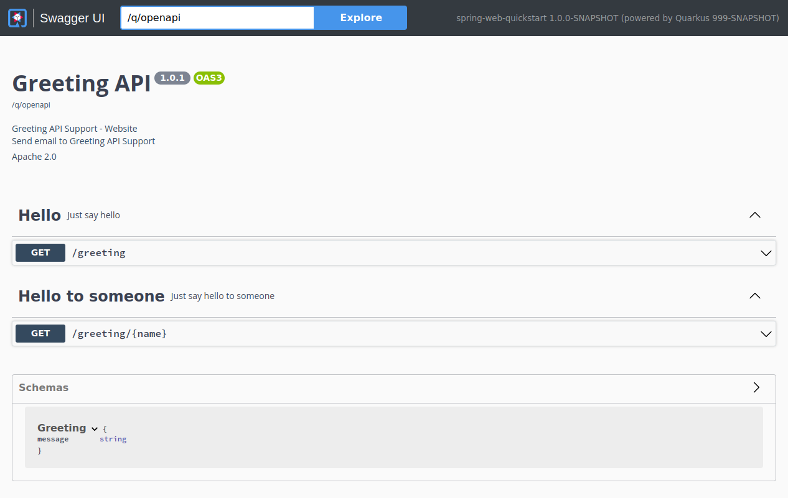

# Quarkus extension for Spring Web API

While users are encouraged to use Jakarta REST (formerly known as JAX-RS) annotations for defining REST endpoints, Quarkus provides a compatibility layer for Spring Web in the form of the `spring-web` extension.

This guide explains how a Quarkus application can leverage the well known Spring Web annotations to define RESTful services.

## Prerequisites

To complete this guide, you need:

To complete this guide, you need:

- Roughly 15 minutes
- An IDE
- JDK 17+ installed with `JAVA_HOME` configured appropriately
- Apache Maven 3.9.16
- Optionally the [Quarkus CLI](/guides/cli-tooling/index.md) if you want to use it
- Optionally Mandrel or GraalVM installed and [configured appropriately](/guides/building-native-image/index.md#configuring-graalvm) if you want to build a native executable (or Docker if you use a native container build)

## Solution

We recommend that you follow the instructions in the next sections and create the application step by step. However, you can go right to the completed example.

Clone the Git repository: `git clone https://github.com/quarkusio/quarkus-quickstarts.git`, or download an [archive](https://github.com/quarkusio/quarkus-quickstarts/archive/main.zip).

The solution is located in the `spring-web-quickstart` [directory](https://github.com/quarkusio/quarkus-quickstarts/tree/main/spring-web-quickstart).

## Creating the Maven project

First, we need a new project. Create a new project with the following command:

**CLI**

```bash
quarkus create app org.acme:spring-web-quickstart \
    --extension='spring-web,rest-jackson' \
    --no-code
cd spring-web-quickstart
```

To create a Gradle project, add the `--gradle` or `--gradle-kotlin-dsl` option.

For more information about how to install and use the Quarkus CLI, see the [Quarkus CLI](/guides/cli-tooling/index.md) guide.

**Maven**

```bash
mvn io.quarkus.platform:quarkus-maven-plugin:3.40.1.2:create \
    -DprojectGroupId=org.acme \
    -DprojectArtifactId=spring-web-quickstart \
    -Dextensions='spring-web,rest-jackson' \
    -DnoCode
cd spring-web-quickstart
```

To create a Gradle project, add the `-DbuildTool=gradle` or `-DbuildTool=gradle-kotlin-dsl` option.

For Windows users:

- If using Powershell, wrap `-D` parameters in double quotes e.g. `"-DprojectArtifactId=spring-web-quickstart"`

This command generates a project which imports the `spring-web` extension.

If you already have your Quarkus project configured, you can add the `spring-web` extension to your project by running the following command in your project base directory:

**CLI**

```bash
quarkus extension add spring-web,rest-jackson
```

**Maven**

```bash
./mvnw quarkus:add-extension -Dextensions='spring-web,rest-jackson'
```

**Gradle**

```bash
./gradlew addExtension --extensions='spring-web,rest-jackson'
```

This will add the following to your build file:

**pom.xml**

```xml
<dependency>
    <groupId>io.quarkus</groupId>
    <artifactId>quarkus-spring-web</artifactId>
</dependency>
<dependency>
    <groupId>io.quarkus</groupId>
    <artifactId>quarkus-rest-jackson</artifactId>
</dependency>
```

**build.gradle**

```gradle
implementation("io.quarkus:quarkus-spring-web")
implementation("io.quarkus:quarkus-rest-jackson")
```

> [!IMPORTANT]
> `quarkus-spring-web` needs to be complemented with either `quarkus-rest-jackson` or `quarkus-resteasy-jackson` in order to work.

## GreetingController

Create the `src/main/java/org/acme/spring/web/GreetingController.java` file, a controller with the Spring Web annotations to define our REST endpoint, as follows:

```java
package org.acme.spring.web;

import org.springframework.web.bind.annotation.GetMapping;
import org.springframework.web.bind.annotation.RequestMapping;
import org.springframework.web.bind.annotation.RestController;

@RestController
@RequestMapping("/greeting")
public class GreetingController {

    @GetMapping
    public String hello() {
        return "hello";
    }
}
```

## GreetingControllerTest

Note that a test for the controller has been created as well:

```java
package org.acme.spring.web;

import io.quarkus.test.junit.QuarkusTest;
import org.junit.jupiter.api.Test;

import static io.restassured.RestAssured.given;
import static org.hamcrest.CoreMatchers.is;

@QuarkusTest
public class GreetingControllerTest {

    @Test
    public void testHelloEndpoint() {
        given()
          .when().get("/greeting")
          .then()
             .statusCode(200)
             .body(is("hello"));
    }

}
```

## Package and run the application

Run the application with:

**CLI**

```bash
quarkus dev
```

**Maven**

```bash
./mvnw quarkus:dev
```

**Gradle**

```bash
./gradlew --console=plain quarkusDev
```

Open your browser to <http://localhost:8080/greeting>.

The result should be: `{"message": "hello"}`.

## Run the application as a native executable

You can generate the native executable with:

**CLI**

```bash
quarkus build --native
```

**Maven**

```bash
./mvnw install -Dnative
```

**Gradle**

```bash
./gradlew build -Dquarkus.native.enabled=true
```

## Going further with an endpoint returning JSON

The `GreetingController` above was an example of a very simple endpoint. In many cases however it is required to return JSON content. The following example illustrates how that could be achieved using a Spring RestController:

```java
import org.springframework.web.bind.annotation.GetMapping;
import org.springframework.web.bind.annotation.PathVariable;
import org.springframework.web.bind.annotation.RequestMapping;
import org.springframework.web.bind.annotation.RestController;

@RestController
@RequestMapping("/greeting")
public class GreetingController {

    @GetMapping("/{name}")
    public Greeting hello(@PathVariable(name = "name") String name) {
        return new Greeting("hello " + name);
    }

    public static class Greeting {
        private final String message;

        public Greeting(String message) {
            this.message = message;
        }

        public String getMessage(){
            return message;
        }
    }
}
```

The corresponding test could look like:

```java
package org.acme.spring.web;

import io.quarkus.test.junit.QuarkusTest;
import org.junit.jupiter.api.Test;

import static io.restassured.RestAssured.given;
import static org.hamcrest.CoreMatchers.is;

@QuarkusTest
public class GreetingControllerTest {

    @Test
    public void testHelloEndpoint() {
        given()
          .when().get("/greeting/quarkus")
          .then()
            .statusCode(200)
            .body("message", is("hello quarkus"));
    }

}
```

It should be noted that when using the Spring Web support in Quarkus, [Jackson](https://github.com/FasterXML/jackson) is automatically added to the classpath and properly set up.

## Adding OpenAPI and Swagger-UI

You can add support for [OpenAPI](https://www.openapis.org/) and [Swagger-UI](https://swagger.io/tools/swagger-ui/) by using the `quarkus-smallrye-openapi` extension.

Add the extension by running this command:

```bash
./mvnw quarkus:add-extension -Dextensions="io.quarkus:quarkus-smallrye-openapi"
```

This will add the following to your `pom.xml`:

```xml
<dependency>
    <groupId>io.quarkus</groupId>
    <artifactId>quarkus-smallrye-openapi</artifactId>
</dependency>
```

This is enough to generate a basic OpenAPI schema document from your REST Endpoints:

```bash
curl http://localhost:8080/q/openapi
```

You will see the generated OpenAPI schema document:

```yaml
---
openapi: 3.0.1
info:
  title: Generated API
  version: "1.0"
paths:
  /greeting:
    get:
      responses:
        "200":
          description: OK
          content:
            '*/*':
              schema:
                type: string
  /greeting/{name}:
    get:
      parameters:
      - name: name
        in: path
        required: true
        schema:
          type: string
      responses:
        "200":
          description: OK
          content:
            'application/json':
              schema:
                $ref: '#/components/schemas/Greeting'
components:
  schemas:
    Greeting:
      type: object
      properties:
        message:
          type: string
```

Also see [the OpenAPI Guide](/guides/openapi-swaggerui/index.md)

### Adding MicroProfile OpenAPI Annotations

You can use [MicroProfile OpenAPI](https://github.com/eclipse/microprofile-open-api) to better document your schema, example, adding the following to the class level of the `GreetingController`:

```java
@OpenAPIDefinition(
    info = @Info(
        title="Greeting API",
        version = "1.0.1",
        contact = @Contact(
            name = "Greeting API Support",
            url = "http://exampleurl.com/contact",
            email = "techsupport@example.com"),
        license = @License(
            name = "Apache 2.0",
            url = "https://www.apache.org/licenses/LICENSE-2.0.html"))
)
```

And describe your endpoints like this:

```java
@Tag(name = "Hello", description = "Just say hello")
@GetMapping(produces=MediaType.TEXT_PLAIN_VALUE)
public String hello() {
    return "hello";
}

@GetMapping(value = "/{name}", produces=MediaType.APPLICATION_JSON_VALUE)
@Tag(name = "Hello to someone", description = "Just say hello to someone")
public Greeting hello(@PathVariable(name = "name") String name) {
    return new Greeting("hello " + name);
}
```

will generate this OpenAPI schema:

```yaml
---
openapi: 3.0.1
info:
  title: Greeting API
  contact:
    name: Greeting API Support
    url: http://exampleurl.com/contact
    email: techsupport@example.com
  license:
    name: Apache 2.0
    url: https://www.apache.org/licenses/LICENSE-2.0.html
  version: 1.0.1
tags:
- name: Hello
  description: Just say hello
- name: Hello to someone
  description: Just say hello to someone
paths:
  /greeting:
    get:
      tags:
      - Hello
      responses:
        "200":
          description: OK
          content:
            '*/*':
              schema:
                type: string
  /greeting/{name}:
    get:
      tags:
      - Hello to someone
      parameters:
      - name: name
        in: path
        required: true
        schema:
          type: string
      responses:
        "200":
          description: OK
          content:
            '*/*':
              schema:
                $ref: '#/components/schemas/Greeting'
components:
  schemas:
    Greeting:
      type: object
      properties:
        message:
          type: string
```

### Using Swagger UI

Swagger UI is included by default when running in `Dev` or `Test` mode, and can optionally be added to `Prod` mode. See [the Swagger UI](/guides/openapi-swaggerui/index.md#dev-mode) Guide for more details.

Navigate to [localhost:8080/q/swagger-ui/](http://localhost:8080/q/swagger-ui/) and you will see the Swagger UI screen:



## Supported Spring Web functionalities

Quarkus currently supports a subset of the functionalities that Spring Web provides. More specifically Quarkus supports the REST related features of Spring Web (think of `@RestController` instead of `@Controller`).

### Annotations

The table below summarizes the supported annotations:

**Supported Spring Web annotation**

| Name | Comments |
| --- | --- |
| @RestController |  |
| @RequestMapping |  |
| @GetMapping |  |
| @PostMapping |  |
| @PutMapping |  |
| @DeleteMapping |  |
| @PatchMapping |  |
| @RequestParam |  |
| @RequestHeader |  |
| @MatrixVariable |  |
| @PathVariable |  |
| @CookieValue |  |
| @RequestBody |  |
| @ResponseStatus |  |
| @ExceptionHandler | Can only be used in a @RestControllerAdvice class, not on a per-controller basis |
| @RestControllerAdvice | Only the @ExceptionHandler capability is supported |

### Controller method return types

The following method return types are supported:

- Primitive types
- String (which will be used as a literal, no Spring MVC view support is provided)
- POJO classes which will be serialized via JSON
- `org.springframework.http.ResponseEntity`

### Controller method parameter types

In addition to the method parameters that can be annotated with the appropriate Spring Web annotations from the previous table, `jakarta.servlet.http.HttpServletRequest` and `jakarta.servlet.http.HttpServletResponse` are also supported. For this to function however, users need to add the `quarkus-undertow` dependency.

⚠️ Important: These types are only available when using the Classic RESTEasy stack (quarkus-resteasy / quarkus-resteasy-jackson) because they rely on the Servlet API provided by Undertow (quarkus-undertow).

If your application uses the Reactive stack (quarkus-rest / quarkus-rest-jackson), then the Servlet API is not supported. In this case, adding the quarkus-undertow dependency will not enable servlet injection and will result in runtime errors.

### Exception handler method return types

The following method return types are supported:

- `org.springframework.http.ResponseEntity`
- `java.util.Map`

Other return types mentioned in the Spring [`ExceptionHandler javadoc`](https://docs.spring.io/spring-framework/docs/current/javadoc-api/org/springframework/web/bind/annotation/ExceptionHandler.html) are not supported.

### Exception handler method parameter types

The following parameter types are supported, in arbitrary order:

- An exception argument: declared as a general `Exception` or as a more specific exception. This also serves as a mapping hint if the annotation itself does not narrow the exception types through its `value()`.
- Request and/or response objects (typically from the Servlet API). You may choose any specific request/response type, e.g. `ServletRequest` / `HttpServletRequest`. To use Servlet API, the `quarkus-undertow` dependency needs to be added.

Other parameter types mentioned in the Spring [`ExceptionHandler javadoc`](https://docs.spring.io/spring-framework/docs/current/javadoc-api/org/springframework/web/bind/annotation/ExceptionHandler.html) are not supported.

#### Using `HttpServerRequest` and `HttpServerResponse` in Spring Web-style exception handlers

When using the Quarkus Spring Web compatibility layer on top of the reactive stack (`quarkus-rest-jackson`), you cannot inject servlet-based request and response types such as `jakarta.servlet.http.HttpServletRequest` or `jakarta.servlet.http.HttpServletResponse`. These types are only available when using the Classic RESTEasy stack (quarkus-resteasy / quarkus-resteasy-jackson), which relies on the Servlet API provided by `quarkus-undertow` dependency.

To provide a Spring-friendly experience while staying reactive, Quarkus allows you to inject the following types into your `@ExceptionHandler` methods:

- io.vertx.core.http.HttpServerRequest

- io.vertx.core.http.HttpServerResponse

These types give you direct access to the underlying Vert.x HTTP layer. This allows you to manipulate the response (e.g. set headers, cookies, or status codes) or enrich the returned information using details from the request.

For example:

```java
@ExceptionHandler(IllegalArgumentException.class)
public ResponseEntity<Object> handleException(Exception ex,
                                                       HttpServerRequest request,
                                                       HttpServerResponse response) {
    // Add a custom header to the response
    response.putHeader("X-Error-Reason", "IllegalArgument");

    // Build a response body enriched with request details
    String body = String.format("Request %s %s failed",
            request.method().name(),
            request.uri());

    return new ResponseEntity<>(body, HttpStatus.BAD_REQUEST);
}

```

**Warning:** This is potentially dangerous. Users should only do this if they understand the reactive model, and are aware that writing directly to the response can bypass normal handling of status codes, headers, and serialization.

## Important Technical Note

Please note that the Spring support in Quarkus does not start a Spring Application Context nor are any Spring infrastructure classes run. Spring classes and annotations are only used for reading metadata and / or are used as user code method return types or parameter types. What that means for end users, is that adding arbitrary Spring libraries will not have any effect. Moreover, Spring infrastructure classes (like `org.springframework.beans.factory.config.BeanPostProcessor` for example) will not be executed.

## Conversion Table

The following table shows how Spring Web annotations can be converted to Jakarta REST annotations.

| Spring | Jakarta REST | Comments |
| --- | --- | --- |
| @RestController |  | There is no equivalent in Jakarta REST. Annotating a class with @Path suffices |
| @RequestMapping(path="/api") | @Path("/api") |  |
| @RequestMapping(consumes="application/json") | @Consumes("application/json") |  |
| @RequestMapping(produces="application/json") | @Produces("application/json") |  |
| @RequestParam | @QueryParam |  |
| @PathVariable | @PathParam |  |
| @RequestBody |  | No equivalent in Jakarta REST. Method parameters corresponding to the body of the request are handled in Jakarta REST without requiring any annotation |
| @RestControllerAdvice |  | No equivalent in Jakarta REST |
| @ResponseStatus |  | No equivalent in Jakarta REST |
| @ExceptionHandler |  | No equivalent annotation in Jakarta REST. Exceptions are handled by implementing `jakarta.ws.rs.ext.ExceptionMapper` |

## More Spring guides

Quarkus has more Spring compatibility features. See the following guides for more details:

- [Quarkus - Extension for Spring DI](/guides/spring-di/index.md)
- [Quarkus - Extension for Spring Data JPA](/guides/spring-data-jpa/index.md)
- [Quarkus - Extension for Spring Data REST](/guides/spring-data-rest/index.md)
- [Quarkus - Extension for Spring Security](/guides/spring-security/index.md)
- [Quarkus - Reading properties from Spring Cloud Config Server](/guides/spring-cloud-config-client/index.md)
- [Quarkus - Extension for Spring Boot properties](/guides/spring-boot-properties/index.md)
- [Quarkus - Extension for Spring Cache](/guides/spring-cache/index.md)
- [Quarkus - Extension for Spring Scheduled](/guides/spring-scheduled/index.md)
- [Quarkus - Extension for Spring Transaction](/guides/spring-tx/index.md)
- [Testing Spring-style Applications in Quarkus](/guides/spring-test/index.md)
