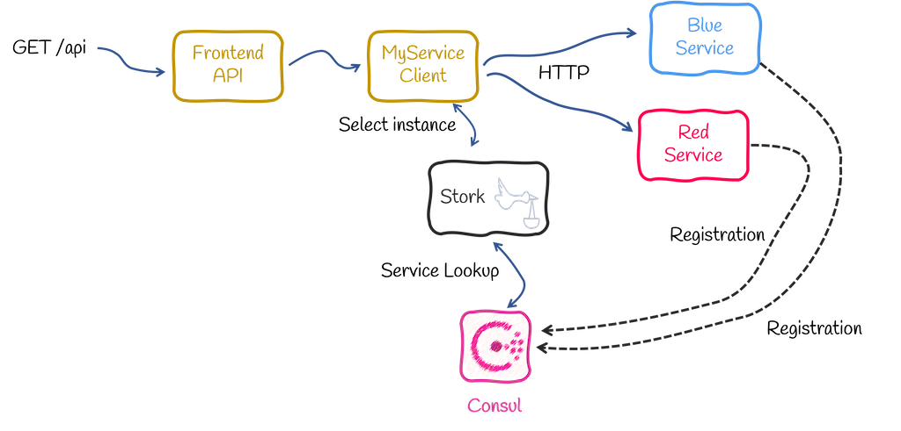
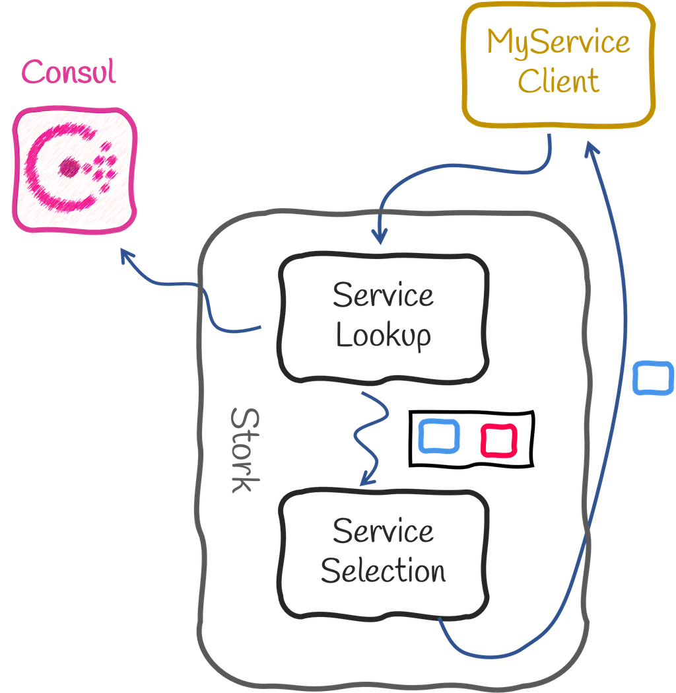

# Getting started with SmallRye Stork

The essence of distributed systems resides in the interaction between services. In modern architecture, you often have multiple instances of your service to share the load or improve the resilience by redundancy. But how do you select the best instance of your service? That's where [SmallRye Stork](https://smallrye.io/smallrye-stork) helps. Stork is going to choose the most appropriate instance. It offers:

- Extensible service discovery mechanisms
- Built-in support for Consul and Kubernetes
- Customizable client load-balancing strategies

<a id="extension-status-note"></a>

> [!NOTE]
> This technology is considered preview.
>
> In *preview*, backward compatibility and presence in the ecosystem is not guaranteed. Specific improvements might require changing configuration or APIs, and plans to become *stable* are under way. Feedback is welcome on our [mailing list](https://groups.google.com/d/forum/quarkus-dev) or as issues in our [GitHub issue tracker](https://github.com/quarkusio/quarkus/issues).
>
> For a full list of possible statuses, check our [FAQ entry](https://quarkus.io/faq/#what-are-the-extension-statuses).

## Prerequisites

To complete this guide, you need:

- Roughly 15 minutes
- An IDE
- JDK 17+ installed with `JAVA_HOME` configured appropriately
- Apache Maven 3.9.16
- A working container runtime (Docker or [Podman](/guides/podman/index.md))
- Optionally the [Quarkus CLI](/guides/cli-tooling/index.md) if you want to use it
- Optionally Mandrel or GraalVM installed and [configured appropriately](/guides/building-native-image/index.md#configuring-graalvm) if you want to build a native executable (or Docker if you use a native container build)

## Architecture

In this guide, we will build an application composed of:

- A simple blue service exposed on port 9000
- A simple red service exposed on port 9001
- A REST Client calling the blue or red service (the selection is delegated to Stork)
- A REST endpoint using the REST client and calling the services
- The blue and red services are registered in [Consul](https://www.consul.io/).



For the sake of simplicity, everything (except Consul) will be running in the same Quarkus application. Of course, each component will run in its own process in the real world.

## Solution

We recommend that you follow the instructions in the next sections and create the applications step by step. However, you can go right to the completed example.

Clone the Git repository: `git clone https://github.com/quarkusio/quarkus-quickstarts.git`, or download an [archive](https://github.com/quarkusio/quarkus-quickstarts/archive/main.zip).

The solution is located in the `stork-quickstart` [directory](https://github.com/quarkusio/quarkus-quickstarts/tree/main/stork-quickstart).

## Discovery and selection

Before going further, we need to discuss discovery vs. selection.

- Service discovery is the process of locating service instances. It produces a list of service instances that is potentially empty (if no service matches the request) or contains multiple service instances.

- Service selection, also called load-balancing, chooses the best instance from the list returned by the discovery process. The result is a single service instance or an exception when no suitable instance can be found.

Stork handles both discovery and selection. However, it does not handle the communication with the service but only provides a service instance. The various integrations in Quarkus extract the location of the service from that service instance.



## Bootstrapping the project

Create a Quarkus project importing the quarkus-rest-client, quarkus-rest, and quarkus-smallrye-stork extensions using your favorite approach:

**CLI**

```bash
quarkus create app org.acme:stork-quickstart \
    --extension='quarkus-rest-client,quarkus-rest,quarkus-smallrye-stork' \
    --no-code
cd stork-quickstart
```

To create a Gradle project, add the `--gradle` or `--gradle-kotlin-dsl` option.

For more information about how to install and use the Quarkus CLI, see the [Quarkus CLI](/guides/cli-tooling/index.md) guide.

**Maven**

```bash
mvn io.quarkus.platform:quarkus-maven-plugin:3.40.1.2:create \
    -DprojectGroupId=org.acme \
    -DprojectArtifactId=stork-quickstart \
    -Dextensions='quarkus-rest-client,quarkus-rest,quarkus-smallrye-stork' \
    -DnoCode
cd stork-quickstart
```

To create a Gradle project, add the `-DbuildTool=gradle` or `-DbuildTool=gradle-kotlin-dsl` option.

For Windows users:

- If using Powershell, wrap `-D` parameters in double quotes e.g. `"-DprojectArtifactId=stork-quickstart"`

In the generated project, also add the following dependencies:

**pom.xml**

```xml
<dependency>
  <groupId>io.smallrye.stork</groupId>
  <artifactId>stork-service-discovery-consul</artifactId>
</dependency>
<dependency>
  <groupId>io.smallrye.reactive</groupId>
  <artifactId>smallrye-mutiny-vertx-consul-client</artifactId>
</dependency>
```

**build.gradle**

```gradle
implementation("io.smallrye.stork:stork-service-discovery-consul")
implementation("io.smallrye.reactive:smallrye-mutiny-vertx-consul-client")
```

`stork-service-discovery-consul` provides an implementation of service discovery for Consul. `smallrye-mutiny-vertx-consul-client` is a Consul client which we will use to register our services in Consul.

## The Blue and Red services

Let's start with the very beginning: the service we will discover, select and call.

Create the `src/main/java/org/acme/services/BlueService.java` with the following content:

```java
package org.acme.services;

import io.quarkus.runtime.StartupEvent;
import io.vertx.mutiny.core.Vertx;
import org.eclipse.microprofile.config.inject.ConfigProperty;

import jakarta.enterprise.context.ApplicationScoped;
import jakarta.enterprise.event.Observes;

@ApplicationScoped
public class BlueService {

    @ConfigProperty(name = "blue-service-port", defaultValue = "9000") int port;

    /**
     * Start an HTTP server for the blue service.
     *
     * Note: this method is called on a worker thread, and so it is allowed to block.
     */
    public void init(@Observes StartupEvent ev, Vertx vertx) {
        vertx.createHttpServer()
                .requestHandler(req -> req.response().endAndForget("Hello from Blue!"))
                .listenAndAwait(port);
    }
}
```

It creates a new HTTP server (using Vert.x) and implements our simple service when the application starts. For each HTTP request, it sends a response with "Hello from Blue!" as the body.

Following the same logic, create the `src/main/java/org/acme/services/RedService.java` with the following content:

```java

package org.acme.services;

import io.quarkus.runtime.StartupEvent;
import io.vertx.mutiny.core.Vertx;
import org.eclipse.microprofile.config.inject.ConfigProperty;

import jakarta.enterprise.context.ApplicationScoped;
import jakarta.enterprise.event.Observes;

@ApplicationScoped
public class RedService {
    @ConfigProperty(name = "red-service-port", defaultValue = "9001") int port;

    /**
     * Start an HTTP server for the red service.
     *
     * Note: this method is called on a worker thread, and so it is allowed to block.
     */
    public void init(@Observes StartupEvent ev, Vertx vertx) {
        vertx.createHttpServer()
                .requestHandler(req -> req.response().endAndForget("Hello from Red!"))
                .listenAndAwait(port);
    }

}
```

This time, it writes "Hello from Red!".

## Service registration in Consul

Now that we have implemented our services, we need to register them into Consul.

> [!NOTE]
> Stork is not limited to Consul and integrates with other service discovery mechanisms.

Create the `src/main/java/org/acme/services/Registration.java` file with the following content:

```java
package org.acme.services;

import io.quarkus.runtime.StartupEvent;
import io.vertx.ext.consul.ServiceOptions;
import io.vertx.mutiny.ext.consul.ConsulClient;
import io.vertx.ext.consul.ConsulClientOptions;
import io.vertx.mutiny.core.Vertx;
import org.eclipse.microprofile.config.inject.ConfigProperty;

import jakarta.enterprise.context.ApplicationScoped;
import jakarta.enterprise.event.Observes;

@ApplicationScoped
public class Registration {

    @ConfigProperty(name = "consul.host") String host;
    @ConfigProperty(name = "consul.port") int port;

    @ConfigProperty(name = "red-service-port", defaultValue = "9000") int red;
    @ConfigProperty(name = "blue-service-port", defaultValue = "9001") int blue;

    /**
     * Register our two services in Consul.
     *
     * Note: this method is called on a worker thread, and so it is allowed to block.
     */
    public void init(@Observes StartupEvent ev, Vertx vertx) {
        ConsulClient client = ConsulClient.create(vertx, new ConsulClientOptions().setHost(host).setPort(port));

        client.registerServiceAndAwait(
                new ServiceOptions().setPort(red).setAddress("localhost").setName("my-service").setId("red"));
        client.registerServiceAndAwait(
                new ServiceOptions().setPort(blue).setAddress("localhost").setName("my-service").setId("blue"));
    }
}
```

When the application starts, it connects to Consul using the Vert.x Consul Client and registers our two instances. Both registration uses the same name (`my-service`), but different ids to indicate that it's two instances of the same *service*.

## The REST Client interface and the front end API

So far, we didn't use Stork; we just scaffolded the services we will be discovering, selecting, and calling.

We will call the services using the REST Client. Create the `src/main/java/org/acme/MyService.java` file with the following content:

```java
package org.acme;

import org.eclipse.microprofile.rest.client.inject.RegisterRestClient;

import jakarta.ws.rs.GET;
import jakarta.ws.rs.Produces;
import jakarta.ws.rs.core.MediaType;

/**
 * The REST Client interface.
 *
 * Notice the `baseUri`. It uses `stork://` as URL scheme indicating that the called service uses Stork to locate and
 * select the service instance. The `my-service` part is the service name. This is used to configure Stork discovery
 * and selection in the `application.properties` file.
 */
@RegisterRestClient(baseUri = "stork://my-service")
public interface MyService {

    @GET
    @Produces(MediaType.TEXT_PLAIN)
    String get();
}
```

It's a straightforward REST client interface containing a single method. However, note the `baseUri` attribute. It starts with `stork://`. It instructs the REST client to delegate the discovery and selection of the service instances to Stork. Notice the `my-service` part in the URL. It is the service name we will be using in the application configuration.

It does not change how the REST client is used. Create the `src/main/java/org/acme/FrontendApi.java` file with the following content:

```java
package org.acme;

import org.eclipse.microprofile.rest.client.inject.RestClient;

import jakarta.ws.rs.GET;
import jakarta.ws.rs.Path;
import jakarta.ws.rs.Produces;
import jakarta.ws.rs.core.MediaType;

/**
 * A frontend API using our REST Client (which uses Stork to locate and select the service instance on each call).
 */
@Path("/api")
public class FrontendApi {

    @RestClient MyService service;

    @GET
    @Produces(MediaType.TEXT_PLAIN)
    public String invoke() {
        return service.get();
    }

}
```

It injects and uses the REST client as usual.

## Stork Filter

The `baseUri` configured in the REST client will be processed by `StorkClientRequestFilter` class, this is a [Jakarta REST filter](https://quarkus.io/specs/jaxrs/2.1/index.html#filters). If you need to process the metadata associated with a message: HTTP headers, query parameters, media type, and other metadata, you can implement another filter to configure what you need. Let’s implement a custom filter to add logging capability to our service. We create `CustomLoggingFilter` and annotating it with the @Provider annotation:

```java
package org.acme;

import io.vertx.core.http.HttpServerRequest;
import org.jboss.logging.Logger;
import org.jboss.resteasy.reactive.client.spi.ResteasyReactiveClientRequestContext;
import org.jboss.resteasy.reactive.client.spi.ResteasyReactiveClientRequestFilter;

import jakarta.ws.rs.ext.Provider;

@Provider
public class CustomLoggingFilter implements ResteasyReactiveClientRequestFilter {

    private static final Logger LOG = Logger.getLogger(CustomLoggingFilter.class);

    @Override
    public void filter(ResteasyReactiveClientRequestContext requestContext) {
        LOG.infof("Resolved address by Stork: %s",requestContext.getUri().toString());
    }
}
```

The order in which filters are executed is defined by [Priorities](https://quarkus.io/specs/jaxrs/2.1/index.html#priorities). Note that `CustomLoggingFilter` is using a default value, so the user-level priority and the `StorkClientRequestFilter` uses the security authentication filter priority. This means that `StorkClientRequestFilter` will be executed before our `CustomLoggingFilter`. Use `@Priority` annotation to change this behaviour.

## Stork configuration

The system is almost complete. We only need to configure Stork and the `Registration` bean.

In the `src/main/resources/application.properties`, add:

```properties
consul.host=localhost
consul.port=8500

quarkus.stork.my-service.service-discovery.type=consul
quarkus.stork.my-service.service-discovery.consul-host=localhost
quarkus.stork.my-service.service-discovery.consul-port=8500
quarkus.stork.my-service.load-balancer.type=round-robin
```

The first two lines provide the Consul location used by the `Registration` bean.

The other properties are related to Stork. `stork.my-service.service-discovery` indicates which type of service discovery we will be using to locate the `my-service` service. In our case, it's `consul`. `quarkus.stork.my-service.service-discovery.consul-host` and `quarkus.stork.my-service.service-discovery.consul-port` configures the access to Consul. Finally, `quarkus.stork.my-service.load-balancer.type` configures the service selection. In our case, we use a `round-robin`.

## Running the application

We're done! So, let's see if it works.

First, start Consul:

```shell script
docker run --rm --name consul -p 8500:8500 -p 8501:8501 consul:1.7 agent -dev -ui -client=0.0.0.0 -bind=0.0.0.0 --https-port=8501
```

If you start Consul differently, do not forget to edit the application configuration.

Then, package the application:

**CLI**

```bash
quarkus build
```

**Maven**

```bash
./mvnw install
```

**Gradle**

```bash
./gradlew build
```

And run it:

```shell script
> java -jar target/quarkus-app/quarkus-run.jar
```

In another terminal, run:

```shell script
> curl http://localhost:8080/api
...
> curl http://localhost:8080/api
...
> curl http://localhost:8080/api
...
```

The responses alternate between `Hello from Red!` and `Hello from Blue!`.

You can compile this application into a native executable:

**CLI**

```bash
quarkus build --native
```

**Maven**

```bash
./mvnw install -Dnative
```

**Gradle**

```bash
./gradlew build -Dquarkus.native.enabled=true
```

And start it with:

```shell script
> ./target/stork-getting-started-1.0.0-SNAPSHOT-runner
```

## Going further

This guide has shown how to use SmallRye Stork to discover and select your services. You can find more about Stork in:

- the [Stork reference guide](/guides/stork-reference/index.md),
- the [SmallRye Stork website](https://smallrye.io/smallrye-stork).
