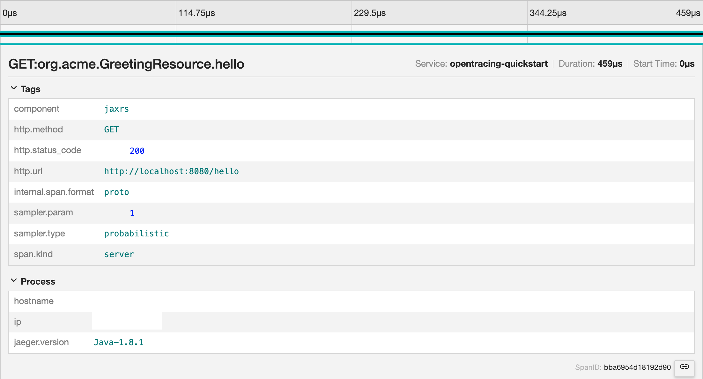
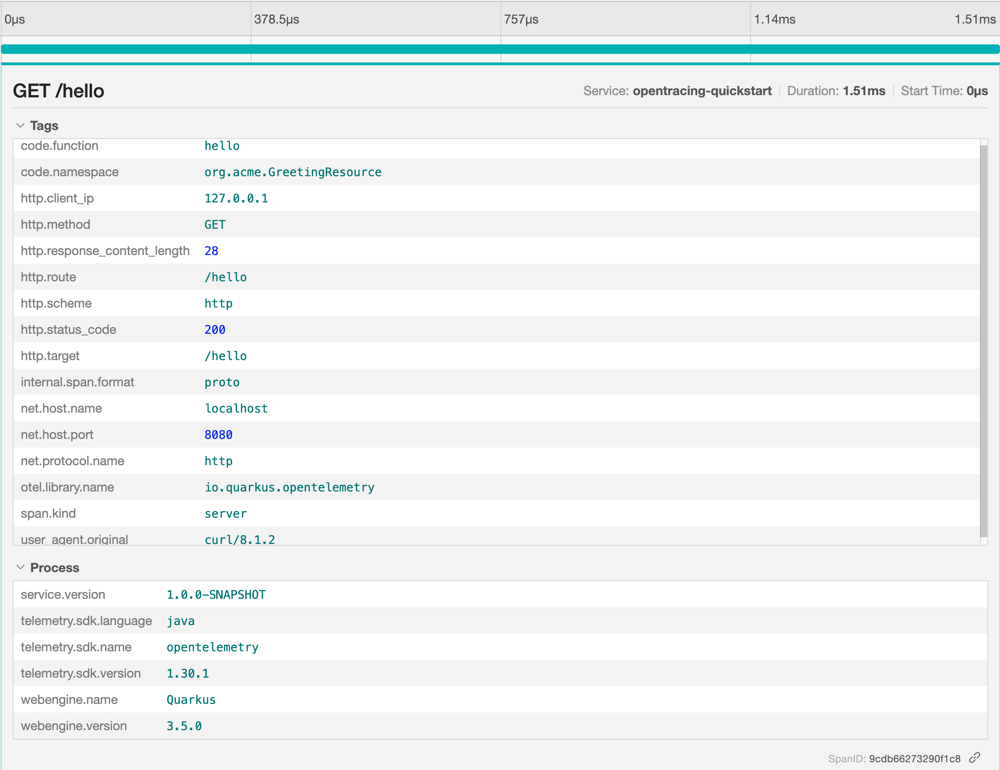

# Migrate from OpenTracing to OpenTelemetry tracing

Migrate an application from [OpenTracing](https://docs.quarkiverse.io/quarkus-smallrye-opentracing/dev/index.html) to [OpenTelemetry tracing](/guides/opentelemetry/index.md) in Quarkus 3.x.

The legacy OpenTracing framework has been deprecated in favor of the new OpenTelemetry tracing framework. We announced the [OpenTracing deprecation on November 2022](https://quarkus.io/blog/quarkus-observability-roadmap-2023/#opentracing-archived), and we are dropping the extension from Quarkus core repository and moving it to the Quarkiverse Hub.

It is now time to migrate your application to OpenTelemetry tracing if you haven’t done it yet.

If you need to migrate from Quarkus 2.16.x please beware that configuration properties are different and you should check the older Quarkus OpenTelemetry guide version, [here](https://quarkus.io/version/2.16/guides/opentelemetry#configuration-reference).

## Prerequisites

To complete this guide, you need:

- Roughly 15 minutes
- An IDE
- JDK 17+ installed with `JAVA_HOME` configured appropriately
- Apache Maven 3.9.16
- Optionally the [Quarkus CLI](/guides/cli-tooling/index.md) if you want to use it
- Optionally Mandrel or GraalVM installed and [configured appropriately](/guides/building-native-image/index.md#configuring-graalvm) if you want to build a native executable (or Docker if you use a native container build)

## Summary

The demo has 5 parts. Please read the summary and then jump to the section that best fits your use case.

1 - The **starting point** presents the quickstart app that uses OpenTracing

2 - The first part is good for anyone performing a **big bang change** of OpenTracing when you don't have any manual instrumentation

3 - This is the **big bang replacement** of OpenTracing when you have manually instrumented the code. We explain the main differences between OpenTracing and OpenTelemetry

4 - The last part uses the **OpenTracing shim**. This is useful if you have a large application with manually instrumented code. It can help performing the migration step by step because it allows the use of the legacy OpenTracing API on top of new OpenTelemetry API

5 - Conclusion and additional resources

The tasks described below fall into 3 categories:

- Dependencies
- Configuration
- Code

<a id="starting-point"></a>
## Starting point

This tutorial is built on top of the `opentracing-quickstart` legacy project.

### Generate the legacy project

Create the legacy project by executing the following command:

**CLI**

```bash
quarkus create app org.acme:opentracing-quickstart \
    --extension='rest,quarkus-smallrye-opentracing'
cd opentracing-quickstart
```

To create a Gradle project, add the `--gradle` or `--gradle-kotlin-dsl` option.

For more information about how to install and use the Quarkus CLI, see the [Quarkus CLI](/guides/cli-tooling/index.md) guide.

**Maven**

```bash
mvn io.quarkus.platform:quarkus-maven-plugin:3.40.1.2:create \
    -DprojectGroupId=org.acme \
    -DprojectArtifactId=opentracing-quickstart \
    -Dextensions='rest,quarkus-smallrye-opentracing'
cd opentracing-quickstart
```

To create a Gradle project, add the `-DbuildTool=gradle` or `-DbuildTool=gradle-kotlin-dsl` option.

For Windows users:

- If using Powershell, wrap `-D` parameters in double quotes e.g. `"-DprojectArtifactId=opentracing-quickstart"`

This command generates the Maven structure importing the `smallrye-opentracing` extension, which includes the OpenTracing support and the default [Jaeger](https://www.jaegertracing.io/) tracer.

### Check out the existing legacy project

For convenience there is a project in github with all the steps from the tutorial. You can clone it with the following command:

```bash
git clone git@github.com:quarkusio/opentracing-quickstart-migration.git
```

For convenience, [the repository](https://github.com/quarkusio/opentracing-quickstart-migration) containing the app to migrate, includes several branches with commits mimicking the migration steps described in this tutorial. You can check out the `main` branch to start from the beginning.

### The application

The Quarkus project has a single endpoint and the related class looks like this:

```java
import jakarta.ws.rs.GET;
import jakarta.ws.rs.Path;
import jakarta.ws.rs.Produces;
import jakarta.ws.rs.core.MediaType;

@Path("/hello")
public class GreetingResource {

    @GET
    @Produces(MediaType.TEXT_PLAIN)
    public String hello() {
        return "Hello from Quarkus REST";
    }
}
```

There is no OpenTracing specific code in the generated project, but the `smallrye-opentracing` extension is present and enabled by default, and it will automatically instrument the code.

Let's start the Jaeger-all-in-one Docker image, where we will retrieve and see the captured traces:

```bash
docker run -e COLLECTOR_OTLP_ENABLED=true -p 6831:6831/udp -p 6832:6832/udp -p 5778:5778 -p 16686:16686 -p 4317:4317 -p 4318:4318 -p 14250:14250 -p 14268:14268 -p 14269:14269 -p 9411:9411 jaegertracing/all-in-one:latest
```

At this point you can run the application with Quarkus dev mode:

**CLI**

```bash
quarkus dev
```

**Maven**

```bash
./mvnw quarkus:dev
```

**Gradle**

```bash
./gradlew --console=plain quarkusDev
```

If you call the [`/hello` endpoint](http://localhost:8080/hello) the related traces can be retrieved in the Jaeger UI at this address: <http://localhost:16686/>

They will look like this:



## Big bang change from OpenTracing to OpenTelemetry

This is the happiest path, in this case there is no manual instrumentation. We can do a big bang change from OpenTracing to OpenTelemetry without side effects.

### Change dependencies

To migrate between the two frameworks, you must drop the old `quarkus-smallrye-opentracing` extension and replace it by the `quarkus-opentelemetry` extension in the build file:

The legacy extension is removed from the project:

**pom.xml**

```xml
<dependency>
    <groupId>io.quarkus</groupId>
    <artifactId>quarkus-smallrye-opentracing</artifactId>
</dependency>
```

**build.gradle**

```gradle
implementation("io.quarkus:quarkus-smallrye-opentracing")
```

The new one is added:

**pom.xml**

```xml
<dependency>
    <groupId>io.quarkus</groupId>
    <artifactId>quarkus-opentelemetry</artifactId>
</dependency>
```

**build.gradle**

```gradle
implementation("io.quarkus:quarkus-opentelemetry")
```

### Application properties

You should remove the old OpenTracing properties, starting with `quarkus.jaeger.*` from the `application.properties` file, like in this example:

```application.properties
#Legacy OpenTracing properties to be removed
quarkus.jaeger.service-name=legume
quarkus.jaeger.sampler-type=const
quarkus.jaeger.sampler-param=1
quarkus.jaeger.endpoint=http://localhost:14268/api/traces
quarkus.jaeger.log-trace-context=true
```

If you use the default values in the OpenTelemetry properties, there is no necessity to include anything in the `application.properties` file.

Some common properties to migrate are:

| Legacy OpenTracing property | New OpenTelemetry property |
| --- | --- |
| `quarkus.jaeger.service-name=legume` | `quarkus.application.name=legume` |
| `quarkus.jaeger.endpoint=http://localhost:14268/api/traces` | `quarkus.otel.exporter.otlp.traces.endpoint=http://localhost:4317` |
| `quarkus.jaeger.auth-token` | `quarkus.otel.exporter.otlp.traces.headers` |
| `quarkus.jaeger.sampler-type` | `quarkus.otel.traces.sampler` |
| `quarkus.jaeger.sampler-param` | `quarkus.otel.traces.sampler.arg` |
| `quarkus.jaeger.tags` | `quarkus.otel.resource.attributes` |
| `quarkus.jaeger.propagation` | `quarkus.otel.propagators` |

The way the extensions can be enabled and disabled is very different. The OpenTelemetry extension is enabled by default and you can disable all or parts of it by checking [this section of the OpenTelemetry guide](/guides/opentelemetry/index.md#disable-all-or-parts-of-the-opentelemetry-extension).

All the OpenTelemetry properties and their defaults can be found in the [OpenTelemetry configuration reference](/guides/opentelemetry/index.md#configuration-reference).

### Run the application

Restarting Quarkus is not needed, auto-reload should have kicked in and you now can call the [`/hello` endpoint](http://localhost:8080/hello) and then see the traces in the Jaeger UI: <http://localhost:16686/>

However, you can now see spans produced by the OpenTelemetry's auto-instrumentation instead of the OpenTracing one:



If you don't have any manual instrumentation of your own, you are done!

## The big bang replacement, when you have manual instrumentation

Let's say instead of the `GreetingResource` class from above, you have something more complex. You will need additional work on top of the changes from the [Starting point](#starting-point).

This class now uses the `@Traced` annotation and creates a "manual" programmatic span.

Copy/paste that code for the `GreetingResource` class in the quickstart project:

<a id="greeting-resource-starting-point"></a>
### The GreetingsResource with OpenTracing manual instrumentation

```java
package org.acme;

import io.opentracing.Scope;
import io.opentracing.Span;
import io.opentracing.tag.Tags;
import jakarta.enterprise.context.ApplicationScoped;
import jakarta.inject.Inject;
import jakarta.ws.rs.GET;
import jakarta.ws.rs.Path;
import jakarta.ws.rs.Produces;
import jakarta.ws.rs.core.MediaType;
import org.eclipse.microprofile.opentracing.Traced;

@Path("/hello")
@ApplicationScoped
public class GreetingResource {

    @Inject
    io.opentracing.Tracer legacyTracer; <1>

    @GET
    @Produces(MediaType.TEXT_PLAIN)
    @Traced(operationName = "Not needed, will change the current span name") <2>
    public String hello() {
        // Add a tag to the active span
        legacyTracer.activeSpan().setTag(Tags.COMPONENT, "GreetingResource"); <3>

        // Create a manual inner span
        Span innerSpan = legacyTracer.buildSpan("Count response chars").start();

        try (Scope dbScope = legacyTracer.scopeManager().activate(innerSpan)) {
            String response = "Hello from Quarkus REST";
            innerSpan.setTag("response-chars-count", response.length());
            return response;
        } catch (Exception e) {
            innerSpan.setTag("error", true); <4>
            innerSpan.setTag("error.message", e.getMessage());
            throw e;
        } finally {
            innerSpan.finish();
        }
    }
}
```

1. The legacy OpenTracing tracer, must be replaced by the new OpenTelemetry tracer.
2. The `@Traced` annotation is replaced by the `@WithSpan` annotation but beware that this new annotation will always create a new Span. You shouldn't use it on JAX-RS endpoints because they are already instrumented.
3. The `Tag` class is replaced by the `Attribute` class. `Tags` is replaced by the `SemanticAttributes` class, which should be used whenever possible, to keep attribute names consistent with the specification.
4. There are new methods to handle errors in OpenTelemetry.

The OpenTelemetry tracer is not compatible with the OpenTracing API. The main changes are summarized in the following table:

| Note | MicroProfile OpenTracing v3 | OpenTelemetry |
| --- | --- | --- |
| 1 | `@Inject io.opentracing.Tracer legacyTracer;` | `@Inject io.opentelemetry.api.trace.Tracer otelTracer;` |
| 2 | `@Traced` | `@WithSpan` |
| 3 | Tag | Attribute |
| 3 | Tags | SemanticAttributes |
| 4 | ```innerSpan.setTag("error", true); innerSpan.setTag("error.message", e.getMessage());``` | ```innerSpan.setStatus(ERROR); innerSpan.recordException(e);``` |
| - | Baggage carried by SpanContext in the Span | Baggage is an independent signal propagated in parallel with the OTel Context, it's not part of it. |

Once the dependencies have been updated, the above class will break the build because the quickstart project is now running with OpenTelemetry. Errors like this will show up in the logs:

```bash
2023-10-27 16:11:12,454 ERROR [io.qua.dep.dev.IsolatedDevModeMain] (main) Failed to start quarkus: java.lang.RuntimeException: io.quarkus.builder.BuildException: Build failure: Build failed due to errors
        [error]: Build step io.quarkus.arc.deployment.ArcProcessor#validate threw an exception: jakarta.enterprise.inject.spi.DeploymentException: jakarta.enterprise.inject.UnsatisfiedResolutionException: Unsatisfied dependency for type io.opentracing.Tracer and qualifiers [@Default]
...
```

The new OpenTelemetry API must be used instead. This is one way to migrate the code:

### GreetingsResource with OpenTelemetry manual instrumentation

```java
package org.acme;

import io.opentelemetry.api.trace.Span;
import io.opentelemetry.api.trace.StatusCode;
import io.opentelemetry.context.Scope;
import io.opentelemetry.instrumentation.annotations.WithSpan;
import io.opentelemetry.semconv.trace.attributes.SemanticAttributes;
import jakarta.enterprise.context.ApplicationScoped;
import jakarta.inject.Inject;
import jakarta.ws.rs.GET;
import jakarta.ws.rs.Path;
import jakarta.ws.rs.Produces;
import jakarta.ws.rs.core.MediaType;

import static io.opentelemetry.api.trace.StatusCode.*;

@Path("/hello")
@ApplicationScoped
public class GreetingResource {

    @Inject
    io.opentelemetry.api.trace.Tracer otelTracer;

    @GET
    @Produces(MediaType.TEXT_PLAIN)
    @WithSpan(value = "Not needed, will create a new span, child of the automatic JAX-RS span")
    public String hello() {
        // Add a tag to the active span
        Span incomingSpan = Span.current();
        incomingSpan.setAttribute(SemanticAttributes.CODE_NAMESPACE, "GreetingResource");

        // Create a manual inner span
        Span innerSpan = otelTracer.spanBuilder("Count response chars").startSpan();
        try (Scope scope = innerSpan.makeCurrent()) {
            final String response = "Hello from Quarkus REST";
            innerSpan.setAttribute("response-chars-count", response.length());
            return response;
        } catch (Exception e) {
            innerSpan.setStatus(ERROR);
            innerSpan.recordException(e);
            throw e;
        } finally {
            innerSpan.end();
        }
    }
}

```

Once you remove all the OpenTracing dependencies the code will build. Don't forget to double check if the traces contain the right spans. You can see them in the Jaeger UI: <http://localhost:16686/>.

## The OpenTracing shim

In this section, we present an OpenTelemetry library that can smooth the transition by providing access to the legacy OpenTracing API. This can help with the migration of large applications with many manual instrumentation points.

To proceed with this section, the code project must be its [Starting point](#starting-point). If you have changes related to the previous sections, please revert them or re-generate the project according to the [Starting point](#starting-point) instructions before proceeding.

### The dependencies

Remove the `quarkus-smallrye-opentracing` extension and add the `quarkus-opentelemetry` extension and the `opentelemetry-opentracing-shim` library to the build file:

The legacy extension is removed from the project:

**pom.xml**

```xml
<dependency>
    <groupId>io.quarkus</groupId>
    <artifactId>quarkus-smallrye-opentracing</artifactId>
</dependency>
```

**build.gradle**

```gradle
implementation("io.quarkus:quarkus-smallrye-opentracing")
```

The new one is added:

**pom.xml**

```xml
<dependency>
    <groupId>io.quarkus</groupId>
    <artifactId>quarkus-opentelemetry</artifactId>
</dependency>
<dependency>
  <groupId>io.opentelemetry</groupId>
  <artifactId>opentelemetry-opentracing-shim</artifactId>
  <!-- No need to declare the version -->
</dependency>
```

**build.gradle**

```gradle
implementation("io.quarkus:quarkus-opentelemetry")
implementation("io.quarkus:opentelemetry-opentracing-shim")
```

### The code changes

Remembering the initial version of the `GreetingResource` class from the  [The GreetingsResource with OpenTracing manual instrumentation](#greeting-resource-starting-point):

```java
package org.acme;

import io.opentracing.Scope;
import io.opentracing.Span;
import io.opentracing.tag.Tags;
import jakarta.enterprise.context.ApplicationScoped;
import jakarta.inject.Inject;
import jakarta.ws.rs.GET;
import jakarta.ws.rs.Path;
import jakarta.ws.rs.Produces;
import jakarta.ws.rs.core.MediaType;
import org.eclipse.microprofile.opentracing.Traced;

@Path("/hello")
@ApplicationScoped
public class GreetingResource {

    @Inject
    io.opentracing.Tracer legacyTracer; <1>

    @GET
    @Produces(MediaType.TEXT_PLAIN)
    @Traced(operationName = "Not needed, will change the current span name") <2>
    public String hello() {
        // Add a tag to the active span
        legacyTracer.activeSpan().setTag(Tags.COMPONENT, "GreetingResource"); <3>

        // Create a manual inner span
        Span innerSpan = legacyTracer.buildSpan("Count response chars").start();

        try (Scope dbScope = legacyTracer.scopeManager().activate(innerSpan)) {
            String response = "Hello from Quarkus REST";
            innerSpan.setTag("response-chars-count", response.length());
            return response;
        } catch (Exception e) {
            innerSpan.setTag("error", true);
            innerSpan.setTag("error.message", e.getMessage());
            throw e;
        } finally {
            innerSpan.finish();
        }
    }
}
```

1. The `Tracer` annotation must be removed and instead, we need to inject the OpenTelemetry SDK. We will need it in \<3>.
2. The `@Traced` annotation is replaced by the `@WithSpan` annotation but beware that this new annotation will always create a new Span. You shouldn't use it on JAX-RS endpoints and we only have it here for demonstration purposes.
3. We must obtain an instance of the `legacyTracer`. The Shim includes a utility class for this purpose: `Tracer legacyTracer = OpenTracingShim.createTracerShim(openTelemetry);`

After the changes, the code will compile and you will be able to use both the OpenTracing and OpenTelemetry APIs at the same time:

```java
package org.acme;

import io.opentelemetry.instrumentation.annotations.WithSpan;
import io.opentelemetry.opentracingshim.OpenTracingShim;
import io.opentracing.Scope;
import io.opentracing.Span;
import io.opentracing.Tracer;
import io.opentracing.tag.Tags;
import jakarta.enterprise.context.ApplicationScoped;
import jakarta.inject.Inject;
import jakarta.ws.rs.GET;
import jakarta.ws.rs.Path;
import jakarta.ws.rs.Produces;
import jakarta.ws.rs.core.MediaType;

@Path("/hello")
@ApplicationScoped
public class GreetingResource {

    @Inject
    io.opentelemetry.api.OpenTelemetry openTelemetry;

    @GET
    @Produces(MediaType.TEXT_PLAIN)
    @WithSpan(value = "Not needed, will create a new span, child of the automatic JAX-RS span")
    public String hello() {
        // Add a tag to the active span
        Tracer legacyTracer = OpenTracingShim.createTracerShim(openTelemetry);
        legacyTracer.activeSpan().setTag(Tags.COMPONENT, "GreetingResource");

        // Create a manual inner span
        Span innerSpan = legacyTracer.buildSpan("Count response chars").start();

        try (Scope dbScope = legacyTracer.scopeManager().activate(innerSpan)) {
            String response = "Hello from Quarkus REST";
            innerSpan.setTag("response-chars-count", response.length());
            return response;
        } catch (Exception e) {
            innerSpan.setTag("error", true);
            innerSpan.setTag("error.message", e.getMessage());
            throw e;
        } finally {
            innerSpan.finish();
        }
    }
}
```

> [!IMPORTANT]
> It's advised not to utilize the shim for a permanent solution but solely as a tool to smooth the migration.

## Conclusion and additional resources

This tutorial showed how to migrate an application from OpenTracing to OpenTelemetry tracing in Quarkus 3.x.

You can find more information about the migration to OpenTelemetry at:

- [The companion GitHub repository for this tutorial](https://github.com/quarkusio/opentracing-quickstart-migration)
- [Migrating from OpenTracing](https://opentelemetry.io/docs/migration/opentracing/)
- [OpenTracing compatibility with OpenTelemetry](https://opentelemetry.io/docs/specs/otel/compatibility/opentracing/)
