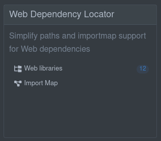
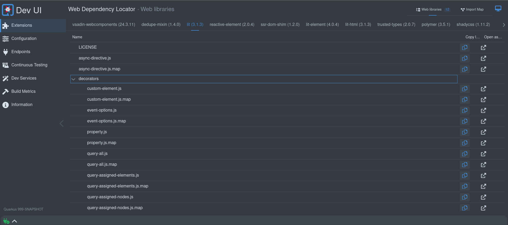
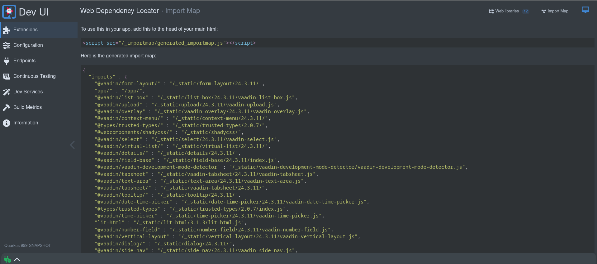

# Web dependency locator

This document shows how static resources can be served from web dependency jars like [WebJars](https://www.webjars.org) and [mvnpm](https://mvnpm.org).

## Using the `quarkus-web-dependency-locator` extension

**pom.xml**

```xml
<dependency>
    <groupId>io.quarkus</groupId>
    <artifactId>quarkus-web-dependency-locator</artifactId>
</dependency>
```

**build.gradle**

```gradle
implementation("io.quarkus:quarkus-web-dependency-locator")
```

### WebJars

If you are using [WebJars](https://www.webjars.org), like the following JQuery one:

**pom.xml**

```xml
<dependency>
    <groupId>org.webjars</groupId>
    <artifactId>jquery</artifactId>
    <version>3.1.1</version>
</dependency>
```

**build.gradle**

```gradle
implementation("org.webjars:jquery:3.1.1")
```

you can reference the files in the jar from your HTML, example `/webjars/jquery/3.1.1/jquery.min.js`.

The above is available by default, however, adding the `quarkus-web-dependency-locator` extension allows you to reference the files without having to include the version in the path, example `/webjars/jquery/jquery.min.js`.

### Mvnpm

If you are using [mvnpm](https://mvnpm.org), like the following Lit one:

**pom.xml**

```xml
<dependency>
    <groupId>org.mvnpm</groupId>
    <artifactId>lit</artifactId>
    <version>3.1.2</version>
</dependency>
```

**build.gradle**

```gradle
implementation("org.mvnpm:lit:3.1.2")
```

you can reference the files in the jar from your HTML, example `/_static/lit/3.1.2/index.js`.

The above is available by default, however, adding the `quarkus-web-dependency-locator` extension allows you to reference the files without having to include the version in the path, example `/_static/lit/index.js`.

#### ImportMaps

Mvnpm jars also allows you to use an [importmap](https://developer.mozilla.org/en-US/docs/Web/HTML/Element/script/type/importmap), that will allow you to just use module imports, example `import { LitElement, html, css} from 'lit';`.

The importmap is generated by the `quarkus-web-dependency-locator` extension, and available at `/_importmap/generated_importmap.js`. This means adding the following to your `index.html` will allow you to import web libraries by name:

```html
<!DOCTYPE html>
<html lang="en">
  <head>
    <meta charset="UTF-8">
    <meta name="viewport" content="width=device-width, initial-scale=1.0">
    <title>My app</title>

    <script src="/_importmap/generated_importmap.js"></script> <1>

    <script type="module">
        import '@lit'; <2>
        import 'app/demo-app.js'; <3>
    </script>
  </head>
    
</html>
```

1. Use the generated importmap
2. Import web libraries
3. Import your own files, this can be done by adding `quarkus.web-dependency-locator.import-mappings.app/ = /app/` to the config. Any key-value pair can be added.

##### Automatic imports

You can also automate the imports above. To do this, move your web assets from `src/main/resources/META-INF/resources` to `src/main/resources/web` and now replace the above scripts and imports with `{#bundle /}`:

```html
<!DOCTYPE html>
<html lang="en">
  <head>
    <meta charset="UTF-8">
    <meta name="viewport" content="width=device-width, initial-scale=1.0">
    <title>My app</title>

    {#bundle /} <1>

  </head>
    
</html>
```

1. This will be replaced at build time with the importmap script, and also include any CSS and JavaScript discovered in the `/app` directory.

This allows you to add libraries, js and css without having to change your HTML. Hot-reload is also supported.

### Dev UI

When adding the `quarkus-web-dependency-locator` extension , you can see the files being served, and the generated importmap, in the Dev UI:

  
