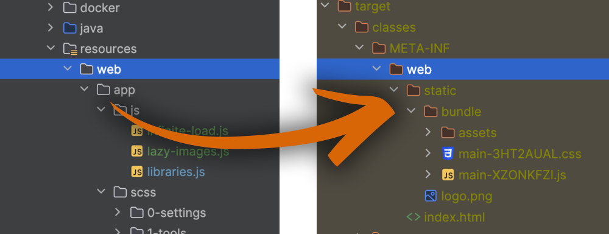

# Quarkus for the Web

Quarkus provides several extensions to create web applications, this document aims to provide directions on which extension to use for different use cases.

## The basics

### Serving static resources

Let's assume you have a Quarkus backend, and you want to serve static files. This is the most basic case, it is supported out of the box with all our Vert.x based extensions, you must place them in the `META-INF/resources` directory of your application.

You can find more information in the [HTTP reference guide](/guides/http-reference/index.md#serving-static-resources).

### Serving scripts, styles, and web libraries

However, if you want to insert scripts, styles, and libraries in your web pages, you have 3 options:

1. Consume libraries from public CDNs such as cdnjs, unpkg, jsDelivr and more, or copy them to your `META-INF/resources` directory.
2. Use runtime web dependencies such as [mvnpm](https://mvnpm.org) or [WebJars](https://www.webjars.org), when added to your pom.xml or build.gradle they can be directly [accessed from your web pages](/guides/web-dependency-locator/index.md).
3. Package your scripts (js, ts), styles (css, scss), and web dependencies together using a bundler (see [below](#bundling)).

> [!NOTE]
> **We recommend using a bundler for production** as it offers better control, consistency, security, and performance. The good news is that Quarkus makes it really easy and fast with the [Quarkus Web Bundler extension](https://docs.quarkiverse.io/quarkus-web-bundler/dev/).

<a id="bundling"></a>
### Bundling scripts, styles, and libraries

There are two ways to bundle your web assets:

1. Using [the Quarkus Web Bundler extension](https://docs.quarkiverse.io/quarkus-web-bundler/dev/), which is the recommended way. Without any configuration, it puts everything together in an instant, and follows good practices such as dead-code elimination, minification, caching, and more.
2. Using a custom bundler such as Webpack, Parcel, Rollup, etc. This can be easily integrated with Quarkus using the [Quarkus Quinoa extension](https://docs.quarkiverse.io/quarkus-quinoa/dev/).



## Server-side rendering (SSR)

For templating and server-side rendering with Quarkus, there are different engines available such as [Qute](/guides/qute/index.md) or [Freemarker](https://docs.quarkiverse.io/quarkus-freemarker/dev/) and others.

### Qute Web

Qute is designed specifically to meet the Quarkus needs, and help you deal with templates, snippets, and partials and render the data from your storage. It is inspired by the most famous template engines, it is fast, type-safe, works in native, and has a lot of nice features.

To install Qute Web, follow [the instructions](/guides/qute/index.md#serving-templates).

Here is a simple example of a Qute template:

**src/main/resources/templates/pub/index.html**

```html
<!DOCTYPE html>
<html>
<head>
    <meta charset="UTF-8">
    <title>Qute Page</title>
    {#bundle /} <1>
</head>
<body>
    <h1>Hello {http:param('name', 'Quarkus')}</h1> <2>
    <ul>
    {#for item in cdi:Product.items} <3>
       <li>{item.name} {#if item.active}{item.price}{/if}</li> <4>
    {/for}
    </ul>
</body>
</html>
```

1. With the [Web Bundler extension](https://docs.quarkiverse.io/quarkus-web-bundler/dev/), this expression will be replaced by the bundled scripts and styles.
2. You can directly use the HTTP parameters in your templates.
3. This expression is validated. Try to change the expression to `cdi:Product.notHere` and the build will fail.
4. If you install [Quarkus IDEs plugins](/guides/ide-tooling/index.md), you will have autocompletion, link to implementation and validation.

### Model-View-Controller (MVC)

The MVC approach is also made very easy with Quarkus thanks to Qute.

Associated with the [Web Bundler extension](https://docs.quarkiverse.io/quarkus-web-bundler/dev/), the road is open to build modern web applications for all your needs.

**src/main/java/rest/Todos.java**

```java
package rest;

[...]

public class Todos extends Controller {

    @CheckedTemplate
    static class Templates {
        public static native TemplateInstance index(List<Todo> todos);
    }

    public TemplateInstance index() {
        // list every todo
        List<Todo> todos = Todo.listAll();
        // render the index template
        return Templates.index(todos);
    }

    @POST
    public void add(@NotBlank @RestForm String task) {
        // check if there are validation issues
        if(validationFailed()) {
            // go back to the index page
            index();
        }
        // create a new Todo
        Todo todo = new Todo();
        todo.task = task;
        todo.persist();
        // send loving message
        flash("message", "Task added");
        // redirect to index page
        index();
    }

    @POST
    public void delete(@RestPath Long id) {
        // find the Todo
        Todo todo = Todo.findById(id);
        notFoundIfNull(todo);
        // delete it
        todo.delete();
        // send loving message
        flash("message", "Task deleted");
        // redirect to index page
        index();
    }

    @POST
    public void done(@RestPath Long id) {
        // find the Todo
        Todo todo = Todo.findById(id);
        notFoundIfNull(todo);
        // switch its done state
        todo.done = !todo.done;
        if(todo.done)
            todo.doneDate = new Date();
        // send loving message
        flash("message", "Task updated");
        // redirect to index page
        index();
    }
}
```

> [!NOTE]
> Check out [Quarkus Insights Episode #178](https://www.youtube.com/watch?v=JNmHN5mK180). You can also give it a try using [the web-lab repo](https://github.com/quarkusio/quarkus-web-lab).

## Single Page Applications

Quarkus provides very solid tools for creating or integrating Single Page Applications to Quarkus (React, Angular, Vue, …), here are 3 options:

- [Quarkus Quinoa](https://docs.quarkiverse.io/quarkus-quinoa/dev/) bridges your npm-compatible web application and Quarkus for both dev and prod. No need to install Node.js or configure your framework, it will detect it and use sensible defaults.
- The [Quarkus Web Bundler](https://docs.quarkiverse.io/quarkus-web-bundler/dev/) is also a good approach, it is closer to the Java ecosystem and removes a lot of boilerplate and configuration, it is fast and efficient. For examples of such SPAs, see [code.quarkus.io](https://github.com/quarkusio/code.quarkus.io) and [mvnpm.org](https://github.com/mvnpm/mvnpm).
- Your automation using the [maven-frontend-plugin](https://github.com/eirslett/frontend-maven-plugin) or similar tools.

## Full-stack microservices (Micro-frontends)

Quarkus is an excellent choice for both full-stack web components and full-stack microservices aka Micro-frontends. By utilizing the Web Bundler or Quinoa, you can significantly reduce boilerplate code and manage multiple services efficiently without much configuration duplication.

For example the [Quarkus documentation search engine](https://github.com/quarkusio/search.quarkus.io) on [quarkus.io](https://quarkus.io) uses the Web Bundler to create a full-stack web-component. With Lit Element for the web-component and OpenSearch for the indexation it is a nice way to enhance the static web-site experience in a dynamic way.

More content about this is coming soon... // Blog article in prep: <https://github.com/quarkusio/quarkusio.github.io/issues/1934>

## Other ways

We described Quarkus most common ways to create web applications but there are other options:

- [Vaadin Flow extension](https://quarkus.io/extensions/com.vaadin/vaadin-quarkus-extension/), for this unique framework that lets you build web apps directly from Java code without writing HTML or JavaScript.
- JavaServer Faces (jsf) is a specification for building component-based web apps in Java. It available in Quarkus, the [MyFaces](https://quarkus.io/extensions/org.apache.myfaces.core.extensions.quarkus/myfaces-quarkus/) extension is an implementation of Faces for Quarkus. [PrimeFaces](https://quarkus.io/extensions/io.quarkiverse.primefaces/quarkus-primefaces/) is a Faces components suite, and [OmniFaces](https://quarkus.io/extensions/io.quarkiverse.omnifaces/quarkus-omnifaces/), a utility library. More information is available in [this blog post](https://www.melloware.com/quarkus-faces-using-jsf-with-quarkus/).
- Create [a new extension](/guides/building-my-first-extension/index.md) for your favorite web framework.

## Testing your web applications

For testing web applications, [Quarkus Playwright](https://docs.quarkiverse.io/quarkus-playwright/dev/) is very easy to use. You can create effective cross-browser end-to-end tests mimicking user interaction and making sure your web application is working as a whole. The big advantage is that it benefits from all dev-services and Quarkus mocking features.

```java
@QuarkusTest
@WithPlaywright
public class WebApplicationTest {

    @InjectPlaywright
    BrowserContext context;

    @TestHTTPResource("/")
    URL index;

    @Test
    public void testIndex() {
        final Page page = context.newPage();
        Response response = page.navigate(index.toString());
        Assertions.assertEquals("OK", response.statusText());

        page.waitForLoadState();

        String title = page.title();
        Assertions.assertEquals("My Awesome App", title);

        // Make sure the web app is loaded and hits the backend
        final ElementHandle quinoaEl = page.waitForSelector(".toast-body.received");
        String greeting = quinoaEl.innerText();
        Assertions.assertEquals("Hello from REST", greeting);
    }
}
```

## Q&A

### Why is Quarkus a very good option for Web Applications compared to other frameworks?

Quarkus is well known for its backend extensions ecosystem and developer experience, if you combine it with great extensions for frontend, then it is a perfect mix! All the testing and dev-mode features are now available for both frontend and backend.

### What are the advantages of SSR (Server Side Rendering) over SPA (Single Page App)?

Here are the benefits of performing rendering work on the server:

**Data Retrieval:** Fetching data on the server, closer to the data source. This enhances performance by reducing the time needed to retrieve data for rendering and minimizes client requests.

**Enhanced Security:** Storage of sensitive data and logic is happening on the server, such as tokens and API keys, without exposing them to client-side risks.

**Caching Efficiency:** Server-side rendering allows for result caching, which can be reused across users and subsequent requests. This optimizes performance and lowers costs by reducing rendering and data fetching per request.

**Improved Initial Page Load and First Contentful Paint (FCP):** Generating HTML on the server enables users to view the page immediately, eliminating the need to wait for client-side JavaScript to download, parse, and execute for rendering.

**Search Engine Optimization (SEO) and Social Media Shareability:** The rendered HTML aids search engine indexing and social network previews, enhancing discoverability and shareability.

### I am hesitating between Quinoa and the Web Bundler, how should I make my decision?

You have to think that the bundled output is essentially the same with both solutions. Also, switching from one to the other is not a big deal, the choice is about the developer experience and finding the best fit for your team.

Some guidelines:

**Go for Quinoa:**

- You have an existing frontend configured with a npm-compatible build tool, Quinoa is the most direct option.
- You have a dedicated frontend team familiar with tools such as NPM, Yarn and other for building Single Page Apps.
- You want to write Javascript unit tests (such as Jest, Jasmine, ..), it is not possible with the Web Bundler. However, you could publish a components library on NPM and consume it from the Web Bundler.
- You use very specific bundling options or specific tools in your build process
- You love package.json and configurations tweaking

**Go for Web Bundler:**

- For simple web applications, the Web Bundler is the easiest and fastest way to get started
- You prefer to stay close to the Maven/Gradle ecosystem (Node.js is not needed), it uses an extremely fast bundler for the web (esbuild)
- You want to reduce boilerplate and configuration

### How do I scale a Quarkus Web Application?

Serving a few static pages and scripts from an existing Quarkus backend is not a big overhead, so scaling the full app is usually the simplest option. You could also split it in two services: one for the backend and one for the frontend. However, in most cases, this approach wouldn’t yield substantial benefits compared to the initial method.

If your application involves a substantial number of static resources, consider using a CDN. Both the Web Bundler and Quinoa can be configured to work seamlessly with a CDN, providing improved performance and distribution of assets.
